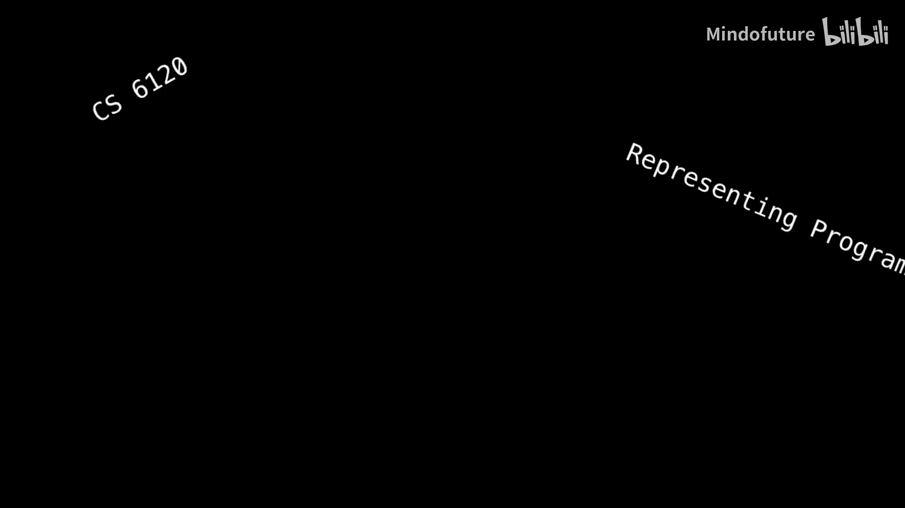
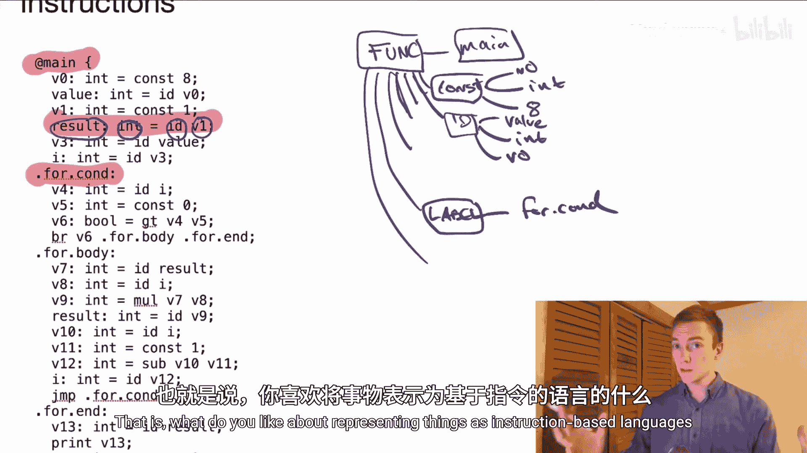
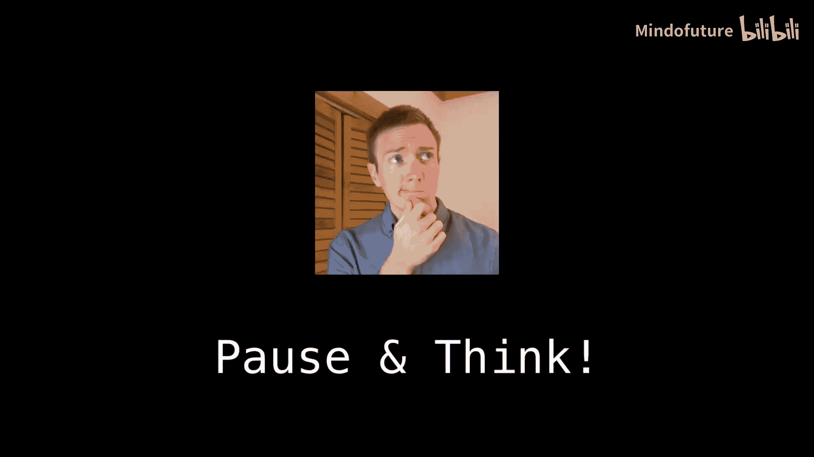
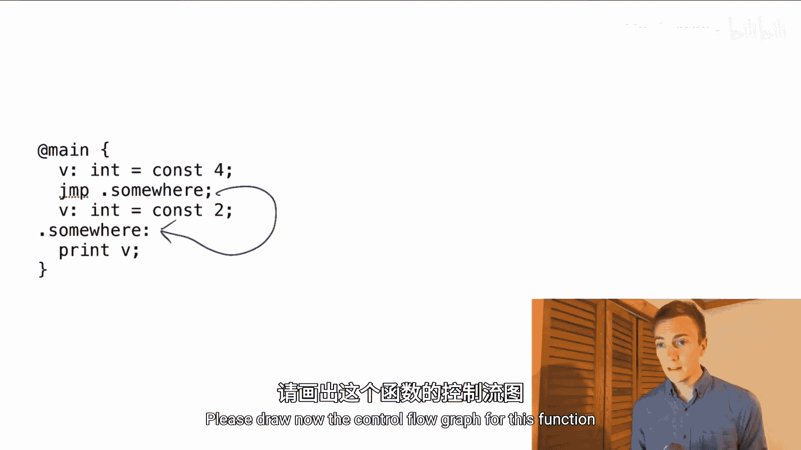
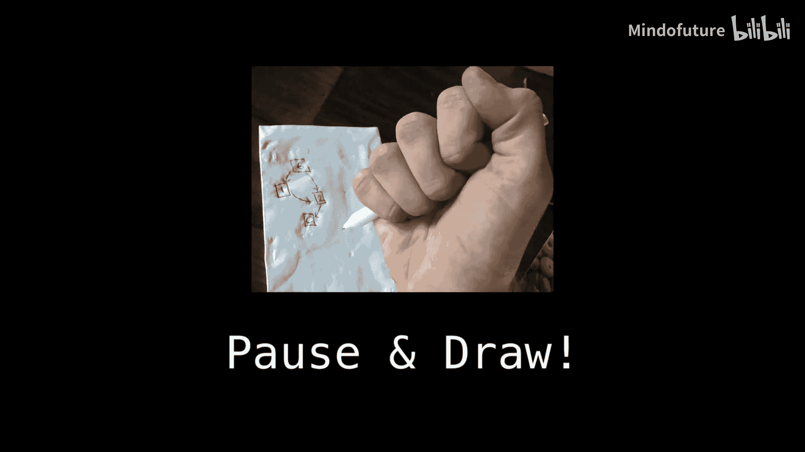
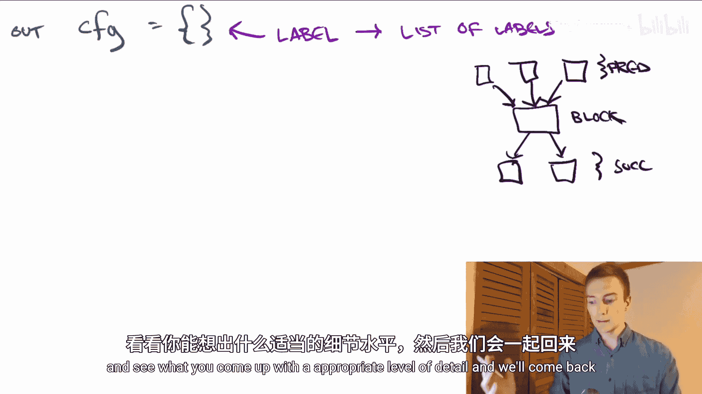
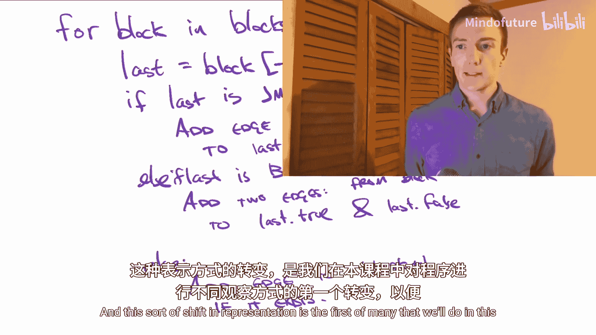

# 【康奈尔大学-•-中英】高级编译器项目教程-CS-6120（Advanced-Compilers，2020）-p02-P02-Lesson-2--Representing-Programs--BV1gE9ZYsEUm_p2-

Hi and welcome to lesson 2 of 6120 Today I want to talk about how we represent programs for a compiler What exactly do I mean by representing programs basically I mean what the programming what we consider to be the programming language when we are manipulating programs as part of the compilation process so what we read in and transform and eventually translate into another language as part of a compiler。

Of course， the most obvious way to represent programs is as text that is as concrete syntax。

 the actual things that you type into a text editor when you're writing a program。

 so that looks like this for a JavaScript language， for example。

 it has lots of really nice properties。 I'd like you to think for a second now about what makes this。

 what are the strengths and weaknesses of representing programs as concrete text。

Pause the video for a second， not for too long to think about what's good about this representation and what's bad about this representation for representing in a compiler。

Obviously this is a really easy representation to write this kind of the whole point。

 but it's a terrible representation for actually transforming you don't really understand any of the。

 this is not the right level abstraction for understanding the semantics of programs。

 which you really need to do in order to transform it。😊。

Wwhichch is what we're going to do in all of 6120。 So the next obvious step that next obvious kind of program representation that you might imagine is abstract syntax。

 So instead of the concrete syntax of this program。

 it's easy to imagine a data structure that represents represents the same syntax。

 the same program but an abstract way， and that's an Ast or an abstract syntaxt that you're doubtless aware of from any previous effort that you've from any previous working with program languages that you've done if you have ever written an interpreter。

 you've probably use an Ast， but just to give you an idea of what that looks like the idea is that you have these it's just a data structure。

 it looks like a tree where you have nodes in the tree that represent different parts of the program。

 So for example， might have this toplevel notion of a program that contains in this case like a block of statement and that has its own children for the four statement in this program that we just saw like for example there is a let statement。

 a let statement of four statement and。This expression for the console log。

 So these are all nodes in the tree。 you notice that at this level we haven't like expanded out what goes into the let statement。

 but I will now fast forward and show you the rest of this tree。

So I got a little bit tired of drawing the entire tree。

 But I think you can see what I'm getting at here in this program in this representation of the program。

 the tree is the tree represents like sort of every。

Concept that you can have in the language as a node in this tree like data structure。

 This by itself is already a vast improvement over the concrete syntax。

 And it's a lot easier to to reason about what the program actually does。

 And it's not a bad representation for compilers。 I'd like you to pause again。 However。

 and think a little bit about the pros and cons of this representation。

 What makes this good for a compiler and what what makes this challenging for a compiler。Great ideas。

 Personalally speaking， I'd say that this representation。

 the As T representation is perfect for writing an interpreter。

 It's really easy to see how to take a tree and use a recursive function to process the levels in the tree and call yourself and to run the program that is like to process a block。

 for example， you just recursively need to interpret all the statements in the block while updating some reflection of the program's environment。

 It's perfect for doing that kind of a thing。 In fact， it's really convenient for a lot of compilers。

 It's plenty of compilers do all of their work on an AsT representation of the program。

 It's not a terrible idea。 In fact， I've written compilers myself that do exactly this kind of thing that never really transition out of an Ast that reflects kind of the structure of the original program。

 For this class， however， I want to show you a different approach。

 a different representation of programs that looks quite a bit different than the As T approach that is going to be more convenient for writing a lot of interesting compiler optimizations。

 And that's to represent programs as lists of instructions。

 The main thing that this shift and representation is going to do。😊。

Is to make the representation more regular。 That is the one big downside that I see of the AST approach is that all the different types of nodes in this tree have different behavior and if you want to write an analysis that can a compiler analysis that can process any program。

 you have to constantly be reasoning about the difference in semantics of all these different types of nodes。

 For example， this example has a let expression that has children that are the value to assign into and and the expression to evaluate on the right- hand side to assign to put into that variable。

So the thing about this is that you is that the children mean very different things from each other。

 and they mean very different things still from， for example。

 this dot expression that I put over here where the left hand side the thing is the name of the variable that we're accessing and the right hand side is the name of the field that we're going to be looking things up in。

This goes on for the forest statement and the assignment statements that we see throughout the rest of this program。

 all of these different kinds all these different kinds of expressions。

 different kinds of syntax nodes have very different meaning of like what their children are relative to the node。

 So this is great for representing programs as humans write them。

 a sort of like intermediate level abstraction between the concrete syntax and something that a program can actually run。

 However， I think we can do better， that is we can make things more regular and more predictable。

 specifically for the purpose of transforming in a compiler。😊。

So that's the next representation I want to consider。

 And it's the one that we' will be using throughout the rest of 6120。

 which is representing programs as lists of instructions。

 The idea in this technique is that you transform the program。

Into a something that looks like an assembly language。

 It's I and idealized this assembly language in the sense that it doesn't have like a fixed number of registries and doesn't have like weird things like condition flags。

 doesn't have all the other like horrible addressing modes that X6 has， for instance。

 But it looks like an assembly language in the sense that all it really consists of is a list of instructions。

 And those instructions have a very regular form。 That is theres just like a。Name of an operation。

 And there's a bunch of arguments to that operation。

And they can sort of move values around from from one variable to another。

 This is the kind of representation for what'sworth that underlies LVM and it's the same style of representation they'll be using in a programming language that I created just for 6120 that we'll be learning more about soon。

 This is an example of the same program that we've seen in the previous slide represented as instructions in that simple language that we' use in 6120。

The idea is that theres in this version of the program in order to represent things。

 there's not a bunch of different kinds of syntax nodes。

 There's actually only a few there is there you can declare functions like this。

 You can declare labels which work just like assembly language labels。

 and then you can run instructions So these instructions have an extremely simple and regular form。

 that is they have a destination here result。 they have a type of that destination。

And then they have an op code saying like what to do。 And then they have a list of operas。 So this。

 for example， the Id operation is just the identity operation。 So does this very simple thing。

 it reads the value V1 does absolutely nothing to it and puts the result into the variable called result。

 And it says that that thing has type in。 This is a tremendously inconvenient way to write programs if you are human。

 you would never want to like write down programs and essentially assembly language structure。

 even if you get rid of the limits on the numbers of registers you can use， for example。

 This is a terrible， terrible way to write programs。 However， it's a really。

 really convenientnient way to process programs as part of a compiler。I want to emphasize， however。

 that like that it is technically true that this instruction。

Kind of representation of programs can also have concrete syntax and abstract syntax。

 It's just that the abstract syntax for instruction based representations are super。

 super simple and extremely regular。So if we were to draw out the abstract syntax tree for this program using an instruction based representation。

 it would just sort of look like this。 there'd be sort of a top level function node that takes the name of the function we're declaring。

 and then all of the children are just a very， very flat representation of all of the things in the body。

 That is like there's just a big list of instructions and labels。

 So the first thing in this program is a constant instruction。 So the constant instruction。

Has a few children。 It has the variable we're assigning into。 It has its type。

And it has the value that we' are going to put in there of that type。 So that's 8。

 The second thing is an I D instruction。It， too， has a child that's the value we're assigning into。

 That's value here。 It has the type of that thing， just like Kst。

 And then it has a list of arguments here。 only one argument， and that's v 0。Eventually。

 there are also labels in here。 So there's going to be a label。Whose name is for con， for example。

 and on and on。 So the thing about this abstract syn tree is it's very short and squat。

 that is technically an abstract syn tree of a very different looking program。

 But the key is that that this language is so much simpler and so much more regular that is going to be really convenient for doing compiler analyses。

🎼Now would be a great time to pause and reflect on the advantages and disadvantages of this representation。

 that is like what do you like about representing things as like instruction based languages and what do you dislike about them。

So based on that instructionbased representation of programs。

 I want to talk about some of the ways that we extract better structure out of these programs for doing analyses。

 So rather than just treating things as one big flat list of instructions。

 there are obviously different ways to look at the program。

 that will be useful in different scenarios for understanding different properties。

 the first time when I want to talk to you about is a control flow graph。

 So the basic idea in a CFg is that every vertex is an instruction that is like something you might execute in the program。

 not a label。 and edges between the instructions represent the transfer of control。 So in this very。

 very tiny program written in this instruction based language， there are only two instructions。

 there's one constant instruction is one print instruction， super simple program。 so。

By my definition of a CG， there had better be two nodes。

 there is a constant node that represents the first instruction and there is a print node that represents the second and the entire program for this one function called main can be represented as just a graph with an edge from this one to that one。

 That is the control， the program counter of the virtual machine that executes this program will start with the constant instruction。

 and when that's done， it will transfer control across the edge here to the print instruction。

Let's do a more complicated example。Not much more complicated。

 But here's a program that has a jump in it。 The jump works exactly as you are familiar with than an assembly。

 That is that this jump will transfer control to this label right here and then start executing after that。

 Please draw now the。

🎼Control flow graph for this function。

Great work。 Here's my CG that I do。 It has four instructions。 That is。

 I didn't draw anywhere in here。 the label for somewhere。

 I just do the four instructions that are normal instructions。 That is not labels。 The clearly。

 we have just this we have a constant that immediately after that executes a jump instruction。

 And the thing about that is that we know that the thing that will execute right after the jump instruction is the print instruction。

 So there's an edge representing that transfer of control。

 And we have one very lonely instruction hanging out all by its lonesome with no edges going in that is guaranteed never to be executed。

 And you can see that by the structure of the control flow graph。

 So it's actually worth noting now that this very simple alternate representation of programs。

 that is rather just a big list of instructions， but as a control flow graph has already LED us to a really obvious conclusion。

 That is that there is some code in here that is totally useless and could be deleted。

 If we wanted to write our very first compiler pass on these programs。

 we could just construct a control flow graph and look for the lonely nodes。😊。

That are guaranteed never to be executed and delete them。

 And that would be a form of dead code elimination。The important thing to emphasize though。

 is by shifting the representation of the program， we were able to look at the semantics of the program differently and different properties became obvious。

Here's another program。 It shows off a different aspect of the language we haven't seen before。

 which is that there are branch instructions， the seendtics of the branch instruction is that you read a variable and then you decide based on whether that variable。

 which is a boolean， is true or false whether to go here to that label or to this label。

 please pause the video and draw the CFG for this program now。

Here I've started drawing my CFG and already have run into an interesting issue。

 which is that when we draw branch instructions， it's important to this is the first time we've seen two children of a given node that is to an out degree of greater than one for a node for a branch instructions。

 there is a difference between the two different destinations you can go if you want to faithfully represent the semantics of the program。

 you have to distinguish between these two。 So it might even be helpful to， for example。

 label the true branch and the false branch。There's no need to label all the rest of the branches because all the rest of the edges rather。

 because there's only one edge coming out of every given node。

It indicates just sort of going to the next instruction。

 There's also one edge missing from this diagram so far。

 I haven't drawn the CFG edge that goes from this instruction after it executes。

 as in any other assembly language， it will proceed onto the next instruction。

 ignoring any labels on V。 So I need an edge from after executing this instruction to executing this one。

 And then finally， we are done。In CGs， it's usually super useful to label the entry and exit to the CFG that is where execution begins and ends in this CFG。

And in this language in general， the first instruction in the program is the first one to execute。

 So this is the entry instruction。We can label that in the CG and the exit the exit instruction is the one at the very end of the function right before it returns。

 There's no explicit return statement here because this function doesn't return anything but the last one that terminates execution of the function is the print statement so we can label that to The next evolution of these representations that I want to show you relies in the fact that this CF representation I've been showing you so far feels a little bit redundant。

 that is in particular， these chains of instructions that look like this are super。

 super common in normal programs。 That is it's really often that you'll draw the CFg with a whole bunch of blocks that are connected just one after the other with a chain of edges。

 And that's because that's how we normally write programs。

 that is it often takes more than one instruction to run between interesting controls transfers of control。

 That is like we need to do a few instructions and then we need to jump to another series of a few instructions and so on。

 So it feels kind of wasteful to representing things as。😊，Individual instructions。

 when we can sort of think of them as one big block of instructions。

 And that's the concept of cosening a control flow graph to use basic blocks。

 The intuitive definition of a basic block is that it is a chunk of instructions that all execute together。

 That is， if execution starts at the beginning of a basic block is going to finish executing at the end of the basic block。

 So it's one of those structures in the instruction based control flow graph where you just sort of jump inevitably from one instruction to the next。

 or' just gather those together and call those a control flow graph。

To put it a little bit more crisply。A basic block is a sequence of instructions where jumps and branches that is transfers of control outside of just going to the next instruction can only happen at the beginning and the end of a basic block。

 that is you can't have a jump or a branch instruction， anywhere in the middle of a basic block。

 it can only happen at the end。 and any jump anywhere in the program。

 any branch can only ever transfer control to the top of a different basic block。

So to scroll back up to our longer example of an instruction。

 it's really easy to visually see the basic blocks in this example。This is a basic block。

Because all the instructions come one after the other。

 That is that there are no jumps anywhere in this range， however。

We can't extend that basic block one step farther past this label。

 because control will eventually transfer to that label called forcon。

 because there is a jump that goes here。That ends， that must end the basic block。So that's a block。

This is a block。And we have to stop it there because there is a branch instruction and you're not allowed to keep growing a basic block beyond a branch instruction。

Here is a basic block。 And， of course， that has to end because there's a jump。And then finally。

 there's a basic block down here。 So it's really visually easy to see them in these programs because they're separated by the labels。

 And as long as you are jumping to that label， that label to a given as long as you are jumping to a given label。

 that label must be the beginning of a basic block。Return to our definition。

The nice thing about basic blocks from a compiler analysis perspective is that you can assume that if any instruction a basic block executes。

 then all of the instructions must execute。 And this comes up a lot when you're doing analyses。

 You don't really need to think about individual instructions。

 You can think about entire chunks of them and know that they all sort of execute together。

So here's the same program we just drew a controll flow graph a second ago at the instruction level。

 I would now like you to draw a control flow graph at the basic block level。

 drawaw a CFG and label the entry and exit nodes just as you did before， but this time。

 do it for entire basic blocks。Here's my C O G。 Did you get the same one， Great。

 One additional piece of terminology I wanted to layer on top here is that the set of instructions that end the formation of basic blocks has a special name。

 So， for example， this branch instruction means that you can't continue making a larger basic block past this point。

 If you imagine trying to grow your basic blocks as big as possible。

 These things are called terminators。😊，Entertainingly。

So in this little language that we've been experimenting with。

 the only terminators that exist are the branch instruction and the jump instruction。

So when you represent basic blocks and memory， you can think of them as just lists of instructions where the last one is the only one that can be a terminator。

 All the rest of the instructions have to be non termminator instructions。And of course。

 there are basic blocks in this program that don't have terminators。

 and that's because they fall through through the next instruction。

So we've now seen two fundamentally different representations of these instruction based programs。

 You can either think of them as just linear lists of instructions and labels or you can think of them as control flow graphs。

 possibly at the granularity of basic blocks， we really need an algorithm to go from the linear list of instructions。

 which is how you might like store these programs on disk， for example。

 to extract a graph- based representation to extract a CFG for doing interesting analyses。

The first step is just to form the basic blocks。 so we're not going to try to make a control flow graph yet。

 We'll do that in the next step。 We're just going to try to take a linear list of instructions and chunk it up into blocks that willll then analyze to make a CFfG。

So get out some paper and we're going to together write the pseudocode for。Forming basic blocks。

I like to write my pseudocode in kind of like Pythonish format。 But you can do it however you like。

 But the way this is going to work is that you're going to start with a。Input list of instructions。

And you're going to produce an output list called blocks。So this thing is a just the flat。

List of instructions slash labels that you've seen so far。 So， for example。

 this might contain like V 0 colon int。Equals const。2， that's one instruction。

 And it might also contain like。This great label statement。And so on。The blocks。

 that's going to be a list of。List。😔，Of instructions。

So think now about how you would structure this search by walking over the list of instructions。

Hlariously， I misspelled thatton。Call this Ins， how would you loop over the list of instructions and create lists of instructions to put into this list of list of instructions that's going to be all the basic blocks in the program。

🎼Pause this video now and give it a shot。 You don't need to completely work this out。

 but give it give it a try， and then we'll come back together and see if we got the same answer。

So here's what I would do， because I like to write my pseudocode in like fake Python。

 I would start it out with a four loop that says that like for I in ins。

So the way this is going to work out is I'm going to walk over every single instruction and sequence and hope that I can glue together blocks on the fly as a kind of supporting data structure I'm going to need。

A list for the current block that I'm currently forming。 So the block starts out empty。

 and then we're going to fill this up and then empty it out。

 and then fill it back up again and then empty it out every time adding it on the list of blocks。

Inside the loop， the main thing that I need to do is check whether the instruction。

Is something that should end the basic block。 So if it's just a normal instruction。

 we'll put it on the block。 And if otherwise， we will end the basic block。

 So that the things that matter here is if I is a。A label that means we have to end the basic block because a jump might be incoming to the next instruction。

 or it's a termerier。 that is。Branch or jump。If so， then we need to end this basic block。

 So here's a pseudocode for that。 again， in Pythonny style， I will say that we will。Empty out。

The block。 But before we do that。We'll put on the end of our output list of blocks the current thing that we have built up in the as our current basic block。

Of course， this algorithm isn't that great yet because it doesn't actually put anything to any of the blocks。

 It's just going to append a bunch of empty blocks to the output。

 What we also need to do is actually put these instructions into the blocks。

The way I'm going to do that is that whenever we see an instruction。

 as long as that thing is not a label， we'll put it into the current basic block before terminating it so。

I'll just say， in Python style。Blocked at a pen。I， so that way that works， is that everything。

 including terminators， is going to go at the end of the currently being formed block and that also。

 if it was a terminator， or if we saw a label， then we'll end that block there and start a new one afresh。

 So that's the algorithm for forming basic blocks。 I hope you got the same thing as I did。

The next thing that we're going to do is use that list of blocks to form a control flow graph。

To do this， we will， I'll just give you a hint。 We're going to need an additional data structure that we didn't do when were form basic blocks。

 which is to map from labels to basic blocks。 That is we're going to know which which labels mark the beginning of which basic blocks。

 So going back to one of these example programs。 we sort of want to associate。

This label with this block that follows it。 You can sort of think of it almost as like the name。

 The identifier of that block is here so that we know that anywhere in the program where we jump to the label here。

 We know that we， in the control flow graph need to think of an edge going to the here block。

 So you can imagine that we've done that in the basic block formation process。

 That's really easy to do all we need to do is come up with a another like label to。

Block data structure。 This can just be a dictionary and the way that it will。Look。

Is it will map label names， which are just strings。To these， like lists of instructions。

I'm sure you can see how to modify the basic block formation process to also keep track of the labels that are associated with each block。

 and in the next step we will use those to form the control flow graph。So in the CFG Form step。

 we're going to start with those inputs that we just computed in the basic block formation step and we're going to compute exactly one output。

 a variable we can just call CFG， which we're going to make a dictionary。

 and this is going to be a representation of the graph just using an edge list format。

So this CFG dictionary is going to map labels， which remember are just strings identified as basic blocks to a list of all the labels of the successor blocks。

Successors are at CFT terminology for just the。The nodes on the other end of the out edges from the current block。

 So if this is us， if this is some blocks that we're processing。

 then the things that have edges into this。All of these blocks are called。

Predecessors and all of these blocks that have out edges from the current block。

 Those are called successors。 So this CFG thing， again。

 is going to map blocks to a list of all the successors of that block。

 And that will serve as a representation of the CFG。

 So imagine you have already formed the basic blocks。

 And now it's time to write the pseudocode for forming the CFG。

 So please pause the video and give it your best shot。 Again。

 You don't need to completely finish this。 but give it a try and see what you come up with a appropriate level of detail and will come back together and compare our answers。

😊。

Here's my rough sketch of the algorithm。It's going to start just like it did with the basic lock formation formation thing。

 which is that we're going to start with a for loop that loops over all the stuff。 In this case。

 we will look at。All of the blocks in this list of blocks that we computed in the previous step。

The way that I'm the strategy'm going to use on every block is to look at its last instruction。

 that is look at the thing that might be a terminator or might be just nothing if we're going to follow through。

 follow through。 So we'll get that last instruction， call it last。 This is just an instruction。

 And in Python terms， the last thing in the list， that's block negative 1。 Okay， I'll use that so。

I'm going to divide into three cases， the instruction。Might be a。Actually， let's do jump first。

 So if it's a jump instruction， a jump instructions only have one destination that is on。

 There's only one successor of this block。 So the thing we'll need to do is。

Just add an edge to the graph that goes from the current block that we're processing。2。

The destination of that jump。I'm glossing over a little bit here because I'm not managing the distinction between blocks and the labels they're associated with。

 but I hope you can forgive me that we can just sort of merge those two things together in a real implementation。

The next case that we will need to worry about other than jumps。Is that it is。

A branch instruction and branch instructions， of course。

 are just like jumps except they have two different destinations。

 So we're gonna need to add two edges to our graph。

I used last do true and last do false here to mean the two different destination labels of the instruction。

 that's just sort of like made up syntax for how you might traverse the actual As T for these programs。

 but I hope you are assured that it's not going to be that hard regardless of whatever data structure you choose to represent instructions。

 There's one final case。That's a elseif。 This is the else case。

 we're going to have to deal with cases where the。Block doesn't have a termmininator that it doesn't end in a branch。

 So it's going to fall through to the next block。 We're gonna need to add an edge to the to the graph for that as well。

 I'll just say， add edge。T。😔，Block plus one。 that's， again， a total abusive not just notation。

 just to say the next block in the list in real Python， of course。

 you need to sort of keep track of where you are in the list and look at the next thing and also add a qualifier on here to say if it exists。

That is， if this is the last block and we and the next thing is just the closing curly brace for the entire function。

 then we are done， and this is the exit node and we don't add an edge to the graph。

So that's the algorithm for forming a controltourl flow graph。

 And this sort of shift in representation is the first of many that we' will do in this class to look at。

Programs differently so that different properties become obvious when we're doing analyses。

