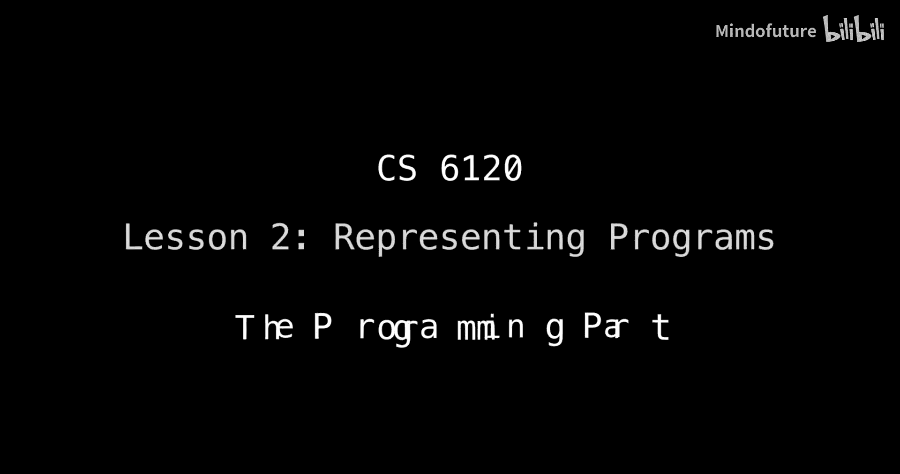
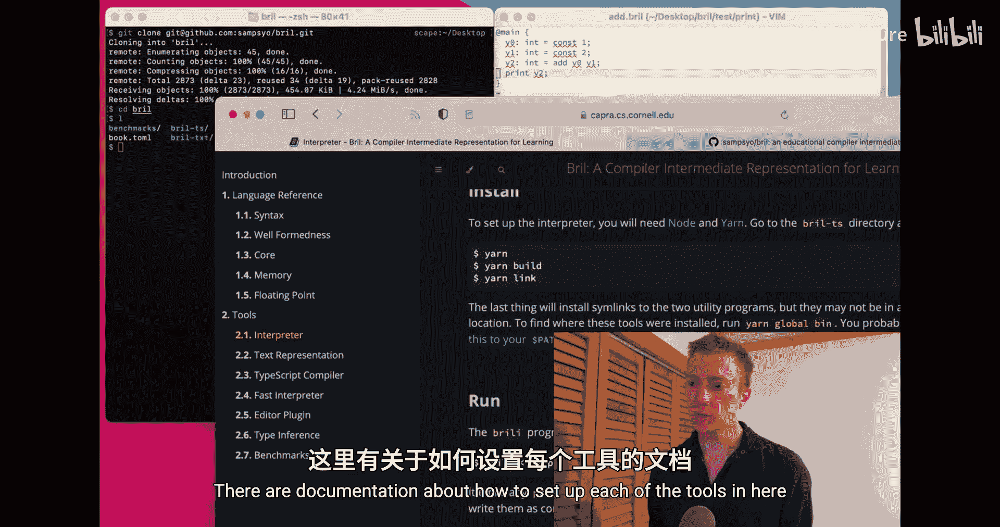
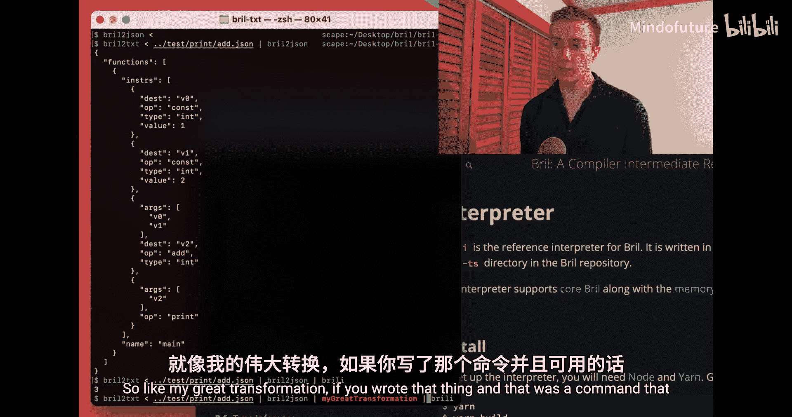
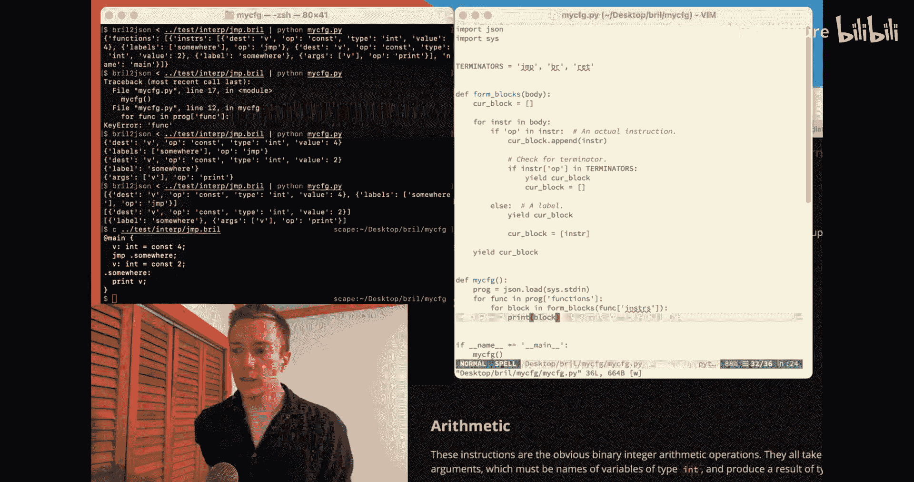
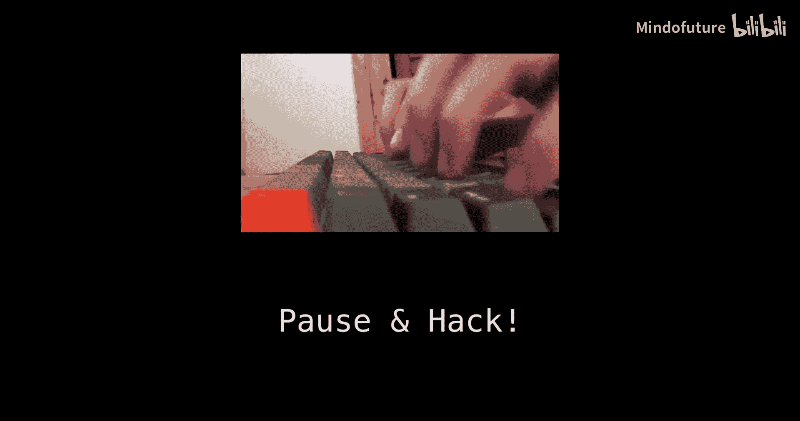
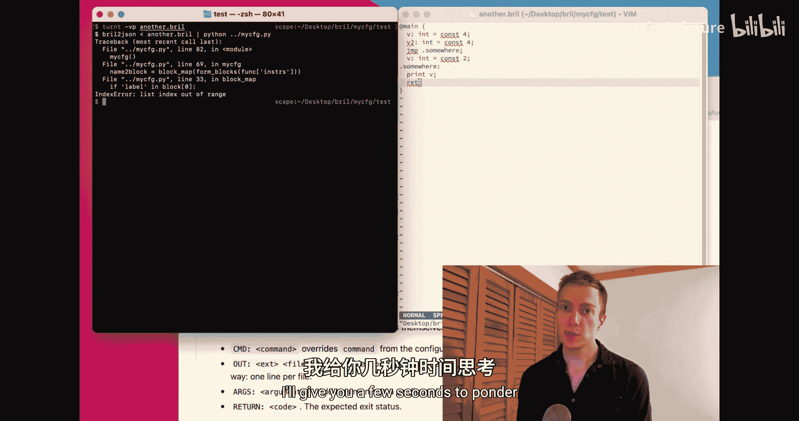
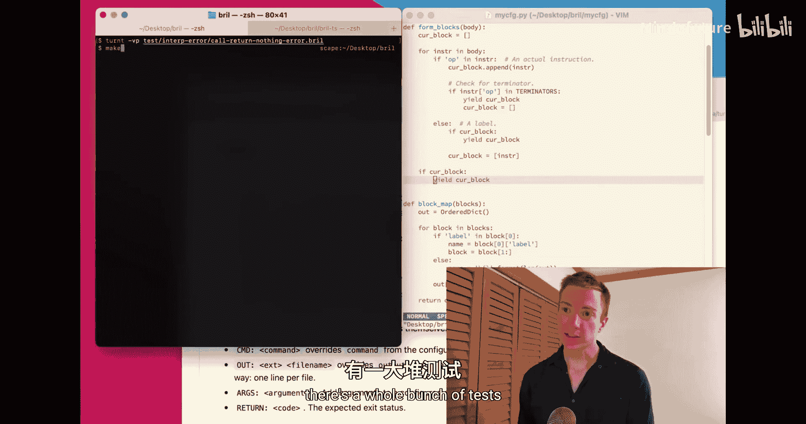

# 【康奈尔大学-•-中英】高级编译器项目教程-CS-6120（Advanced-Compilers，2020）-p03-P03-Lesson-2--Introduction-to-Bril--BV1gE9ZYsEUm_p3-

In this video， we're going to get our hands dirty with manipulating programs written in the programming language that we saw at a very high level used in the previous video。

 the one with all the instructions， that one we were just sort of using as a fuzzy example of a notional programming language this time we're going to make it concrete with real code so the code that I was showing you previously maybe looked unfamiliar because it's a programming language that I invented just for 6120 the programming language is called Briille for the big red intermediate language and it's what we're going to use for the first few months of this course to sort of to get familiar with manipulating programs without going full scale on interacting with real- worldorld programming languages like C or using real compiler infrastructures like LVM this sort of provides a nice way that is indicative of how real worldorld compilers work and presenting quite a bit of their complexity well sort of sweeping under the carpet。

 a bunch of the rough edges that make it hard to get started。

The idea behind Briille is that it's a very， very simple and extremely regular intermediate language that's based on instructions that you can extend as much as you want to make it as interesting as you want。

 So it's not just a fixed language。 you can add whatever extensions you want on top of it。

 So we'll start by playing around with the very core of the language。

 But there are existing extensions that make it more interesting。 and you can， of course。

 add your own。 The canonical home for everything related to Briille。

 which is the big red intermediate language is here at this URL that you can find links several places from the 6120 website。

 You'll also want to check out the。😊，GitHub repository that contains a kind of mono repository with a bunch of infrastructure in the documentation related to Briille。

 So a mono repository means that there's a bunch of different tools in here and they're all interrelated。

 even though they're kind of separate tools。But we're going to start out with just sort of getting a feel for what this language is like。

Let's get started by looking at a very simple example of a Briille program。Yeah。

One of the most important things about Briille is the canonical representation is as a JO document Jason is just a serialization format。

 It's not all that interesting， but the point is that every single language out there has a built-in library for the most part for parsing and emitting JO files so there is no canonical language that you need to use to process Briille programs you don't need to write a parser remember this class is definitively not about parsers you just need to use a built-in J library in order to start processing braille documents you don't need to use any existing infrastructure。

So the way that a Briille program works is that it starts out the top level in a braille program is just as dictionary that says here are the functions that it contains。

 and then here is a dictionary that contains a definition of a single function。

 you'll see that there's sort of a key value structure going on here we have the name of the function it has no arguments but there is a list of instructions so the instructions contain the body of the function。

 and each instruction in the body is just a JN dictionary。

So and this one has exactly four instructions， there's a constant instruction indicated by its op being constant。

 there is a second one， and then there is an ad instruction and then finally a print instruction These correspond to the much。

 much more readable and more human writeriable text format that we saw in the document in the previous video。

I'll show you that one， that text。Equivalent now。Here's the texto equivalent of that same program。

 and I really want to emphasize that even though this is way more convenient for reading and writing。

 it is not the canonical representation of the braille program。

 the text format is just an alternative representation that is fit for human foibles。

 the actual representation， the canonical one is for computers， and that's the Json representation。

 but you can see that there's a one to one correspondence going on here。

 The a symbol means that we're declaring a function and then there are four instructions in the body。

 There's two constants that add instruction and finally the print instruction。

It's very convenient to be able to read and write programs in this format。

 but then to do anything interesting with them， we will translate them into the JON representation and then do stuff from there。

 load them up in whatever tool you like， transform it and then emit it back as JO I have provided for you already a parser and emitter for this text format which means that you never have to touch a parser in the entirety of 6120 in order to use Briille and write interesting compilers you just have to process the JON representation Next we're going to get the Braille tools set up and start processing some programs。

The first thing to do is to clone the repository。Then the next thing we're going want to do is install a couple of the tools in the documentation you can see that there's a bunch of interesting tools that come with Braille。

 but a couple of them are more important than the others， in particular。

 the things we're going to want to use the most are the implementation of the text representation that is the parser andter that go back and forth between Jason and the human readable form and the interpreter that is the thing that can actually execute the programs and tell you what they do super important。

There is therere a documentation about how to set up each of the tools in here。

 but there's also for those two most important tools。

 you can also see setup instructions in the Readme。 They are， it's not hard at all。

 The first thing is in the Braille Ts directory that includes the interpreter Also a language definition in Typescript if you want to use Typecr to manipulate Braille programs。

 and then it also contains a very， very limited compiler from Typescript into Braille。

 which makes it easier to write longer programs。 but the thing you need to do in here is you'll need the yarn package manager。

 you can also use NPm if you know how to do that。 In case you type yarn to install all the dependencies。

Yarn build to compile the typeyscript code。And then you can type yan link。

 This adds to your path a program called Briille I for the Briille interpreter。

 This is something you can pipe Briille programs into in their J representation in order to run them。

 For example， there is a program in the test directory。Here's the add program we just saw before。

 If you pipe that into the Briille interpreter， it will run the program。

 And when it hits a print statement， it prints out the result。

 you notice that I used a less than in that previous command that is to indicate that we're reading from the file and piping that into the interpreter。

Next， we want to set up the。Tools for。The text format and so there's a directory called Briille text here this thing is written in Python。

 so we've already seen two different programming languages interacting with Braille programs and again this is part of the philosophy that you should be able to use any programming language and any set of tools you like in order to load up and manipulate and interpret Braille programs these ones are in Python the previous ones are in Typecr for this you'll need a tool a package management tool for Python called called Fit。

 which you can install。In kind of the obvious way， then you'll have a tool called Fit。

 which you can use thin。Say flit install and then there's many different options for the flt install command。

 but the ones that I recommend are similarlink so that you can make changes to the text format if you want to or like pull updated changes in this Git repository and they'll get reflected automatically and then user just to install it without super user permissions。

Then you will have tools aside from the Braille interpreter。

 you'll now have two different tools called Braille to text that takes Json documentation。

 Json representation of Braille programs and dumps them out as human readable text and the Braille to JN。

 which is a parser that emits the JN representation。 I'll show you how to use those two things now。

 we can do Braille to text on the program we were just using before。 So under test。Add， Jason。

That takes adjacent representation and dumps it out in the text format we just saw。

The Braille to Jason thing does exactly the opposite。 So in fact。

 we could take this thing that is currently a human readable representation and pipe this into Braille to Jason。

 and that should print out the Jason representation。

 The nice thing about this then is that you can take this Jason representation and pipe it into the Braille interpreter if you want to actually run it。

 So using these Uniix command line shells， you can build up more and more interesting pipelines。

 For example， if you write an optimization or a transformation on these things。

 you can just put this in between the thing that emits Jason and the thing that runs the programs in the pipeline。

 So like my great transformation if you wrote that thing and that was a command that was available。

 you could transform programs before feeding them into the interpreter。😊。

Your task for lesson2 is to load up Braille programs and write some code that does something to them。

 It doesn't have to be that interesting。 And in fact， it should be somewhat unambitious。

 It's just to get you sort of familiar with the Braille ecosystem and understand what it's like to process these programs。

 And the rest of this video we're going to do some of that together。

 I'm going to get started at least drawing the control flow graph for Braille programs that is forming basic blocks just like we did in the previous video。

 You are welcome to follow along。 In fact， I encourage you to follow along。

 you don't have to follow the code exactly how I do it you can again， use any language you want。

 I'm going to do this in Python just because it makes it really easy to write like pseudocode like processing algorithms but you can use any tool you like。

 And if you do this CFG exercise， I think you'll learn a lot。

 And if you think up one additional thing that you can do on top of this and turn that in for your task for this week。

 then you'll be up and running with with the Braille ecosystem。Anyway， to get started。

I'm just going to start completely from scratch and make a CFGs character in Python。

Let's do the normal boilerplate。I'm just going to have a function called my CFFG， I guess， for now。

I know I'm going to need。Python's J library in order to load it programs。

I'm also going to read them from this standard input。 so I'll need cis。 Okay， we're almost there。

We've almost loaded a braille program。 All I need to do now is just。Json do loads has that it in。

And now I have a program just to make sure I'm doing everything right。

 I'm just going to print that out。 And So we need a sort an interesting program。

 There's a whole bunch of them in the test directory that come with the Braille repository。 So。

 for example， under test。And the interpreter test has lots of things like there's a jump test。

 for example， let's take a look at that one。 This is a great program。 It contains one jump。

 in case it should make for a like semi interesting control flow graph。To use this， of course。

 we can't pipe this directly into our program because it's not in the J format。

 So that what we'll need to do is run that Brail to J program。And pipe in。

This jump program that we were using。 and now we'll pipe that into the my CFfG program and then unsurprisingly。

 just prints out the Python representation of that。 Jason， great， cool。 Okay， we're pretty much good。

 So these programs can have multiple functions for this service that doesn't really matter。

 So I'm just going to loop over the functions in the program。And then do something with them。

 I guess the first thing I'm going to need to do is form the block blocks， form the basic blocks。

 So I'm going to make a new function called form blocks。 And I guess all it really needs is the。

Insts from that。Let's call that the body of the function。

I'm not I'm going to have to do something that like loops over the instructions in the body。

 but just to make sure that I'm doing this right。That's not right。Cool。

 so those are the instructions in the body。 now we're going to actually do our algorithm for forming the basic blocks。

 So as I recall from our algorithm， we had this thing called block。

 which here I'll name a curve block。 that's going to start out empty。

 And we're going to loop over all of the blocks。 And I guess I will use Python generators to yield the current block as I build it up。

 But I guess the point is that I need to。😊，Terminate the block if I encounter a label or a terminator instruction。

And otherwise， I need to add things to the。Current block。I think that I think we got that right。

 Okay， so anyway， but I will， I think I， I guess the top level thing need to do is distinguish between normal instructions like actual instructions and labels that appear in this list。

 That is like we have some maps that have a label thing in them。

 And then all instructions will have this like op。Field in the dictionary。

So I can distinguish between actual instructions and labels by doing this。

And we'll do something here。So this might be a label anyway。

 I have to do one thing in the case that it's an actual instruction and another thing in case it's a label。

 So the way that it worked， I think from our pseudocode is that if it's an actual instruction。

 then regardless of what it is， regardless of whether it's a terminator or not we will want to take our current block and append the instruction So this is going to become a list of instructions。

 including the terminator for this block and point is that we now need to check for a terminator。

And we're going to do that is say if the instructions op code in。

 and then we need to figure out what our list of termminators is。

 I realized in the previous video that I made things sound a little bit too simple。

 I said that there that the only two termmininators should be jump and branch。

 but to answer questions like this。 you should listen to me。

 you should go to the actual documentation for Braille。 So let's flip to the documentation here。

 The documentation has a section called the language reference。

 and the first one is not going be very helpful for this discussion。

 but is going to be super helpful for like understanding the。😊，The a structure of braille programs。

 And it tells you what a program is， what a type is， what a function contains， all that stuff。

 Like what fields exist on which objects。 But what I really want to know is like what the actual available operations are。

 And the way that the braille documentation is organized is that there is a base set of operations and types that make up the kind of the core of the braille language。

 And then there are some extensions。 So the core just contains integers and billions and things like adding and multiplying and these kind of very。

 very basic operations。 You can see that there's also a extension for dealing with with allocating and freeing and accessing memory and one for floating point。

 but we don't need those for now， we just need to look at the operations that are available in the base language that's all we're processing for now。

😊，And of course all the terminators we're going to have to worry about are going to be control operators so conveniently there is a section in here called control that lists all the control operators and these are the four that exists in the entire braille language there are jump and branch as we saw before there is also call for function invocation can you can call functions in braille。

 which is a very very useful thing to do you can also return from functions。😊。

Here is a perhaps surprising thing。Generally speaking， in instruction based Is。

 the when you call functions， that is not considered a terminator for a basic block。

 even though it does involve。In some way， jumping out of the current basic block and executing some other instructions next。

 the reason is that the call will eventually return to that point in your basic block。

 So the kind of invariant we want to maintain about basic blocks is that that the blocks execute in some way Atomically。

 That is like if one instruction executes。 then they all execute。

 and that is still true of when you can have call instructions kind of mixed in in the middle because you will be calling the function。

 But eventually you'll come back to that basic block and you'll finish the rest of the basic block。

So generally speaking， call is not a terminator。 However， the one that I left out was RE。

 That is if you return from a function that immediately stops the basic block that immediately stops the execution of the function。

 so it should also break up a basic blocks。 So I guess the way I'm going to do it is I'm going to like have a list of the top called Terinators。

 which is just going to be a couple of all the opt codes that I want to consider to be terminating instructions。

 So that has not call but。Jump and branch and return。

And I will do something if the op code for an instruction is in that list of terminators。

 that couple of terminators。So do's something with that。In particular， I need to。

 as the name applies terminate the block。 but otherwise I think that we don't we need to terminate the block。

 and I guess we need to start a new one。 So what I'll do that is that I'm going to use Python generators here So I'll say like yield the current block that is let the that the client see that we have formed a complete basic block and then I will set curve block to be a new empty fresh list for us to build up。

Okay， so I think it's all good for instructions that is like for Terminators we'll add them to the block first and then we'll yield that completed block that has now has an instruction at the end。

So when we hit a label， we will want to end the current basic block。

 So I think that the easiest way to do this is just to say yield curve block。

Just as we did before and for this version is going to be super useful to be able to like associate blocks with the labels that they start with。

 So I think that the way I want to do this is that when we finish a basic block instead of just saying curve block is the empty list just like starting a new fresh one I think I want to say that the next block starts with the label that we just hit。

 that is like we just sort of finish the block， we hit a label I would like to to include the label at the start of the next basic block and of course labels aren't like actually part of the code that runs those basic blocks。

 but iss going to be useful to have those labels sitting around so that we can still jump between blocks So the way I'm going to do this is to put the instruction in the basic block。

In the next basic block that we start， the last thing we need to do， which I almost forgot about。

 which is is that we need to emit one last basic block。

 that is if we're still forming a basic block and we get to the end of a function and there's not a control operator there。

 that is there's no return。 There's kind of an implicit return there that we need to consider at the end of the last basic block。

 So last thing we need to do is yield curve block。And this at least is a good start。

 We can debug this in a second， but I will first just say。

That will print out every block in the program。So this should be pretty simple for the program that we just saw。

 hopefully this does something interesting。Looks like。Maybe it's， it's super helpful， I think。

 to look at the actual code。In。To decide whether we have this right。

That is to read the the human readable text representation。

 So does it look like there should be three blocks， That is the first one that contains the constant。

 and then the jump， the second one that just contains。The constant。And then finally。

 the last one that we are going to include the label and then。And then。The print statement。 Yes。

 okay， So I think this is right。 I think that at least for this one。

 I think we have something that's working。 So great。

 we have our very first version of our basic block formation algorithm。 That's not a CFg。

 it's not a CG extractor yet。 But we do have our basic blocks。

 Now would be a great time to take it from here and give you your best shot at doing the rest of the algorithm that is like taking this list of blocks and actually implementing the pseudocode that we developed together for forming entire control flow graph。

 that is a bit something that represents the graph from blocks to blocks that is the successor relation that is like which basic blocks are the destinations of jumps from other basic blocks。

 So feel free to pause the video and do that now， give it your best CFR you can get into it。

 I'm sure that you run into some weird garly challenges and then come back and I will I'll show you how I arrived my solution。

😊。

So in developing my solution， the first thing that I think we need is in addition to having this list of blocks。

 we're going to need a named map of blocks。 So my first tactic。

 and this is not the only way to do it， is to write a separate function that you might call the like block map。

Function， and this is going to take a list of blocks， a sequence of blocks。

 and it's going iterate over them and create names for every block。

 And it's going to do that with the label that might exist at the top of the block。

 And if you don't have a label at the top of the block， it's going to invent a name for you。

So this way， we will have a kind of regular representation that like gives us a string way to refer to blocks when we're forming the CFG。

So here's how this is gonna work for me。 I guess like the， the， the。

I'm going have like this out dictionary that's going to map again， names to entire blocks。

 and then going to iterate over。The blocks。And add them to this dictionary。So eventually。

 I'm going to turn this out。嗯。So。I guess there are two cases I need to do。

 I need to do something like out name equals block。 But first。

 I need to figure out what the name is for a given block。 And there are two cases here。

 Either we have a label or we don't， so。Here's how to tell。 That is like the block 0。

 That's the first instruction。 We're going to see if that has a label key， If so。

 then the name is just going to be block 0。喂博。And it occurs to me that we don't need to keep around the label anymore more。

 because it's kind of redundant in this representation。

 that is so we just need the instructions that form out the body of the block。

 So we can just say that the block is now block one to the end。

 This is Python syntax for make a new list that is like the old one except it skip the first element。

 Okay， so otherwise， then we don't have a label at the beginning。

 And we're not going to do anything to the block。 All the instructions are important。 However。

 we do need a。Name， so we'll just make one up here。 So like we could say， just like B1 or whatever。

 You could just like sort of randomly create a number to go at the end here。

One random idea that I have is that we could just get a number。From the length of the out map so far。

 So the first one will be B 0。 And then like eventually we will。

 we will like every time we'll add something。 this。

 this is guaranteed be guaranteed to be unique because we're constantly adding to the outer array。

 Okay， so I think this works。Let's find out together。 Very suspensable。Let's just。

Do create this thing called name to block。 And that's gonna be block map applied to。

Forming blocks here。And we' was just going to print out this name to block a map。Okay。

 fingers crossed。So it's a little hard to read， but it looks like we have a block called B 0。

1 called B1， and one called somewhere， which sounds about right。 Okay。

 so I think we have names for all our blocks。The next thing that we need to do is actually compute the successors for these blocks。

 We now have this name to block thing。 And I think this is going to have to work by iterating over all of the blocks。

 So the blocks are in the values of the name to block map。

 So I'll just say for a block in name to block values。

I thought better but I'm gonna make a function called。Get C FG。 And this thing is going to。

 I guess I'll write a do string for myself。 given a name to block map。

So this is going to produce a dictionary that maps names of blocks to lists of names of blocks that are successors of the one on the left hand side。

 Oh that makes sense。 Any， I'm going to do my loop here。And then call it down here。Eventually。

 I'm going to print out that CFfG allright。Okay， so I'm going have to do for each block。

Is find out what its successors are。 That is the thing that I'm producing is again。

 this like output dictionary。 and then we're gonna eventually do like out。呃。

I guess I actually want the name here。 So now we have the name also of the the block that we're processing。

 In case we need to do， we need somehow to produce a list ofor successors of this block。

 Most blocks will only have one successor。 those with branches at the end， will' have two successors。

 But any case， this is what we need to do。 And eventually， we need to return。Out， okay。

 but we need to compute those successors。Everything that matters about computing the successor is we can think of by looking at the last instruction。

 that is last instruction might be a jump or in in which case we know exactly what the successor is。

 or maybe it's a nonconttrol operation in which case we know that the successor is the next block in the sequence。

 So I guess I'm just going do that Now。 I'm gonna to take this like last item that's block negative one in Python syntax。

I'm going do something with this。 So I guess there's a few different cases。 We can say， like， if。

We're going to have to do something if it is a jump。In fact， I think that we can let。

 let's actually take a look at this at the code。 So in the Jasonson representation。

Jumps and branches use a key called labels that indicate the the kind of the labels that they are pointing to。

 So both the jump instruction and the branch instruction just give us the names of the blocks that are the successor of this block。

 So I think that this one， these two cases， we can probably handle the same way。

 That is like jump and branch the successors。Are just。This is meant to be the last instruction。

 the last instructionss labels。So I think that's all we need to do。 and if that's the case。

 then those are the successors to this block。I hope I have that right。嗯。Other case。

Another case we have to worry about is the is the other terminator。 So if。

That last operation is return。Then there are no labels that are argument to the return function。

 In fact， we can confirm that by looking at the documentation。The return function， it's just a rat。

 It doesn't have any arguments or anything。 If it's a rat， then the successors are nothing that is。

 this is an exit block。 It doesn't have any out edges coming from it。

But we're still not done because there's a chance that this is a non termminator instruction。

 That is that we have to worry about the case where the block falls through to the next block and that we don't have this convenience of just being able to get the label of the block for the from the instruction that's the terminator。

 And we have a little bit of a problem， because now we need to ask the question。

 what is the next block from this block。 And so far， we've just been maintaining a dictionary。

 So it's not really a well posed question to ask what is the next block after this one。

 So I'm going to take advantage of a little bit of a Python magic to make this easier， which is that。

Python has a collection class。Called order dit that is guaranteed to maintain its order。

 which means that when we're building up this block map。

 we're not just going to be making an unstructured map。

 we're going to be making one that maintains the order that we inserted in。

 So we can ask the wellform question， what is the next block Now。

 If you're doing this in some language， It doesn't have this like order diiced thing。

 It might actually be cleaner not to， you can just admit an association list that is like just key a pairs of keys and values instead of using a dictionary。

So that means that in this Gi C FG function， I now have the ability to， and this is not very elegant。

 I have to admit， to use Python's enumerate utility to look up the index of the current block we're looking in。

 So now it's possible to ask。嗯。Forgot this mistaken argument。It's possible to ask。

 like name to block dot items。Let's call it keys actually， so if we。Get a list of all the keys。

 I would be the current one。 We can get I plus 1。So， the successor。

To this block will just be I plus  one。 So I know this is gonna be a problem if I'm at the last block already。

 but I'm just gonna give it a shot for now。 and it is almost certainly going to crash。 In fact。

 maybe I would like to watch it crash when we have to deal with the last block。 Yes。

 it's going to do this。It's going to crash when it hits the last thing。 And， of course。

 that is out of range。 So we can fix this。 And again， this is really not terribly elegant。

 but we can just say。There are no successors， it's just like having return if you're at the very end。

Otherwise， do what we were going to do anyway。Did this work？No。Maybe if you want to。

 you can debug my code by maybe you've already figured out the bug。

 but I now need to figure out what I'm doing here。Of course， this should be off by one。Great。

 so I think we kind of have a CFG here that is like we named these blocks before。

 I guess it would be nice to print out。😊，In fact， I'll print it out in a slightly messer way。

So it's easier to read。So we know we have these three blocks。 They got these two invented names。

 B0 and B1。 and then somewhere， the successor of B0 is somewhere because it jumps there。

 The successor of B1 is somewhere because it falls through。

 And the successor of somewhere is nothing because it's the end of the function。 woo。

 I think we got a CG。 The next step is just for fun。

 I'm gonna draw these these C Gs as actual graphs using the graph vz tool。 If you never use graph。

 is's pretty cool。😊，It is just a way to like output a textual representation。

 get it turned into a nice little like visual graphic。 It's not pretty， but it's super。

 super nice for getting a quick visualization out of compiler tools。

 So I'm going to do that just using the CFG that is like the successor map function that I had just emit。

😊，That's not gonna be that hard。 Fortunately， the the dot format that graphph is uses is really。

 really simple。 You just have to say like digraph。 and then you give a name。

 and it' is gonna be like opening curly braces。 think Python formatting。 I' gotta do that twice。

 Anyway， I got to say like。呃。Gotta give this graph a name anyway。

 just to sort of show you what that looks like。I don't want to print。This stuff anymore。So， yeah。

 so we got this diagram means。 We're gonna to print all the edges。嗯。

So we're going to make one vertex per。C FG node per basic block。 So we'll do。

We' just do some indentation and print and add the name of the block。I guess that's all we need。

 So we don't even need this stuff。 We'll just print the name of the block。 Okay， great， cool。

 Now we will add the edges。 The way that this will work is I'll just loop over the name to block map。

 So we'll get the name and the successors， the name of the current block and some successors name to block。

😊，And we will。 the syntax for doing this is just that you have one name of it previously declared vertex map to another name。

 and you can just。Put in， I guess we need。To loop over the successors。That should do it。 And finally。

 we just need a closing cur brace。 And I think we should be all good。

This gives that's not right at all。Of course， I to loop over CFG， not named to block。

Hopefully this works。Okay， so we got declarations of the three vertices。

 And I think we also got just two edges Bu to somewhere and be one to somewhere。

 And I think that's it。 So I think that this is a valid graph f graph。

 So we can just piped that thing into。Dot T PVFO。Cfg doPdf， I think this works。

And we can view this wonderful control flow graph。Of course。

 the fact that this CFG extractor and Gph drawer works on exactly one example should not be satisfying at all。

 in fact it should be somewhat suspicious that there are probably issues going on with the rest of the language that we've just done。

 one tiny little example that doesn't even have more than one instruction per basic block most of the time。

There are definitely bugs in this。 I can tell you that I sort of skipped over a few cases that will certainly come up when we were run this on more realistic programs。

 So the next thing I want to show to you is a convenient way to do testing。

 not required that you use this at all in 6120 but it is what the rest of the Braille infrastructure uses and I'm going to show you that this tool for testing that you might find generally useful when writing small tools as part of a larger compiler that tool is called Tt Tt is a testing tool。

 the tiny unified runner and tester that we made a couple of years ago that is super。

 super simple All it does is run a command like say this command right here on several different files and then check that the output matches a precomputed output on disk So it doesn't do any it doesn't work like unit tests that you don't have to write the expected write checks for what you expect your function to do instead just do this super simple thing which。

Is to make sure that you match some precomputed output。

 This is a really nice way to get most of the benefits of testing that is like you can make a few changes and then run your program on a whole bunch of inputs to make sure nothing broke while you're doing refactoring for example。

 without a lot of the overhead of testing a traditional unit testing that is you don't have to write these complicated specifications this I' just find in my experience is a super super useful way to go about gaining confidence that your implementation for like these little compiler tasks actually works。

 So I'm going to recommend that you explore this， it can be useful just to get familiar with even if you don't use it and I'm going to apply it to our little CF extractor now Tt is also a Python tool you don't need to do anything fancy to install it。

 you can just do P install Tt I already have it installed do I apparently not。😊，Okay， now I got it。

 great。 But in case， it is the tool that is used in all of the test infrastructure for Briille。

 So that test directory that you saw before that has a bunch of inputs。 So， for example。

 the interpreter directory has a bunch of tests for the interpreter。 It has this。😊，It has， let's see。

 it's got a divide program。And if you look at that， it's just a normal braille program。

 and then checked into the repository is an example is the output of that。

 That is like what the interpreter should print。 And the key to working with Tt is that there is a config file called Tt do Tamel。

 which is just indicates like what command we're supposed to run in this。

 And there's like other things that you can read about in the readme for Trent that you can put in the configuration file。

 But this is the so of it。 you just kind of like write down this command to say that like I'm going run I'm going convert the input file。

 That's this one div dot Brile in this case to Jason and then run the interpreter on it。

 And that's what's going to be captured in the out file。 super， super simple。 And if we run tut。

 we can we can check that this is the case。 So actually just go over to the interpret directory。

 And if I just sayt div do Briille。 this will run those commands and say okay。

 you do match exactly what's on the disk。 a different thing that you will find super useful combination of flags is the verbo in print flags。

 which just say。😊，I'm going to execute this command and just show you the output instead of comparing it to the expected output。

 So this is a nice way to to not have to remember that you have to like put the less than in the special place and the pipes in the special place in order to like run the command every time。

 this is just a way to like to have a reproducible way to run the same command on a whole bunch of different files。

 like， for example， there's another。😊，That like here that。Well， that's surprising。

 but other than that， you can see that this makes it easy to run the same command on multiple files just to observe the output while you're debugging。

In any case， we're going to ignore that bug in the interpreter right now。

 I actually don't know what's going on。 I think it's just an old version of the interpreter。

 It's trying to run。 And we're going to flip back over to our CFG example and set up some testing infrastructure structure for it。

 So it's super simple。 All you got to do is like have a test directory。

 You don't even need a directory if you don't want to。 But any case you can put in a。You can put it。

 put a file called。Turt dot Tamel and start typing your configuration。 Again。

 there's a whole bunch of configuration options you can learn about in the read me for Trent。

 But the big thing you need to do is just say command and then type some command here。

 And then I'm gonna just scroll up and like， look at the command that I was running before。

 I don't want to actually feed it through dot Ex。 I just want to actually， I just want to run the。

I just want to run our extractor to print the print the graph is graph specification。

 And instead of hard codingd a specific file name here。

 I will now just say just say brackets file name that gets expanded to the file name of the current test。

 I will also need to change the path to the Python script then running because now I'm under this test directory these commands run in the directory where the file names are。

 So like this where the test files are。 So this will just be jump out Briille。

 for example if we do that and we'll need a relative path to the script we're actually trying to run So the next thing we're need is a file to actually run this on。

 I'll just start by copying over an existing test。So from the test directory， the interpreter tests。

 we had this great test we were using before。 I'll copy it here。

 we can run Tt on this immediately and will tell us that something is wrong because we don't have an expected output yet one of the flags to Trent is diff。

 which will tell you what's the difference between what is on disk and what we're actually outputting。

 So this diff is indicating that there was nothing on disk and and everything is being added。

 So in order to like mark this as the correct output， it looks like the correct output to me。

 the last flag deterrent that you want to use all the time is Tt save。

 save something to disk called Ju dot out， we can look that。It is exactly the output we expected。

 And then finally， now， if we do Trent jump out Braille， this says， okay。

 that is you match the correct output。 And just to check that that we're actually testing something meaningful。

 if I edit my CFG file and say like print something totally different。 and I say Trent di。

Jumptop braille。 I should now get a difference indicating exactly what changed。

 So as we improve the output or we make changes， it can be super slow to look at the diff to make sure that those are expected changes。

 And if so， we can do save to update the expected output for future runs。

So I suppose to make things a little bit more interesting， I will add a second test。

 and I'll do that just by copying a jumptop Briille， I guess I'll say。Just call this another test。

One thing that I would love to test is when。We have more than one instruction up here。

 or another thing I think would be great is to say that we have an explicit return at the end。

 And let's see what happens just to see the output。 we can say run another dot Brile。

 And unsurprisingly， we have already found a bug。 Maybe you can see what the bug is。

 I'll give you a few seconds to ponder。😊。

You got it exactly right。 The bug here is that there is no block 0 for one of the blocks。

 The particular block in question is the one that that appears after the re here。

 That is when we were forming basic blocks， we weren't careful enough to check whether there would be any instructions at all between a terminator and the end of the function or the beginning of the next basic block。

 So it's actually going to be a problem as well if we have a jump right before another label。

 So we can fix that in。Our script real quick。Just by saying we only are ever going to yield full blocks。

 rather blocks with at least one instruction in。 so we can just say if cur block。Then nailil that。

And just do the same thing。Down here。 And hopefully， that fixes our problem。Hey， hey， it works。 cool。

 So this looks like the right graph。We still have the same CFG despite those things that I added。

 So I'm going to go ahead and save this as the expected output。

 Now we can run all the tests for this script by just saying Trent star Briille。

 and it will run both of them and tell that everything's going okay。

 I encourage you to once you have a CFG extractor or anything else working on Braille working。

 add a few more tests and keep expanding your tests said as you identify bugs。

 just add a new tests and exercise of that bug， commit the output to your repository and build up a larger and larger set of tests。

 For example， in the main braille directory at the root of the repository。

 there's a whole bunch of tests you can just make tests to run the entire suite。

 And you can see that we've just been building these up over time。

 as we' made small tweaks and found bugs， it's really easy to just add one more tests and pretty soon you have dozens and dozens of tests and you can be reasonably sure that you didn't break your code when you make small changes because you can easily check a very large number of inputs to make sure that they're still doing the right thing。

 Good luck。 and I hope you enjoy using Trent。😊。

And please ask any questions you have at all about the Braille infrastructure。

 if you're confused about any of the documentation， please post questions on Zolulu。

