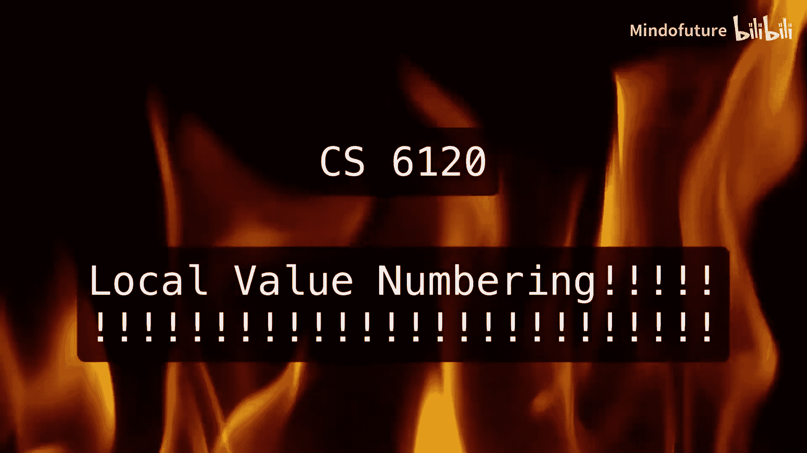
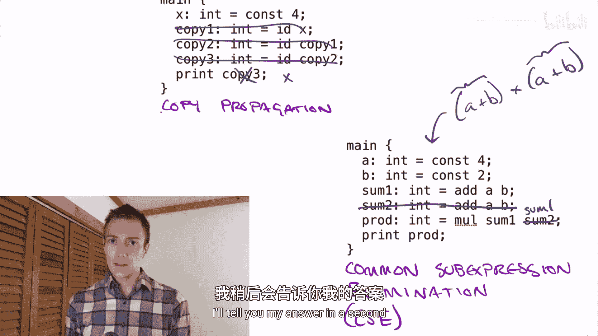
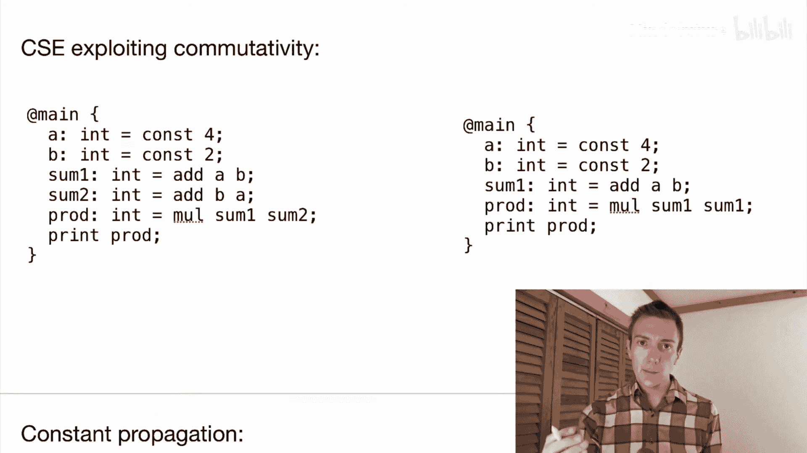
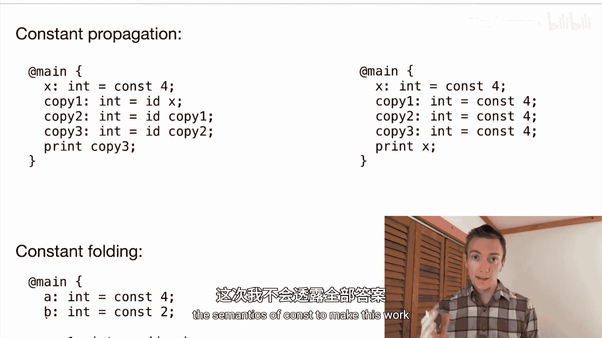
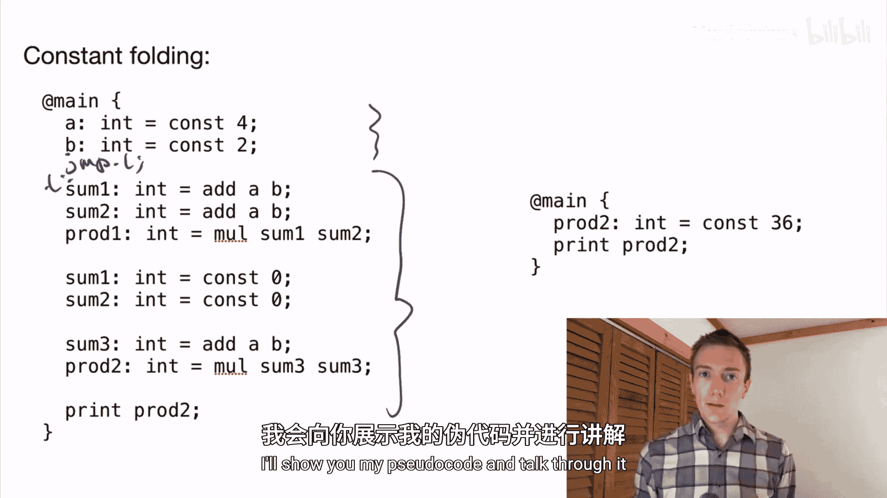
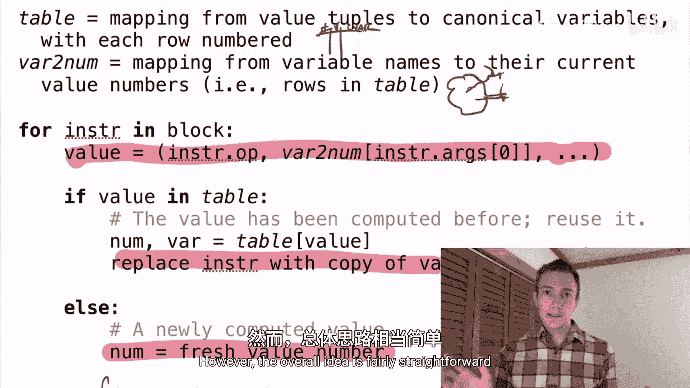

# 【康奈尔大学-•-中英】高级编译器项目教程-CS-6120（Advanced-Compilers，2020）-p05-P05-Lesson-3--Local-Value-Numbering--BV1gE9ZYsEUm_p5-

🎼，In this video， we're going to kill three local optimization birds with a single stone。

 The idea is going to be to shift our perspective on how we look at basic blocks so that several different forms of redundancy all become apparent at once and become easy to eliminate in a single pass。

This technique is going to be called local value numbering， as you might guess。

 there is an equivalent called global value numbering that extends the same reasoning to work on entire functions。

 we're going to focus on single basic blocks for now。

 and then later you'll see how to extend this to deal with control flows。To start off。

 I want to look at three different forms of redundancy that exist in programs。

 And I want to emphasize that each of these three things can be subject to。

Optimization passes that remove them as as their only purpose that is in some compilers courses in some textbooks。

 you'll see each of these three things discussed as completely separate optimizations。

 and there are cases where it makes sense to think of them as totally separate optimizations。

 what we're going to do in this video， however， is try to see the underlying phenomenon that underpins all of them and does a pretty good job at resolving all of these forms of redundancy。

 and that's what local value numbering does。So let's look at these three programs。

The first one demonstrates dead code elimination。 that is cases where there is code that has no effect can possibly have any effect in the output。

 and the optimization just consists of deleting the redundant instructions。The second one。

Exhibits an optimization that is sometimes called copy propagation。

 which just says that if you have several instructions。

 several computations that reuse the same original value。

 it is often easier to just use that value directly。 So in this function。

 we might eliminate all of these instructions。And instead of using all those I Ds。

 just print X instead， that optimization is sometimes called copy propagation。The third one。

The third program here demonstrates a different form of redundancy。 This one。

 if you squintted it for a second， this is a the long。

 instructional way of saying a plus B times a plus B。

And this represents an opportunity for what's called the common sub expressionpression elimination。

 where these things are the subexpressions that are common。

 That is that it's the same computation being done twice。

 And a better thing to do is just to do that addition once and then return the multiplication of that thing by itself。

 So we shouldn't need to do this sum 2。 But， of course， that variable is still referenced here。

 But if we were to just replace it with sum 1， then we'd get the same answer。

 That's common sub That's common subexpression elimination。 Sometimes just abbreviated to CS S E。

So my deep philosophical question for you is to ponder what these three examples。

 what these three different forms of redundancy all have in common。 That is。

 what is the fundamental underlying phenomenon that is making these programs redundant。

 There is no right answer to this question。 I， of course。

 have an answer in mind to this philosophical imponderable。

 But I'd like you to think for a little bit just by yourself。

About what is the common thread between these forms of redundancy。

 I'll tell you my answer in a second。

🎼。

The reason that these programs all have redundancy is because they say to compute things using the variables。

 whereas it is equivalent to just look at the underlying values being computed。 And if you do that。

 then these forms of redundancy kind of automatically disappear。

So let's look at these programs again， a value numbering approach to optimizing this program will realize that the same variable is being used for two different values and try to disambiguate those two things。

 and then will be will'll end up with a program where one where there's。Two separate values。

 one of which is clearly unused。This makes it easy to eliminate that unused variable and get us down to a program that just assigns to a once。

Looking at this second example， the one with copy propagation。The philosophy of value numbering that。

 again， is trying to disentangle the values from the variables says that there's only a single value in this program。

 That is the constant for， and it's being reused multiple times for multiple variables。

 And that's what looks like waste from a value numbering perspective。

 If we disentangle that single value from all those different variables。

 Those other variables that can hold that value， simply fall away。

 And we can see that the print statement should just be referring to the underlying value。 Finally。

 let's look at the common sub expression elimination example。 In this one。

 the value numbering philosophyilosophies says that there are two variables some one and some two that hold the same value that is a plus B。

 And， of course， here we're getting into the tricky notion of how you define what a value even is。

 is not just a constant。 There's something underlying going on here about reflecting what computation is being reflected by the variable。

 But if you accept some definition， some careful definition of what a value is。

 Then the value numbering optimization is going to look at this program。

And realize that the same value is being stored in two different variables， and that's redundant。

 And so in the computations that consume those variables， it suffices to just use a single one。

 and that will reduce and eliminate the redundancy。

So let's see how the value numbering approach actually works。

I'm going give this idea to at a very high level， and then we're going to walk through an example to see how it plays out。

 Finally， I'm going to leave it to you to develop the actual pseudocode and implement the algorithm。

But the idea behind the value numbering as an optimization really revolves around one big data structure that we'll see here。

There is a table。 And as this is where the name comes from。

 that's going to assign a bunch of numbers in the left hand column。 And then by this， I mean。

 like literal， actual natural numbers assigned to the values being computed values you can think of as expressions。

I'll talk about the representation of values in a moment。

 But those what we're also going to maintain。For every value。

 a canonical home for where that value is being stored。 So the very high level idea is that we will。

Try to disentangle a notion of values that is sort of expressions that are being computed and also keep track of one place and one place only where that value is being stored。

 So， for example， if we end up using the same value in two different locations。

 even if they are stored superficially in。To completely different variables。

 this approach we be able to look through it and say， no， that's actually the same underlying value。

 And instead of computing it again， we can just look at the canonical variable that's storing that thing already and just use that variable。

 One of the important things here is how to represent the computations。 that is the expressions。

 the values that are being numbered。 And as this， this table that I'm showing you indicates we won't represent。

 represent that in this kind of like funky form that refers to other rows in the table。

 So here we have this like number one plus number one expression。

 What that actually means is that this is the addition。Of value number one。

Which is currently stored in variable X to value number one。

 So we're not going to when we refer when we build up these values。

 we're going to be storing them as using these actual numbers that refer to rows in the table。

 So every every expression that shows up in this column of the table will be referring to values by their numbers。

 rather than by their variables。 And this is sort of completes the disentanglement from between variables and the values that they're stored in。

By referring sort of by having self references back to this table to say like， well。

 this is one big value that's computed out of several smaller values。

 then we can live fully in the abstract realm of computed values and maintain a mapping to where those values are stored in variables。

This all sounds fairly abstract， and I swear this is going to get more concrete in a second when we go through an example。

However， there's one more piece to the data structure here。 this。

 this is sort of the main table data structure。 But there's one other thing that the algorithm is going to need。

 which is。We're going to step through the basic block instruction by instruction。

 keeping track of kind of the imaginary environment that would be happening if we were actually executing the block。

 So it's going to be like executing the program will step through and sort of keep track of what variable holds。

 But instead of like in a normal interpreter where every variable will hold like an actual concrete value like5。

 they'll hold this notion of a value that is one of these expressions。

 So this cloud I'm showing off to the lefthand side here is going to say that we'll have an environment。

 So after we execute a expression that assign after we execute a statement that assigns into the variable a we'll have this environment that says that okay a now currently holds a value number two。

 So it's going to work exactly like an interpreter。

 but instead of holding actual concrete runtime values。

 values here will just be the numbers that is like the indices into this table and this way。😊。

We're able to keep track of a model of what computations go on in a basic block。

Just like an interpreter does， but using but statically。

 that is without actually knowing what the inputs are。

I hope you've had a moment to ingest that very high level description。

 We're now going to go through a concrete example that will hopefully make these things a little bit more clear。

 And this is a pretty tricky and abstract way of thinking。 So if you have any questions at all。

 I encourage you to either bring them up on the next Zoom iteration of this class or to ask questions in zoo up。

 you really， really got to ask questions if you have them。

 because I know this is not easy to understand。😊，So we're going to start out with this program on the right hand side so this is the common subexpression elimination example。

 and we're going to start executing this program， start executing this program in a LVN style that is instead of actually interpreting it we're going to maintain one of these tables So I'm going to start by like drawing the main data structure we have which is this numbered table。

 It's going to keep track of all the values computer in the program So there's the value table that's why we're going to put these funky expressions that refer to other rows in the table and then we'll also keep track of the current canonical home for that value in this variable column and then off to the side we'll have this fuzzy cloud which is the current environment which reflects the current state of all of the variables in the program。

This everything starts out empty。 of course， we're at the very beginning of the program and there's nothing in the environment and there's nothing in the table because nothing's been computed yet。

 In the next frame of this animation， we're going to advance past the first two instructions。

 these constant assignments to A and B and see how that affects the environment and the main data structure for the LVN pass。

So at this point， that is like right after the A And B assignments。

 we need the same table with number， value and variable。Yeah。

What this algorithm is going to do is insert values for a and B that are going to be pointed to by this cloud off to the left remember。

 That's the environment it keeps track of the current values of all of the variables。

 And every time you you sort of manufacture a new value that like hasn't ever existed before。

 You need to insert a new role in the table。 So these are going to be get the first two numbers we'll call them one and2。

 The value here you can imagine that you have a way of expressing what constants are。

 let's just say that yeah， the value here is going to be。Const 4 in this one's const 2。

 those have never been never shown up anywhere else in the program。

 the canonical home for this computation。Is a。That is。

 we will associate whenever we compute something。 We'll say， if it's never been computed before。

 we'll say that the canocical home for that。 The variable associated with it is the one where we've already stored it。

 Great， So that's the first step。 That's not so hard。 Okay。

 so the next step is to interpret this ad instruction that stores in some。

To make this kind of animate， I'm going to。Copy and paste our data structures。

And just extend them now at this point， that is between between the sum one and some two expressions。

 both adds。To execute this instruction， we are computing something that has never been computed before。

 And the way that you confirm that is by looking through the value table。

Just scanning over everything in the value table and seeing whether we have computed anything that looks like this。

To do that， we're going to have to come up with a representation for what this what the new computation is that we'll insert into the table。

 So we have like cons4 and cons 2 for the actual constants。 What are we going to do for ads。

The way to do this is you you need a representation that you can easily compare for uniqueness。

 And the way we will do that is by building up tuples。

 So the representation concretely and computationally when you're implementing Lvn is to use some sort of a tuple。

 This is sort of like hash coning if you ever done that in functional programming。

 This tuple is going to include a symbol to say that what this is is an addd and has two arguments。

 and those arguments are going to refer to other rows in the Lvn table。

 That is there're just going to be the numbers indicating other values。

 So the way this works that we're going to fill up these arguments by saying， okay。

 So what is the current number associated with with the variable A。

 we need to look at the cloud to see the current value of a is refers to the row1 So we'll insert So the。

Value number for this argument is one， and will'll do the same thing for B。

 Look it up in the current cloud。 The current environment。 its number is 2。

 So the new value being computed can be represented by this tuple， add 1，2。

So L VM looks through the value column of the table and sees。

 is there anyone else who has ever computed add 12 ever before， And if the answer is no。

 we are going to insert it into the table to say that we have now computed it。

 and anyone who computes it in the future can just reuse this。

 So I'll just write that value here in the table。Add number one， number2。

 which is the topple representation of the value we have just computed。

We will now need to sort of clean up the rest of our bookkeeping。

 which is to say that this gets its own value number。 It's 3。 It gets a canonical home。

 which is some one。And then we need to update the cloud。

 That is the current environment to say that some。Points2， row 3。Okay。

 so the next step is we need to do something very similar for， for sum 2。

 So I'm gonna to again copy and paste these data structures。

That we have just finished computing for this step。And we'll see how they animate when we apply them。

To the sum2 instruction。So the way LvN works is it's going to look at the expression being computed here。

 And so it's going to construct one of these value tuples to indicate what this new instruction does。

 So again， this is going to say， well， that's an ad。 and it's got two arguments。 And again。

 it's going to look at a。 Look in the cloud。 Find out that's number one。Still。Is going to look at B。

 Look in the cloud。 Find out that's number 2 still。And now we have the value。

 the tuple the value tuple that is being computed by this new instruction。

 Lvn likes reducing redundancy。 So it's going to look at this tuple and look through the the value columnumb see。

 has this ever been computed before。 And the answer this time for the first time is yes。

 there is already something in the value table that looks exactly like this。

 And so there's an opportunity to reduce redundancy。

So instead of adding a new value to the value table， like we've done every single time before。

 we will do nothing。 We'll put nothing new in there and we'll just say， great， we now have。

Some2 in the cloud， that is like the current state of what all the variables currently point to。

That now points to the same thing that as we don't need a new row in the table。

 this row suffices perfectly fine to represent the value of sum 2 as well。Crucially。

 we don't need to update anything about this variable associated with the value。

 that is the canonical home， the original place from which you can get this this value is still here in some。

So this indirectly， if you kind of read the arrows going here， this is now saying that some two。

Is holds the value number 3， which is this thing， but that doesn't really matter。

 What really matters is that it's the same thing as some1。 So that later on， computations， in fact。

 in the very next instruction， computationuts that use sum2 don't need to to literally use sum2。

 In fact， they can look somewhere else for the same value。Great， let's now do the next instruction。

 That is the multiply of some1 and sum 2。 I will copy and paste these data structures again。

And move them right after prod to see what happens there。

The the algorithm for constructing the value is again， just as it was before。

 that is this time we will use mole as the op code and we're going to need the the values associated with its arguments。

So here the argument， the first argument is some at LvN goes to the cloud， the current environment。

 It says that some is value number 3。And then it goes back to the second argument。

 It sees it sum 2 goes to the cloud。 It sees that that is associated also with number 3。

 So it reconstructs this as multiply of3 and 3。So finally， it can put into the table。

A new thing that has never been computed before， this mole。Number 3。Number 3。

That gets value number four， and that gets put into the prod。And the。

Variable that is the canonical home for this multiplication is still prod。

 So we adjusted the by virtue of having already figured out that sum2 holds the same value as sum 1。

 we have now adjusted the value doublebble that we have computed for prod。There's one last step here。

 which is to go through with with the print instruction。

But it's not all that interesting because it doesn't actually compute anything。

 It's only going to sort of look up the value that's being used for print。

 find its canonical home and use that variable。So that's the entire process for scanning through a basic block and instruction by instruction。

 building up this L VN data structure， associating values with variables and disent。

So that's the entire process for scanning through a basic block instruction by instruction and building up this LVN data structure。

Disentangling the values from the variables and assigning numbers to all of the values in order to do that。

There's one thing that we haven't done， though， which is to actually optimize the program。

 I've only shown you building up the data structure。

I'm going to rewind a bit and go back to the first frame and show you what happens kind of alongside as we transform the program。

 so you shouldn't think of this as a second pass， really。

 this is something you can do on the fly while building up the data structure to automatically reduce the redundancy in the program。

The basic idea is that every time you finish maintaining the data structure。

 you reconstruct the instruction we just processed， according to the value tuple in the table。

 This means that we。Eliminate the old instruction， which is based on the way that the original programmer happened to associate the values with variable names and reconstruct the same computation based on the values themselves。

 kind of ignoring the variable names。The way this will look。Is that， for example。

 when we have finished processing this sum one instruction。

 we will cross it out and reconstruct it from scratch based on the table and the value we have the value topple we have just created。

So this works by saying， okay， well， this needs to store into some one。 We'll leave that the same。

 Someone call an int。 We're going to store something in there。

 And then we will look at the value top we have just constructed for this。 So that's this tuple。

 addd number one number2 and will say， great。 I know how to do that。

 I will create an addd instruction to reflect the operation being performed。

 And I'm going to come up with the two arguments to add to put in here to do that。

 I will look at entry number one in the table And its canonical home， which is a。

So this is going to be add A。 I'm going to do it again。 I'm going to look at entry number two。

 and itss canonical home， which is variable B。Surprising， absolutely nobody。

 we have reconstructed an instruction that looks exactly the same as the old instruction。

 And that's what this algorithm must do is reconstruct instructions from scratch。

 Even if they look identical to the old one。 It's not any surprise here because this is the first time this value has ever been computed。

 So we need it to be computed somewhere。 It just so happens that it will be computed right here and then use to eliminate redundancy later on。

 Let's look at what happens when we follow this reconstruction algorithm for some  too instead of some one。

 So we'll cross out the old instruction。 and we'll again say， okay。

 we need to assign to the same variable is can be some one call an ant。 But this time。

When we look up the。The value associated with add A B， we found it in the table。 That is。

 we didn't need to insert a new value in the table。 So that computation already had a canonical home。

Which is some one。When that happens， instead of reconstructing the ad operation from scratch。

 we can just say now you are an identity operation that now contains exactly the same thing as the canoccle home for this competition。

 So this will just be I D sum1。So in reconstructing this instruction。

 we get rid of the ad altogether and replace it with just a copy。Next。

Let's look at the prod instruction。 We'll follow a similar algorithm， which。

Involves crossing out this thing and saying， okay， great。

 I will replace you with a new prod colon int equals something， and we'll figure out what that is。

 This computation was。 This value was inserted into the table。 That is， it got its own new row。

 which means we don't get to play the I D trick to to reuse an existing。😊，Variable， but instead。

 we will have to do a mole thing， and we will insert。The arguments to do that。

 we will look at the value tuple and we'll see that it uses number 3 and then number 3 again。

 So looking at the number3 row， we see that the canonical home is some one。

So it'll multiply someone by some one。So that's not quite the same as the original instruction。

 We've reconstructed a new instruction that means exactly the same thing。

 but instead of using sum two as a second argument， we get to use some， which is fantastic。

 we have now eliminated the need for someone altogether。

If we follow this thing through to its logical conclusion。

 we will also have to reconstruct this print to see where its value should actually come from。

 but it will just be reconstructed as print prod， because the canonical home of value number 4 is in the variable prod will end up with a basic block that has been transformed to。

Replace prod with two different references to sum1。 sum 2 is now just a copy of sum 1。

 and that instruction is now dead。 So we've optimized a couple of different things at once。

 And all that needs to be done now is to run a trivial dead code elimination pass。

 like the one from the previous video to just remove the assignment to sum 2。

 which is now completely dead and never use anywhere in the entire function。

That simple cleanup pass will remove this instruction and let us reassociate with someone。

 So in combination with that very， very simple dead code elimination pass。

 we've gotten the full effect of a common sub expressionpression elimination pass as well。

 through this shift in perspective from thinking about variables exclusively to thinking about the values that underpin the computation。

 by reconstructing these instructions， we got rid of the redundancy and made it really easy to remove dead。

 That's the basic algorithm for doing local value numbering。😊。

I promised you before that local value numbering is kind of this all encompassing way of looking at the world that makes a lot of optimizations happen automatically。

Really， it's a sort of a framework for implementing different optimizations as little tweaks to the basic alveian algorithm。

 Next， we're going to walk through a few of the extensions you can make on top of the basic algorithm in order to make other forms of redundancy go away。

In each case， I'm going to show you a original code in the left hand side and new code on the right hand side that we can hope to produce。

So here is the the first。Optimization that we kind of get for free out of the basic L VN algorithm。

 And that's common sub expressionpression elimination。

 a behavior like a traditional CSE optimization， which says that you can delete this some two instruction and you can replace this reference to some two with a new reference to some1。

 which is a canonical home。 And I'm kind of alignlighting the fact that we need to do a really。

 really simple dead code elimination that we saw in the previous video in order just to clean up the debt instruction we've just created。

 But in any case， the optimization， as we implemented it so far。😊，呃 can。

Perform this type of optimization and get rid of the redundancy。

Here's a different form of optimization， copy propagation。That is getting rid of these chains of Is。

That should all result in the same value。 get rid of， let's get rid of all those instructions。 And。

 in fact， just replace them with I Ds。 Now， I'm not doing the the automatic dead the trivial dead eli here。

 but we can still just use X directly。The algorithms I showed you so far doesn't actually accomplish this。

 The key to making it work is understanding something about the underlying semantics of the language。

 The basic framework I've shown you so far doesn't say anything about what actual instructions do。

 what the meaning of add is， what the meaning of multiply is none of that matters for the basic L V N framework。

 This tweak to it， however， does。 The instruction it needs to know about the semantics it needs to understand。

Is the I D instruction。 It needs to know that I D。Takes a value and produces exactly the same value by adding that understanding。

 that level of semantic awareness of the underlying language to LvN。 we get this optimization。

The tweak to the algorithm is that when you construct a value that looks like this。

 That is whenever you see a value that says Id and then has an argument。

 you just consider that to be exactly equal to number one。

 So when you look in that value table of the column for instances of this value。

 You consider anything that you consider this to be identical to value number one。

 This means that we get to replace all of these instructions with copies not of the previous variable without this awareness。

 we need to just sort of assume that I D can do anything and we just get to refer to the underlying value。

 So this is just sort of a small local tweak that you can make to the Lvn algorithm that introduces some awareness of the semantics of the Briille language that makes a totally different kind of optimization happen more or less automatically。

Next， let's look at a different form of optimization。

 So this is going to be an enhancement of the common sub expressionpression elimination behavior。

As you know， add A B should be in in any reasonable language， the same as add B A。 Of course。

 if we're talking about integers。 So this instruction should do the same thing as this instruction。

 That's not， of course， automatically true， the basic L VN framework has no idea that this is true of the addd instruction。

 So just like in the I D case。 If we just teach it a tiny bit about the semantics of Brile about individual instructions in Brill。

 We can make this different optimizations happen。 In particular。

 what will happen here is that we will get to apply the same C SE logic as we did when when we had a add a B twice。

 and we'll get to replace sum 2 with sum 1， and then finally D C E away the dead store to to sum 2。😊。

I would now like you to think about exactly where you would need to change the LVN algorithm in order to get this behavior。

 That is in order to transform this program into this program by just running the LvN algorithm。

 Where is that one small change where we need to introduce awareness of what the ad instruction actually means。

 Think about it and come up with your answer before you unpause the video。

🎼。

🎼Here's how I think you should do it， there are many ways to do it。

 but I think that you should implement a canonicalization pass on values that is as soon as you construct a tuple like add AB that is it will actually look like add number1 number two for example。

 you check for commutative operators and whenever you do that you canonicalize them so that the value numbers are always non-deecreasing so if you have add number two number one you canonize that to add number one number two and then when you're scanning through your table you'll find an exact match on the canonicalized form of the value that would work for this commutivity optimization。

The here'st yet another one constant propagation In this version it's just like the copy propagation。

 except we want to replace IDs with something even simpler， the constant instruction。

 So this means that if you ID through a bunch of times， same the same underlying constant for。

 we can replace that not just with Is， but we can replace those things with constant instructions。

You can think now about where you would need to change the LveN algorithm to teach it the semantics of Kst to make this work。

🎼The。

🎼，I'm not going to reveal the full answer this time。

 but I think this has to do with where you reconstruct instructions in the algorithm。Okay。

 so here's one final one that sort of demonstrates the full unbridled power of LvN。

It should be possible to take this entire program because it starts out with constants。4 in2。

 that does like a bunch of sums， does some products and stuff and finally prints things。

 I think we should be able to turn this into something that just computes an actual number。

 This optimization is outside of the LvN Con called constant folding because it's not just propagating constants。

 It's folding them through operations that act on constants。 So if you know。

 you have a constant and a constant and you do an operation to them。 you can compute at compile time。

 that constant。 And that's pretty cool because it lets you get rid of a whole bunch of computation that would otherwise be done at runtime and basically simulate the same effects a compile time replacing the whole thing with a constant expression。

 My implementation of LvN with all its power combined is able to， in fact。

 reduce this entire big program to this tiny one that just constructs that just uses a single constant。

 Simulating the effects of the program at runtime。 I'll let you think offline about where exactly you would need to make tweaks to the LVN algorithm in order to make this whole thing work。

😊，I also want to emphasize that we're talking again， the L and L V N is for local value numbering。

 which means that this thing only works because we're doing all this computation within a single basic block。

 In my implementation， for example， if you were to like， jump to a label。That's right here。

 It would totally break because it would be able to optimize some things around in here。

 but it wouldn't get to know that the inputs A and B are constants。

 It only looks at a single basic block at a time。 So those are the myriad ways that it's possible to customize the basic L V N framework with little tweaks introducing the semantics of the underlying language to make more optimizations fall out。

 There are many others。 We won't discuss them here。

Where we're heading is to do an actual implementation of of LvN for Brill。

 That's your main task for this week。I have to emphasize that this is not that this may seem easier than it actually is。

 There's a lot of fiddly details you're going to have to get right in order to get an implementation that is both correct and actually optimizes the programs。

 All of these extensions to L VN are bonus for this week's task。 You don't actually have to do them。

 Just getting the basic framework is the task that you have to do。

The next step that we're going to do here， however。

 is go over the pseudocode for taking these vague ideas and these pictures。

 scrolling around on an iPad screen and turning them slightly closer to an actual algorithm。

I would really like you now to pause this video and take some time。

 not just like a couple of minutes to think about it。

 but try actually sketching out the entire pseudocode for how to run this LVN algorithm。

 Think carefully about what the data structures are going to have to look like。 Again。

 you don't It's pseudocodes。 so you don't have to think about how to implement those data structures。

 but think about like what has to map to what and write the four loops in the assignments and stuff。

 indicating exactly where you're going to like replace instructions and where you're going to insert things into the data structures。

 thinking through the entire pseudocode for this。 I'll show you my pseudocode and talk through it。

 and then it's going to be on you to implement that。😊。

🎼The。🎼The。🎼。

Okay， here's my pseudocode。 It starts out with the initialization of the data structures。

 which you'll recognize from the terribly drawn cartoons above。The first one is the table。

 which that's the thing that looked like the table above。

 I phrased it slightly differently here as being a numbered mapping from values to canonical variables。

 but really it's a sort of three way relation that includes the number。

 the value and the canonical variable， the canonical home of that value。

 I'll be sort of using it as a map that's keyed by the values。Then there's the veritanum map。

 which you can think of as the。As the cloud we were using before。

 that's the environment that keeps track of the current values associated with every variable that has been assigned to so far during our scan。

 And here's the scan。 We're going to just iterate through every step in the in the every instruction in the block。

The first thing to note about actual concrete implementation of this is that you're going to need some representation for values。

 that is。第。The value thing here that I've been like sort of referring to as a tuple。

 The main reason I keep on calling it a tuple is because we need to be able to do equality comparisons。

 We need to be able to look things up in the table table here， index by this value。

 which means we need to be able to compare things。 We need to construct one of these tuples and check whether there's an existing tuple that's the same thing。

 whatever language you're using to implement LVN。 It must have a quality defined for the types that you're using to represent values。

 That is you have to be able to do in kind of Java terms。 like dot equals instead of double equals。

 That is to say that like we need to to compare them for equality and not for identity。

I'm going skip over the big if in the middle of this loop and go to the very end to show what happens。

 regardless of whether something is in the table or not。 When we do this in table。

 that's where we're going to use that equality on values to look things up to decide like whether this already exists or not。

 we're going to do some stuff。 But eventually we're going to maintain the cloud。

 that is we will add like whatever the destination of this new instruction is that like new variable X is now going to point to some row in the table。

 that table， that table entry nu is going to be decided differently for the two branches。

 But regardless at the very end， we're going to need to update the cloud to point to have the variable。

Be tracked in the current environment。Okay， so let's now look at the two possibilities。

 The first possibility is that the value already exists。 In which case we have found some redundancy。

 And what we're going to need to do is replace the instruction with a with something that eliminates that redundancy。

 And what I mean by with a copy of the variable is that， I mean。

 that you should say like the destination is like Id of var。

 where var is the canonical home that we got out of the table。

 So this case is fairly straightforward。 The other one is slightly more complicated。

 not that much more complicated。 So this is a case where we have a newly computed value that has never existed before。

 And we just need to do some bookkeeping。So this work was we will get a new number that is like the next row in the table。

 if you will。 And I'm going to skip over this sort of this massiness in the middle。

 which is a complicated， unfortunate thing we will deal with in a moment And just talk about the bookkeeping we do with that number。

 We need to update the table to with that new number。To track the canonical home of the value。

 So that means add a new entry to the bottom of the table that has like the new number。

 the newly computed value and the new destination that is now the canonical home of that value in case is ever being used and again in the future。

We will then update the actual instruction so we can this is that reconstruction step that says that we will use values from the table instead of the original variables。

 that's actually fairly straightforward。 It's just that you have to go through all of the arguments and replace their old variable names with the canonical variable names for those values。

Okay， finally， I promised we'd come back to this nasty bit in the middle。

 which deals with the kind of an unfortunate circumstance of the L VN situation In Lvn。

 Remember the philosophy as we're trying to disentangle the notion of values that is things being computed from variables that is where they're being stored。

 And there is one situation where that's particularly inconvenient when it comes to the realization in actual variable names。

 So far， we have conveniently been able to just leave all the destination variables named the same thing that they were before。

 Here's the circumstance where that that is leaving all the variable names the same becomes a problem。

 Say that you do x equals some computation， like let's say x equals a plus B。 I don't know。

 use X for a while and eventually you reassign X to something else。

 and then you some more computation and then eventually， you do another copy of the same computation。

 that is you compute the same value A plus B and A and B have not changed so far。😊。

If that's the case， then L V N will want to。 In fact。

 it should be able to eliminate their redundancy in。Why。

 and just reuse the computation we already have。 However。

 this is obviously a problem because X doesn't hold that value any more through the unfortunate conflation of values and variables。

 we don't have the original value that we thought we had。 So doing this replacement would be unsafe。

 But we actually need to do is to， let's call it x prime or something to rename this to a different variable。

 So we still have it around in case it gets used in the future。One way to do this。

 which would be very ugly， but also very easy， would be every time you reconstruct an instruction。

 you make a completely new variable name for it。 That is like， just call it like variable 1。

 variable 2， variable 3。 And this would totally work because it would sort of it would complete the disassociation between the old。

Crappy variable names of the past and replace them all with variable names that just represent the nice。

 clean world of value numbers of the future。 However， that's not really all that friendly。

 it is a little bit nicer to sort of be lazy about it and reuse the old variable names when possible and only do renaming when necessary。

 So we're going to take that approach。 That is we will use。

 will like renamem things as X prime only opportunistically only when we have to instead of renaming all the variables eagerly。

 So that's what this pseudocode does。 It does a slightly tricky thing to say if the instruction will ever be overwritten later。

 That is if the， I guess that should probably actually say， if the。😊。

Insta dot D will ever be overwritten。 That is if there's any other instruction later in the basic block that will ever write to the same variable。

 then let's do some renaming。 Otherwise just keep the same old name for Sandity's sake。

 So you don't lose track of what variables came from and went to where。

So in that case will you can just construct a new fresh variable name and say that's the destination for this instruction and when you reconstruct the instruction and insert it back into the program we'll use that new variable name and also when we set the canonical home for the newly computed value we will say that this is now x prime instead of x so that future uses of that value will go to the right variable。

So that's the entire pseudocode for LVM。 It's got some intricacies to it。

 that variable na thing is just kind of an unfortunate。

 weird consequence of the fact that variables can be reused。

 whereas values values are kind of forever。However， the overall idea is fairly straightforward。

Making it work and making it work without bugs is another story。 and that is your task for this week。

 Good luck， writing to translating this pseudocode that you now understand in depth into real code and making it work on real programs。

