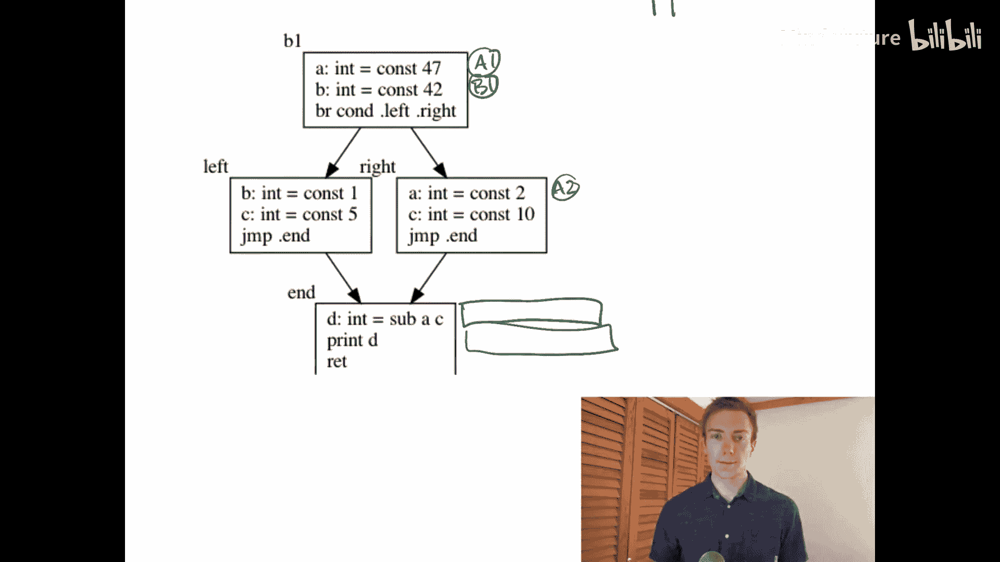
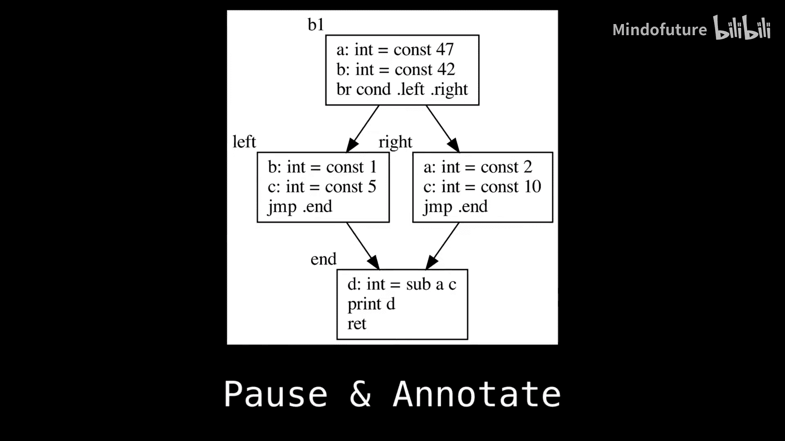
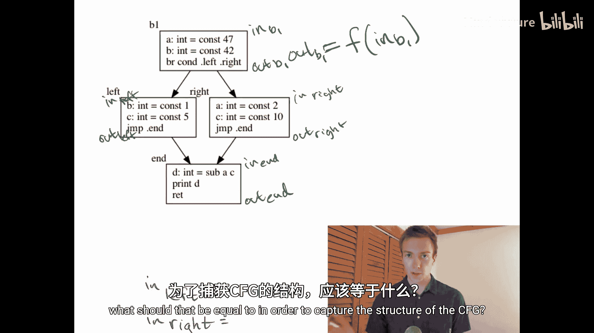
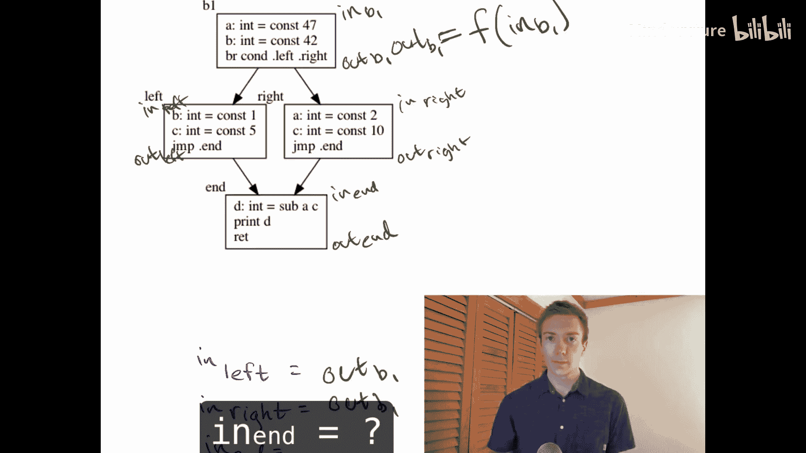
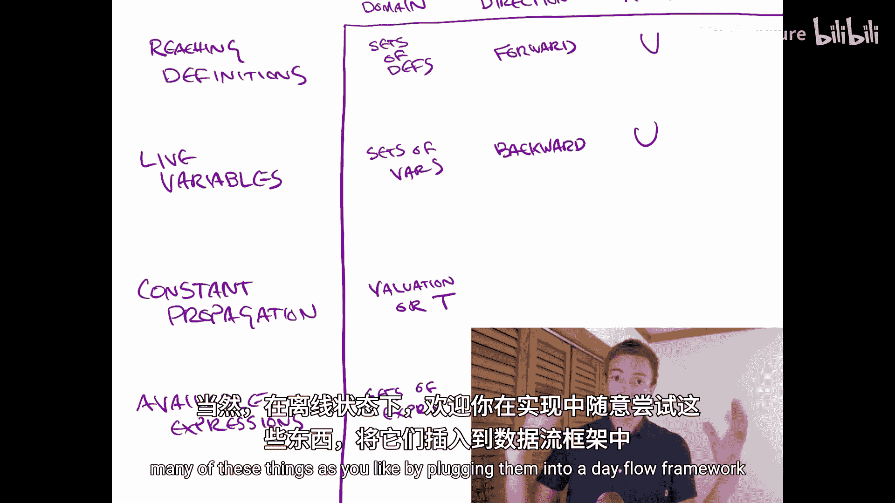
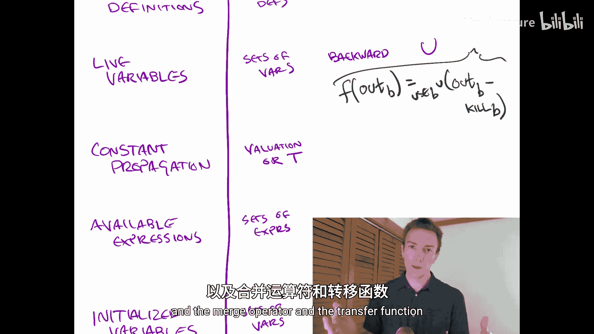

# 【康奈尔大学-•-中英】高级编译器项目教程-CS-6120（Advanced-Compilers，2020）-p06-P06-Lesson-4--Data-Flow--BV1gE9ZYsEUm_p6-

This lesson is going to be about global analysis。 We're going to see a technique。

 a general technique for doing global analysis that's based on lots of local analyses。

 The technique is called the data flow。Dataflowlow is a kind of a generic framework that you can fit lots of different analyses into。

 and then using a single common algorithm， turn that into global analyses that can deal with arbitrary control flow graphs。

First， I want to start out by getting you used to the idea of what a global analysis looks like。

 one that is actually sensitive to controlF。So let's look at this program。

 This is a really simple program。 I've sort of transcribed it here in purple into to make it slightly more readable with an ifel statement。

Now， imagine that your task is to do some sort of constant propagation on this program。

 That is we want to know what A and C might be。 That is like what constants they might be when we're printing them out at the end when we finally print out their difference。

 So the question is， is it possible to replace A with a constant or is it possible to replace C with a constant。

 And the point about asking this question I that is a global property。

 you can't answer it by just looking at the basic block at the end。

 You kind of have to look at the entire control flow graph to decide which times you define that is which times you assign to A and B。

 which of those are actually still relevant at the time that you print。

That something involving A and C。To answer questions like that。

 we will have to look at the entire control flow graph that is we' have to think of things in terms of basic blocks in the way they're interconnected and to make it entirely obvious。

 I really want to emphasize that this is not something that can be solved using the same sort of constant propagation LVN techniques that we saw in the last lesson in general for arbitrary control flow graphs。

 It may be possible to do that for this particular program。

 but one simple way to break that kind of reasoning。

 That is just sort of scanning down the list of instructions and updating things one by one is to realize that this program is equivalent to one where we take this and block and say we like。

Add an explicit return to it and then insert it way up here。

 And then if we do something that just is sensitive to the orders of instruction ordering of instructions。

 then this will clearly be wrong for the actual CFG。 this program is equivalent。

 just moving basic blocks around doesn't actually affect the semantics of the program。

 But reasoning about things in the order of instructions will be completely wrong。

 If we put this block in the wrong place。 And， of course， in general。

 we need to write global analyseses that can deal with any arbitrary control flow graph。

 That is really imagine any arbitrary topology where the vertices contain any code whatsoever。

 And they can be connected in any control flow structure。 as you can imagine any arbitrary edges。

 or going to have to deal with that structure。 And that's what data flow is going to give us kind of a generic framework for reasoning about。

😊，Before we jump into the framework， I wanted to pose one particular global analysis and make it a little bit more formal。

So we can see how to set it up as a data flow problem。

The problem we're going to solve is determining reaching definitions。

 I've written the formal definition of what a reaching definition is up here on the slide。

 but is's going to take a few sort of sub definitions in order to get exactly what I mean。

 roughly speaking， I mean， any we want to know for every instruction in the program。

 We want to know what other instructions。That wrote to variables are still valid at that point。

 That is are still the most recent assignment to that variable to define it。 However。

 take a look at these four definitions of funky compilers terms that we will build up here。

 The first is a use。 An instruction is a use for all of its arguments。 So if you say， like print a。

 for example， that's a use of the variable A。 Conversely。

 a definition is just an instruction that writes to some variable that we call that a value instruction in Briille in particular。

 So any instruction that writes to a variable， you can also call that a definition of that variable。

An available definition is one that reaches a given program point。 So by reaching。

 I just mean that it is still the most recent definition of that thing。 And finally。

 we'll use the terminology kill。 Sorry， but this is just the terminology。

 to say that any definition kills all the currently available。Definitions for the same variable。

 That is anything that overwrites a variable kills all the previous definitions at that point。

 So to return to a definition of reaching， this is just to say that if you have a definition of some variable V that reaches some other instruction。

 Remember， the definition is an instruction that reaches some other instruction， call it U。

 If there exists a path in the C F G from D to U。 that is like it's possible for control to go from the definition to the use where along that path and you sort of trace all the basic blocks from one path to another。

 there are no other assignments to that variable V。

 that is that definition is not killed along the path。So the reaching definitions problem。

 that is the analysis problem we want to solve can be put this way for every definition in every use。

 And remember， definitions and uses in Braille terminology are instructions。

 So for every instructions that either uses a variable or writes to a variable。

 we want to determine whether that definition reaches that use， if you like。

 you can think of this as a big matrix where you write all the instructions along the X axis and all the instructions along the y axis。

 and we want to put in a1 or a0 at every location to say if this definition reaches this use。

So that's the formal definition of the reaching definitions problem。

I want you to solve this analysis by hand for the example that we've seen so far。

 The way this is going to look is that you'll need to for every like you can come up with names for every definition。

 So let's call this a 1， because it's the first definition of a。 and this is a2。 And this is B1。

 You can come up with names for every single definition。 And then look through at all of the uses。

 that is every instruction that uses variables。 There is only one use here in the entire program。

 which actually， sorry， there are two uses。 there are these two uses in the final block in the end block here。

Decide which definitions， according to your naming scheme。

 are reaching this point and reaching this point。Go ahead and stare at this control flow graph for a while。

 La all the definitions and make a list of the definitions that reach those two uses。

🎼。

This was a little bit of a trick question because I forgot that there was another use in this program。

 There a third use。 Of course， this branch instruction reads from the con variable。

 The con variable is an argument to the function。 So we'll also want to incorporate that variable as another definition。

 That's not an instruction。 It's a definition that comes from the argument。

 So we'll want to consider that variable， just like any instruction that defines a variable as a definition when we're asking which definitions reach each use。

 and we'll also， of course， want to write down the uses for that third for that third use。

My answer for which definitions are available are reaching sorry rather at the branch instruction here are that of course cond 1 is and A1 and B1。

 those definitions reach that point。Tversing through the rest of the graph。

 we now need to answer that question for this assignment to D， which is both， of course。

 a definition and a use， as I've labeled it as D1， because it it's a definition。 But as a use。

 we can ask which definitions reach there。 And the answer is pretty much all of them。

 That is cond1 reaches there。 So does a1 and B1 and A 2 and B2。And C1 and C 2。

All those definitions reach this point。 And， of course， for the final point， the set of of。

Definitions that reach there are exactly the same。With the addition of D1。Great。

 so you have solved a global analysis problem。So how did you solve this。

 You use your human brain looking at the program and looking all the paths through the CFG。 That is。

 presumably you notice that a1 reaches this point because this definition has a path along which a is not killed that reaches this point。

 And you notice that B has a different path along which it is not killed and therefore reaching it reaches that point。

 So you kind of had to look at every single definition and try looking for paths through the graph。

 that was tractable for the small CFG。 but you can see how it will quickly get unwieldy and might even be pretty confusing if we end up having cycles in the graph。

 That is if we have loops in the control flow。To handle general graphs and to do this for arbitrary problems。

 not just reaching definitions， we have the data flow framework。

 The data flow framework is kind of a recipe that is its a you feed it a few ingredients。

 that is you think about your problem that you want to solve as a global analysis。

 you feed it some information about that problem。 and then you ask a data flow solver that is an offthe shelf algorithm for solving arbitrary data flow problems to give you back a solution。

So the general idea boils down to these four steps。 The first step。

 the first ingredient to solving a data flow problem is to figure out the thing you want to know at every point in the program。

 But instead of saying that we'll calculate at every single instruction and the data flow set up。

 we will just try to calculate that thing at the beginning and the ending of every basic block that is right before the first instruction。

 every block and right after the last instruction。 So we need to figure out like what information is we're trying to calculate at those points for the reaching definitions problem。

 for example， that's like the set of definitions that reach there。

So that that's like the quantity we want to calculate for those program points。

The next step is to write an equation for every single block that relates the state at the beginning to the state at the end。

 That is， we will do a local analysis on every block。

 This is kind of the awesome thing about data flow analysis。 I that in this step。

 you get to reason completely locally。 You can pretend that this is the only block that exists in the entire world and ask questions。

 for example， about how assuming that we know that some definitions reach the beginning of the block。

 What definitions must therefore reach the end of the block。

 And you can temporarily forget about the entire structure of the CFfG and just think locally about the one block。

 Then the rest of the CFG comes in in the next step in the recipe。

 which is to add qualities that set up equations。😊，According to the edges， that is， for example。

 that somehow the quantity at the end of this basic block must be related to the quantity at the beginning of a basic block that it jumps to。

 Finally， we will take those systems of that system of equations that we have just made。

 that is a bunch of equations that relate the beginning to the ending of each basic block and a bunch of qualities that capture the edges in the control flow graph。

 Those make up a bunch of qualities and we will hand that over the wall to and off thes shelf solver that will tell us the answer。

 That is the value at every basic block entry and exit。

 The magic thing about data flow analyses is that you don't have to invent that solving algorithm from scratch every time。

 I'm going to show you the pseudocode for a solver for generic data flow problems in just a little bit。

 but you don't have to make a new solver every single time。

 You can use a generic solving algorithm for data flow analyses。

 and just provide it with these ingredients。😊，To make it do wildly different things each time。

So to make this concrete。This equation solving view says that we want to introduce sort of variables that we can write equal on。

 So we'll say that there are， there is an in and out variable。For every single basic block。

 that is like the sort of incoming information and theing outgoing information for every block。

These will be distinct variables。 So label this is in for B1 and out for B1。And similarly。

 for every other basic book。The function I mentioned before。

 that sort of local analysis function for every block that's sometimes called the transfer function for what's worth will set will relate。

The in for every block that is， for example， for B1 to the out for that block。

So we'll get a bunch of equalities that way。 We will also want to relate the the blocks to each other。

 That is like the exit of one block to the entry of another one。 So here's my question for you。

 I want to know what to write for this equation in order to capture the edges in the graph。 That is。

 what should I make the variable in left， that is the value for like some arbitrary value if we're we can imagine is like sets of reaching definitions。

 But anything we want to ask about like what is true about the program。 at the。

Entry to the left block。 What should that be equal to in order to capture the structure of this CFG。

I think it should be equal to。Out B1， that is whatever was true about the program at the very end of B1 has definitely better also be true at the beginning of。

Of the left basic block。 that's also true of the right basic block。

 That is that should also be equal to to in right should be equal to out B1。

 whatever was true about the program that we're wondering about at the end of B1 should totally still be true at the beginning of the block that it jumps to。

So here's a somewhat harder question。 What should the value for。In end B， that is。

 what should I set up as the equation that gives the the value that is like what is true about the program at in end。

That's a little bit trickier。 There's going to need to be some sort of some sort of way of combining whatever was true at the end of the left and right basic blocks。

 That is we can't say that this is， well， whatever was true here is exactly the same as out left that is like the end of the previous of the left basic block。

It。Has to be that we need some way of combining that that those pieces of information。

 So it's definitely going to be related to out left。

 That is in and will have something to do with the out left and outright variables。

But this sort of points to one last ingredient that I didn't show you in the recipe。

 which is I' going to need some way to merge that information。 That is。

 this is sort of the last piece of the puzzle in order to capture a direct transfers of a control。

 we can just set things equal to each other。 But when a block has more than one predecessor。

 we're going to need a way to sort of figure out how to mash together the information from both sides。

So here's kind of a fillable form that I want to fill out for reaching definitions。

 but you can fill out in a myriad different ways in order to make different global data flow analyses。

The first thing you need is an initial value。 you need a value for the thing you're trying to compute at that to sort of kick off the whole thing to provide sort of a seed for the system of equations。

 we need a value for the reaching definitions， say， at the very beginning of the first block。

 the entry block of the entire function。This I've sort of we've decided that our representation for the values you want to compute are sets of definitions。

 so this should be a set of definitions。The next thing we need is the transfer function that is we need a way to compute the output value。

 the output set of definitions， given the input set of definitions for every single block。

Then finally， the last thing we need is a merge function。

 that is we need a way for whenever you have a block with multiple predecessors that has。

 it looks in the control flow graph， something like this。

 We need a way of taking the output values from the predecessor blocks。😊，🎼Taking those together。

 gathering them up， mashing them together somehow and computing the output value the input value for this basic block that is for reaching definitions。

 these， of course， are all going to be sets of definitions。

 And we need a way to compute the set of reaching definitions at the entry to a basic block。

 given that we know the sets of reaching definitions at the end of all the predecessor blocks。

 So once you do this， that is once you fill in this form for a given data flow analysis。

 you are basically done and we can in just a moment， see how to solve that system。

 I want you to pause the video now and try filling in these blanks。

 come up with an initial value a transfer function and emerge function for reaching definitions。Okay。

 here are my answers for the entry to the basic block。

 We will want to use a set representing the arguments to the function that is just like we saw for the con variable in our little example above。

 We want to sort of seed the system with the set of definitions that have reached the very top of the very first basic block。

 So that's a that's the set of arguments。Next， we need a transfer function because the value we're computing here is a set。

 a set of definitions。 This function is going to look like a。Operation on sets。

 That is this thing is a set and this thing， the thing we're computing is a set。

And it's also going to have to ask some questions about the block。

So my answer is going to be an equation involving this set in B。 Okay。

 my answer is that if you take the set of definitions that were available at the very beginning of the block and you then remove。

 this is like a set difference operation， a symmetric difference operation and you take out everything。

That was killed。By that basic block， then we're almost there， we those things。

 those things that were reaching this block， but then were killed somewhere in the block。

 Those are no longer reaching the end of the basic block。

 But some new things are reaching the end of the basic block。

 which are the definitions of this block。So if we take the union of the definitions of this block and the symmetric difference between the things that were defined at the beginning and the things that were killed by this block。

 that should be the reaching definitions at the end of the block。

It's really common for the values that we're computing in dataflow analysis to be sets。

 and therefore it's really common for transfer functions to look like a bunch of operations on sets。

 that is to take the input set and take local analyses about the blocks that compute sets and then do set operations on them like union and  sesymmetrictic difference and stuff to compute the value for the output。

 so finally， we need a merge function。 That is we need to say， okay， given that I have a basic block。

 I want to know how to compute the reaching definitions at the top。

 given that I have a bunch of sets of reach the definitions for my predecessors。

 the ends of my predecessors。 the operation， the merge function for reaching definitions is just union。

 and I'm writing it really big because it's like a big union over all the predecessors。

 all the end variables for the predecessors to this block。😊，If we have that。

 that is a complete definition of the reaching definitions problem and all we need to do is solve this problem。

 So the next step is going to be looking at a generic algorithm for solving data flow analyses。

 given these ingredients that we've just given for reaching definitions。

This is the classic work list algorithm for solving data flow problems。

 One thing that I think is remarkable about this algorithm is that it's so short and it's so easy to understand。

 It's remarkable that it works at all and that it works for any arbitrary data flow problem that satisfies some constraints。

 I think， is truly remarkable。😊，So as I showed above。

 there's a few things you need to provide to this algorithm。

 You need to provide initial value and functions that we will hear， call， merge and transfer。

 The way the algorithm works is it first needs to initialize things Here。

 I'm sort of representing those in and out variables as maps that is like for every basic block。

 including the entry block。 We will have an。In variable and the work list represents the blocks that are that still need to be processed。

 That is that it have preliminary values for their input and output variables。

 but still need updating and eventually this is going to start out as all the blocks because we haven't really analyze anything and eventually the thing will terminate when we have no more blocks to process。

So the way that the classic this algorithm works is that you can pick any block at all from the work list。

 It doesn't actually matter what the order is。 This is another remarkable property of this algorithm。

 that it remains stable。 that is the solving remains stable， regardless of the order that you pick。

 you can just take any arbitrary block that hasn't been finished。

And what you do is that you update its in and out variables。

 You update its in variables by taking by running the merge function。

 So you get the out variable for every predecessor。 And to remind you what a predecessor looks like。

 We're in a control flow graph。 This is us the basic block in question。Call that B。

 and then everything up here。Is a predecessor in everything down here。Is a successor of B。

So if we take the out variable for every predecessor and we call the merge function on it for reaching definitions again。

 that's like the big union operator， that gives us the in value for this block。

 then now that we have an input value， we can just call the transfer function to do the local analysis on this block and compute the out block。

Then finally， all we need to do is is maintain the work list。

 And this just says that if we change anything about outbe。

 that is if that update set a new value for outB that wasn't the old value about outbe。

 we just have to tell the algorithm that we now need to pay attention to the successors again。

 That is those successors are going to have to look at our output value to compute their input value again。

So every step in this algorithm is easy to understand。

 that is that we need to sort of merge our inputs， do our transfer。

 and then ask for our successors to run。 What I think is surprising that is true that you can prove about this is that given a few constraints that this is guaranteed to converge。

 that is it runs in a finite amount of time and gives you the correct answer that it gives you values for in and out that satisfy the system of equations defined by your data flow problem。

There's one extra detail about the work of this algorithm about data flow problems in general that I haven't revealed yet。

 which is that there are two different flavors。 There is forward algorithms and backward algorithms。

 The reaching definitions problem is is a forward data flow analysis problem。

 that means that it works by like having an initial value for the entry block。

 and then traversing from predecessors to successors that is passing information downward along the data flow graph。

 It's also possible to have backwards data flow analyses where you have an initial value for the end of the exit block。

 and you propagate information backward along the edges in the graph。

 This algorithm generalizes really nicely to backward problems。

 that is all you have to do is kind of like flip in an out directionion and you have to flip the predecessors in successors in this algorithm。

 And if you do that， you can do other analysis that we'll see in a little while that require a different kind of analysis where like information comes from the end and goes to the beginning。

😊，One last really surprising thing about solvers for dataflow analysis。

 They work pretty much automatically if your program has cycles。

 That is we have only really been considering examples where the CFG is kind of this feed forward graph that doesn't have any loops in it。

 And I think it's remarkable that the algorithm still converges and still gives you the right answer。

 even if you have loops。 And this is the really nice thing。

 If you had to reinvent analyses for loops every single time you would quickly lose patients with compilers。

 So the dataflow dataflow solver algorithms like the workless algorithm provide a really nice way to deal with arbitrary graphs。

 including ones with cycles like this one。 If you calculate the reaching definitions for for this program with that has has an actual loop in it。

 it will just work and will give you the answer that you expect。

 That is it will satisfy the equal in your systems of equations。 just super。😊，For。

I want to briefly touch on the requirements for what makes this work because you can't just give like any arbitrary。

 you probably wouldn't want to feed an merge function， for example。

 that like flips a coin and then this decides whether to include reaching definitions or not。

 there are requirements in order to make the data flow analysis algorithm converge and give you the right answer。

 There's really deep theory about what makes data flow analyses work。

 and I don't want to go off into the theory， you can read about that in the links for today's lesson if you're curious。

 but I do want to give you kind of an idea of what is a sufficient condition for a data flow analysis to be wellform and therefore for the algorithm to successfully conclude things about it。

The first is and this is kind of the big one that you have to pay attention to。

 is monoity that is that like in general， the values that you're computing kind of through this solving of the worthless algorithm that kind of have to only go in one direction for some definition of directions。

 That is when we when we gather more information and this is most concrete if you are computing sets。

 we have to be adding things to the sets。 So you have to be able to define some sort of an order on the values you're computing。

 and you ensure that every time the worthless algorithm runs。

 things are only ever moving in that order。 maybe you can see how this in general。

 ensures that the algorithm will eventually terminate。

 that is if you have a order that like eventually that can eventually end in one way or another。

 then you by only moving in one direction than you ensure convergence。

 that's kind of the proof of termination for this algorithm。So for example。

 you can imagine like the order for sets， it makes sense to use like the subset order so if we are thinking about like sets of variables as in this example and I'm showing a partial order that relates that's the subset relation on sets of A B and C and the nice thing about this order is that it has a top element in a bottom element that is it has the empty set and then the set of all the finite set of all the variables that are being computed which means if we only ever move one direction in this and doesn't matter which direction in this one because there's a top element and a bottom element if we only move one direction in this relation then we are guaranteed to eventually converge that is like someday we either if we're going in the upper direction will eventually get to the empty set and then we'll know that the workless albumbin will definitely terminate or will eventually get saturated and get to the universe set set of the finite set of all the variables in the program。

 for example。And then we'll also know that it terminates。

So if it helps you want to if you want to prove to yourself that your data flow analysis fits this constraint。

 you can think of forming a partial of defining a partial order on the values that are being computed。

 so for example， if we're doing something with sets， then that partial order。

 you can use the superset relation for instance。And you need to think of your， your merge function。

Ensure that your merge function， whatever it is， is the is the meat that is the greatest lower bound on that partial order。

 So， for example， for this partial order， the meat is the。The union operator。 So in this sense。

 by like picking the partial order， you kind of fill out the entire recipe for doing data flow。

The initial value has to be the the top value here， the empty set。

 and then your transfer function has to be monotonic with respect to the order by what you mean that if you have。

An ordering between x and y， then applying the transfer function to F to x and applying the transfer function to y should preserve that ordering。

 So x ordered with respect to y implies that f of x is ordered with respect to F of y。If you do that。

 then you have satisfied the requirements of data flow and you're guaranteed to get a correct answer and for the algorithm to terminate and give you that correct answer。

It can be useful to think about what even defines a correct solution to a data flow problem。

 that is what is a correct answer for a system of data flow equations。

The classic answer to this is to define it as the meat overall pad solution。 So imagine this。

 this sort of idealized。Data F graph。There's a， this is B1 we will think of as the entry block。

So this is a path from the entry block to a given node we that we're considering that the。

There are lots of possible paths， potentially through other nodes not shown here from the entry block to the given block。

 we will。Say that a correct solution is if you take。

 if you sort of chain the transfer function across the across all the blocks along a path from the entry to your node。

 and then you take all of those chains and you meet take the meet。

 that is the the merge function across all of those things。

 then you get the correct answer for the data flow analysis。 So to write it out in symbols。

 you can say that like。Out for a given block， call it Bn that is like the out variable for that thing is the big meet that is like take the take the merge function and apply it to all the paths。

From the entry block。2 B， N。 And call that B1。 Remember， that's the entry block。

 And then a bunch of stuff in the middle。 and eventually B N。 and then。

Take the then we will compute the value going across a given path。

 So we will this will look like a bunch of applications。Of the transfer functions for all the blocks。

Eventually， applied to。The top value for the partial order。So first。

 we'll have to apply B1 and then we'll have to apply F for every block along the chain and eventually be n-1 and finally ben and applying the transfer function along the entire chain and then taking the meat of that thing。

 That sort of defines the correct solution finding all the paths is of course， going to be super。

 super slow， which is why we like the workless algorithm and it's remarkable that that algorithm。

 which is efficient， is guaranteed to find the same solution as this kind of like exhaustive look at all the paths thing。

 And just to be clear， it's not even clear what how you would do it in attractive in a reasonable way in the presence of a。

Of a graph with cycles。 that is it like， if you think your naive algorithm is going to be like enumerate all the paths from the entry block to my block in question and then compute something for every single path。

 that ain't going to work if your graph has cycles because。Enumerate all the paths will never finish。

 There are an infinite number of paths in a directed graph with cycles， of course。So the algorithm。

 the argument for the correctness of data flow algorithms that is like for the workless algorithm for solving a data flow problem relies on the properties of the partial order that's sort of underpinning your data flow problem。

 I'm not going to talk about like that exact proof。

 but if you're super curious there are links that you can follow associated with this lesson。

The final thing I want to do in this lesson is take this framework that we've learned about and instantiate it。

 think about how to instantiate it for lots of different global analysis problems。

 So I've made a big table here， that lists and you can see these analyses in the notes for this lesson as well。

 it lists a bunch of global analysis that you can solve with a data flow analysis problem and the idea is that you can do this by you can solve all these problems just by filling out the cells in this table that is you just have to provide the ingredients。

 the domain that is like the types of things that you're calculating the direction forwarder backward the merge function and the transfer function I'm going to explain to you really briefly what all these things are and then it's going to be your task now to think about how to fill in the cells of the table in order to come up with a setup for a data flow problem that solves for a data flow analysis that solves this problem。

 We've already talked about reaching definition So I want to talk about that one live variables。

Set of all the variables that have been written to and are going to be read or might be read sometime in the future。

 That is it's not just the variables that are defined at a given point。

 It's the ones that that are still necessary。 You can see how this might be useful in eliminating some dead code taking your dead code elimination to kind of a data flowy place。

Consant propagation is something that we did locally using LVN。

 but constant propagation on a data flow graph needs some way to understand at every point in the program。

 whether a variable is guaranteed to be a constant and so you can replace that variable with a constant。

Available expressions asks which expressions have been computed before。

 expressions in terms of variables， and this of course。

 is useful in doing common subexpression elimination on an entire control flow graph。

Then initialized variables， I included。 it's not。 It's not about optimization。 initialized variables。

You know in Java how it complains at you， if you define a variable。

 if you say like string S and then later on you say you try to say like S plus hello or something。

 it will complain about you at the point where you use a variable when it's not defined of course。

 is a flow sensitiveens property， it has to do with a control flow graph for example。

 you can do all sorts of like loops and ifs and stuff assigning to variables at different points and that will like that affect whether you should get an error when you try to read from a variable that's uninitialized。

 So the initialized variable data flow problem answers that sort of thing。

 interval analysis is an interesting one， it's about numerical problem。

 So when you actually care about like the floating point or integer value of a variable and it asks what is the interval that is like say like from5 to 42。

 for example， that is the range of values that that variable can take on For example。

 if you end up with this range and eventually you have like something that says like if x is less than 45。

Then you can simplify this to true because you know that you don't know exactly what the variable is。

 but you do know that it's less than 45。All of these things can be solved with suitable definitions of the domain。

 the direction， the merge function and the transfer function。

 I want you to pick just one of these analyses and think through how to fill in the fill in the columns that is like maybe you want to take constant propagation。

 I've given you kind of the domain that is like the thing that we're calculating， that's pretty easy。

 Think about whether you want to do that forward or backward that is predecessors successor or the other way around and come up with a merge function in a transfer function。

 Do that now。 and then of course， offline， you're welcome to in your implementation。

 play with as many of these things as you like by plugging them into a data flow framework。😊。

I'm not going to tell you all the answers。 You can work these out and even try them out on real code in your implementation。

 I do however want to give you one example of a backward analysis we've so far seen fully worked through a forward analysis and reaching definitions。

 Let's think about live variables。 remember what we're trying to do is calculate the set of variables that have been defined and are going to be used at some point in the future that is later in the control flow graph。

So I've told you that some of the ingredients are that these are going to be sets of variables。

 obviously the domain sets of variables， the direction will be backward and the merge function is going to use union。

Beyond that， we just need to define the transfer function。 And here's my idea。 We will start。

 We need to define this function。We can use a little more room here。 We need to find this function。

On and。This goes。Backward this time。 So instead of。Computing the out value based on the in value。

 we will compute the in value based on the out value。 So for a given basic block。

 we have an output set of live variables， and we need to compute the input set of live variables that is the ones that are live at the beginning of the block。

So that's going to start with those things that are live at the end。And like before。

 this is going to have to do with with set operations。

 So we're going take thesymmetric difference to take the the things that were live at the end and remove variables that were killed during this basic block that is like assigned to。

 So those definitions。That were。That you can be just right。Kill B。

 those are not live at the beginning of the basic block。

 So it's all the things that were live at the end， except for those ones that we killed somewhere in the middle of the basic block。

 And then also， there are the uses。 That is the things that are defined before they're used somewhere in this basic block。

And we'll say that those things are now live。 That is， if you refer to X， for example。

 somewhere in the basic block， and that wasn't live before， Well。

 it's live now at the top of the basic block。 So this data flow equation。

 this transfer function for live variables coupled with the rest of the ingredients。

 gives you a global analysis that tells you this very cool information just by plugging in it into the existing algorithm。

I encourage you to do this for all of them。 Take as much time as you want。 Of course。

 and just look through all these analyses and try to think through how you would set them up as data flow problems。

 thinking up the direction and the merge operator and the transfer function。 It can be great fun。😊。

