# 【康奈尔大学-•-中英】高级编译器项目教程-CS-6120（Advanced-Compilers，2020）-p07-P07-Lesson-4--Implementation-Task--BV1gE9ZYsEUm_p7-

Yeah。🎼The。Alright folks this video is gonna to be super short。

 I just need to introduce you to the programming task associated with lesson4。

 It's all about dataflow to put it real simply your task is basically just to implement a dataflow analysis and to convince yourself that it works using tests as usual So the difference between this in the previous task is that this is into transformation on programs you just have to implement analysis So for example。

 you are free to implement any of the analysis that we saw in the previous video that are also listed in the notes associated with this。

 you can even just implement the real simple reaching definitions analysis that we used in an example you just have to implement one of them。

 There's also kind of if you feel like it， you can feel free to generalize your implementation to kind of an arbitrary data flow framework that can solve any problem and to parameterize it so you can feed in several different definitions of data flow analysis I highly。

 highly highly encourage you hover that in the first phase of your implementation you just make it work for one don't try to overgeneralize as a first step。

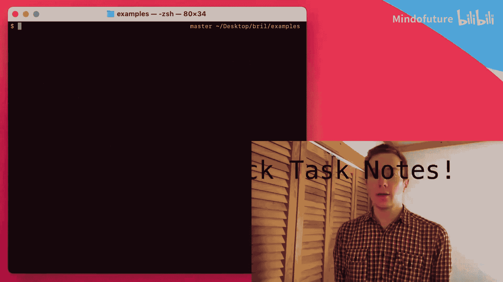

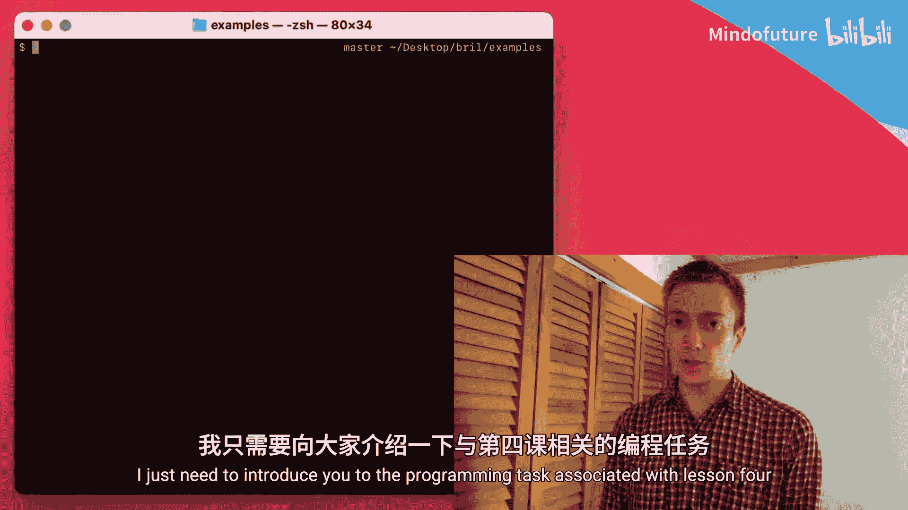

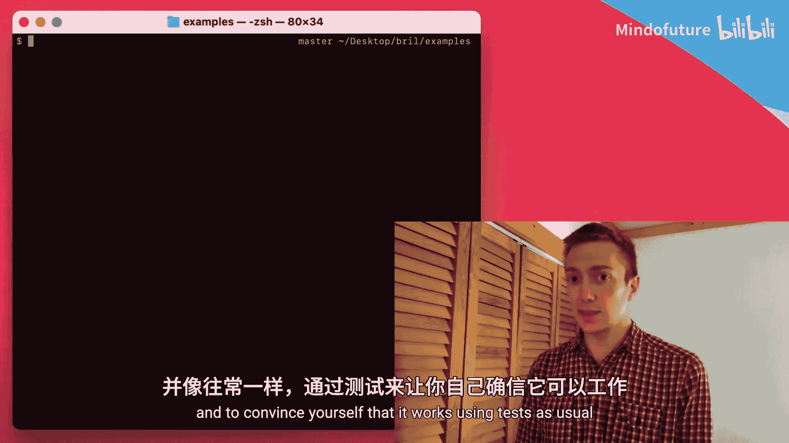

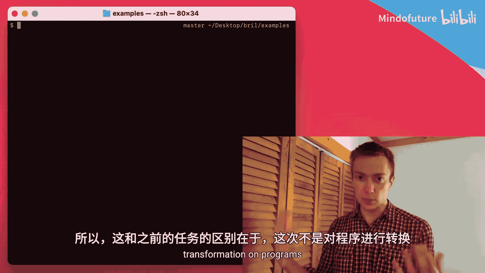

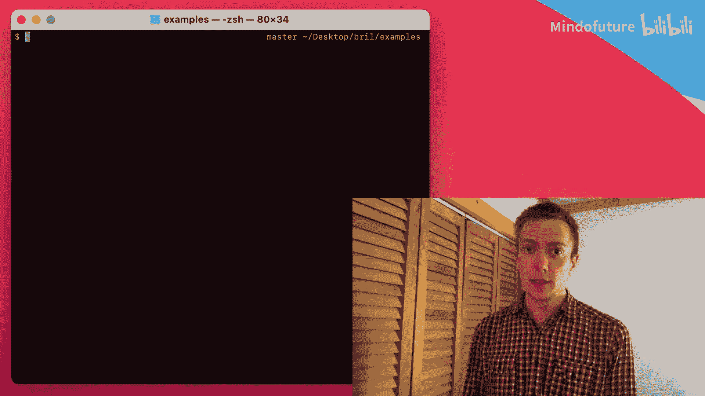

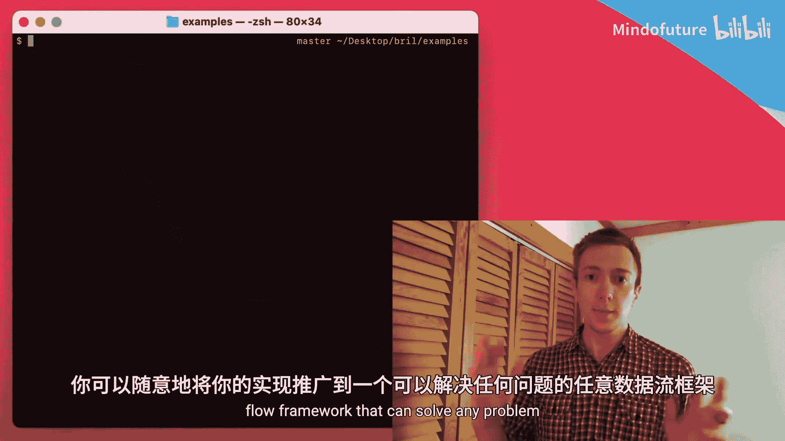

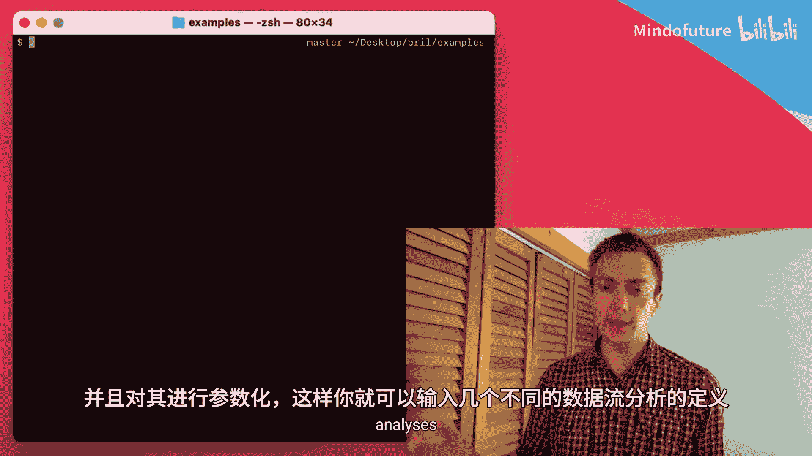

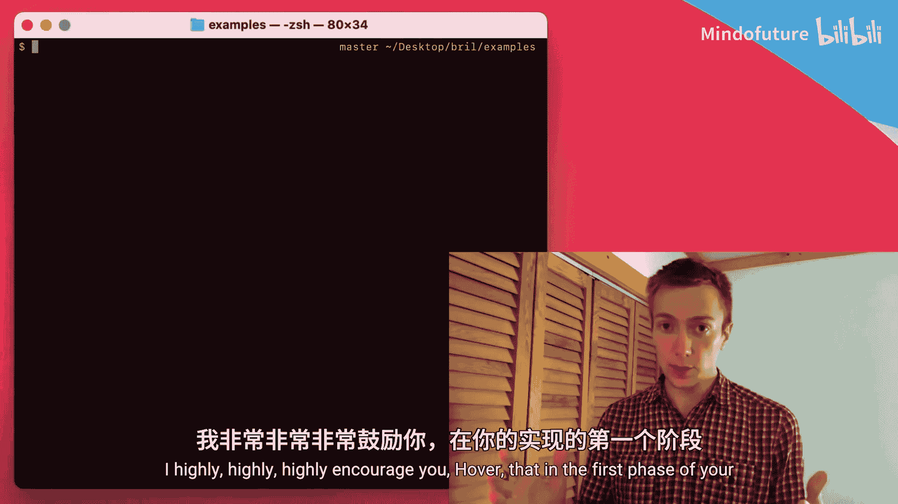

Just try to make it work once。 And then if you have extra time and you're super excited。

 then you can generalize out from there。 It's not that hard once you've done it once。

 but I really don't recommend trying to get the fully general thing right before you pick a particular data flow analysis you want to run。

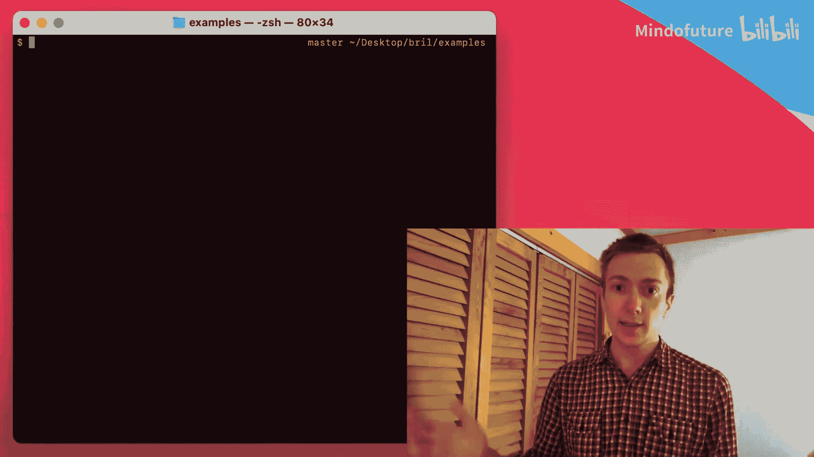

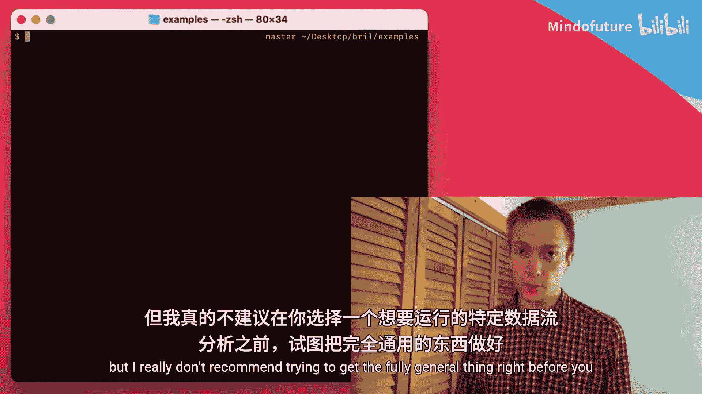

So for example， I have a few test programs in here， it doesn't really matter what they do。

 but here's a factorial implementation。 I can show off real quick what it looks like to run a simple data flow analysis on this I need to。

 as usual braille to J this thing。

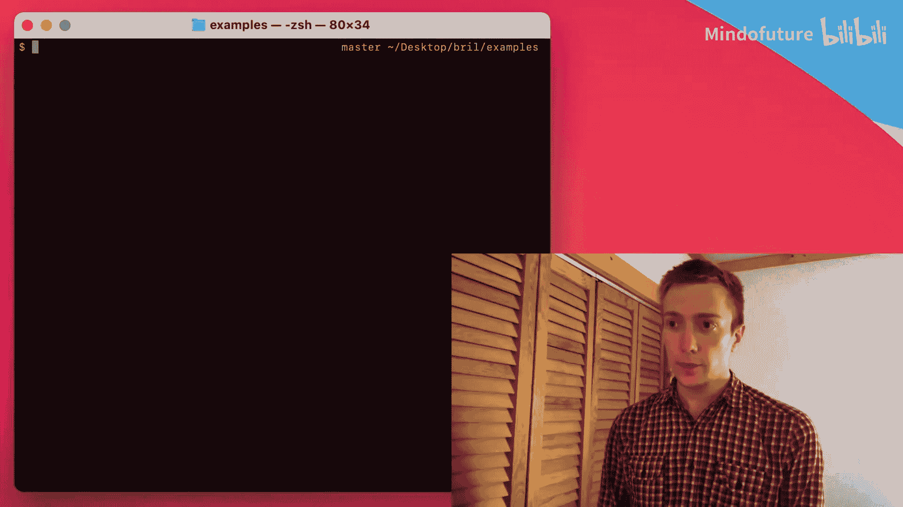

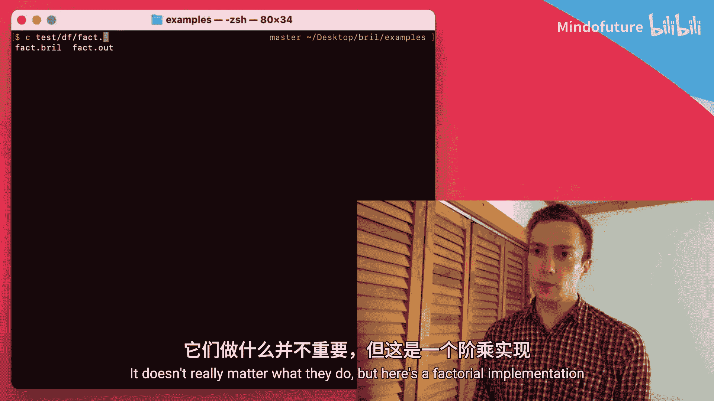

And then I will pipe that into my generic data flow solve program and then it has a few analyses built into it。

 one simple one is the defined variables analysis。 This is just a super simple analysis that it's even more basic than lie variables that are guaranteed to be used again in the future defined areas just like all the variables that have written to at some point in the past at this point。

 and this is the sets of live variables at the beginning and ending of every basic block as labeled in the control flow graph。

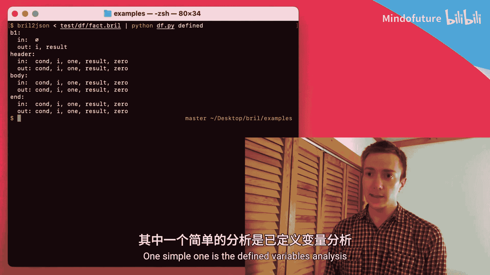

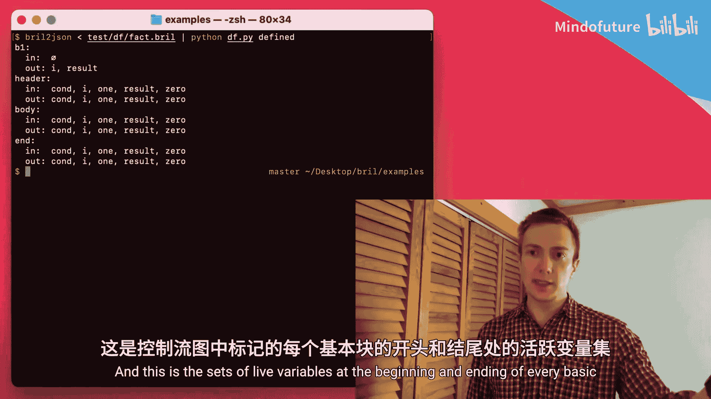

You are free to use this defined variables thing as as kind of a warm up。

 I think it's like maybe a little too ambitious for the actual thing that you turn in a little too unambitious。

 I hope I said that correctly。But you can do all sorts of other things like， for example。

 you can find the live variables I've implemented in mine。

 or I've also done a simple constant propagation analysis for using my data flow framework。

 And the way that you can interpret this output is that every variable is marked with a question mark if I don't know what the value is that is if it's not a constant if I can't prove it to be a constant to this point。

 and then maybe unsurprisingly， there's a variable called one that is guaranteed to hold one at every point in the program and the same thing with variable called zero。

 anyway， go crazy， come up with whatever data flow analysis you want just scale it the time you have available。

 implement some data flow analysis and then take it as far as you like。

 you can implement a fully general framework and 100 different data flow analysis if you really feel like it。

I want to show you just one small turrt trick that you can use when you are testing this。

 which is that， as you might imagine， it might make sense to sort of set up turrt tests so you can validate that。

 for example， this fact， this fact analysis does what I want。

If you use the Args functionality of Tt， you can see that I've set up。

You can see that I've set up the command for my turn setup to like pass an arbitrary arguments to my data flow analysis。

 So if you want to run multiple data flow analysis and you also want to do this thing where you like pass the name of the analysis on the command line you can do that too and you can specify in the file which data flow analysis you want to use but Trent also has an Args flag so like for both print mode and we can also say。

 for example， use the analysis live or defined， for example， on this。This program。

 and then I don't have to remember the whole pipeline every single time and makes it really easy to run multiple data fill analyses on the same program if you set up your analysis this way。

 Good luck and be sure to ask questions in the zoo up thread associated with this lesson。

