# 【康奈尔大学-•-中英】高级编译器项目教程-CS-6120（Advanced-Compilers，2020）-p09-P09-Lesson-5--Static-Single-Assignment--BV1gE9ZYsEUm_p9-

Hey， this video is about SSA or static single assignment form SSA is kind of a philosophy in addition to a shift in representation of programs that makes a lot of analyses a lot easier。

In particular， you may have notice， undoubtedly even notice when implementing some optimizations for Braille already that a lot of the problems that we have to deal with when implementing when analyzing programs have to do with variable name conflicts。

 that is everything would be a lot easier。 if we didn't have to worry about this the fact that we are constantly reassigning to variables。

 which is a fact of life in real imperative programs。 But it's just plain annoying。 Like。

 for example， here's a simple Braille program that's perfectly valid， but。

It's kind of annoying because it reassigns to both A and B。

 and so it is you when you want to optimize this program or you want to like eliminate dead code or do constant propagation。

 for example， you have to deal with the concept propagation itself or the deadcodeional elimination itself。

 but also the fact that there are reuse of the same variable name。

It would be way more convenient if we could somehow magically only deal with programs where variable names are always unique。

 That is every time you assign to a variable。 that is the one and only static location in the program that variable is ever assigned to。

 Like， for example， if we could just convert programs into this form。

 where we have an A1 and an A2 and those are totally different from each other。 Finally。

 when we do a print， it is now not ambiguous。 It's entirely obvious just by looking at the static text of the program。

 where that assignment to B 2 comes from。😊。

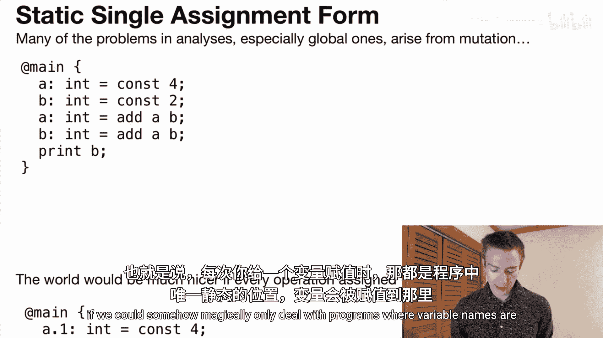

Because there was one and only location， this would be really nice if we only ever had to deal with programs。

That assigned to every variable exactly once， we could rule out a whole class of worries that have plagued us when doing optimizations so far。

 Of course， it's not quite that simple。 When people write programs in imperative languages。

 they do reassign to variables。Mutation is sort of a fact of life。

 so it is not as simple as just wishing that programs didn't reassigned to variables。

 we need to do something a little bit more complicated than that。

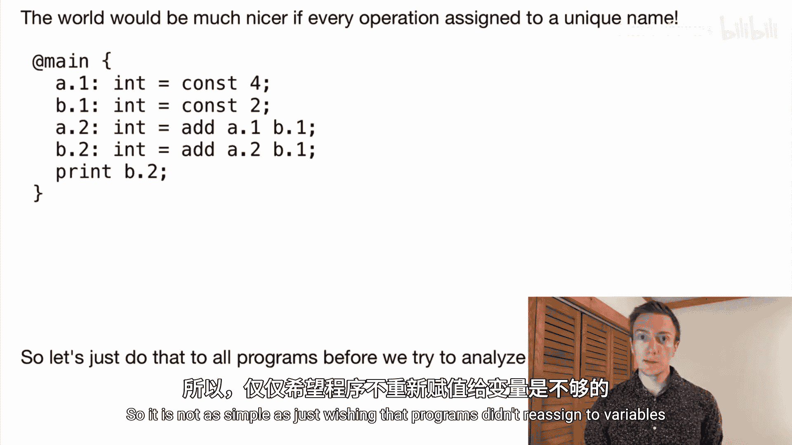

The idea behind SSA form is to do a conversion from the ordinary variable mutating form of programs。

 For example， in Braille where variables can be reused as many times as you like into a form with a static single assignment that is every variable has statically that is in the program text。

 exactly one assignment into it。 This is slightly trickier than it sounds。 but it's not that hard。

 And then once we're in that form， we can do optimizations taking advantage of the nice properties that we get from being an SSA form。

 Then finally， at the very end of the pipeline， you'll want to translate back out of SSA so you can execute programs on a real machine and do so efficiently by reusing storage that is real machines would be terribly inefficient if every single location and memory could only ever be used by one instruction。

 one static instruction。 So we need to do something to convert back into it an ordinary form in order to do this。

😊。

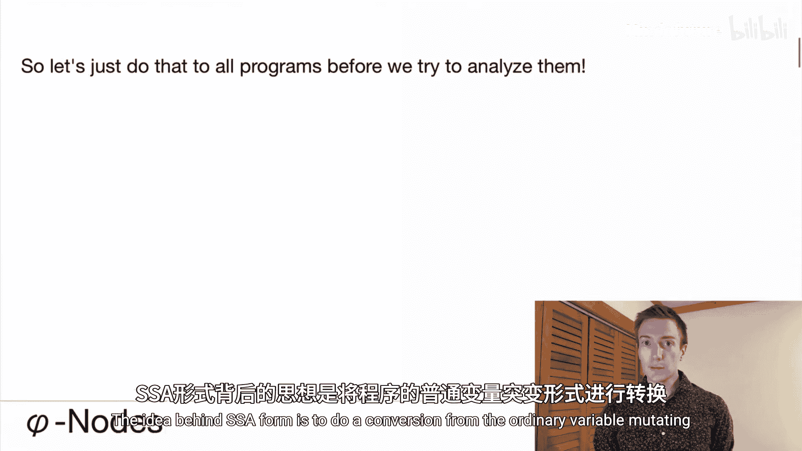

The only tricky part about SSA form has to do with situations where control flow makes it harder than the simple straight line example we've seen so far to get rid of mutation。

 This program that I'm showing on the screen in the form of a CFG makes it slightly trickier to convert into SSA form than the straight line program we saw so far。

 In particular， we can start by doing the implicit transformation we did before by renaming all the variables。

 So， for example， I'll cross out a here and write a dot1 to indicate thats the that's this version of a。

 This program essentially does an if。 So we will need to relabel both blocks。

 both sides of the if to use that new name。 So in both cases。

 both these blocks of referring to the first version of a。 So I'll label them as a dot 1。 However。

 it's two different static assignments to the a variables。

 So we're going to have to invent a new name for both of them。 This left one。

 I'll call a dot 2 and this right one， I'll call a dot 3。😊。

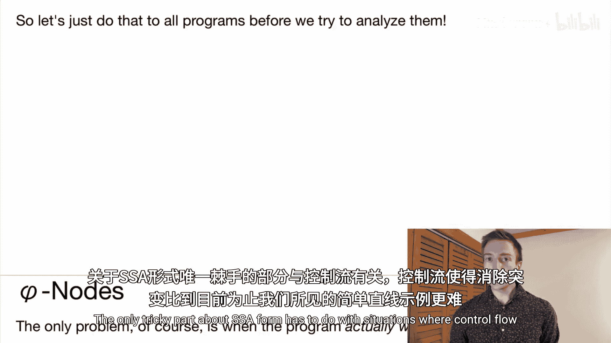

Finally， we need to print out a。 And the difficult part about this program is that we don't know which a to print。

 That is the。The A that we want to print depends on the path we took through the control flow graph。

 It won't work， for example， to cross this out and say A dot2 because that won't be defined along the left side of the control flow graph。

Similarly， it won't work for a dot 3。 We have to do something else。

 And the something else is a fine node In SSA， there is a special kind of instruction just to deal with cases like this。

 That is when the value you want to use depends on the control flow that happened。

Fine notess work like ordinary instructions， except they have this magical ability to tell something about the history of where control flow went in the past。

So to make this work in an SSA form， we will insert。

A new instruction labeled as I finite node that selects between the versions A do2 and A do3 and stores this into a new variable name。

 let's call it A do 4。 Some it selects between those two。

 and then finally we can change this print statement to use A do 4。

The P node needs to select between these two options。

 depending on the control flow edge that is incoming to the current block。 So either it's that one。

Or it's this one。 And depending on which one we'll choose either 8。2 or 8 do3。

A typical way to do this。 There's many different ways to conceptualize how to like label the different edges that you're incoming on。

 But a typical one is to use the labels of the incoming blocks。

 That is to say that if we came from left。Then use A dot 2 and if we came from right the basic block whose topmost label is right。

 then use AD dot 3 and depending on that choice assigned to AD dot4。

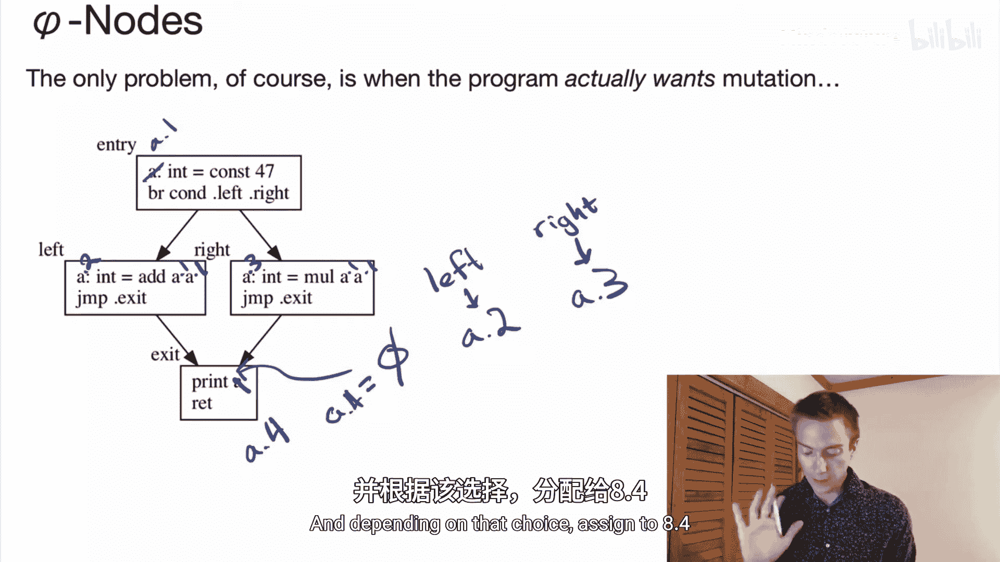

Briille does have an SSA extension that includes a Phi instruction。

 It looks pretty much like the cartoon I just do on the screen。

 except it's spelled with PI instead of a Greek letter。Here's that instruction。

 You can find out more about how exactly this instruction works in the Braille documentation。

 There is an extension called SSA that has exactly one new instruction， and that's the P instruction。

The instruction needs to take n arguments， n variable arguments， and n labels。

For any N from one off to as many as you like。 And the labels are associated with the corresponding variables and the semantics of the Phi instruction。

 is that if the most recently executed block was labeled with that label， think about it differently。

 the second most recent label to be passed by interpretation。

 If that one is the most recent or the second most recent label。

 then use the corresponding variable and move it into the result。

But you can think about this as just selecting between variables。

 depending on the incoming control flow graph edge。One tiny note about Briille。

 This looks like a sort of funny order for how this instruction is written out。

 But the order of variables and and labels in the instruction is。Is actually not important。

 So this thing that says Phi 8 do 2，8。3 left right is exactly the same in the J representation as Phi dot left。

82。Dot right， that indicates a label， a do3。So I find that a slightly more logical way to write it out。

 but it is totally up to you and they are identical in the J representation because labels and variable arguments are kept entirely separate。

Let's do this again in a slightly more complicated control graph。 and I do mean slightly。

 but this is a program that is like the previous example that has an if in it。

 This one has a loop in it。 I would like you to proceed， as we did before。

 by relabelling renaming all the variables so that the assignments are unique so we go into SSA form and see where you get stuck that is like see where a P node is required in order to complete the renaming of the variables。

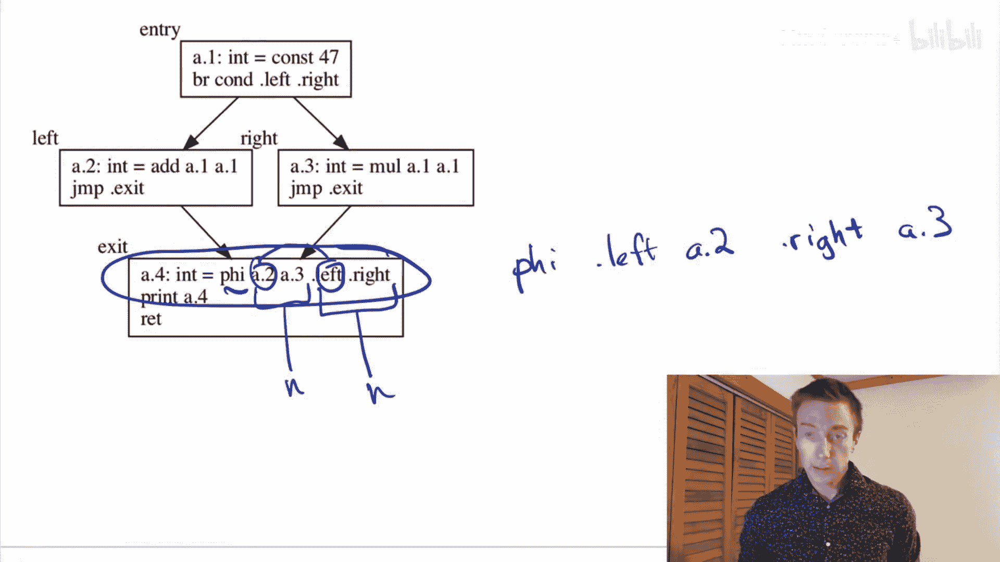

All right， now I'm going to give it a try。The variable that gets reassigned multiple times in this example is I。

 There is an assignment here， an assignment here。 So I'm going to try disambiguating those names。

 I'm going to cross out I here and say， well， that's I dot 1 now。

 And all the uses of that assignment are going to have to refer to I dot 1。

The body of the loop will refer again to like， I dot 1 twice。But this is a new assignment。

 so this will be IOt 2。Here is where we run into a problem。Because。This statement here。

That looks at I。 That is the loop iteration variable。 In this example。

 It needs to get its value either from the initialization at the beginning of the loop or from the body。

 That is the previous execution of the loop when we incremented I。So in this case。

 not it's actually not correct。 And I was wrong to write I dot 1 here。

 because it's not necessarily every single time that we're going to get the value of this from I dot 1。

 Instead， what we need is another fine node in here that somehow creates let's call it I dot 3 and somehow gets the value from I dot 1 and I dot 2。

And then we can refer to I dot 3 here。

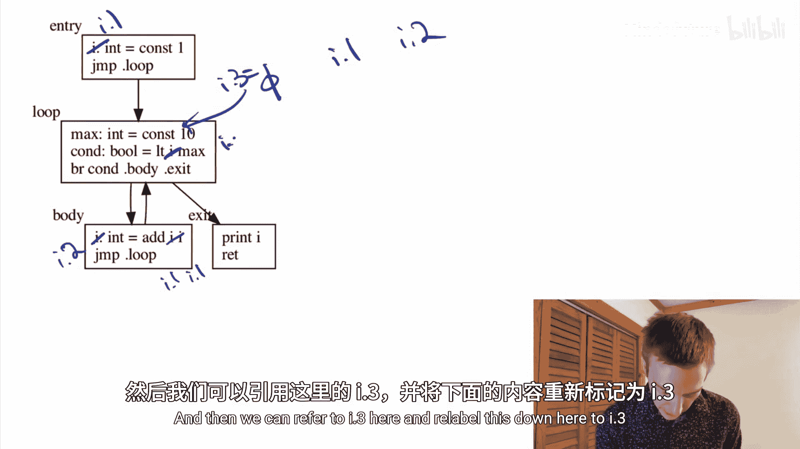

And relabel this down here to I dot 3。The example I have on this slide works pretty much the same way。

 I happen to choose different numbers for the variables， but this is equivalent。

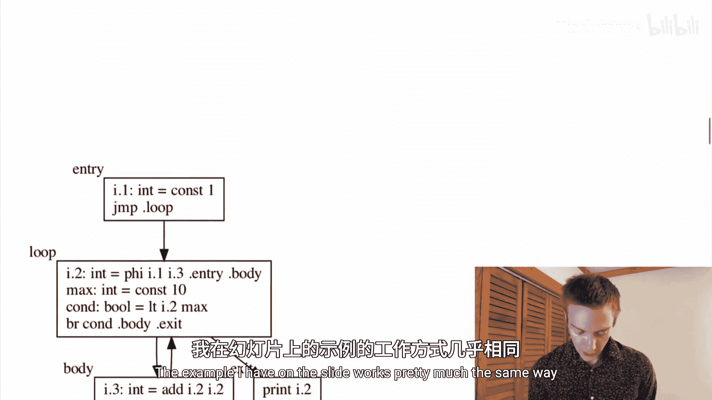

So I hope this helps you recognize where fine nodes are important。

 We need to insert P instructions when converting to SSA when different control flow graphs use the same variable that is assigned to the same variable along different paths。

 And it's not just like that inconvenient programmers decided to reuse variable names。

 It is sometimes essential to the semantics of the program。

 like this is the correct way to write a for loop is to update a value as you go around the loop。

 That's how you know when you finish。 So it's not like we're dealing with the bad habits of programmers or something that we need to rename variables。

 F nodes are actually essential to representing the semantics of imperative programs when we want to do it in SSA form。

In a moment， we're going to see a more complete presentation of the algorithm for converting from unrestricted programs into SSA form。

 But I want to emphasize on a little detour here that SSA is not just a restriction of the form of programs。

 It's also kind of a shift in philosophy that can change the way you think about analyzing and optimizing programs。

 The thing about SSA is that once you get rid of the possibility to reassign variables。

 A few different concepts that felt like distinct things in the representations of programs。

 have now suddenly collapsed and are now a single thing。 And this is sort of hard to convey。

 But there's a few equivalences that arise from SSA。

 The first and most straightforward is that definitions and variables are the same thing。

 I think you can see this that now， if you have a variable that says like X equals add Y Z。

 for example。😊，We used to have to keep track of the definition this instruction as being separate from the variable it assigns to。

 But now every variable is assigned to exactly once in the entire global domain of the function。

 So now we can think of these as one in the same。 That is， if you're doing reaching definitions。

 for example， you no longer have to keep track of which variable。

 like which assignment to which variable is the definition。

 you can think of variables and assignments as just one unified entity。

A consequence is that you can think of instructions as static values。

 So if you think back to implementing local value numbering。

 we used to kind of have to think of values as being abstracted as something that instructions compute。

 But now， values can be thought of as instructions themselves。

 That is this whole thing we can think of as that's the canonical source for the idea of adding together two other values Y and Z。

The final and most powerful， in my opinion， identity in SSA。

 is that you can think of arguments to instructions as being data flow graphs in a data flow graph。

 you can think of the values as nodes， for example， we got like X and Y， for example。

 and then we got a operator on those things and the edges indicate like data from this thing flowing into this computation here。

 And then finally， we get a result out。 So this kind of data flow graph immediately tells you where the values for operations came from。

 And in SSA form， you can think of the edges in data flow graphs as being the arguments to instructions。

 So if instructions are actually values。 And we have x equals add y Z。

 and I'll do like a equals mole X Y， for example， then when we represent this， we can think of。😊。

This reference to the variable X as being an edge in the data fo graph that points to the value that is the instruction add Y Z。

 That is in SSA form。 variable names become irrelevant。

 because variables are exactly the same things in instructions。

 So when we refer to into variables as arguments， what we're actually doing is just having a pointer to the instruction where that value comes from。

 In fact， in LvM for example。 instructions literally are represented in memory。

 using pointers from instructions to other instructions。

 So when an LvM program is represented in memory， not in textual form。

 because it's hard to write down pointers in text form。 then there is not， I mean。

 there are sort of optional annotations for when you want to have a variable name。

 But in in memory form， those are just like four human readability。

 What's actually going on is that the instruction for this multiply。

 contains a direct pointer to this instruction for the addd。

 And that pointer tells you where the argument comes from。

Informs the data flow graph from one instruction to another。

So I hope you can see how this shift in representation that is getting rid of the possibility of reassigning variables。

Has also LED to a shift in the way of thinking about the representation of programs。 That is。

 now you can sort of see the text of a program in this form as not just being text。

 but also a graph where the nodes are instructions and the edges are uses in the form of arguments。

I would love for you to take a moment and just ponder this for a second and think about what it means for your life。

Our next step is driving the algorithms for converting arbitrary programs into SSA form。

 The question I have for you is where the fine nodes should go。 That is。

 knowing what you know about fine nodes and the role that they play in the semantics that they have。

 for example， in Briille。Where should you insert fine nodes， Where are they necessary to put in。

 Can you come up with a general rule for where fine nodes are supposed to go。

 No need to come up with this all the way down to developing an algorithm。

 But just try to come up with a short summary of your understanding of the idea of where fine nodes should be inserted when we're converting to SSA。

 Go for it。Clearly， the main thing that causes you to need to insert a fine node is when you have two different assignments to the same variable。

One way or the other。 But the question still remains， not just do we need a fine node。

 but where should it go。The rough idea is that the fine node needs to be inserted somewhere in the control flow graph。

 after these assignments。 So I'm going to use squiggly lines to indicate not edges in the control flow graph。

 but like entire paths。 That is， if there's some path from this assignment to X and this assignment to X。

 then we， at this point where the control converges。 that's where we need a fine node。 So here。

We will need to insert a P node and then rename this variable to let's call it x1 and this variable to X2。

 and this P node will select between them based on the path that was taken from those two assignments。

To put it differently， you don't need a fine node anywhere in the control flow graph that is dominated by a particular definition。

 So if this is the entry block。And it has paths to both of these assignments。

 Then in all of the places where in the control flow graph is。

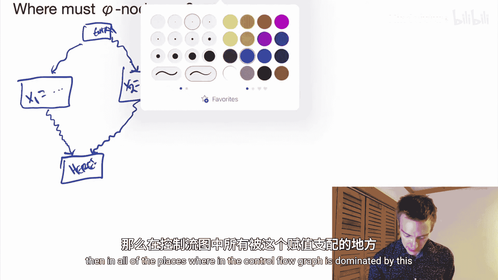

Dominated by this assignment， there's no ambiguity to which X you're referring to and same with everything dominated by this assignment。

 It's only when we leave the sphere of dominance of these two assignments that we need a fine note That is when there's some ambiguity when there is some way to go from the entry block and use X。

 for example， without going through that assignment。

You may recall from the previous video a concept that we used that told us。

 where was the place in the control flow graph that is just beyond the reach of dominance of a given instruction。

 a given basic block。 And that is the dominance frontier。

 The key to converting to SSA is dominance frontiers。

 You'll want to compute the dominance frontier of a CFG。 And essentially。

 the rough idea is that we're going to need to put fine nodes in the dominance frontier of definitions。

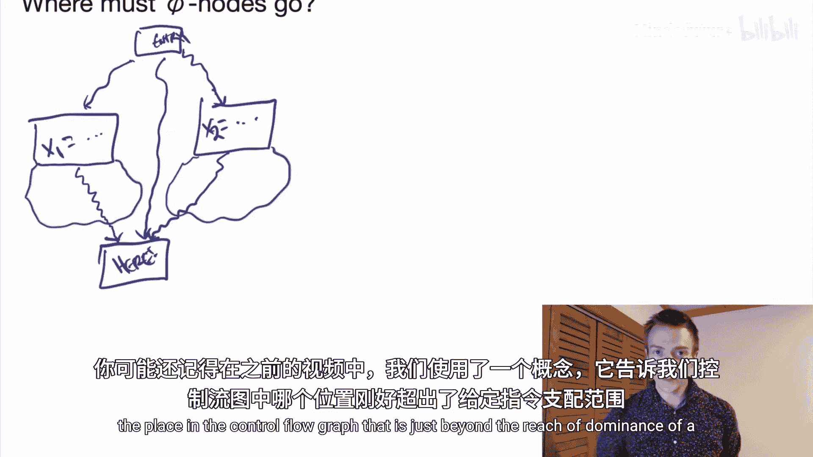

Here's a cartoon to kind of remind you what a dominance frontier looks like。

 All of the nodes that are dominated by a given block， call it a。

 Those things are not in the dominance frontier。 The dominance frontier occurs just beyond that。

 That is the blocks that are reachable。 that is like reachable by a single jump away from the set of nodes dominated by a。

 but are not dominated by a。 that is have edges in from somewhere else in the CFG。

 They're reachable otherwise， not through a from the entry node。

The algorithm for converting to SSA uses the dominance frontier and proceeds in two main steps。

The first step is to insert fine nodes that is to use the dus frontier to figure out where fine nodes have to go in the first place。

 And then the second step after we've inserted all that stuff is to rename all the variables so that assignments are unique。

 So we get and doesn't set SSA form。This might sound a little bit weird。 Like。

 what are we going to do with fine nodes if we haven't yet renamed things and that it does， in fact。

 look a little bit weird。 That is like in the intermediate stage between these。

 we're gonna to have a bunch of instructions that look like you know， like x equals5。

 and then like X， X and X and X。 And like each of these comes with a different label。

 That is we're saying we're choosing between。 Well， you can either get the value from X。

 or you can get it from x， or you can get it from x。

 depending on where you came from in the control flow graph。 And that's super weird。

 And it's definitely not SSA， but it's the stepping stone along the way。

 That is we need to like find these locations。 And then later in a second pass， we'll go， okay， well。

 this is like x 12。 And this is like 7，3，5，9 or something。 And then after doing all of that。

 then we will finally have an SSA form that has fine nodes in the right place。😊，If you like。

 you can pause the video now to think a little bit about how you would derive the pseudocode for the algorithms for these two steps。

 That is where to insert fine nodes and then how to do the renaming。 This is fairly involved。

 So give it some time if you feel like it， but we'll step through the pseudocode together。

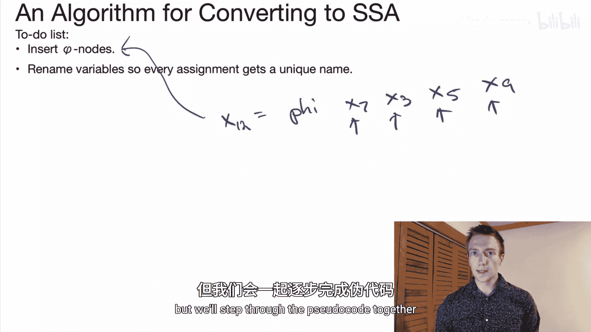

Here's the algorithm for how to go about that。 We will do something for every variable that is will do P insertion for every single variable in the program independently。

The idea is to loop over all the definitions。 That is we're going to insert things into the dominance frontier or the definition。

 So we need to have built up a list of all the blocks that define a given variable。

 This is not too hard to do。 It doesn't need data flow analysis。

 You just look at the instructions that write to a given variable name。

Then we will just go through the entire dominance frontier of that block。

 So we have pre computed the dominance frontier using the algorithm from the other video。

 Then we insert a fine node into that block， but not if we have done so already， that is。

 it's possible for blocks to be in different dominance frontiers for different definitions。

 in which case， we don't need to add two different fine nodes for the same variable。Then we will。

 and this is kind of the tricky part。 We need to add that block。 If we have modified it。

 That is if we have added a p node to it to our list of blocks that define the variable。

 So we have this map called V that like holds a set of all blocks that define the variable V。

 We need to add this new block that we just put a p node into into that list。

 because it now defines V。 That is the instruction looks something like V equals phi of v and V。

 for example， And that means that it's now writing to V。

 And we're going have to go back and look at its dominance frontier and possibly put in a P node there。

 But once we've done that with that one little trick。

 all we're doing is inserting P nodes into all the dominance frontiers of all the definitions。😊，Next。

 let's rename the variables。 and this one's a tiny bit more complicated。

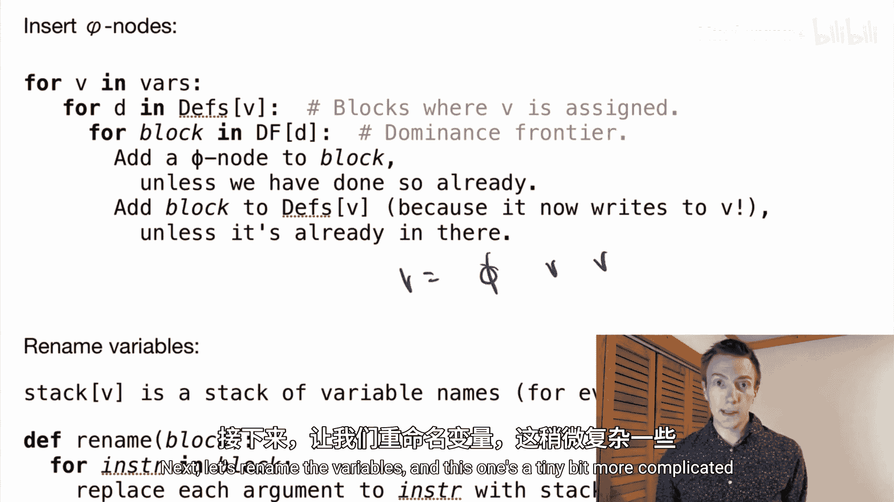

The main data structure that we will need is a stack to keep track of all the variable names that is。

 we will keep track of a stack of new names for every old variable name。

 So if your old variable is called x， then this will be a stack of things like x1 and X 5 and X12 and such。

 and well organize this as a stack that is pushing things onto it and popping things off for reasons you'll see in a moment。

 Another interesting thing about this algorithm is that， unlike。

 I think every other pseudocode algorithm I've shown so far。 This one's recursive。

 That is it really helps to be able to define a function that processes a given block。

 and then we will recursively call this function。 There， of course， also nice for loops。

 But this is a recursive function that will eventually will rename the entry block。😊。

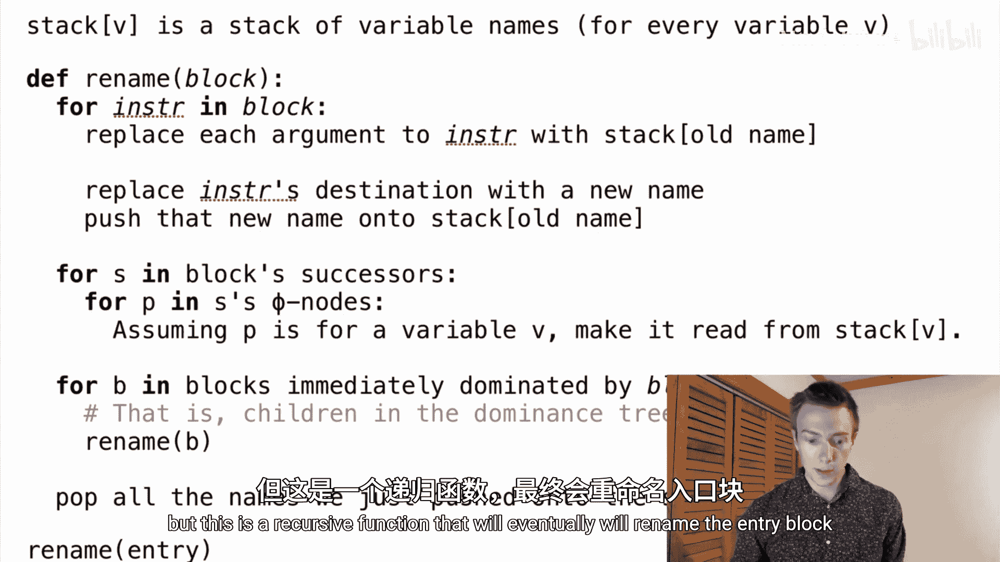

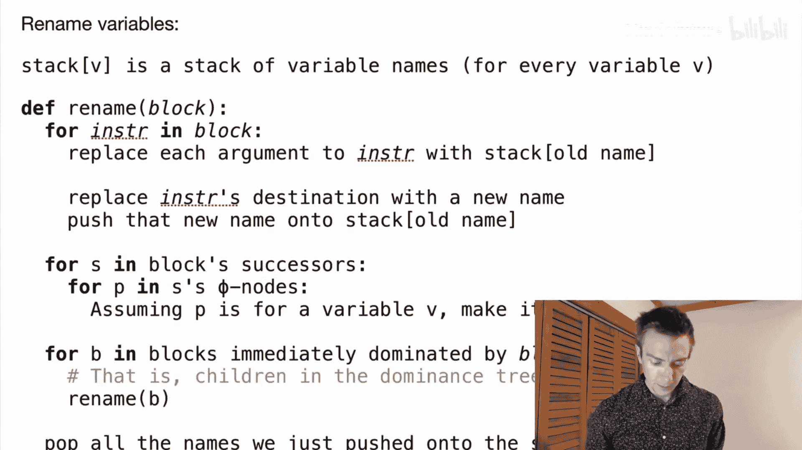

So for the implementation of this recursive rename function。

 the first step is to apply current renames and generate new names。

 So if you think about it this way， if we have a instruction that looks like add x equals add Y Z。

 for example， then we will， this should say the top of the stack。

So we will rename all the arguments to be like， well， this is Y 5。 And this is Z 12， for example。

 using the current names to the variables that will be located at the top of the stack。

 Then we will generate a brand new name for the destination。 So this is like X 17， for example。

 and we'll push that on the stack for the old name of X。 So now the stack X， for example。

Ma be very tall。But we'll have X 17 on top。 So we are using the new names for all the arguments and generating new names for all the destinations of all the assignments in this given block。

 And I hope you can see how this makes sure that globally。

 we will end up with with unique names because we're just。

 we're generating a new name every single time we assign to a variable And just making sure we push onto the stack。

 So we know what variable to use later。😊。

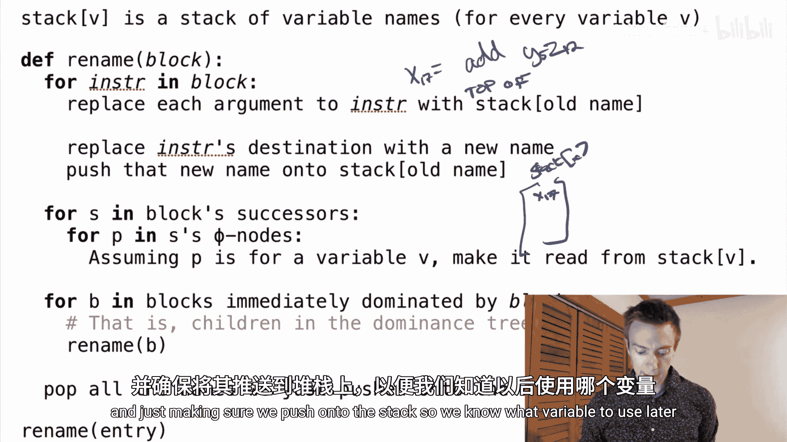

The next step is similar， but instead of processing instructions in the current block。

 this looks at all the current block successors。 and instead of processing normal instructions。

 this one processes all the fine nodes。This ensures that all the immediate successors of this block use the same names as we just generated in our block。

 So we process all the successors。 And for each one。

 we basically give it the same treatment that is read again from the top of the stack for those given variables。

 Remember， we've inserted P nodes that say phi of V V V V V。 Now。

 we will replace those with the actual concrete new names of the renamed variables。😊。

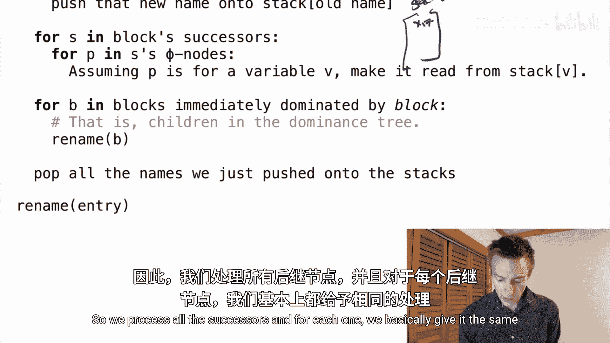

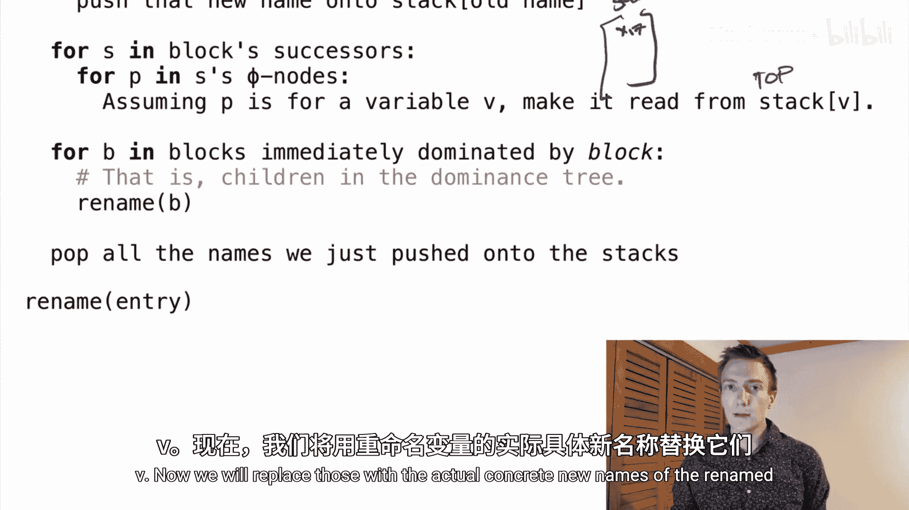

Then the final step is to make the recursive calls。 And for that， we need to use the dominance tree。

 You remember， the dominance tree is a data structure to sort of efficiently store all the domination relationships in a control flow graph。

 The dominance tree， if we look at our children， that gives us the the blocks that are immediately dominated by the current block that is dominated by us。

 but not by a third one in between， if that makes sense。

We need to recursively call the rename function for all of those things that we immediately dominatete。

 and we will sort of recursively traverse down the dumit tree in this order so we process and rename variables in the right way。

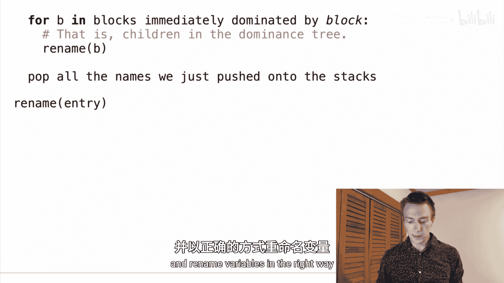

The final step is to pop off all the variable names we just generated in the first step that as we created a bunch of new names and we inserted them everywhere in all the blocks in our little subtree of the dominance tree。

 we need to now remove those names and return the stacks to their old way of being for the other recursive calls to the rename function。

 That is when we return from this function， we should be forgetting about those names and letting other blocks have a chance。

😊。

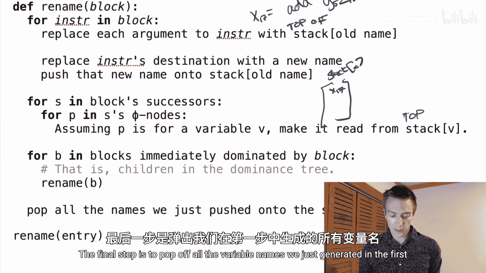

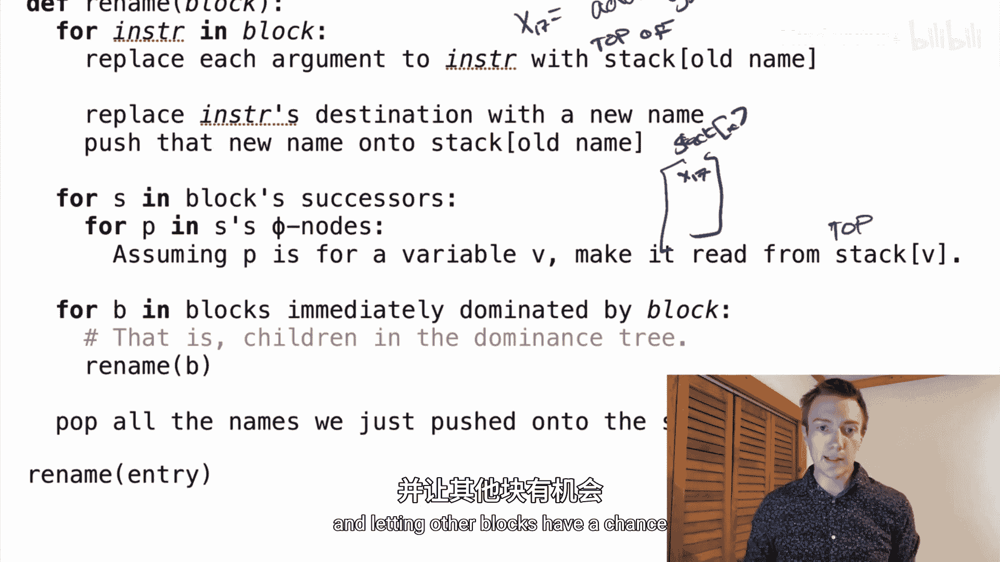

That's the entire algorithm。 It's worth spending some time with to sort of convince yourself that this is at least on the right track。

 I don't think there's going to be a flash of light where you suddenly see， oh， yes。

 This is how we get perfectly consistent naming for for SSA。

 which is why part of your task of this week are implementing this algorithm。 Once you do that。

 I think you will be slightly more convinced that this is the correct thing。

 And it will introduce you to the mystical philosophy that is SSA。😊。

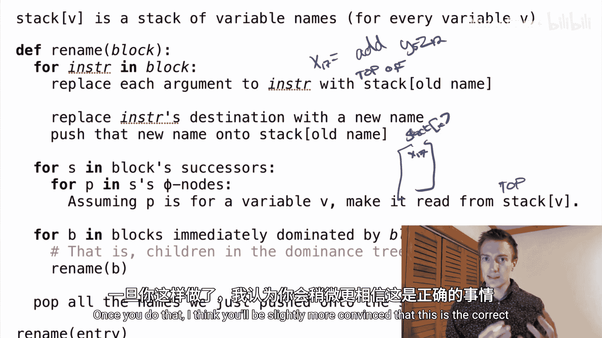

The last step that we need is a way to convert out of SSA form into an ordinary mutating form of the program。

 doing kind of the reverse of what we just saw。 Real machines don't have a fine instruction。

 That's just an invention of compilers。 And even if they did， the idea that every single instruction。

 every static assignment would use a different location and memory or a separate register would be terribly inefficient。

 So eventually， we need to convert back to a mutating form。

 bringing us back to the real world of programs that we actually want to execute。😊。

This is a little bit more simple than converting to SSA form。

But let's think about where you need to do some sort of conversion for every fine node。

 you need to get rid of this fine node by sort of collapsing things back to the same variable。

 So let's think about where fine nodes appear in programs。

 If we have a P instruction like this in a Braille program。

 it must be the case that there is a assignment to V1 and an assignment to V2 somewhere preceding this block in the program。

 And by proceeding， I mean， that these are in basic blocks。

That。Are along paths that eventually reach this point。

 Remember that squiggle means not just an edge in the CF FG， but an entire path。 In any case。

 there must be a V1 assignment of V2 assignment so that we can be reading them in this Phi instruction。

The rough idea behind eliminating fine nodes is to invent new blocks that go along these paths。

So invent a new block here that is the immediate predecessor。Along this path。

And here's a straight edge， to say。You jump directly to this block。

Then all you do is you erase this fine instruction， and you just say。That thee。

It gets assigned to V1。 I run out of space， but you can think this as an I D instruction in Brill。

And then V gets V2 along this path。 So you can see that just before we go into that block that used to have the fine node in it that would choose from whether we came in from this path or that path。

 we can actually just put in a block along those paths that does the same copy。

 So now we're going back to a controlling representation instead of an instructioning representation of exactly the same functionality。

 Here's that same CG drawn in a slightly more readable way。

 The point is that these I D instructions need to go in the control flow paths that they referred that the P node used to refer to。

 And by doing the copies there， we get the same effect as the Phi instructions。

 This simple algorithm for just like inserting copies works just fine。

 I think that's the one to implement for this week's tasks。 However。

 I do want to point out that there are fancier algorithms out there that you can find in the compiler's literature。

 for reducing the amount of needless copying that is done。

 That is this one is perfectly sufficient for correctness， but there might be more。

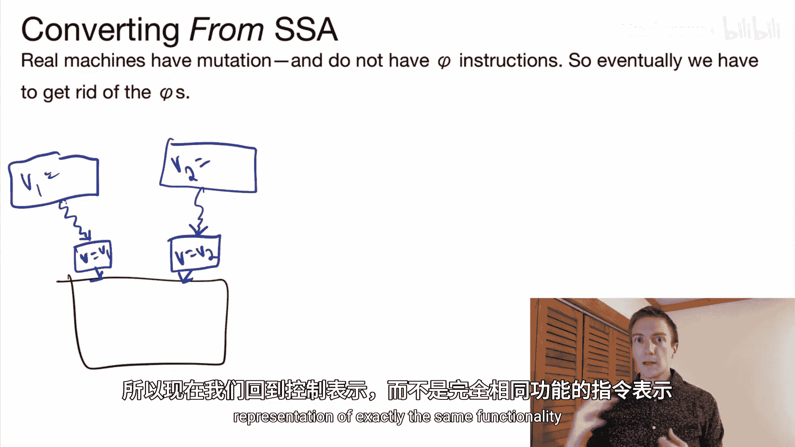

ies then you strictly need。 So if you're interested。

 you can read more in some of the links associated with this week's lesson to find out about fancier algorithms for converting out of SSA form。

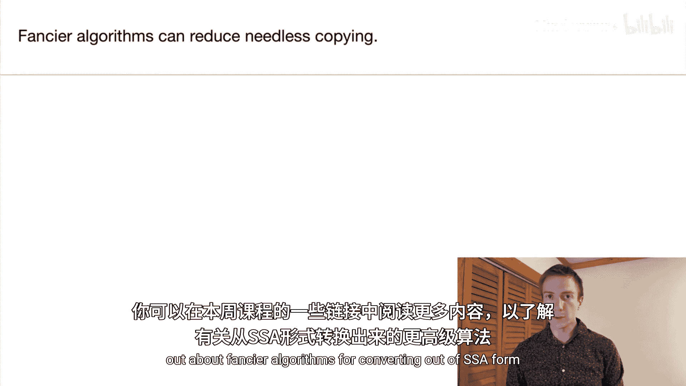

Good luck。