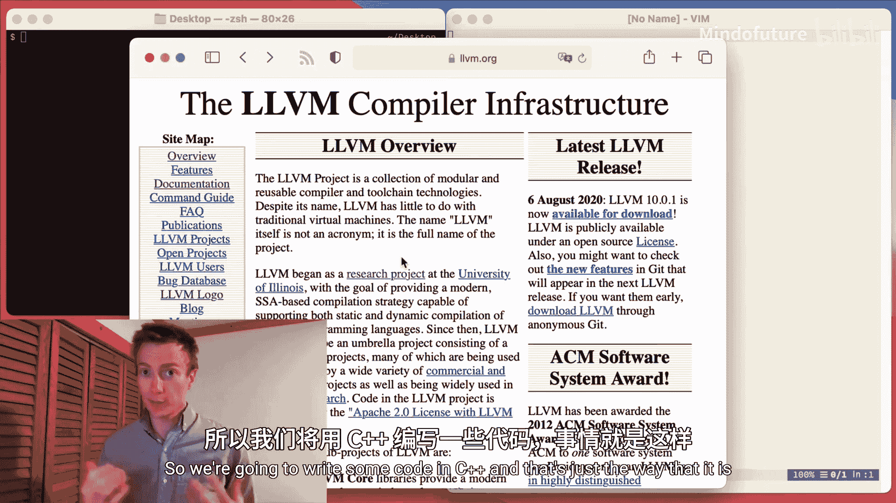
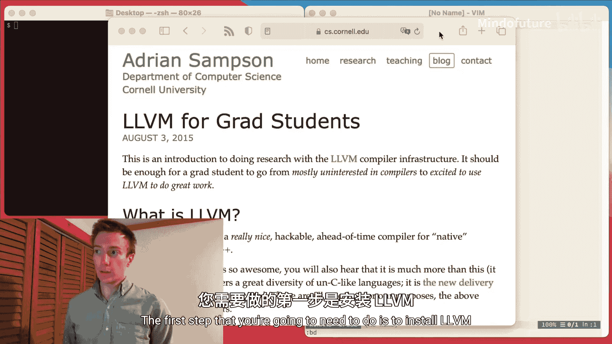
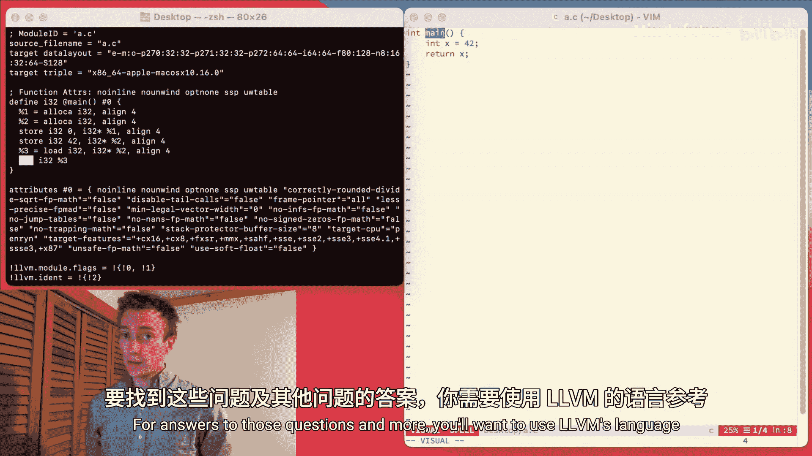
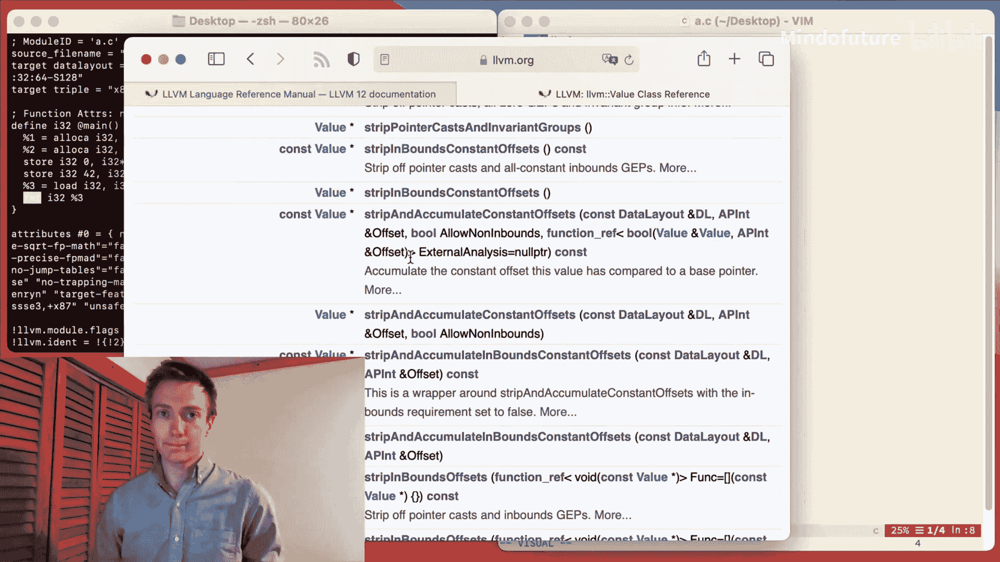
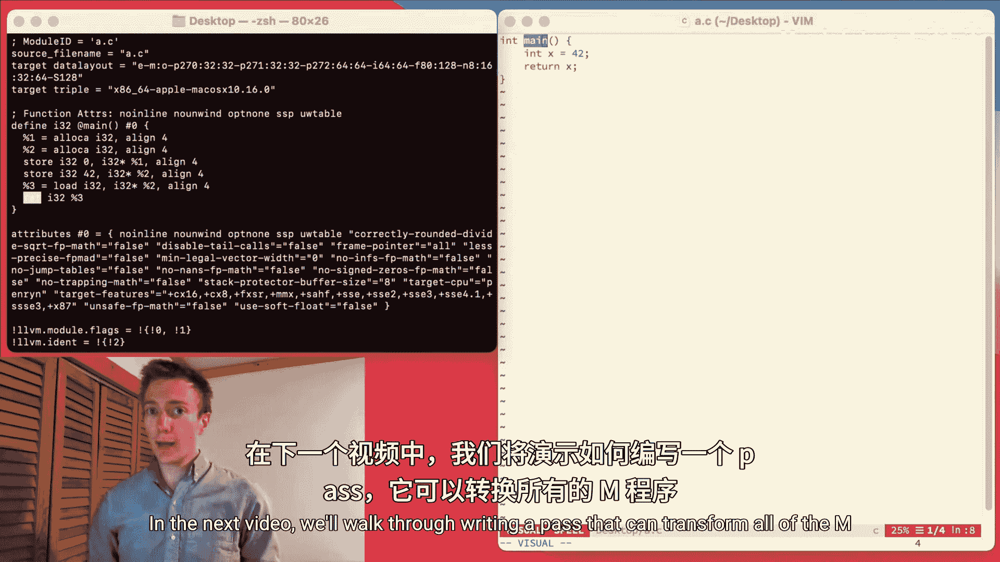

# 【康奈尔大学-•-中英】高级编译器项目教程-CS-6120（Advanced-Compilers，2020）-p10-P10-Lesson-6--Introduction-to-LLVM--BV1gE9ZYsEUm_p10-

🎼Hi there。 In this lesson， we're going to get an introduction to using L O VM to transform and optimize programs。

 L O VM is an extremely popular compile infrastructure for C and other languages like Ru。

 Before you ask， L VM no longer stands for anything。

 It has a really cool dragon logo that you can check out。😊。

It has that the reason we're going to use LVM is that it has a really nice SSA form I R and an amazing API for manipulating it that makes it possible to be very productive very quickly by designing your own modular pass that transforms programs。

 In one very abstract sense。 It is like a supercharged version of Briille。

 which you've been using thus far in this class。 That's not really coincidental because I modeled Brile after it。

 That is the language that is the Briille Ir is like a kind of idealized form of the L VM intermediatemedia representation。

😊，It is also in a different way， kind of the opposite of Briille。

 because LVM is real infrastructure that the world really runs on。

 That is there's a chance there's actually a very high chance that some software along the chain that you are using to watch this very video was compiled with LVM。

 It's like serious infrastructure that people really use。

 Briille is not Briille as an educational tool。 So it is like 10 million times more realistic than Briille。

 which is amazing because it will let us run compile and run like real software。

 and to transform programs that to run on like real architectures and to use an existing library of lots of amazing optimizations。

 However， on the other hand。😊，There is a trade off here because LVM is so realistic。

 It also is less friendly to use than Brill。 A lot of the ways in which Brill is kind of idealized are ruthlessly realistic in LVM。

 So we'll have to deal with a lot of those kind of real these aspects of realism that we didn't have to deal with in Brill by sort of ignoring stuff like opening files。

 for example， which we were conveniently able to do when using Briilll。😊。

I also should mention that LVM is written in C+ plus。

 so we're going to write some code in C plus plus， and that's just the way that it is。

 And this is a big contrast with braille when you could use whatever language you like。

In this lesson， we are going to use a tutorial that I wrote on my blog a very long time ago that is still relevant。

 It's called L V M for grad students， and you will find a link to it in the notes associated with this lesson。

 This will walk you through the concepts behind L VM and get you started by writing a pass that can manipulate code using the LVM infrastructure。

 I'm not going to say every single word that's in the blog post。

 So encourage you to read the blog post alongside the video。😊。

The first step that you're going to need to do is to install LVM。

I'm not going to cover this in detail either， except to say that it is probably in whatever package manager you use。

 For example， I'm on Mac Os。 I'll use the Homebrew package manager。

 and I can just do B installst L V M。 This is a note for Mac users。

 You will need for this tutorial to install L V M separately ideally from homebrew Instead of using the one that comes with Xcode。

 This makes it possible to write passes。 you。Will also need CMake。

 So this is the full command that you need on Homeb on on the Mac。

 but you can find some additional notes in the tutorial that might point you in the direction of how to install LVM on your system。

Please pause the video now and ensure that you can install LVM to the point where you can write a clang version and you get something like this。

 ideally clang version 10 point something or other。Do that now。Great， now you have LVM installed。

 now you can check out what its intermediate representation looks like。

 what the supercharged version of Briille looks like as a programming language。

We're going to do this by writing a C program。 So I'll just do this one very small C program。

 It's the smallest one I can。Reasonably right without being embarrassed。

 we'll just do like int X is 42， and then I'll return 42 from this function。 Don't go crazy at first。

We're going to compile this program with clang。 Kang is the C language frontend for LVM。

 It parses and compiles C programs to LVM's internal representation and then uses LVM to compile the rest of the way to machine code。

 However， we just want to print the internal representation instead of compiling all the way to machine code so we can see what it looks like to do that。

 you need a few magic flags。 you'll do emit LVm with a single dash and dash S。

 which sell it to do assembly instead of emitting binary。

 And then we can say dash O dash to have it just print to standard output instead of writing to a file。

 Of course， you can have this right to a file if you prefer。

 and then I'll just give it the name of the C program I'm compiling。 So those fast。

 it has compiled it to its intermediate representation。 There's a whole bunch of stuff here。

 that is somewhat hard to interpret。 But the main thing that's going on is this definition of a function。

 And you can see maybe here what I mean by this sort of resembling Briille that as we have a definition of a function here。

 the name is main， which comes right from our source program。😊，There's a list of instructions。

 Some of the instructions are even named exactly what they're named in Brill。 For example。

 there is a ret instruction that returns a value from a function the type system is quite a bit more complicated in LVM。

 The first thing that you'll notice is the integer types have arbitrary width。

 So I 32 is the type of a 32 B integer， which LVM has used to implement this C program for me。

You'll notice that the body of the function is made up of these like allocate instructions that create space on the stack and then some stores and then loads and then finally a return。

And you'll see that there are variables being used just like in Braille to store the intermediates。

 So， for example，1，2 and 3 are all variables that are sort of stack local。

 That is they local to the function。 You can think of them as roughly like the the variables that we used in。

In Briille programs that we assigned to and read from in Grille programs。 However， LVM is an SSA I。

 So unlike Briille， which can either be an SSA form or not， every LVM program is in SSA。

 So when we when refer to like percent 3， for example， that's just a nice。

 convenient name that it makes it possible to read this program in text format。

 what's going on actually in L VM internally， is that this REt instruction has a pointer to this load instruction and says that it gets its value from there。

 So LVM is really at the most basic levels kind of baked in this LVM philosophy。

To begin your journey as an L VM hacker， a important thing to do is to get familiar with the documentation。

 you'll often be going to the documentation for to understand basically anything that's going on in LVM。

 One big thing that you'll want to look up all the time is what instructions do。 That is。

 what is this allocate instruction。 what is store， What is load。 What is R。

 For answers to those questions and more。 you'll want to use L VM's language reference。

 You can Google just like LVM L ref。 and you'll get this page。

 This is a very long document that includes a whole bunch about the structure and the type system of L VM。

 but also descriptions of individual instructions。 For example， we can look up that load instruction。

And we will get more detail than we could possibly have wanted about everything that can go into load instructions and exactly their semantics in the context of LVM programs。

 You'll want to acquaint yourself with the LVM language reference as you go through this lesson。

Another big thing that you'll want to use。 and you'll see this。

 me reference this a lot in the next video is the internal oxygengen based documentation that's generated for the LVM API。

 For this， I'm constantly turning to Google to just search LVM in the name of the like C plus plus class or method that I'm looking for。

 For example， I can look for LVM value， and I've at least trained my Google bubble to take me to the LVM Doxgen stuff。

😊，There's a whole bunch of information here， including the class hierarchy and everything that this class contains。

 I can't stress this enough when you're using LVM， you constantly have to be looking at the documentation。

 I don't really know a better way to navigate LVM and to become an LVM expert then constantly reading the documentation。

 you'll have a browser in one hand and you'll have a text editor in the other。

 And this is the way that you will make your way through the LVM ecosystem。

Please take a look around the documentation， try compiling some C programs and see if the IR looks interesting to you and ask questions on Zullip in the next video。

 we'll walk through writing a pass that can transform L EMM programs。

