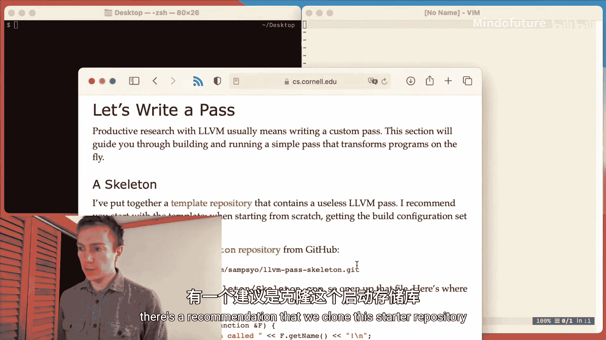
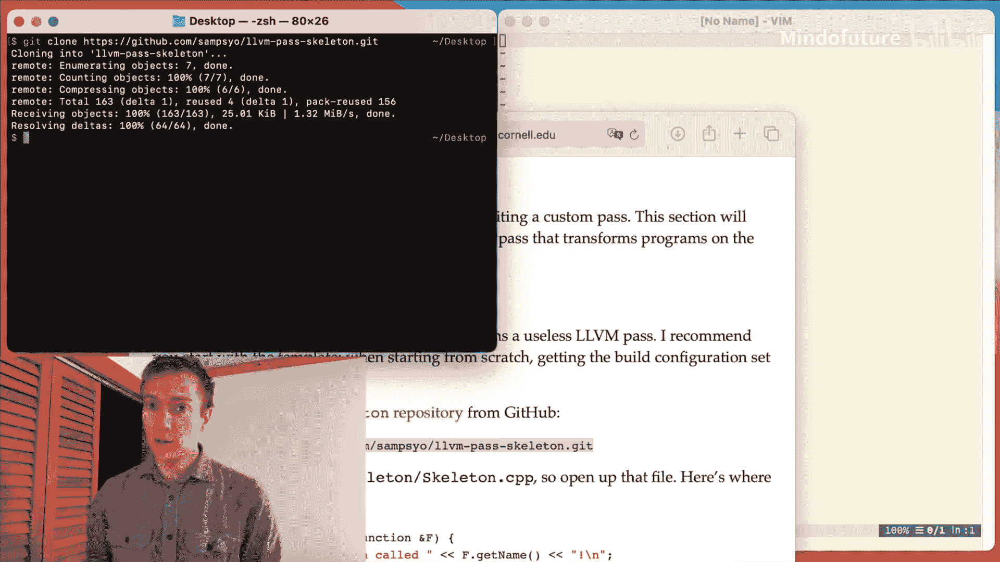
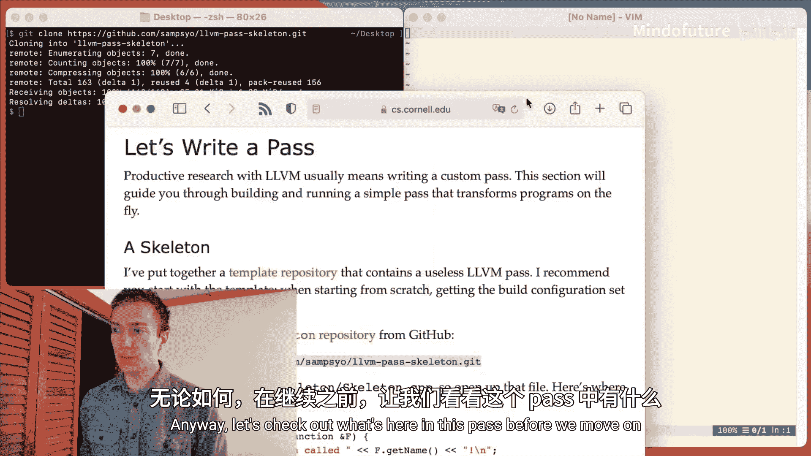
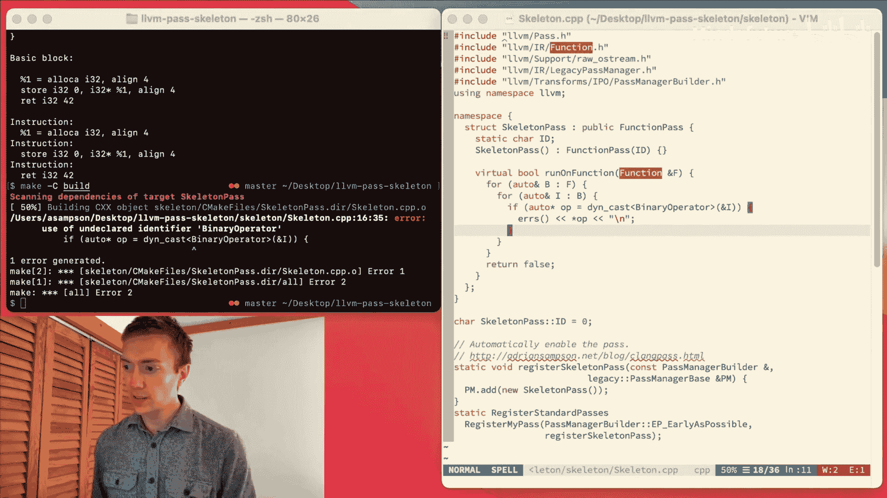
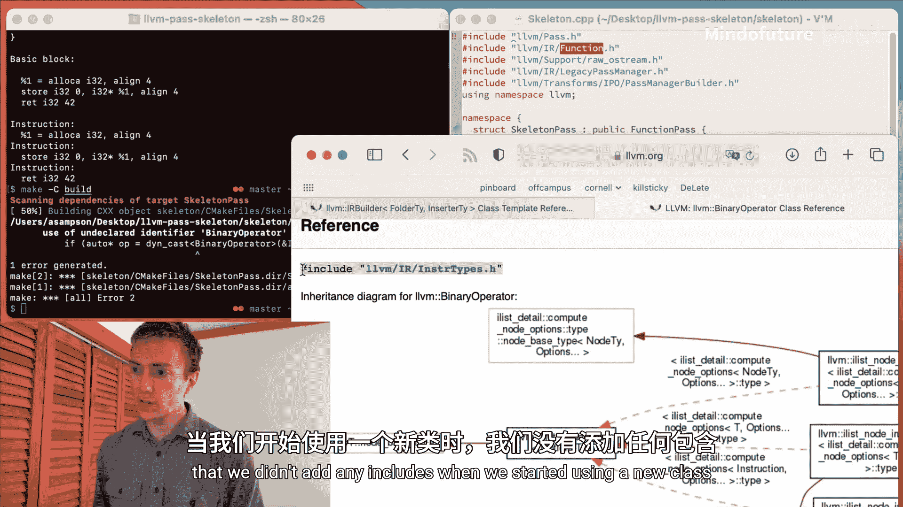
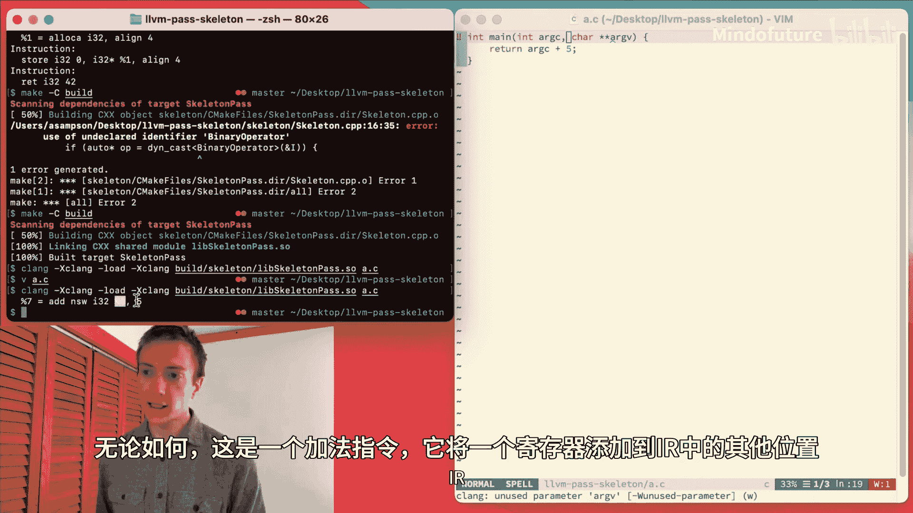
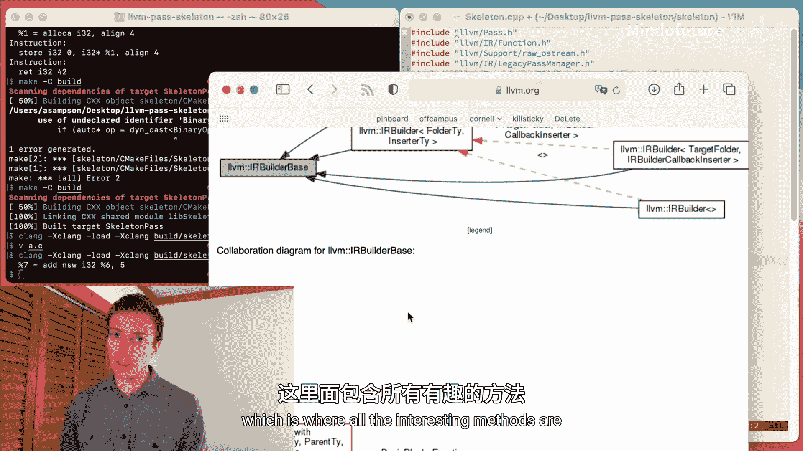
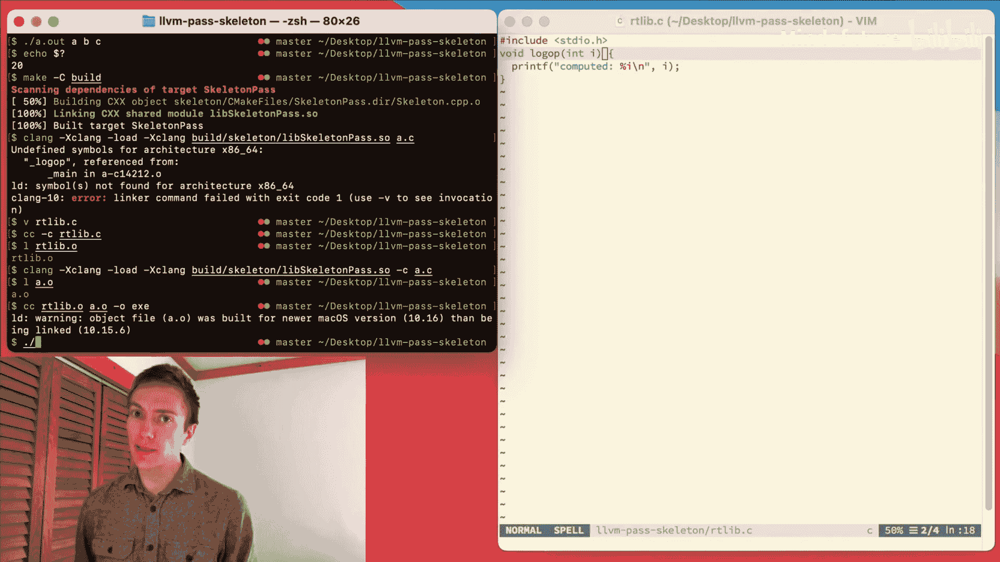
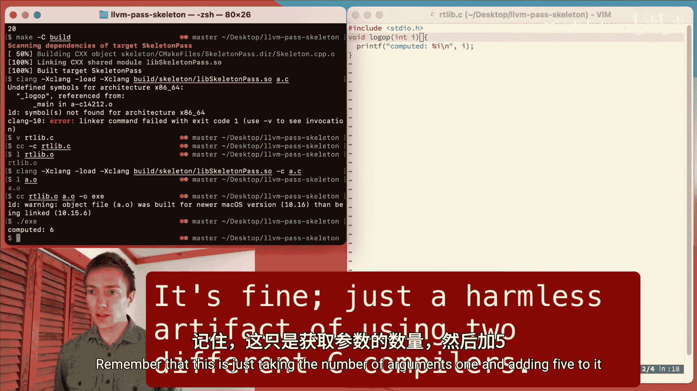
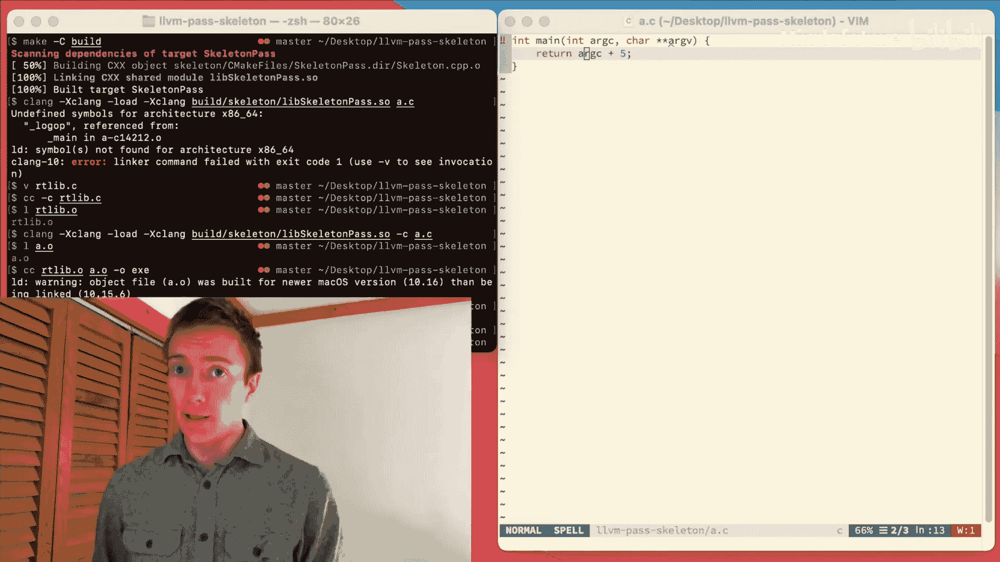

# 【康奈尔大学-•-中英】高级编译器项目教程-CS-6120（Advanced-Compilers，2020）-p11-P11-Lesson-6--Writing-an-LLVM-Pass--BV1gE9ZYsEUm_p11-

Now that you've gotten to explore LVM a bit， the next step is to walk through creating a really boring pass is going to be your job。

 your task for this lesson to make the pass do something interesting。

If we return to the tutorial that we're following， there's a recommendation that we clone this starter repository。

 and I really recommend that you do this that is follow the starter repository instead of starting from scratch。

 just because the build system is kind of annoying to set up。

 You have to set up all these C make variables to make stuff work。 Anyway。

 let's check out what's here in this past before we move on。😊。

There's a skeleton directlyy that contains the code。

 all the actual code is in this thing called skeleton dot C PP。 And if we open this up。

 you can see that it's a pretty short file。 The pass is just a subclass of function pass。

 which you can find in the LVM documentation。 And the main thing that it has is this run on function method。

This takes a function object， an lvi function object that represents that thing like main。

 like we saw in the previous video。 And we will do something with it。 At the moment。

 we're going to do the dumbest possible thing， which is just to print out the name and move on。

 This thing that returns false indicates whether we change the function。 In this case。

 we are just reading the function。 So we return false。 Eventually。

 we're going to be modifying the function on the fly during the pass。

 and we will need to return to from this method。 Any case， let's compile and run this method。😊，Oh。

 one more thing there's also this errors thing， which you can think of is like roughly similar to like C out or C error from like the C++ standard library。

 Anyway， errorss is a special C++ output stream that you can use to print out debugging information It's in the LVM domain space I have done using namespace that's the same as just doing explicitly using errors from the LM domain space with the double colon thing。

Alright， so let's build this。 So inside here， the way to build this is with this as a standard with using CMake。

 you got to make yourself a build directory。 and then you go in there。

 And then you have to do a C make and then tell where the stuff is that we want to build。

 on a lot of systems， including like the Macs with where LVM is installed from Homebrew。

 you need to tell C make where your LVM installationsulation is。

 And you can do that with the LVM D environment variable。 So for me and for Homebrew in general。

 LVM is located here。😊，There is a inside the LVM installation。

 you need to have this like CMake directory， LVM， in case。

 you need to tell CMake that this is where the CMake files are for LVM itself。 Okay。

 then we need to do that command。 So CMake dot dot。And that will generate the build files for us。

Then next， we just have to type make to actually build our pass。

This will build a thing under this build directory。 There'll be a。Diirecty called skeleton。

 where the build products are， and Lib skeleton Pass dot S O or something similar like this is the output of the build process。

 So it's a shared object that is a dynamically linked library that will be loaded into LVM to actually use it to do stuff。

Now let's actually run that pass。 So'll go back up to this directory and I'm going to make a file to build it。

 I'll just call it main A dot C again。 I'll just make this even simpler。

 I'll just return 42 from this thing anyway， I will want to compile this while running our pass on it。

 The way we do this is we run clang and we have to make sure now if you are not sure。

 check that you are using clang from the same Lvm installation that you just built your pass against So the same thing from that Lvm di that we just use。

 We need a few magic incantations to actually use our pass。 And this is what you do。

 you do X clang load X cling and know this look weird。

 but now you have to give the path to the shared library that we just built So that's in build skeleton and then Lib skeleton pass and on my machine So。

 then we have to give it the file that we want to run it on。 And this indeed compiles the file。

 In fact， it just does a normal thing。 It creates a dot out as clang does in its default configuration。

😊，While also running our pass on the code as it goes by。We。

Get to see the output from this output statement that just like prints out the name of the function。

 And congratulations， if you've done this， you have compiled and run your very first L VM pass。😊。

Let's now look a little more closely at the L of VM intermediate representation。

 The programs that you get to manipulate as a pass in L of VM are just C plus plus objects like function that we already saw。

Now I'm going to show you a piece of the blog post that has this diagram that illustrates some of the most important objects that is C++ classes that you're going to have to deal with when manipulating programs as an LM pass。

First， there's module module is a， you can think of it as roughly corresponding to like an original C source file that got compiled with clang。

 but roughly it's kind of this container that contains everything that needs that will eventually be translated into an object file。

 So this includes functions and globals and other stuff like that。

I want to emphasize that everything I'm going to be talking about is a just a C++ class that you can find documented in that big oxygenx reference that I referred to in the previous video。

The most important thing that modules contain are functions。

 functions like main that we saw in that little snippet of LVM earlier。

 they in turn contain basic blocks， and those in turn contain instructions。 In Briille。

 you might be used to thinking functions contain instructions。

 And then it's up to me to construct the basic blocks。

 That's not true in the LVM in memory representation that is the infrastructure has already done the work of translating the file into this kind of objective representation where this containment holds where it's already organized things into basic blocks for you。

 and the instructions already point to each other in SSA form。

And that's one reason why LVM can actually be easier to use than Briille。

Even though it's a much more complicated language because it has all this existing tooling behind it that you get immediately as soon as you start writing your pass to show you what all these objects look like。

 I want to start by just printing them out。So I'm going to go back to this small pass and let's change it a little bit to actually print out to sort of traverse from object to object in the representation of programs and to print stuff out。

So here I was previously just printing out the name of the function。 a different thing you can do is。

Print out functions themselves。 so you can say。If you want to print out the function F。

 including its entire text representation of its body， you can do this。As you can see。

 this has printed out the text representation of the main function。 I' got my message。

 and then it printed out the body。It serialized the function object as text so that I can look at it。

Is going to be important when doing anything with these programs to tra down that hierarchy of objects。

 that is to open up the function and to look inside and process its basic blocks and look inside those basic blocks and look at its instructions。

 So we can do that， too。 In fact， the modern C plus plus makes is pretty easy。

 All we have to do is write one of these for each loops using the auto keyword。 So， for example。

 we can say for every basic block B in the function F do some stuff and for every。

Instruction I in that basic block， do some other stuff。So I'll do it this way。 That is， I'll say。

I'm processing a basic block now。It's a little shorter in the way I wrote it before。

And then inside here， I will print out every instruction as I process it。

This will be super redundant， but it will help us see exactly what's going on with every level in that containment hierarchy of the program。

嗯。Great， so you can see that the outer loop ran once。

 rather the outer loop ran once and the inner loop ran once and the inner inner loop ran three times once for each instruction。

 In each case， just as a debugging tool， it can be helpful just to print out the thing you're looking at。

 you can print out basic blocks。 you can print out functions。 You can even print out modules。

 if you ever get your hands on a module object。 I encourage you to pause the video now and try writing this yourself in the past in the past that you've cloned from Gitthub and even try playing around with it and see if you can find other interesting things to do just by traversing the hierarchy of objects and printing stuff out。

😊，Next， I want to make this pass a tiny bit more interesting by doing two important things that you will always need to do in any interesting LVM pass that is processing the program to look for patterns and then transforming the program when you encounter that pattern I'm going to do something very simple which is just to process the program and find the first binary operator that occurs that is like a plus or a minus or a divide or something and replace it with a multiply so super useful that is I' just adding together two numbers and the first ad I do will be changed with multiplying together those two numbers。

So let's get started by trying to recognize the first binary operator I'm going to delete。All these。

Print out， so I don't need any more。 And I'm going to keep this structure that loops over the function。

 then loop over the blocks。 and to get to all the instructions in the block。

 I'm going to look for the first one that looks like a binary operator。 Here's how to do that。

 You're going want to use this utility called Dinecast。 It is a C plus plus template。

 and it's parameterized with a type。 And it tries to do a cast to that type。

 and it tells you whether it succeeded。 So we're going to try to cast。😊，I。Or rather。

 a pointer to eye to the instruction to the， the class of instructions that represents binary operators。

 There's a class in Iivium that is called。Binary operator that you can find as usual in the documentation。

Here it is。 If you are ever curious about like other instructions， you can div the class hierarchy。

 But in case we just want to tell whether I happens to be of type binary operator。

 The way Doncasts works is it produces a pointer of type binary operator star。

 So we can do auto star often assign it to this， but it also can return a null pointer if the thing was not of that type。

 So every other instruction will produce null， binary operators will produce the same pointer is the original thing。

 but now give you a thing of a different type。 So we can wrap that And if as is often done and C plus plus to tell whether this is a tell whether this cast succeeded。

 That is if we got a non null pointer。 So for now， I'm just going to try this out by doing by just printing out。

😊，Op itself。Only in the case that it is a binary operator。 So instead of giving every instruction。

 we should now only get this one， I think that the program of're compiling so far doesn't have any binary operators。

 I'm just gonna real quick check。 Oh， no， I need to import things。 So this happens all the time， too。

 you will note that we didn't add any includes when we started using a new class at the top of the doxgen reference for most classes that tells you what header you need to import in order to get the thing。

 So it's convenient to just copy and paste。 And I hope this now works。

It did。 Okay， so I think that what I was saying before was that I think the source file doesn't have any binary operators。

 So I think this should print nothing and it does。 Okay， great。 In order to avoid optimizations here。

 I'm going to put in standard arguments that。That you get from Unix。

 and they'll just print out Arg C plus5， just have some sort of binaryno operator going on in here。

The Liter is madam me that I didn't actually use Rguv， but that is intentional。 Okay。

 so let's do it now。 Great， A。 So it printed out the only binary operator in this program。

 which is an ad instruction。 If you're curious what NSW does， that has to do with undefined behavior。

 It says no signed rap。 In any case， this is an ad instruction that does that adds a register somewhere else in the Ir and the constant 5 that it got from the source code。

😊。

The next step now that we have the instruction we want to replace is to construct the new instruction。

 That is the multiply instruction that will replace the old instruction with。To do that。

 we're going to use a thing called the Ir  builder。

 An IRBuilder is a part of the LVM library that's super， super useful for constructing instructions。

 So what's technically possible to just use like C plus plus new or whatever to create a new instruction is going be way better to call methods on the IR builder to create the instruction we want。

As usual， it's useful just to copy the appropriate include out of the documentation。

 and we're going to construct an IR builder。 So we'll need an instance of this IR builder class And when you construct the builder。

 you need to tell it where you're going to be inserting instructions and one convenient way to do that is to give it the existing instruction where you're going to insert at whose location you're going to use for inserting new instructions。

So we need to construct this new multi this new multiply instruction。

 We will need to get the existing operaans of whatever binary operation it is that we're replacing。

 So op is our old instruction。Instructions that use operarans have these have the method get opera end so we can say get up end 0 to get the left hand side。

 The type of this thing is some， some other value。 Val is a really important class in L VM。

Values are the base class for a whole bunch of stuff in LVM。

 including functions and instructions and even basic blocks。

 And they're basically anything that you can refer to from code。

 So the opera end for the the left hand side opera end for our brand operator might be another instruction。

 or it might be a constant value， or it might be a reference to a global， for example。

All of these things are subclasses of value。 So I'm going to take this left hand side and put it into a value pointer。

 And I'll do the same thing。For git operaand 1， which is the right hand side。

 because as a binary operator， we know that there are exactly two opera end。Now。

 I want to create a multiply for these two upper。 just to be clear here。

 I'm throwing away the old instruction， and I'm going to construct a completely new instruction for the multiply。

 So I'll do that by again， making a new value for the multiply。

 But now I'm going to ask the builder to create this for us。

 We're going to call a method on builder to create a multiply instruction。

 So returning to the documentation。Ire builder inherits from this I builder based thing。

 which is where all the interesting methods are。 And there's a whole bunch of things called create b。

 And one of the things is going be create mole to create a new mole instruction and multiply instruction from the LVM language reference。

 So I'm going to call the create mole method on this builder。

 and the things that it needs are just the two operas。 So all they need to pass in are LHS and RHS。

 So regardless of what form those Ls and RHS are that can be used as operas to the new multiply instruction。

😊。

So now I have created this multi instruction， and if we were to compile this。

 it would also be inserted into the new program。 However。

 we need to replace the old instruction with the new one。

The way to do this is to look for all the places that the old instruction was used。

 That is where its result was the opera end of some other instruction and then will replace those uses with uses of the new instruction。

 The old instruction will still be there， but it will be dead code and eliminated when be compiled the rest of the way。

So here's how to do that。 The old instruction op has this collection called uses。

 so we can iterate over this too。 So I can say like auto， and I'll take a reference to every use。

 which is an object by itself in op。Os uses， we can then get the user that is like。

 who is actually using this thing。I'm feeling very divided apparently about which side of the space to put my stars and ends。

 please forgive me。 If you you is a use and we can ask it what its user is a user is any value that has opera end。

 So this is the superclass for example of binary operators， which have two opera。 In any case。

 we can set we can take user。 so imagine this is some other instruction that is consuming the old the result of the old binary operator and we'll do set operas。

 This is the opposite of get opera that you saw before。

 we'll need to give it an index and then we'll need to give it the thing we want to replace we want to set that opera to。

 And thing we want to set it to is multiply that is going to take the old opera end throw away and then insert our multiply in its place。

 recall that this is totally following the SSA philosophy that is to say that this multiply instruction is one in the same as the location that it puts its result in。

 That is there is no distinction between the。😊，Instruction itself and the value the instruction produces。

 those are both the same thing。So we need to figure out like which index of the opera end we want to replace is。

 Fortunatelyly， if we were to look up this use object in the LVM documentation as a way to get that directly。

 So out of view， we can say get opera end number and that tells us exactly the thing we need in order to do this replacement。

Okay， let's try building that。That worked。And let's try transforming it。 Great。 Okay。

 so I think we have now successfully replaced this old instruction with the new one。 Oh， wait。

 there's one thing I forgot， which is that now we need to return true。😊。

I'll just return true at this point here to say that we're going to abort after replacing our first instruction。

 We return true to tell the rest of the pipeline that we have modified this function。Now。

 let's check whether this pass is actually working。 It's gonna be a little bit funky。

 You can make this easier with an actual printf， but just bear with me for a second。

 So if we compile this thing normally with normal claim， this produces a program that we can execute。

 It doesn't print anything out。 There's no printf in here， but we can ask what its return code is。

 And it should be the number of arguments that we gave to it plus 5。

 And I know this is very contrived example。 But again， please bear with me。 So this got one argument。

 that's the name of the executable in the Unix convention plus 5。 This worked out great。

 let's see we can do like ABC or something This should be 4 plus 5 is 9。 I know how to do math。

 great。 Okay， awesome。 So now let's recompile the same source code now using our pass。

 So this won't print anything out。 I've taken the print out of the pass。

 but it will produce an updated version of the executable。 And so this will be very exciting。

 If now this produces the number of operas。 That is in this case，1。 times 5 instead of added to 5。😊。

Let's see what it prints out。Well， that's to be expected， I suppose， because one times 5 is 5。

 those do。A not out， ABC。And indeed， that is  four times 5 is 20。 instead of 4 plus 5 is 9。

 I hope you've enjoyed this like very ridiculous program in this transformation we have made。

 But I still think it's kind of exciting that we've taken a real program written in a real program and language C and transformed it to do our bidding。

 That is to do something that we absolutely didn't ask it to do in the original source code。

 It's a tremendous amount of power that we have as an L VM pass。😊。

The next trick I want to show you is how to insert calls to a runtime library to do more interesting instrumentation。

 So so far， we have just replaced one binary operator with another。

 But what if you want to do something complicated， something as complicated as printing to the screen。

 for example， when something happens inside the code。

 This can be useful if you're counting events or if you want to like do extra logging while you're transforming a program。

😊，One way to do this is to manually generate the LVM instructions to do the behavior you want as part of your pass。

 so you can use Ir builder to say， create me an instruction that makes a format string。

 create a call to printf， then put it all together and then ship off the call。 You can do that。

 but it's super painful。 An easier way to do that is just to insert calls to functions that you'll write yourself and then combine the original program with your library of functions。

 and then execute that。 So you get to write your instrumentation code in C。

 instead of in like funky C plus plus that generates LVM instructions that then does what you want。😊。

So let's do that。 What I'm going to do is instead of replacing instructions。

 I don't no longer going to replace instructions。 no want to generate multiplies and not Im going to need the left hand side and right side。

 I'm going to insert a call to a function that will just log the result of the first binary operator。

In order to get a reference to the function that we're going to call。

 we're going to need to use the module that contains the function we're instrumenting。 Remember。

 modules are containers that contain functions and globals and other stuff like that。

 We're going to need to insert a definition of the function that we're going of the runtime function we're going to call。

 Even though this isn't going to contain any code that's going to come later。

 We do need to have a declaration of the function available。

 So the way that works is we're going to take F R function。 and we can say get parent。

 And that is the module。 Remember that modules contain functions。

 So this functions parent is a module。Moduuleles have a method called gett or insert function。

There's several different forms of it， but there's an easy one where you give it the name of the function that you're going to call here。

 I'm just gonna to say that it's log up for log this binary operation。

 And we need to give it the return type。 So that would be。A is going to have a void return type。

 I'm going to fill in the arguments to this thing later。 It's a little bit annoying。

 but we' got to do get into 32 tie。 I'm going to make this take a an integer as an argument。

So the argument to these things you will find is something called an LVM context。

 LVM context is a really common object you often have to deal with。

 which is sort of contains a bunch of general information about the about the environment surrounding all of the LVM based processing you're doing。

 There's a way to get a context from most stuff that you already have。

 We can do We can get a context from F that we are processing。

 That's the argument to these to these get void types that returns a type object that represents the void type that is like the C void type that is not returning anything at all。

 Go to return context there and a pass in context there and there。Already。

So I think we now have the function we're going to call。 Oh yeah， I'm going let's call that log funk。

The type of it doesn't matter。 that is called the function call E。

 In any case we will we now have a reference to the function， and we can use that to insert calls。

 So lower down here where we are processing binary operations。 Remember。

 we've already done our sort of pattern matching to make sure that we're processing the kind of code we want。

 In this case， the kind of code is binary operator。

 We just need to insert instead of a multiply now a call to this function。So by default。

 when we passed in op as the insertion point for this builder。

 that by default does it right before the instruction we passed in。

 we want to do this right after so we can pass in the result of the binary operator。To do that。

 IRBuilder has a method called set and Start point。So we can tell which basic block we want。

And we can tell it to。Increase the the location within that basic block by saying。

 get your current insert point as what went before to increase by one to go right after。

 So this sort of moves us right after the right after op where we want to consume the result。

Now we need to do builder do create call。 So like everything else that's like create something in builder。

 This does the actual work of creating an instruction。

 and inserting it into the basic block at the desired location。

 there are many different forms of create call again， look at the documentation。

 But one of them says you can give it the function you're trying to call。 and some arguments。

 The arguments you will want to construct separately。

 So an easy way to do this when you're making making arguments to a create call function to method call is to use C plus plus syntax for doing for initializing a ordinary C array。

 So this is that we can say a value pointer as that is gonna to be an array of values you can use this curly brace syntax to construct the initial value of the array。

 We have only one opera end。 we want to feed in that is the result of opt that is the output of doing the binary operator。

 Remember， in SSA results are the same thing as functions。 So we want to pass in the result of that。

😊，Will will just pass in up itself。 And now we have created the call to the runtime function。

 So let's try this out。Great， just as expected， our instrumented code now contains a call to a function called log op that the linker can't find。

 And this is exactly what we expected。 We have transformed the call to call a function。

 but we haven't actually written that function。 Remember。

 the whole point of this was we wanted to be able to write our runtime functions like log op in C instead of generating the L VM manually for it。

😊，So let's do that now。 Let's do， I guess I'll just call it R T Lib for the runtime library。

 So you'll think of this as kind of like part of the pass。

 but it's be compiled separately and then linked in with the programs you want to instrument。

So remember that we we defined' were going to want to define the signature of this function to match the signature we used with the getter insert function from the pass。

 So we made a function called a log up that had a void return type and had an argument that was just a single integer。

 So we got to do something like this。 and I'll just do the easiest possible thing I can think of which is to say that just tell it that we have now computed this binary operation and we'll pass in I and of course I will need to include。

The IO header 4 C。 And the nice thing about this is that you don't have to worry about how complex this program is。

 because you'll never be processing it with your pass。

 This is just something that you get to write on the side and then the interface between your pass and the runtime library are the signatures of these functions that you might call。

 So now we need to put it all together。 That is that we need to compile our runtime library。

 compile the the code to be instrumented， smash it together with the linker and then run that。

So first things first， we just need to compile the runtime library。

 and the important thing about this is that you don't have to compile it with your instrumented version of Kang Kang。

 you can use like whatever compiler you like。 I'll just use the default C compiler in my system referred to by C。

 So to get an object file out of this， I'll use dash C that should give me Rtlib。 O。 Great， cool。

 just normal C compilation stuff， no magic Nola magic going on here at all。

 Now we can use Kang with our magic options to compile C to compile A do C。

 and I will use dash C again， and we should get a do0。😊，Awesome。

 so all we have to do now is link this stuff together so we can use C again to do that to compile Rtlib dot O and the instrumented A do0 and say that we're going to do this to executable called the E X E。

😊，I have no idea what that message means。 I hope it's okay。

In any case， it worked。 It told us that it did the addition。

 Remember that this was just taking the number of arguments，1 and adding 5 to it。

 And then this is previously never print anything out。

 But now it does print something out because it called our runtime library， which which。

Does the call to printf？If you make something interesting with LVM for your task。

 I hope that you will find this technique useful to be able to write runtime behaviors that you want to instrument programs with。

 but not have to write them in LVM instructions to write them in actual C code。

We have only really just scratched the surface。 LVM is an enormous library with a whole bunch of built in optimizations and analyses that you can use to build amazing things that could process sea like programs。

😊。

But now you have the basic tools to begin exploring。

 You have all you need to start building more and more interesting passes that operate on LVM programs For your task。

 you just have to cook up some interesting idea as completely open open endeded and implement implement an LVM pass to do it。

 Please confine your ambitions to writing a pass of some sort。

 There's many other things you could build with the LVM infrastructure。

 but just to keep things scoped。 build something that can be phrased as an LVM pass。

 Have a great time and please ask lots of questions as you get familiar with the LVM infrastructure。

😊。