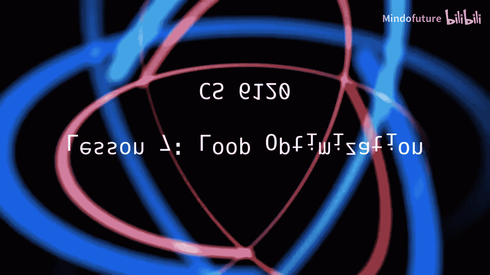
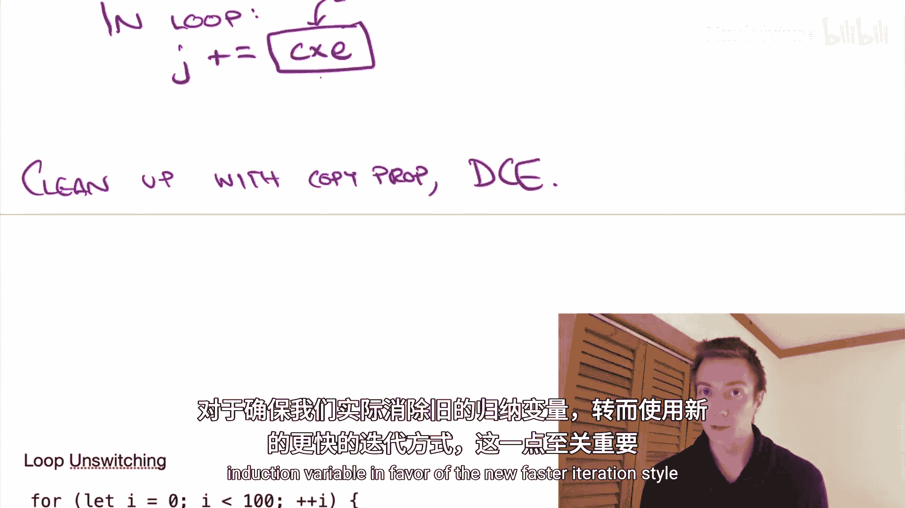
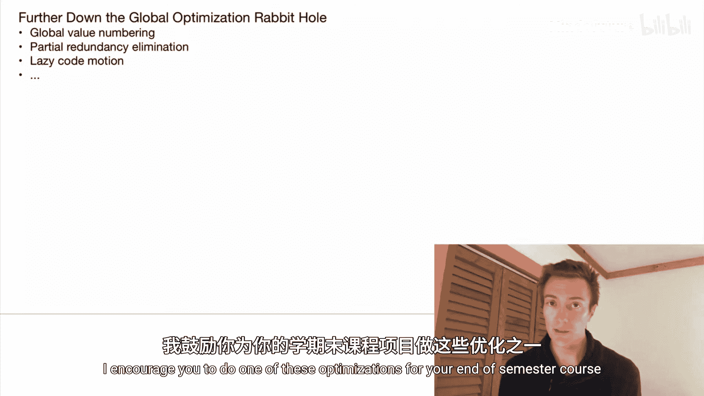

# 【康奈尔大学-•-中英】高级编译器项目教程-CS-6120（Advanced-Compilers，2020）-p12-P12-Lesson-7--Interprocedural-Analysis--BV1gE9ZYsEUm_p12-

。

Hi there。 This lesson is going to be pretty straightforward。

 I just want to introduce you to a few different classic optimizations that apply to loops。

 which will inform the task that you have to do over the next couple of weeks。

 which is just to implement one of these optimizations。

 you can choose to do it either in Braille or L O VM。

 and you can pick from one of these or if you're feeling creative to find your own optimization you want to implement。

 I'm just going to give you a taste of how these optimizations go。 This is a pretty openend task。

 So figuring out how to turn these rough skeletons into actual implementations is entirely up to you。

😊，You will recall from a couple of lessons ago that we described how to find natural loops in CGs。

 Natural loops correspond to looping constructs like4 and while and do while in normal programming languages。

 and they are strongly connected components of basic blocks in a CG that have a single entry block that is a unique basic block that has edges coming in from the outside like this one。

 All of the optimizations I'm going to describe in list this lesson applied to natural loops。

 So probably the first thing that you're going to need to do in your implementation of your optimization is to find the natural loops in the C FG。

😊，Then you'll just be analyzing and manipulating the code within those loops。

You will also recall from a couple of lessons ago that we saw loopinvari code motion as an example of an optimization that applies to natural loops。

 Loinvariant code motion identifies loopinvari code like this expression A times B here。

 Its loopinvari because it computes the exact same value on every iteration of the loop。

Lop andvari code motion just assigns that computation。Like this outside of the loop。

And then replaces it with references to that variable。 So this way。

 we don't have to do a multiplication on every iteration。

 and we get the same answer as the previous program。That's loop andvariant code motion。

 You can return to a couple of lessons ago if you want to see more detail on how to carry out that optimization。

 The rest of the optimizations in this lesson are going to have a similar flavor。Let's look first。

 at induction variable elimination。This optimization is most useful when it's paired with aes to memory。

 That is aes to arrays， like in the Briille memory extension。😊，For example。

 this program has an access to an array A inside of the loop。

If we think about how that has to be implemented in a C like language， the way that this。

Gets turned into actual computations is we have a， which is sort of the base point here to the first element in the array。

 And then we have to add to that some offset， which will be like I。

 the index we're using into the array multiplied by the stride that is the size of the elements in the array。

 And if we do this in a straightforward way， we'll have to do that multiplication and addition in every iteration of the loop。

 which in a way is kind of wasteful。 there's another way to do this indexing to。

 which is instead of calculating the address every time is just to bump a pointer。

 That is we will keep a variable。 let's call it a underscore I that points to the Ih element of the a array。

 And then in every chip around the loop instead of recomputing that from scratch。

 we can just say AI plus equals stride to move it by one element in the array。

 This is nicer because all we have to do now is in addition。

 instead of both an addition and a multiplication to get the address we want to dereference。😊，ち？

To finish this off in the loop， we're going to have to start out with a。A。Pointing to a。

At the very beginning of the loop。And then on every iteration。

 we'll be bumping the pointer by this much。 And then finally， we need a way to tell when we're done。

 which is， instead of comparing I to 100， we will now have to compare a I。To something like。

A plus 100。Time stride。Which， of course， is a loop invariant expression。 That is。

 this computation can be calculated once outside of the loop。

 and then we don't have to redo the multiplication every trip around the loop。

Induction variable elimination seeks to turn loops written in the much more natural way with subscripting like a bracket I and turn it into the faster way of implementing it。

 That is with all this pointer bumping stuff。 automatically。

 I'm going to give you the recipe for doing that。 Next。 The three basic steps。😊。

The first step is to find the original induction variables that is given a CFG。

 we need to recover what looks like I in the original program。

If your representation of the program has fancy iteration constructs that tell you exactly what the loop iteration variables are。

 then you're already done with this step。 But in most programming and languages。

 you don't have that luxury。 and we just have an integer that's being incremented。

 and we have to recover what that iteration is doing。

 So this first step is just to find those iteration variables。 Those induction variables。

 as they're called。Basically， the idea is to look for statements that look like this。

 That is to look for a variable that is defined exactly once during the course of a loop。

 And that definition looks like the variable equals the variable plus some loop invari expression。

 So this is assuming that you've already done an analysis to find the loop andvari code。

 And as long as you can find an I plus equals one of those things。

 Then this is a what's called a basic induction variable。

 We'll see more complex ones in the next step。One note about this， however， is that， of course。

 expressions， statements rather like this don't exist in SSA form。

 So if you decide to do this optimization on an SSA program。

 you actually have a little bit more work to do than you would in non SSA form。

 that is you need to traverse fine nodes to find out to find cases where we're incrementing a single variable across iterations of the loop。

In non SSA form， we can look for definitions that look more literally like this。

 That is just redefining the variable with an increment based on the same variable on every loop iteration。

The next step is to find when I'm calling derived induction loop induction variables。

Derived loop induction variables are based on those basic loop induction variables。

 but they can multiply and add to them on every iteration。 So this is like that。

A eye pointer that we saw in the original example。What we're looking for here to find these derived induction variables。

Is to。Look for uses of our basic loop induction variables that we've already found。

 They're used in kind of an aine equation here。 That is they have a multiplication。

Times the the basic loop induction variable。 And then they have an offset in both of those things。

 That is the multiplicative factor and the additive factor。

 Both of those things must be loop invariant。 In the simplest case， those are actually constants。

 So this is like four the size of integers， for example， and 32 B machines。

And this is a constant that is the base pointer for the array。But in general。

 they don't just have to be constants。 They can be loop invariant。

 that is they can be non constants that are defined just before the loop executes and then not changed on every iteration of the loop。

So if we find one of these affine expressions like C times I plus D。

 where I is a basic loop induction variable。 and C And D are loop invariant values， then。

We can call J a derived loop induction variable， And this is the computation that we want to eliminate。

Once we have this and once we have written down all the bookkeeping we need for both the basic and the derived loop induction variables。

 the final step is to do the replacement that is to end up with an optimized program that doesn't need to do the multiplication。

On every trip around the loop。The first thing we need to replace is the original initial definition of the derived loop induction variable J。

 And that happens in the pre header of the loop。 So we're going to give J an initial value。

 And that initial value will be D。 It additive offset。

 You can think of this as being the equation that defines J on every iteration of the loop。

 But where I is 0。 That is where I is its initial value before we start bumping in。

Then we need to replace the update to J that happens inside the loop。 And this。

 we will replace instead of having C plus I plus D and redefining J from scratch every time we will just be bumping J by an appropriate offset。

 that offset that we want to compute is C times E by which I mean。

 the amount that J moves per every increment in I and the times the amount that I moves by itself every single time。

 You can see， I hope how that works out algebraically。 And the critical thing is。

 we want to multiply these things two things together。

 But we're multiplying together to loop invari quantities。

 So we know by construction that this multiplication itself is also loop invari。

 So we don't just want to put the C times the expression right here in the loop body。

 It's better to bind it in the loop pre header to a variable whose name I'm not showing here。

 and then use that variable to increment J on every iteration of the loop。😊。

So once you've done this and once you've replaced the definition of J。

 both its initial definition and its update， you can get rid of the old definition of J。

 There are again， some things to take care of here。

 depending on whether you're in SSA form in SSA form。 Of course， again。

 you can't actually do plus equals。 So you only need to do some manipulation of P nodes to make this work。

 So it works like a J plus equals on every iteration。 If you're not in SSA form。

 you need to be careful about where you insert this and to make sure that you don't clobber other uses of J that don't want to see that update before it's ready。

😊，In either case， you are now done replacing the definitions of J。

 both in the initial condition and in the inductive case in every iteration of the loop。

 so that J works exactly the same way as it did before。

 but now doesn't require the multiplication from scratch that it did before。

So you can replace all uses of the old J with the new J， and you're done with the optimization。

 except that it's always a great idea to clean up the results of this optimization with copy propagation。

 and especially some dead code elimination。 because if you remember that example I showed you before。

 it only used I to index into a。 And it's pretty common that we therefore don't need I anymore more。

 now that we have computed that like pointer bumping of the AI index。

 So doing some dead code elimination after this pass is super critical to make sure that we actually eliminate the old induction variable in favor of the new faster iteration style。

😊。

So that's induction variable elimination。 let's move on to a few other fun loop optimizations。

Loop unswitching also unsurprisingly， has to do with loop invariant code。

 but it just tries to look for this common pattern that can show up in loops。

 That is when you have an if nested inside of a loop。

 you can imagine how this looks in a control flow graph。 You've got a natural loop。

 and you've got its header。 and then that branches off into two conditions。

If you find this and you also find that the branch that decides which case you go into doesn't depend on the iteration of the loop。

 Well， maybe the optimization kind of writes itself。 That is。

 we can flip the the order of the if and the for。 So we end up with something like this。Yeah。Yeah。

That is， we can have two simpler loops that no longer have ifs in them that do either the F thing or the G thing。

 depending on the condition。 This way， we don't have to execute the branch on every iteration of the loop。

 We can just do it once and to decide which loop to run。

This analysis depends on the loop andvari analysis to figure this out。

 And then it's actually pretty straightforward。 All you need to do is identify the branch that you want to eliminate and do some rearrangement at the CFG level。

 So this is less about moving round instructions and more about rearranging the graph that makes up the control flow of the program。

 All right， One more loop optimization before I leave you to it。

Loop fusion is an optimization that tries to smash together two loops that happen right next to each other。

 Again， this optimization really shines when you have to access arrays inside those loops。

This optimization applies when the two next door loops have the same looping structure。

 That is they use their loop induction variables in the same way。

 This means that discovering the opportunity to apply this optimization requires the loop induction variable analysis that we just saw a few minutes ago。

 The idea is that what we want to do is rewrite this to a single loop that， of course。

 has the same looping structure。 So it will still look like this。

 Itll still use the loop induction variables in exactly the same way。

And we will just copy and paste the two loop bodies right next to each other。

Maybe you can think about what makes it legal to do this。 A from having the same looping structure。

 When is it allowed to copy and paste these two loop bodies and run them as a single loop body instead of running them sequentially as two separate loops。

 Pause the video now and think about the appropriate criterion to use to decide when it's appropriate to apply loop fusion。

Here's the way I think about it。 The way we're changing the behavior of this program is we're taking a program that used to do a bunch of x's and then a bunch of y's。

 and we're transforming it to do X and then y， and then x and then y and so on。

 So the thing that must be true is that it must be safe to reorder Y's plus past X's。

 That is for every iteration of the second loop。 It must be equivalent to execute it。In either order。

 either before or after iterations of the first loop。

So this means that you need to do some independence analysis to make sure that rights from the second loop aren't going to impact reads in the first loop。

 So if， for example， if the second loop body here wrote to the array A。

 that seems like it would be a problem because this loop is trying to read from array A and if that's constantly changing。

 then this reordering of the loop iterations will no longer be equivalent to the original program Mes。

 I hope you can agree a really important criterion for optimizations。In any case， the idea with with。

Loop fusion is not merely that we get to get rid of some of the branches in a program。

 The the optimization potential is actually much bigger than that。

 especially for certain computational domains。 So instead of doing。The right into B。

 I and the read again， from B， I here。Under certain assumptions again。

 we can rewrite this to something that looks a lot more efficient， especially in its use of。Memory。

 that is， we can just directly go to C I。By computing G of F of AI。

I think the most important criterion for this is that the B array must be dead after this loop execution。

 that is nobody else in the program needs to use the B array。If this is true， we can basically。

 what's happening here is we can take one loop that used to have to write to a whole bunch of memory and a second loop that used to have to read from all that memory and glue them together。

 So now they don't need that intermediate memory at all。😊，This kind of optimization is really。

 really critical， for example， in machine learning compilers， where， for example。

 it's super useful to be able to feed a fully connected layer that is a matrix multiplication into a value or nonlinear。

😊，Operation that operates on every element on the output of that matrix multiplication。

 instead of buffering up the entire matrix multiplication。

 putting the result into memory and then reading it back from memory in order to do the value operation。

 If you just do the value operation on the fly while you're computing the matrix multiplication。

 you save a lot of traffic to and from memory。 This kind of optimization that saves memory and memory aes is incredibly critical for deep learning applications。

 where the bottleneck is not really even so much the computation and the branches you're executing。

 but the amount of memory you're using and how frequently you're accessing it。

 because of their extreme memory bandwidth demands and the limited amount of memory that's available on chip and off chip in。

 for example， GPus。😊，So those are the loop optimizations I wanted to introduce you to today。

 There are so many more。 I'm not trying to give you， in any sense。

 an exhaustive enumeration of all the loop optimizations in existence。

 I just wanted to give you a flavor of what's available and to encourage you to explore if you want to get creative with the optimization that you implement other loop optimizations that exist include onrolling that is making copies of the loop body to avoid the loop control overhead interchange that is flipping the order of inner and outer loops。

 splitting or peeling， which typically takes the first few iterations of the loop and takes them out of the loop and executes them by themselves so that the main loop can be simpler and locality transformations that are sensitive directly to the reuse of values across iterations of the loop so that you don't constantly have to be going to main memory。

 So it's friendlier to the cache。 and so many more， loops， of course。

 are super important because most of the time that our program spends is in executing loops。

 a program without loops doesn't run for very long。😊，So there's lots of optimizations out there。

 and I encourage you to explore。As kind of signposting for 6120 overall。

 this is also kind of where we're going to leave it for these classic optimizations。

 these global optimizations that have to do with moving code around and finding redundancies and simplifications in this type of a thing。

 The rest of the class is going to move on to other aspects of analyzing programs and other parts of the puzzle for language implementation beyond just this kind of optimization。

😊，If you are curious， this category of optimization。

 this like classic optimization at the function level。

 is what you'll find in a lot of grad level compilers courses out there。

 So if you really love this kind of thing， I'm going to leave some links to other papers and other courses where you can read a lot more about classic compiler optimization。

 And if you're interested， I encourage you to do one of these optimizations for your end of semester course project。

 Meanwhile， however， we're going to be moving on to other topics。

 while enjoying the warm afterg of all this great time that we spent optimizing programs rearranging Cgs and deleting instructions。

😊。

