# 【康奈尔大学-•-中英】高级编译器项目教程-CS-6120（Advanced-Compilers，2020）-p13-P13-Lesson-8--Interprocedural-Analysis--BV1gE9ZYsEUm_p13-

This lesson is going to be a really brief overview of the wild world of interprocedural optimization As a brief recap of where we've been in 60 and20 so far。

 we've done plenty of local analysis and optimization。 That stuff that works on a single basic block。

 We've done a whole bunch of global optimizations。 That is stuff that applies to the entire function and is sensitive to control flow。

 Interprocedural optimizations is the next level beyond that。

 And that's when you're looking at multiple functions and have to be sensitive to the calls that happen between them。

😊，To motivate why we need sometimes to do some sort of interprocedural reasoning。

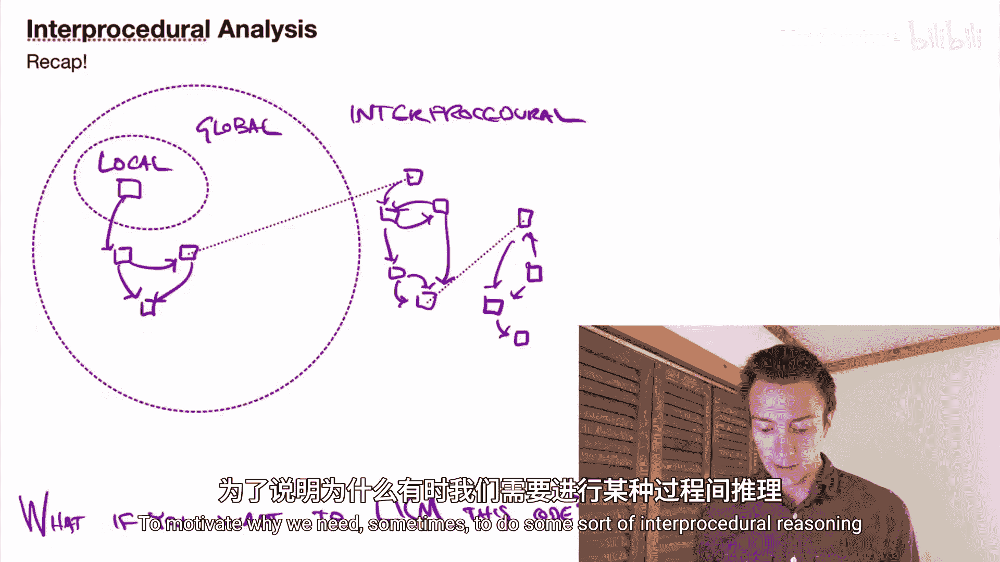

Consider this function。 So this is some sort of pseudocode。

 you can imagine this compiling to Briille。 But in your case。

 what if you wanted to do loop invariant code motion。

 And the insight that you want to exploit is that this F is just doing a multiplication of its argument。

 So this is the same as just writing like X times 42 right there。

 We can see with our human brains that this is a loop andvari code。

 So it would be awesome if we could say， let y equals F of x。 and then just reuse y inside the loop。

 That would be great。 But， of course， this is not something that's possible with global analysis。

 because it requires looking into the body of another function to determine that it's okay to move around the call to F inside the call inside the function body of mean。

😊。

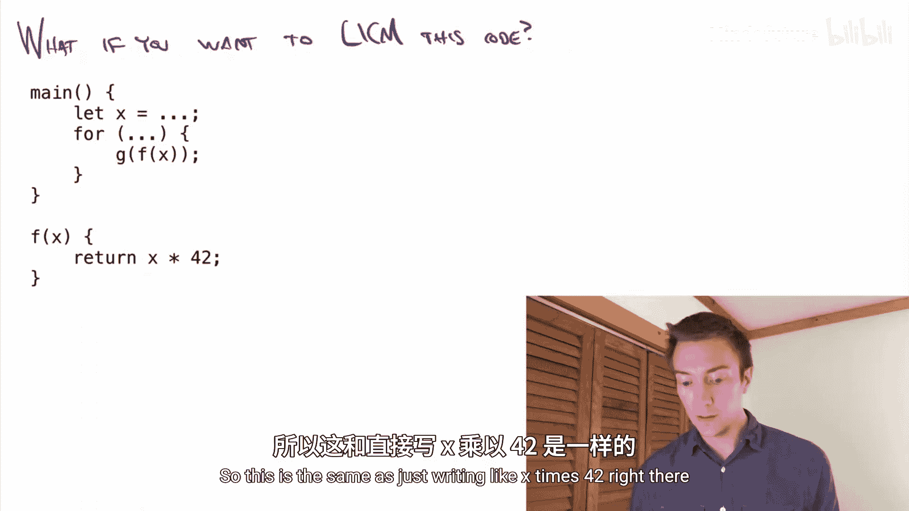

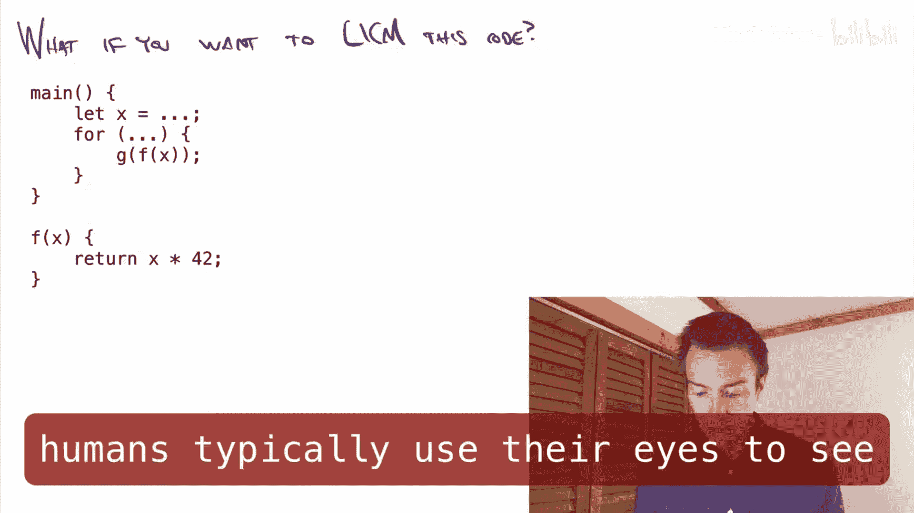

So this is what interprocedural analysis is all about。

 is about taking facts from one function and letting those deductions that you've made about them。

Influence the way that we analyze and transform other functions that call those functions。

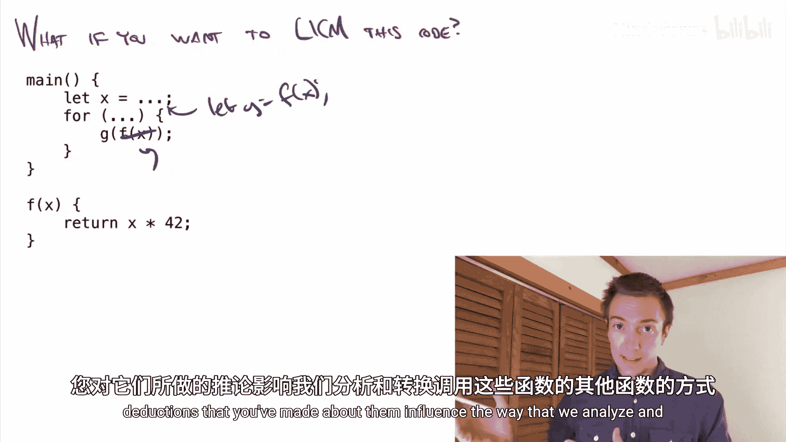

As with lots of other compiler topics， this's kind of a central data structure that we need to worry about for interprocedural optimization。

 That's the call graph。 You can think of this as very。

 very roughly kind of the analog of the control flow graph。

 but for interprocedural analysis instead of for global analysis。 So the call graph is really。

 really simple， it just has the nodes are functions。 So， for example。

 main and F from a previous example， and there is an edge that represents calls from one function to another。

 It could not possibly be simpler than that， it's just a way to represent the network of calls that happen between functions。

 when you're viewing things in an interprocedural way。

You can imagine zooming in individual nodes in the call graph and expanding those out to entire CFGs and zooming into individual nodes in that and expanding those out to basic blocks。

 So this is just another level of abstraction of programs that happens above the function level。

 One big question determining how to do interprocedural analysis is whether you are assuming you have what's called an open world or a closed world。

😊。

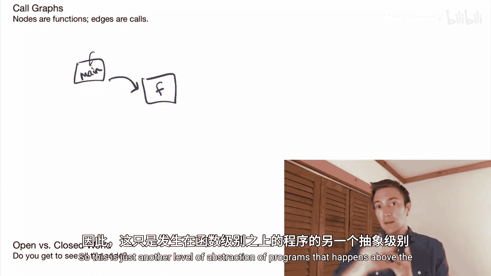

And in an open world assumption， you're assuming that you get to see only a subset of the code that will eventually get run。

 So you get to see some of the code， but you have to imagine that something else is happening with the rest of the codes。

 You see some of the functions， but you have to imagine that there are other functions going on or other classes that are going to be influencing the execution of the program in a closed world assumption you have more optimization potential。

 because you get to assume that the code that you see is everything you get to analyze the entire program and make assumptions based on the fact that nothing else can possibly influence the execution of the program at runtime。

😊。

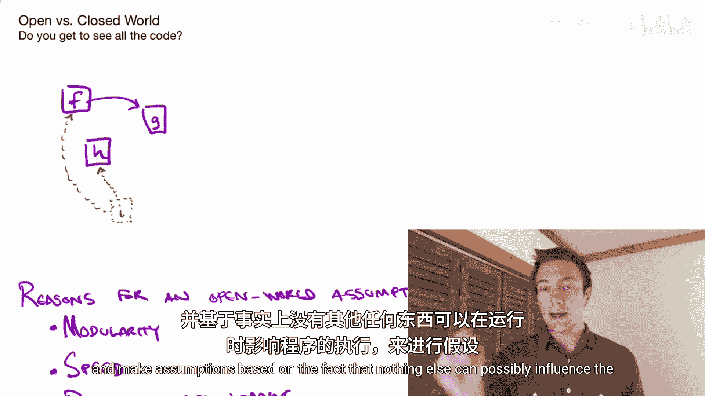

To illustrate what I mean， I've drawn a little tiny call graph here that has F and G and H。

 So if you see a call graph that says like F calls G and neither of these call H and H calls neither of these。

 If you see these by themselves， you might be tempted to assume that you can。

 It's safe to just delete the definition of H。 because nobodys actually calling it。

 It's a dead code at the function level at the interprocedural level。And this is true。

 if you get to make a closed world assumption。 That is， if you' are allowed to see all the code。

 if you have to assume that other code might be executing。

 then there might be like some other function call it I that calls H and F。 And in that case。

 H is not dead。 Sa， for example， I is the main function that you didn't get to see。 In that case。

 it's not allowed to delete H。 So in general， when you're making an open world assumption。

 you just have to assume that other code that we haven't seen yet as allowed to do anything that is like call any function。

 So no functions can possibly be dead and deleteletable。So this sounds really problematic。

 Why would we ever make a open world assumption。 It See like it could limit a lot of the things that you would want to do in interprocedural analysis。

 And this is true。 It is quite limiting， but it's also really practical for a lot of reasons that you just can't get around in a lot of compilers。

 Here are some reasons why often practically you need to make an open world assumption。

 And this limits the powers of interprocedural analysis。 The first is modularity。

When you compile C programs， for example， you're probably very used to compiling C programs like a dot C file to a dot O object file and doing that in parallel conceptually for a whole bunch of separate source files。

 And then finally linking them altogether。 And this is great for lots of reasons。

 and means that the build is parallelizable， It means that it's incremental。 That is。

 if you change one file， you don't then have to recompile the entire thing。

 So it's extremely important for like developer quality of life， among other things。

 So you need to assume when you're compiling each source file that you don't know what's going to happen in the rest of the source files。

😊，This is a really important reason why most of the time interprocedural analysis has to make an open world assumption。

Another reason is speed。 analyzingly the entire program can be incredibly costly。

 whereas looking at just a subset of the call graph can make things go a lot faster。

 When you start talking about analyzing the entire program。

 you start running very slow optimizations that can reach diminishing returns。😊。

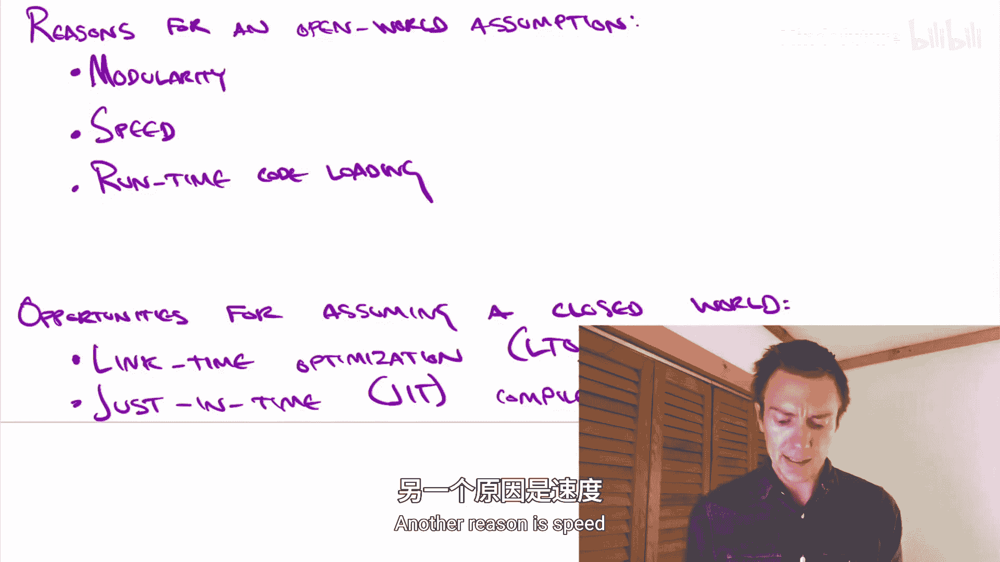

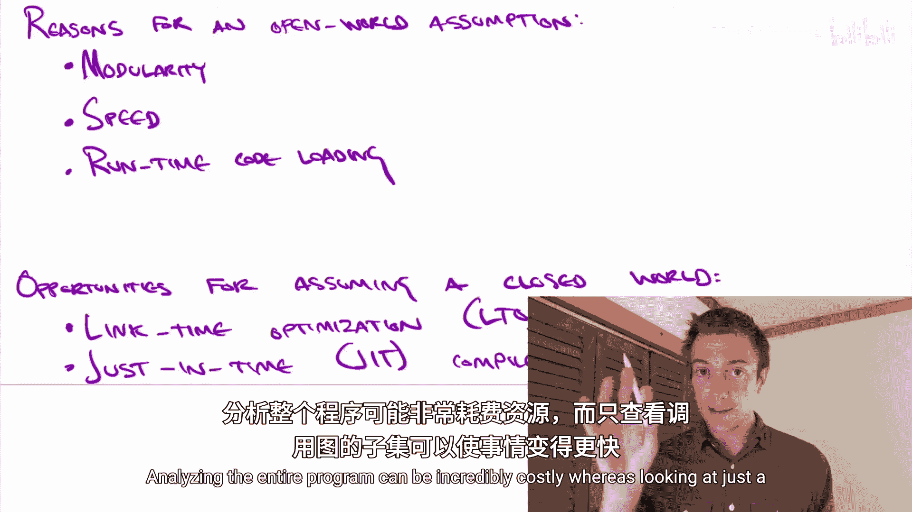

Then finally， there's the possibility in some languages for runtime code loading。 like， for example。

 in jascript or Python， it's possible to avow and therefore run some code that you didn't get to see yet。

 So even if you can guarantee to yourself that you have seen all the code in the program and are willing to spend the time to analyze it。

 you can't be sure what's going to happen when you eventually avow things or like load another jascript program from the host from the server and then conceptually link that in with the rest of your program。

 And even in Java， it's possible to load classes at runtime。

 This is like a very complicated part of the Java spec is just how how and when you load classes。

 So you have to， at some point， assume that it's possible that some code that you weren't anticipating that does something nasty according to your optimization is going to run。

 And this is why we need to make a open worldor assumption for a lot of these languages。😊。

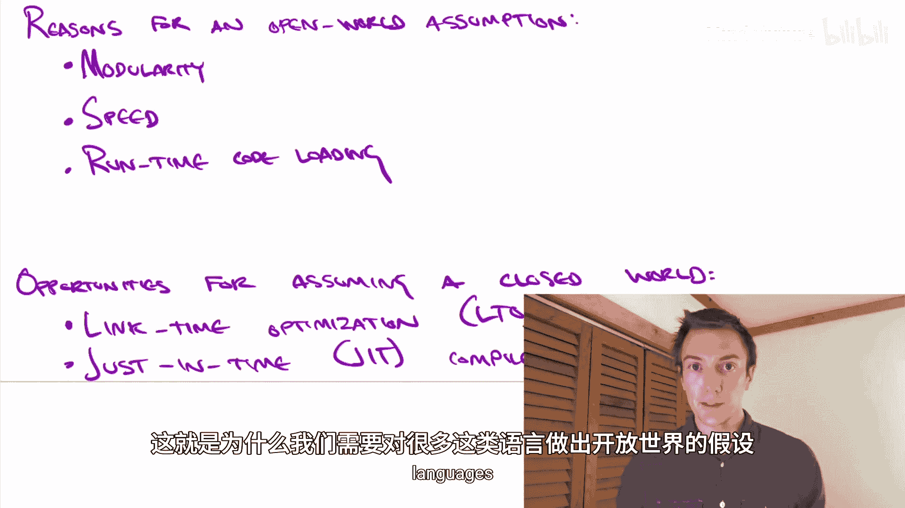

Sometimes in a sort of a counterpoint， it is possible to make a closed world assumption and to get the commensurate benefits that you can derive from knowing that there's no other code that's going to execute as part of the program。

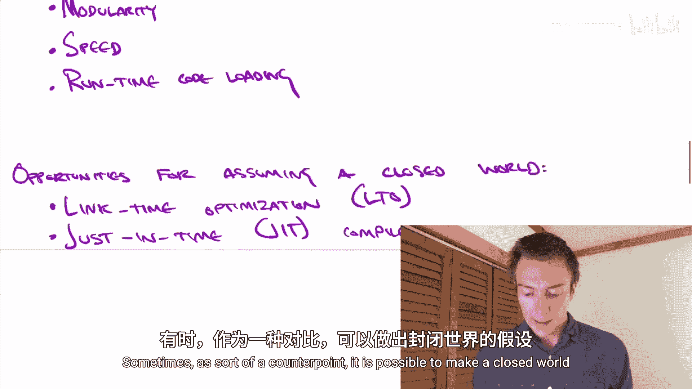

The two big settings that practically this practically happens today are， first of all。

 in link time optimization are LT O。 LTO is a secondary optimization phase that happens in native code compilers。

 after you've compiled all year， for example， dot C files to dot O files and are finally linking them all together。

 LT O is an opportunity to reopimize the code after having optimize the individual files now making the whole program assumption。

 That is now that you get to see all the code that will that is going to into the executable Now you can make even more optimizations than you could with the open world assumption on the individual files。

😊，A second opportunity where compilers sometimes make a closed world assumption is in just in time compilers。

 That is when you're not compiling things ahead of time and then just sort of running the code later。

 when you're compiling the code right before it runs。

 So the way that a whole program assumption or closed world assumption works in Jt compilers is temporarily。

 that is you can assume temporarily that you have seen all the code is going to execute。

 execute the program for a while， And then if you run to a place where it needs to load more code that is like load another class file from disk for a job for example。

 then you have to revisit your assumptions you made during the whole program assumption during the optimization and then possibly recompile the program in the presence of the new code。

 In any case， you get to take advantage temporarily during that time from initially starting to loading new code to do optimizations that would not be possible under an openw assumption。

😊。

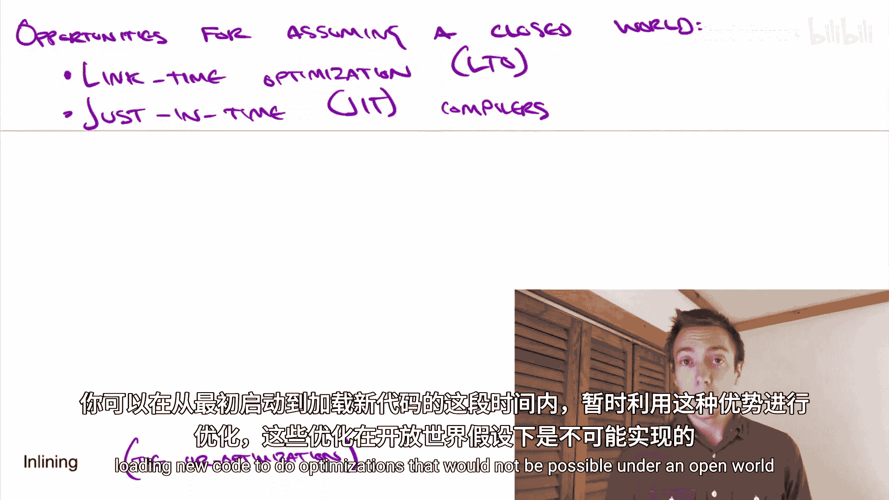

Next， I want to talk about one particularly important optimization that happens on a whole program basis that happens interprocedurally。

 and that is inlining。

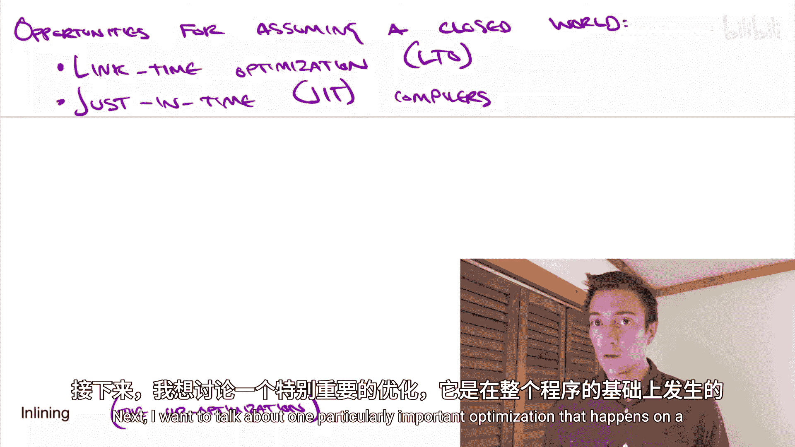

Inlining is a really simple idea。 Basically， it just says that if you ever have a call like this call in this Braille program from a function main to a function fo。

Here's what you can do。 You can delete the call and take the code from the body of the function and just copy and paste it here。

 So we won't like delete the F function because it might be called by someone else， too。

 but we will copy and paste the body of the function and put it in line here。

 There's a couple more things that we need to do in order to like fix up the references to the arguments in the return values。

 So right now， I'd like you to pause the video and and write out the code for what the inlined version of this pair of functions would be。

 That is write a new version of main that has the code for fo inlined into it and think about the steps that you need to do to change the fo code。

 So it now fits into main。😊。

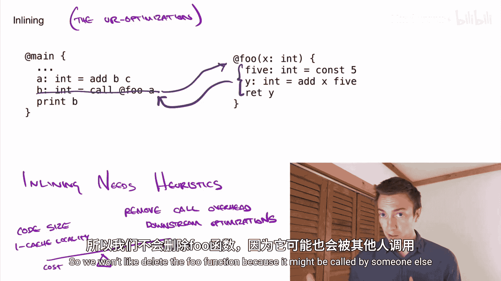

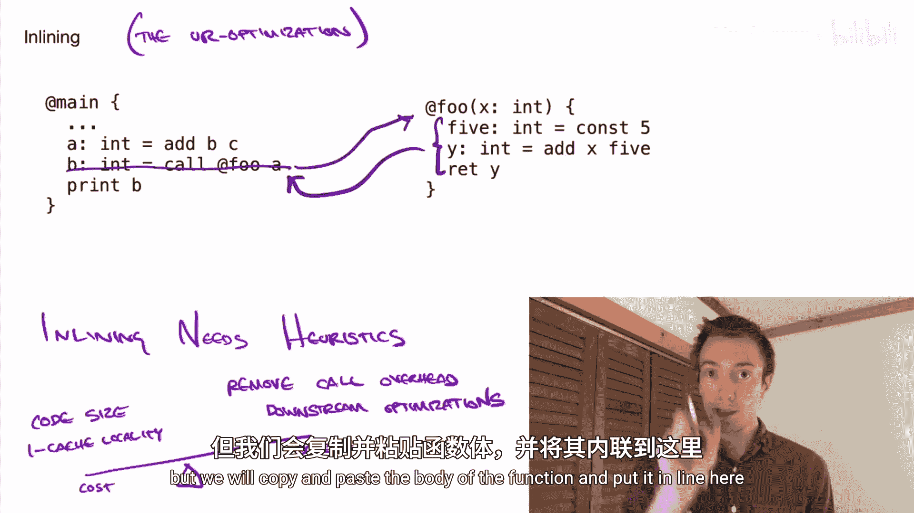

I think there's three main steps。 You have to deal with the arguments， the return values。

 And then finally， you have to deal with the rest of the variable names。 So for the arguments。

 I feel like the easiest way to do it is just to like implement this argument with a move that is like with an I D instruction from Briilll。

 So I'll just say X colon int。Equals ID， and then I'll get the argument from here， so I'll say A。

Then I need to deal with the return value。 I， of course。

 don't want to return from this function here。 Instead， I need to。

A sign into the same thing that came from the function call。 So I say B colon int。Equals I D of Y。

 And then I've sort of simulated the effect of returning the value Y and then putting that in the in the variable B in the main function。

 Then finally， there's the most boring part， which is that you need to make sure that the variables used in the body of fo don't affect anything that happened in main。

 regardless of whether you're in SSA form or not。 This is pretty easy。

 All you have to do is consistently rename all the variables in the inlined function to make sure they can't possibly conflict with any of the variables in the function you're inlining into。

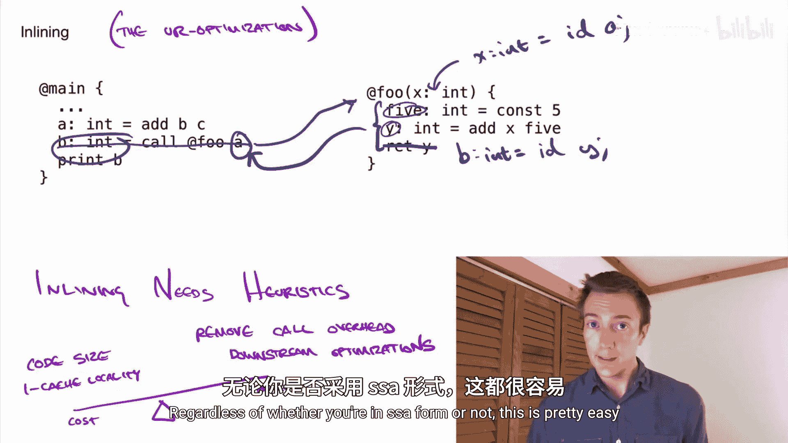

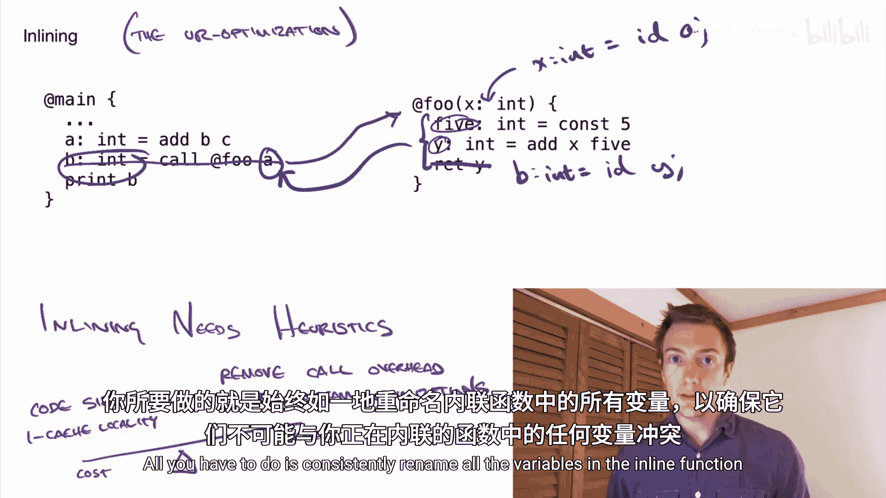

This small example hasn't dealt at all with control flow。 You'll have to deal with that。 too。

 Imagine， for example， that you had branches and jumps inside foo。

 you're going to have to figure out a way to stitch that control flow graph into the control flow graph for main。

 If foo has multiple return statements。 You're going to need to change the control flow graph to have a single exit point。

 in order to stitch that neatly into main， without using the return instruction， which， of course。

 would return from the wrong function。 Anyway， the mechanics of inlining are actually not that complicated。

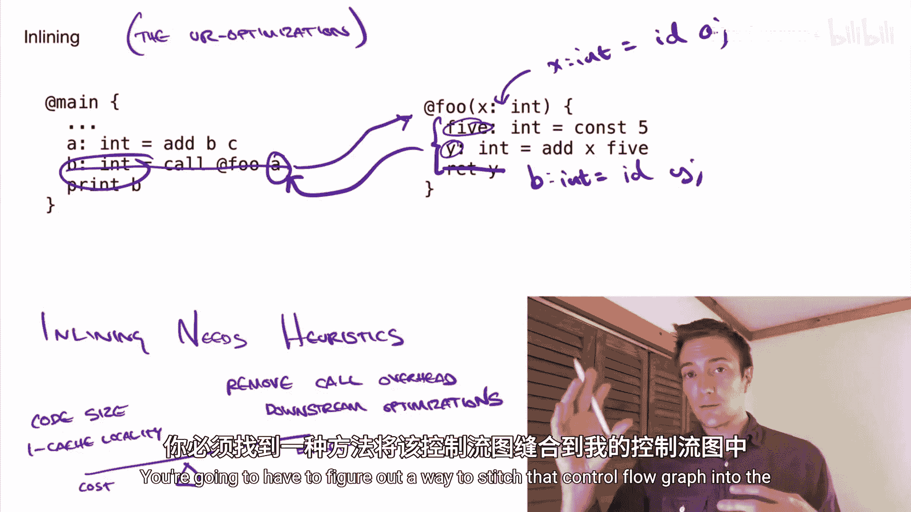

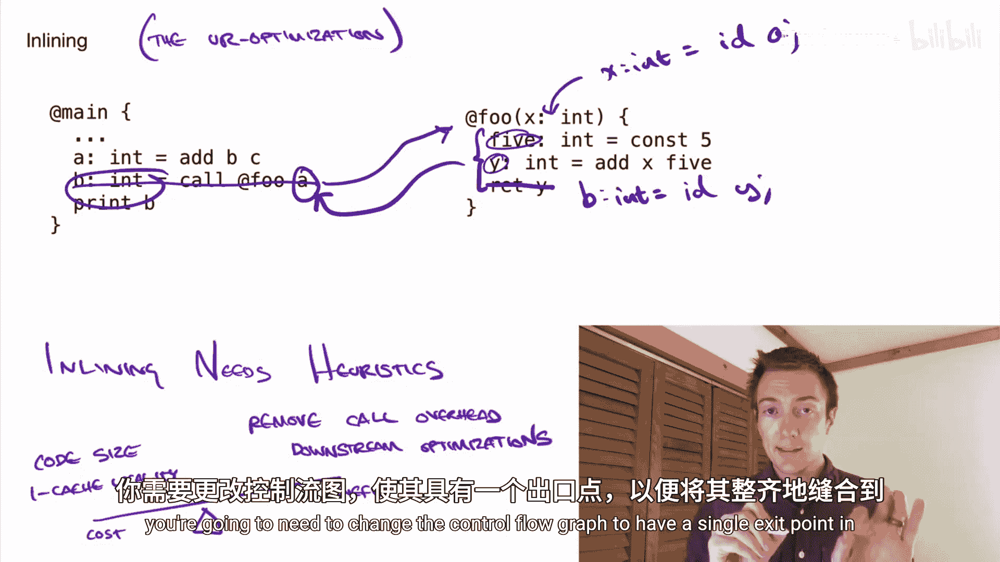

The complicated thing is deciding when to apply it。

The way that I like to think about this is that inlining has a cost and a benefit。

 and both are quantitative， and they're sometimes hard to predict。

 The cost is that you're increasing， of course， the code size of your program in the limit。

 if you tried to inline everything into main， you'd get an exponential blow up in the code size。

It's not even possible in general to do this if you have unbounded recursion in the control in the call graph of your program。

Blowing up the code size is not just a problem in that your like executables have a lot of assembly in them。

 but it also has it can actually slow down the program for because of， for example。

 the locality and the instruction cache of the CPU。

 having too much code and jumping wildly among it can mean that certain structures in your CPU that are tuned that have like a limited amount of size and therefore are tuned for like finite size programs are going to be very。

 very sad if you make your program enormous by inlining everything into。

And this isn't just true in the extreme case every time you inline something。

 you are slightly increasing the pressure on the eyec and making your program a little bit slower from this perspective。

But， of course， there are also benefits。 There is the first sort of benefit。

 which is just removing the call overhead。 that is now you no longer have to deal with the instruction overhead to like jump into a function。

 You don't have to worry about like manipulating the arguments at the assembly level in order to make function calls work。

 And all of this does remove some overhead。 But the real benefit。

 the sort of second order benefits that I think are the main reason why inlining is so important is because they enable downstream optimizations。

 And this is why inlining is sometimes thought of as like the most important optimization that a compiler does。

When you inline stuff from one function to another。

 you unlock more opportunities for doing optimizations in the inline into function。 In a way。

 you're taking local and global analyses that typically would be confined to a single function and giving them interprocedural superpowers by doing inlining。

 So things like copy propagation and loop andvariing code motion can all be a lot more powerful if you have a really good policy for deciding when it iss going to be profitable to inline。

 But the critical thing is that you need to balance those costs in speed and size with the benefits in terms of overhead and downstream optimizations。

😊，So you need some sort of a heuristic to decide when it's O to inline and when it will be a bad idea。

 You can imagine， of course， a whole plethora of different heuristics for deciding for trying to guess when it's a good idea to inline one function into another。

 A really simple way to start is just with a threshold on on the function size。 That is。

 you don't want inline functions that are too big because they'll blow up the code size by duplicating too much code。

 but you do want in line functions that are fairly small。 This has nothing to do， of course。

 with like directly predicting what the potential of downstream optimizations is going to be。

 but it can be a pretty good heuristic。 And everything is going to be a heuristic here。

 You can't perfectly predict this in every single case。😊，So。you're going to implement an inliner。

 you sort of have to like come up with a with some sort of heurtistic and just stick with it and measure it empirically and see if you're missing big opportunities and evolve it over time。

 There is no perfect answer to what is the best inlining heur stick。

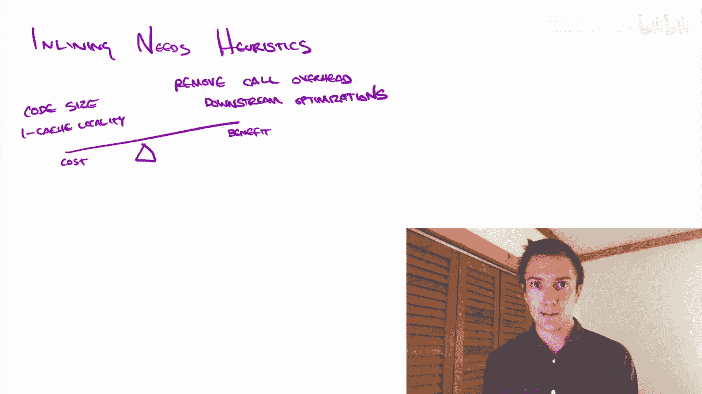

Beyond traditional inlining， I also want to talk about something that can make inlining more complicated in realistic languages。

 and that is virtual function calls。 Burle doesn't have virtual function calls， but basically。

 every single object oriented language out there and lots of other languages that aren't object oriented。

 have some sort of virtual function call。 This， if you're used to thinking at the assembly level of virtual function calls is just an indirect jump。

 That is something and doesn't say， jump to the function at this particular constant address。

 It says， look up this computed address that might be like one of several different functions and call that virtual function calls。

 of course， show up all the time in object oriented languages like this little Java like language I'm showing on the screen。

😊。

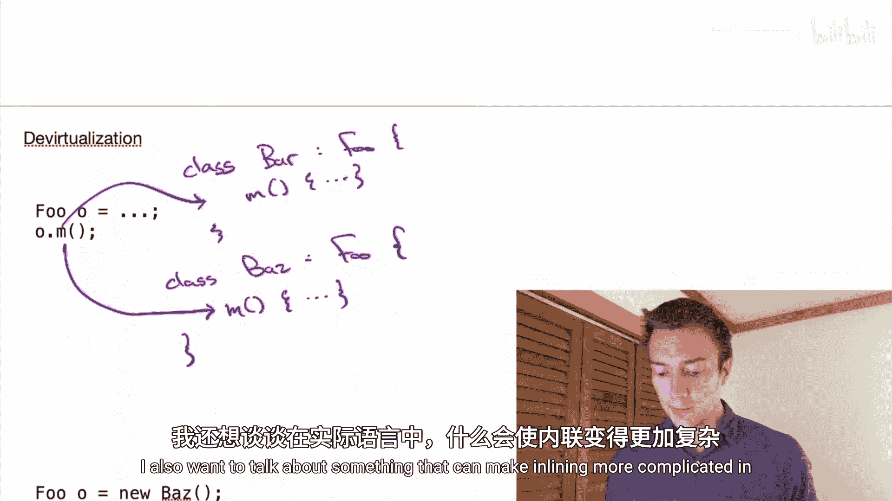

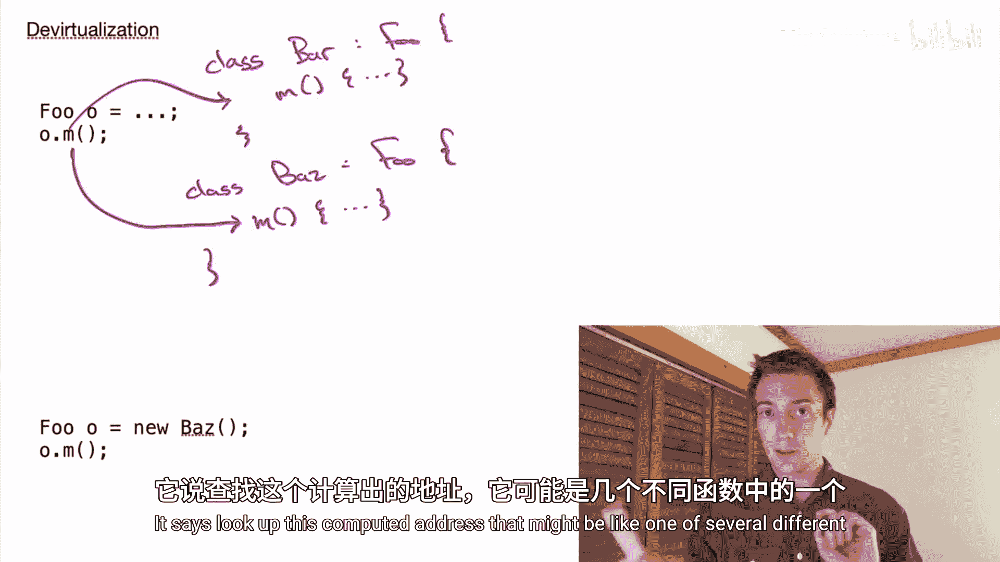

This function call to O dot M doesn't necessarily tell you exactly which M we're invoking。

 For example， this O， its static type is fo， but I'm showing that we have two different subclasses of fo。

 both of which override the M method。 and presumably there's also definition of M in the superclass。

 which means when you see O dot M statically， you can't possibly know every single time exactly which method we're going to be invoking。

 It depends on the runtime type of O that is like the type of the actual object that we're referring to at runtime。

 This ambiguity in virtual function calls， is a big problem for interprocedural optimizations。

 because it means that we can't do inlining。 An inlining remember is our big trick that we have an interprocedural optimizations to be able to tell。

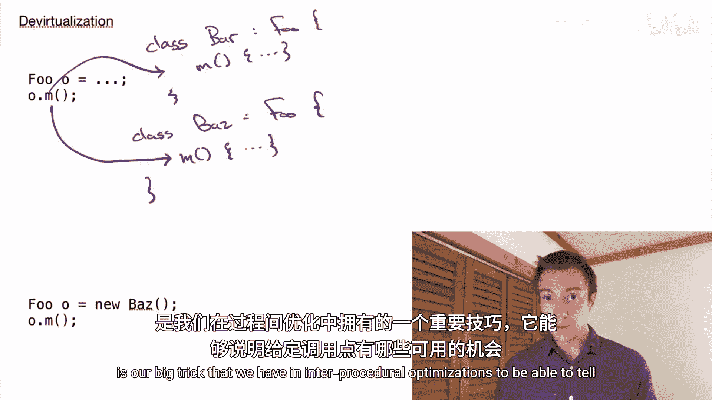

What opportunity is available for a given call site， that is we have to make。

 we have to assume that this can be either this function or this other one。

 and that can be really limiting。De virtualization。

Is a analysis and transformation that tries to take virtual function calls and turn them into static function calls。

 So you so to deduce in opportunities where it's possible。 and， of course， it's not always possible。

 exactly which code you're calling and therefore make it possible to do into procedural optimizations and to do inlining just like normal on any other static function call。

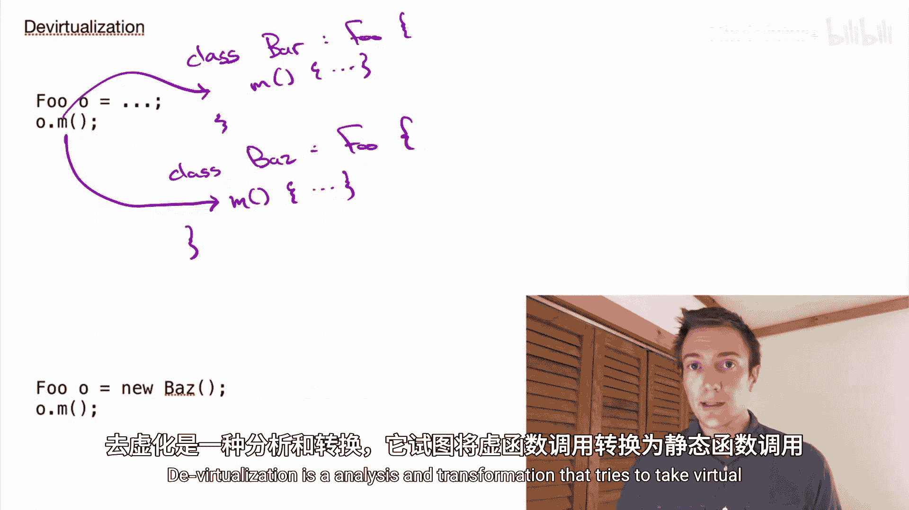

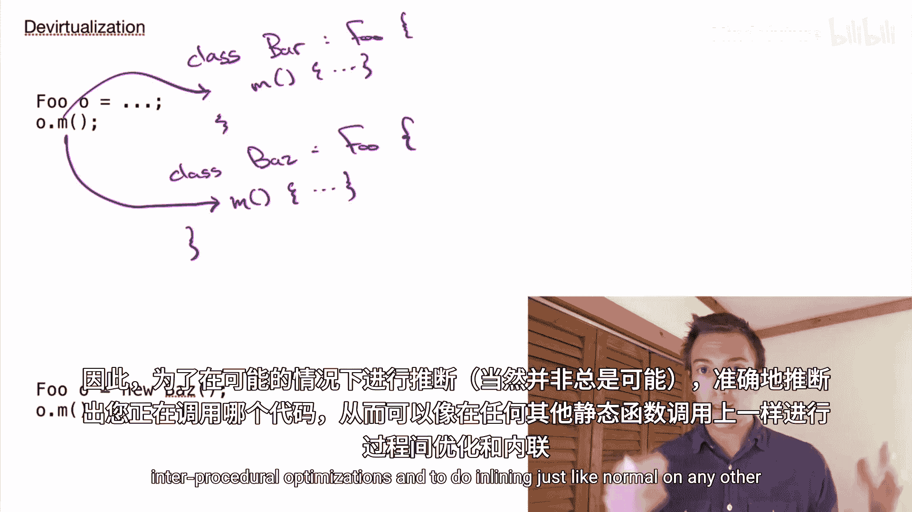

Deviilization is， in general， a really hard problem。There are simple cases， however。

 just to convince you that it's sometimes possible， take a look at this really tiny piece of code。

 That is if we are， if we know that this statement to Oda。

 this call to Oda M happens right after the initialization of O。

 Then we definitely know what type O has at runtime。

 That is there is only one possible class that O can have。 It's definitely ba。

 So we definitely know which method M this thing is calling。

 So that's a really simple opportunity for de virtualization。

 You don't need to know much to know that this thing that is technically a virtual function call can be turned into a direct function call。

😊，In general， you're not always so lucky。 you don't always have method calls right after initializations。

 So you need to do something more like a data flow analysis。 That is。

 you need to do a global optimization that looks at the control flow graph of the program and propagates information about the runtime types of values through the CFG So you can deduce information at call sites。

 So you can imagine doing a data flow analysis， where the information that goes like out of nodes and into nodes in the control flow graph is just sort of a mapping from variables to sets of classes that those variables might contain。

 So on exit to this CFG node， we know that the only class that O can possibly have is Bas。

 And similarly， when leaving this one， we know that the only possible class for O is bar and probably depending on what's in the rest of this graph in this node。

 we can conclude that O must be either a Baz or a bar， but we don't know which。

 So through a global analysis。😊。

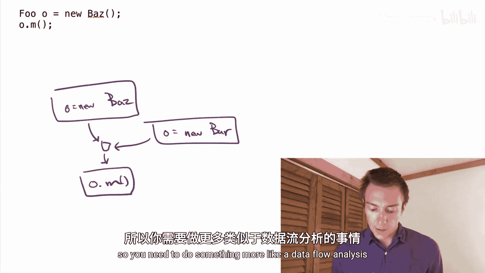

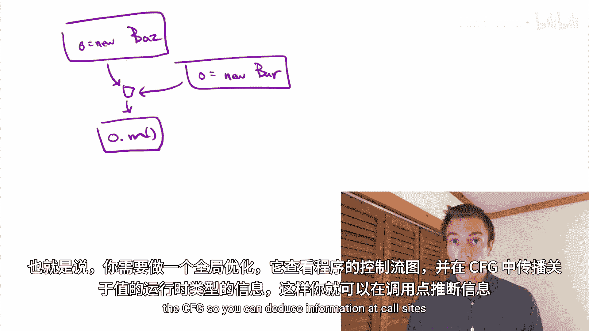

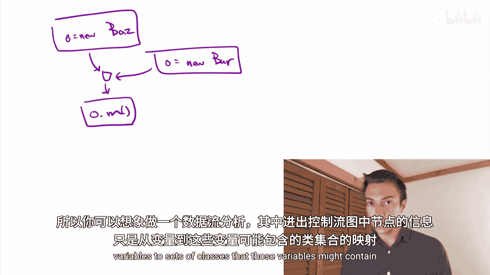

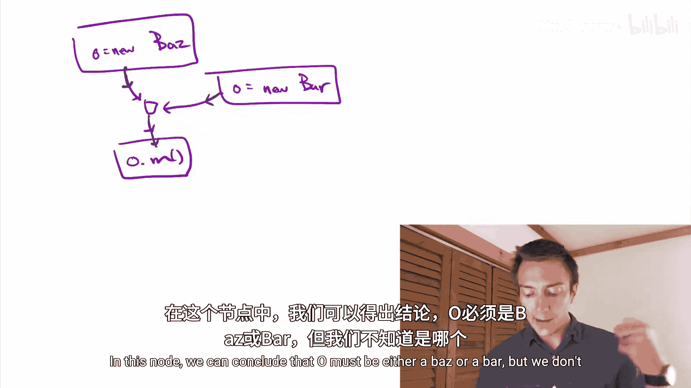

this one that's not too different from other global analyses you see in already。

 you can deduce the information necessary to do de virtualization opportunistically， but of course。

 sometimes you're going to be left with indirect function calls。

 and there's just nothing you can do about that。

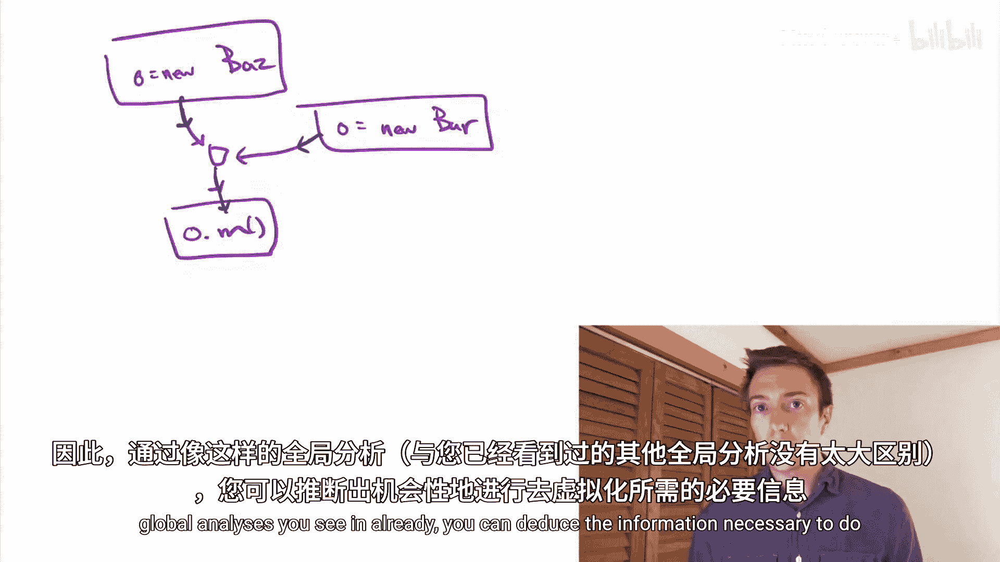

This one last concept that's central to interprocedural analysis that I want introduce you to。

 And that's context sensitivity。 Roughly speaking， context sensitivity is about using contextual information to disambiguate different cases of executing the same code。

To illustrate this point， I'm going to show you this somewhat nasty program that uses a mutable global state。

 Please forgive me。 It's a very contrived example， but I'm trying to demonstrate the possibility for eliminating dead code in this program。

 So to give you a brief overview， we've got this main function that calls。G1 and G2， And both cases。

 those things call this function F。 and F possibly increments I。

 main is going to print out I each time。 So it's going tod it like either 0，1 or 2 at each point。

 In any case， both of the G's set a boan flag B， which F uses to decide whether it's going to increase I。

Please pause the video now and stare at this code for a little bit to make sure you understand it。🎼。

Great， so the important point that I want to make here is that the call to G1 has an effect on I because there B is true。

 and we are going to increment I。 The call to G2 does not an have an effect on I。 In fact。

 it has no effect on the heap。 So a very sophisticated interprocedural analysis should hopefully be able to eliminate this call to G2 and just prove that we can print out the same value twice without executing the call to G1 G2 rather。

 and its invocation of F。 So how we're going to get there。

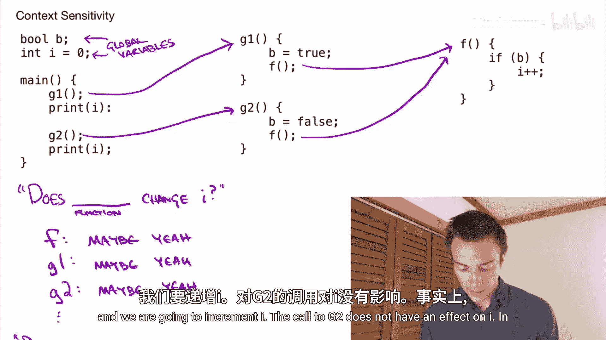

A simple way to go about this that does not work is to try to write a global analysis that asks whether functions change I。

 So if we were to write some sort of analysis， I mean， practically speaking。

 this would ask like which global variables do you modify， not just asking about I。 But in any case。

 if you were to analyze， if we were to ask this question， like， does this function modify I。

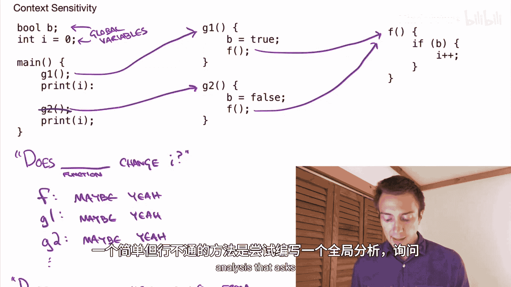

If we were to analyze F， we would have to say yeah， it might。

 because if we do a global analysis of F， it says that well I don't know what the value of b is going to be。

 so it must be the case that it can， yes， modify I。

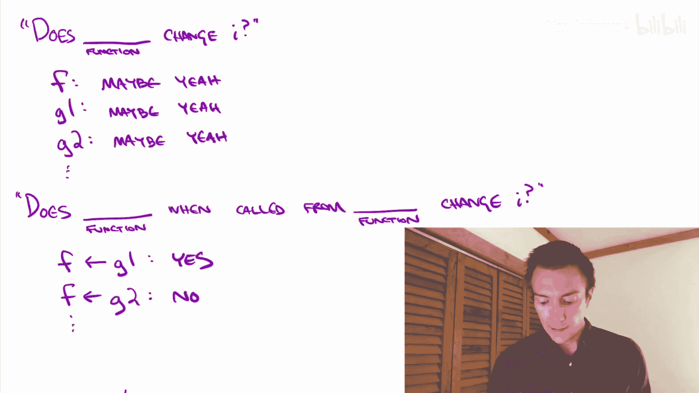

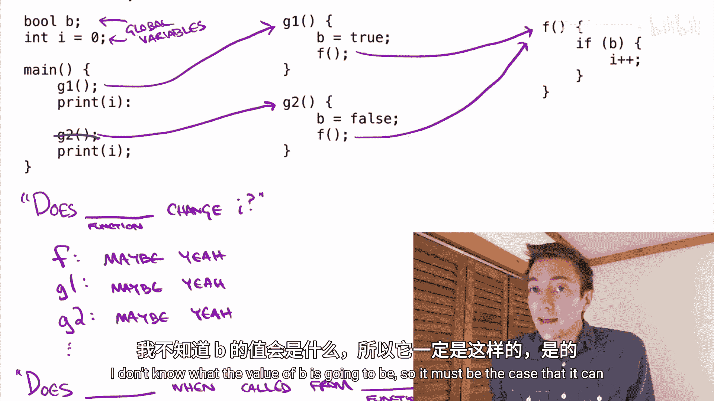

So therefore， we would have to conclude for both G1 and G2。 Yes。

 this also might modify I because it contains a call to a function that we have previously deduced modified I。

 So this by itself is not getting get us anywhere。 We have had to conservatively assume that both G1 and G2 might modify I。

 because F might modify I。

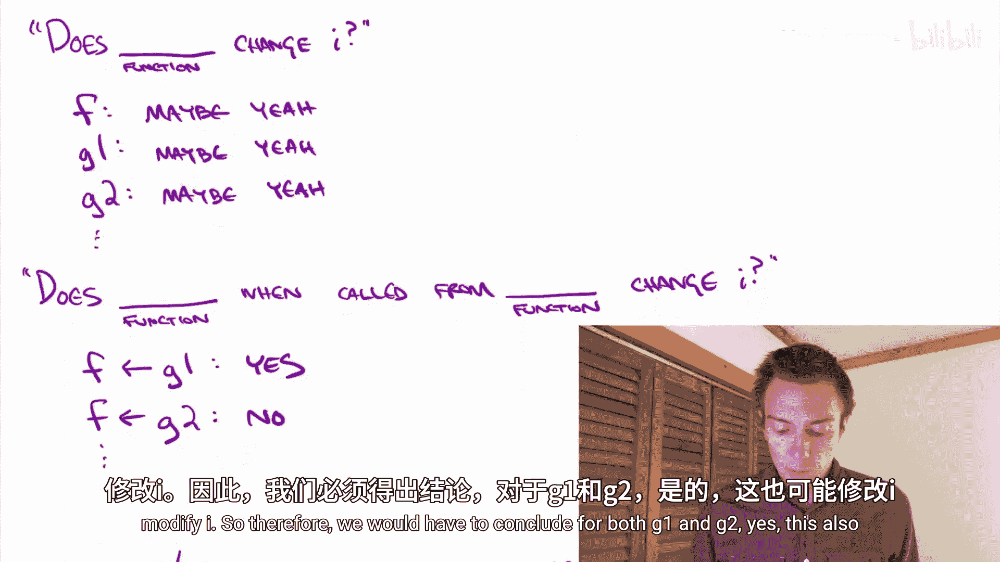

This is disappointing in several ways， But it's possible to fix it by asking a context sensitive question。

 So now let's change the analysis to do something else。 instead of just asking。

 does this function modify I for every function， Let's ask。

 does this function when called from this other function modify I。

 So we're going to have different different questions now， instead of just asking。

 does F possibly change I， we will ask， does F change I when it's called from G1。

 So now it is possible to do more interprocedural reasoning， That is to say。

 when F is called from G1， we know that during the entire invocation of F B is true。

 So we can say yes， it definitely modifyifies I。

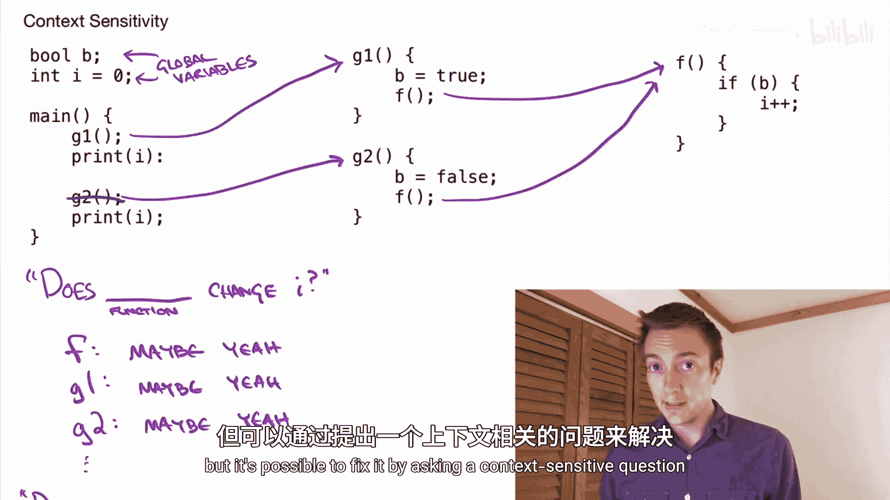

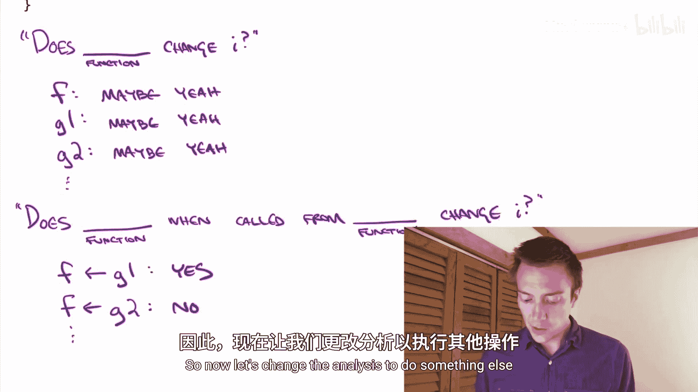

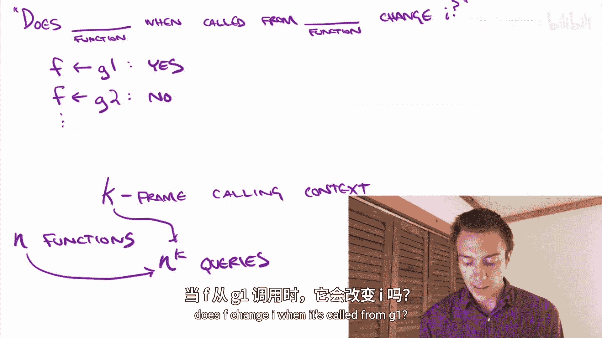

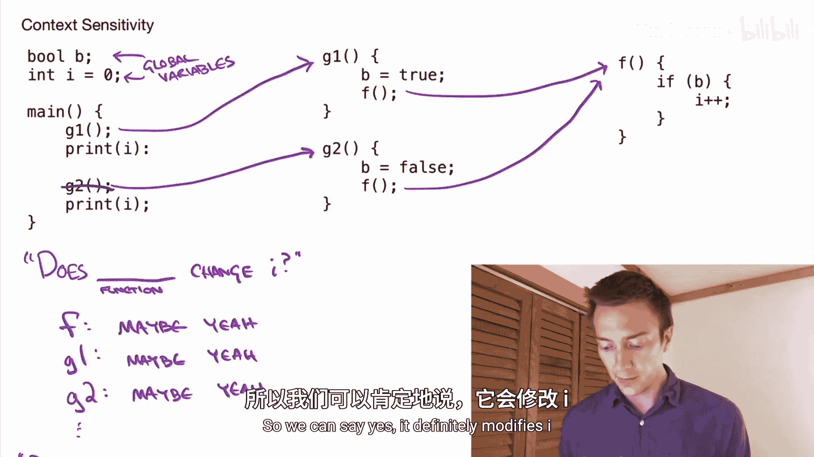

And similarly， we can ask a different question。 Does F modify I when called from G2。 And we can say。

 well， we know during the entire invocation of F here， B is false， and therefore。

 this function cannot possibly change I。 And then we can use that to do the dead code elimination。

 We always wanted to to cross off this call the G2。

 This change in the question we're asking the analysis。 I the introduction of context sensitivity。

 That is， we're not just asking about the code is executing。

 but we're asking about the context that executings in。

 There are many different forms of context you can use in context sensitive analysis。

 This one is called calling context。

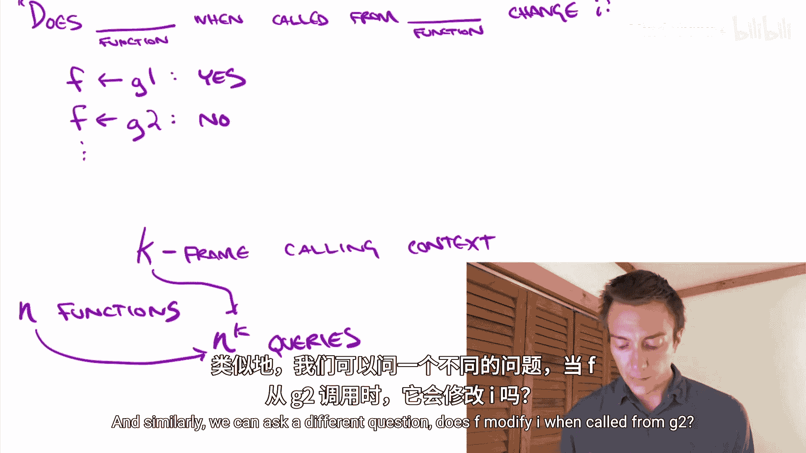

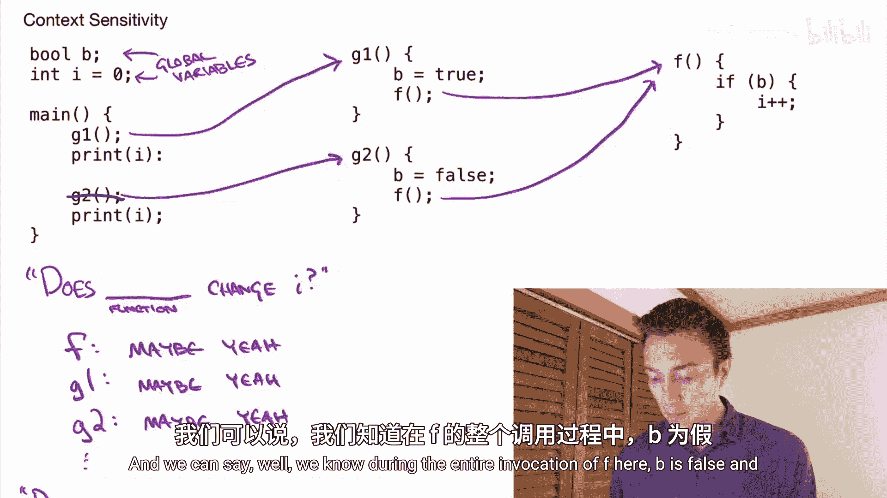

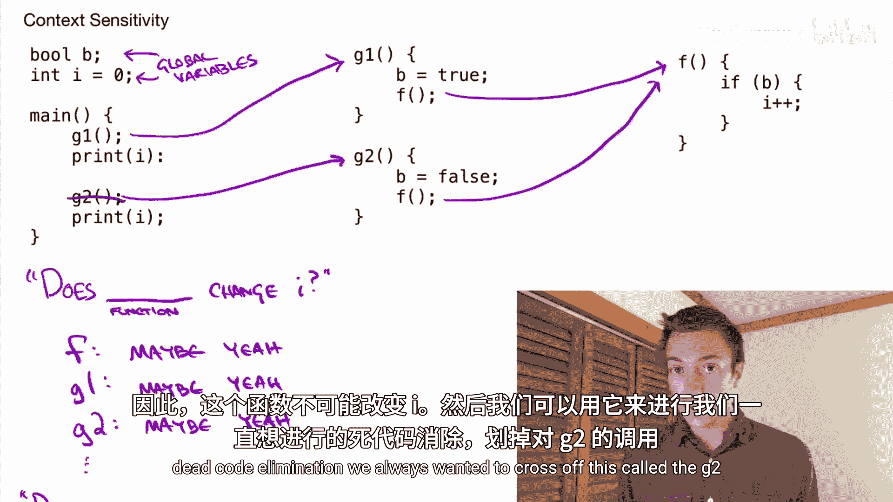

Which is exactly what it sounds like。 We're asking when it's called from a context where the top function on the stack right before F is a call to to some other function like G1 or G2。

 Now， what can you tell us about F。 And that's the calling context of F。 In general。

 doing context sensitive analysis。 requires playing a lot of games with defining exactly what your context is going to be。

 Maybe you can be some information about the current state of the heap。

 Maybe it can be some information about the arguments。 Maybe it'll be calling context。

 Maybe itll be a mixture of all of these things。In all cases， however。

 the more complicated you make the context， the more expensive you make the analysis at the same time as making it more precise for calling context。

 for instance。

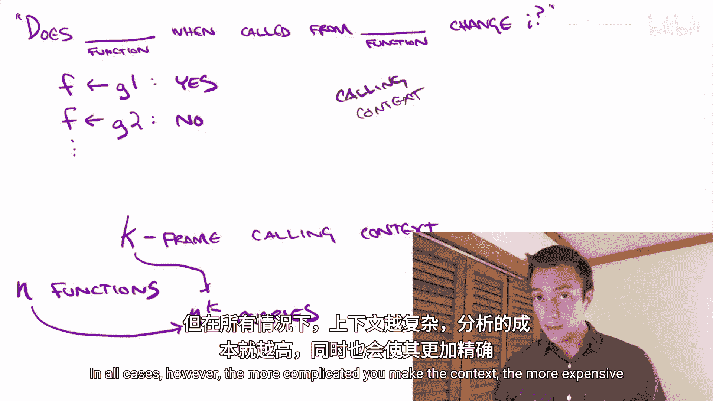

We have so far used a one frame calling context。 that as we're looking at the function。

 and we' look at the single function that called that。 But， of course。

 we could ask even more precise questions at programs by saying， well。

 maybe you have you have different behavior that is distinguished by the third thing on the call stack。

 That is who called the function that called you。 now you can have a more precise analysis。

 If in general， you use a K frame calling context。If you do a context sense of analysis that looks at K stack frames。

 and you have n functions， maybe it's pretty easy to see that you need an exponential number of querries to answer those questions。

 So in the worst case， as you add more frames to your calling context for your context sense of analysis。

 Your analysis can but get exponentially slower。 It probably gets more precise， But at some point。

 there are to some diminishing returns。 So the game you need to play in context sense of analysis is carefully engineering the context that you need in order to answer questions precisely that is disambiguating ambiguous cases as effectively as possible in order to do good optimizations。

 without going overboard without saying we have an infinite calling context and analyze every possible way this program might run。

 Eventually， you're just exploring all executions of a program， and that is a terrible idea。

 But in general， taking an interprocedural analysis and mixing in a little bit of carefully designed context。

 can give your interprocedural analysis。😊。

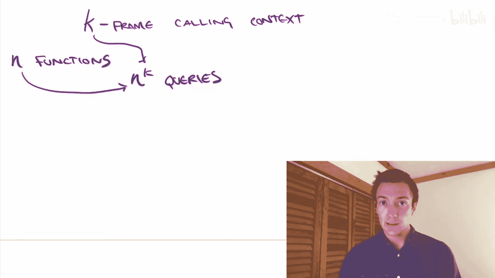

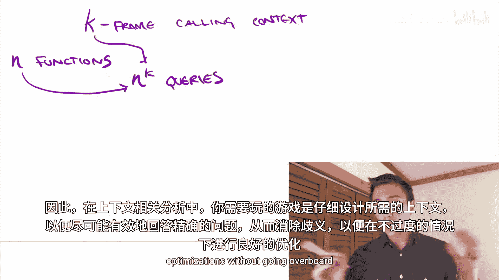

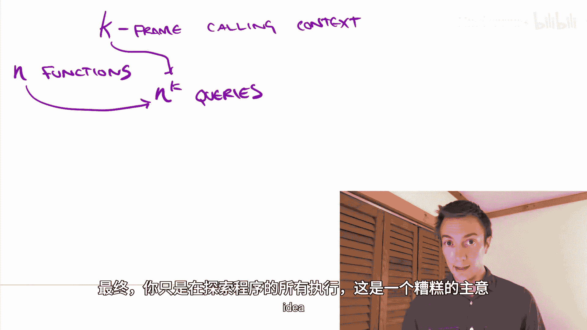

Powers that are impossible to answer without that addition of contact。

 So that is a whirlwind overview of the wild world of interprocedural analyses。

 They can be very powerful analyses and willll see how to build on these concepts in the future。

 for example， when we do alias analysis in the next lesson。

 But I think the main thing that you need to take away from this lesson is just knowing what the tradeoffs are。

 that is in making a what the benefit is of making a closed world assumption versus the practical constraints that need to make you make an open world assumption。

 and the performance tradeoffs of using context sensitivity。

 if you take nothing else away from this lesson。 Remember that inlining is kind of the key interprocedural optimization。

 So if an evil wizard curses you and dooms you to only ever implement a single interprocedural analysis and never implement any other one ever in your entire life。

 you should make that one analysis in liing。 there's many different ways to do in liing well，😊。

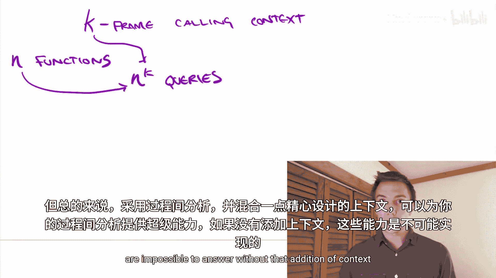

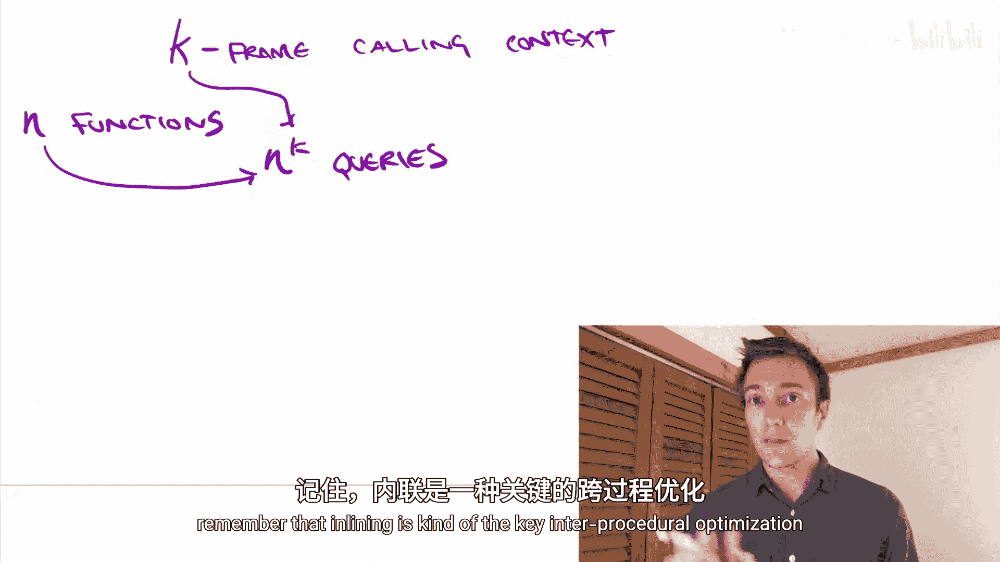

Once you've done it， you can unlock the potential of all you know about local and global optimizations。

