# 【康奈尔大学-•-中英】高级编译器项目教程-CS-6120（Advanced-Compilers，2020）-p14-P14-Lesson-9--Alias-Analysis--BV1gE9ZYsEUm_p14-

In this video， we're going to talk about pointier analysis， Aka alias analysis as the name implies。

This is going to be about analyzing programs that have to that use pointers to motivate why we care about pointers and about loads and stories to memory。

 I want to， at the risk of overstating a point， show that lots of languages。 In fact。

 almost every programming language you've ever used， has pointers。 It's maybe really obvious in C。

 because things are manifestly pointers all over the place。 every time you see a star。

 theres a pointer involved。 Like， for example， in this innocent looking implementation of a string copying like function in C。

 Java also has pointers。 You may not see stars quite as often in Java。

 But everything that's not a primitive type like int or bull is using a pointer under the hood。

 That is everything that has a sort of ordinary object type or an array type。

 that's using an actual pointer。 So when you do， for example。

 when you taken when we're doing this writing this method that takes in an object。

 And we're doing a comparison using equals， that's doing a pointer comparison。😊。

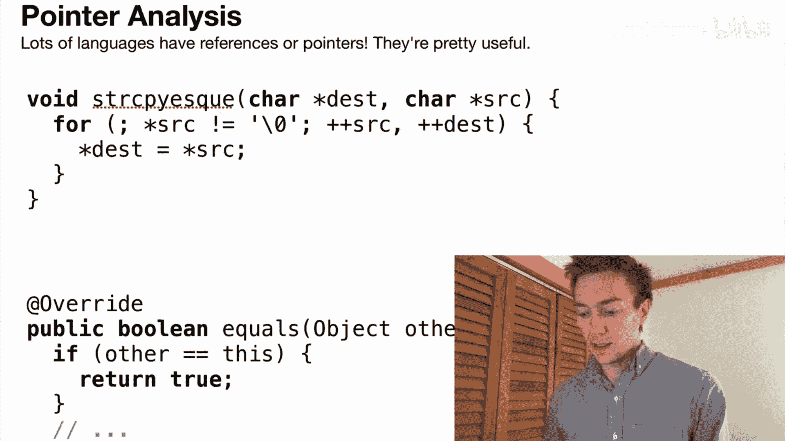

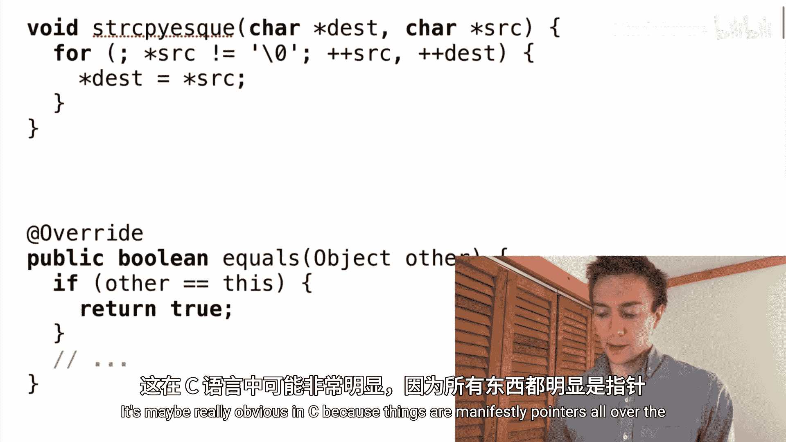

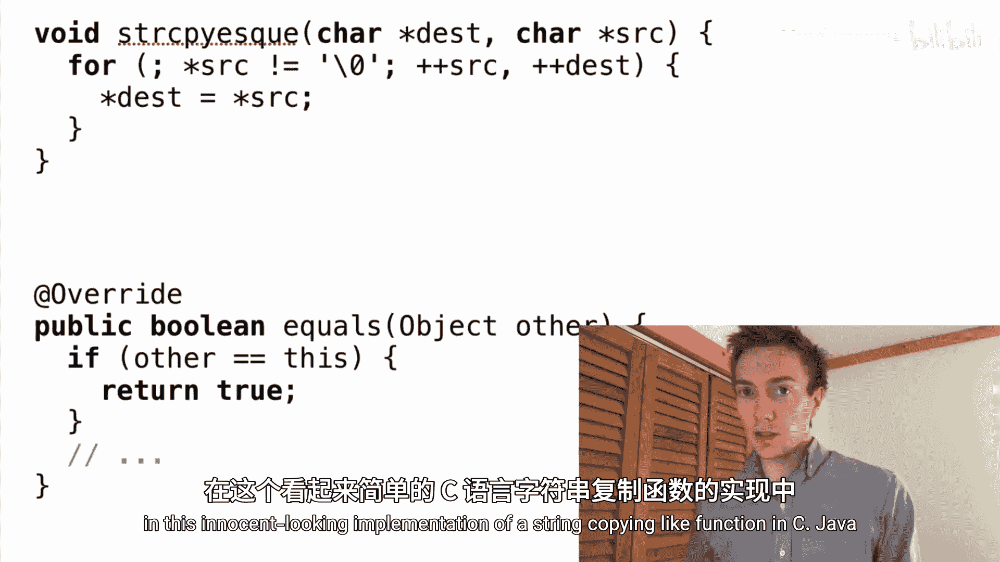

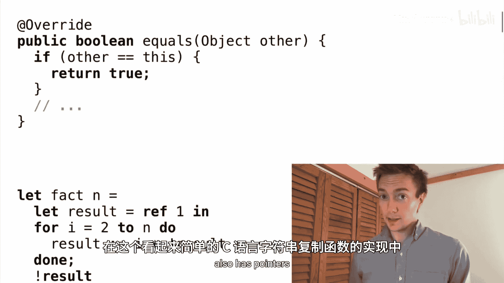

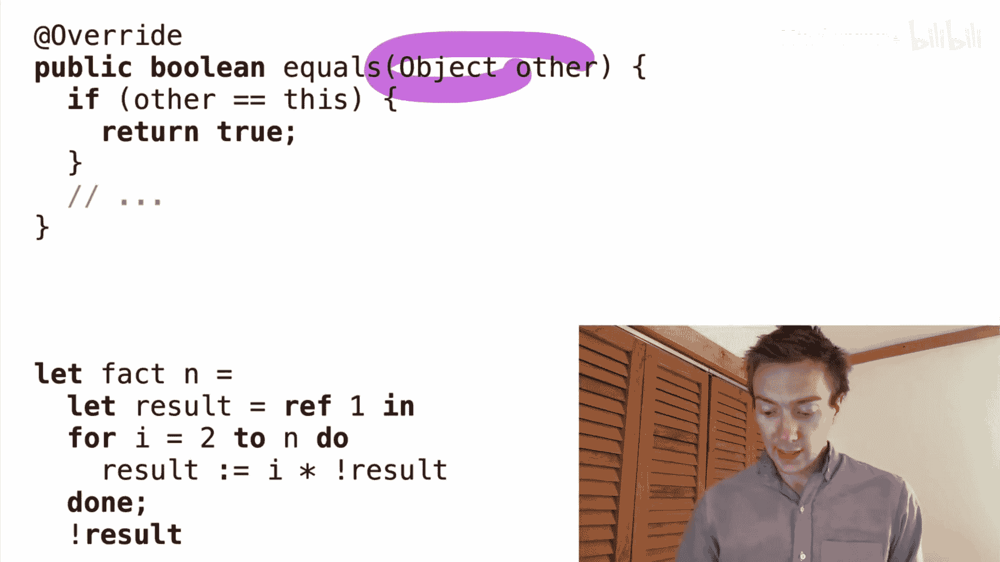

Ocamel has pointers all over the place used implicitly。

 There is a whole bunch of times that Ocaml programs use pointers that you're not even aware of。

 You can also explicitly use pointers。 Aka references in Ocal using the ref thing and then you do a excation point thing。

 which is a which is that moral equivalent of a dereferencing star in C。 In any case。

 there are definitely pointers that you can use and manage yourself in Ocaml。 So in general。

 pointers are really everywhere， and it makes sense to try to analyze programs and to try to optimize them in the presence of using pointers。

 Braille also has pointers。 if you use the memory extension。

 You've probably encounter the memory extension before。

 Maybe you've even written programs that use the memory extension。

 the instructions from the memory extension。😊。

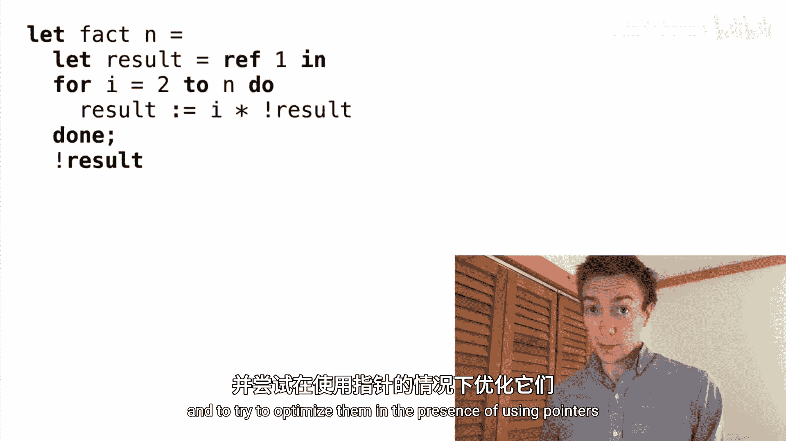

There are， there's an ac instruction that creates for you a new location memory。

 There are store instructions that you put values into memory。

 and there are there's a load that's not shown here。 But there's also a pointer a。

 that's see sort of move around pointers in memory。 There's also a free， also not shown here。

 And but the important thing is that there are values of type pointer to something。

 So vowels is not an in itself， but it's sort of like。😊，A int star in C。 that is。

 it's a pointer that can refer to an int。 I'm going you give a second。

 I'm going to give you a second to just read this program and reffailiarize yourself with how the Braille memory extension works by thinking about what this program does。

I have another program to show you and to have you ponder。

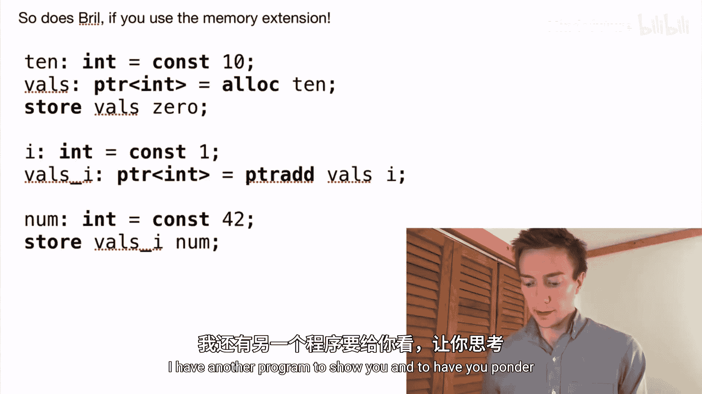

This program is written in something like C。 and my question for you is what this program returns。

 pauseuse the video now and think about what this program does and what value it produces as a boion。

The simple answer to this question is that this function always returns true。

 That is it's easy to see that we are putting the letter A into the location pointing to by a。

 and then we're reading it back out of a without changing it again。

 And therefore it must still equal the value A。 therefore。

 this thing is going to this expression is going to return true and the overall function is going to return true。

 That sounds great。 Unfortunately， it is wrong。 And the reason it's wrong is because like everything else involving pointers。

 This program is made more complex in the presence of a lacing。

 That is the possibility that the two different pointers may point the same location in memory。

 If we're just talking about normal variables like normal stack locks。

 and this we just a normal assignment to a variable A， this or just a normal read from variable A。

 then it would definitely be true that we could optimize this program to just say return true without actually doing anything else。

 But because there is pointers。 because the pointer to the a pointer in the B pointer might actually point to the same location in memory that may be the same memory address when those two。

😊，Things point to the same location in memory。 This function returns false because we're storing a different value into the same location before reading it back。

 So an optimization we might like to do。 that is eliminating this， like hypothetically dead code。

Won't work in the presence of pointers and particular in the presence of aliasing。

And that's what this lesson is about。 It's about deciding when two pointers can point the same location memory that is when they can aliaase each other。

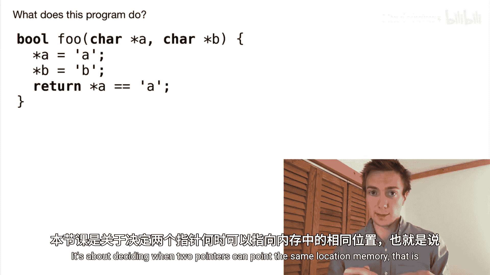

The reason that we're studying this is because it is truly essential to do anything at all with programs that involve pointers。

 Anything you might like to do anything that like seems easy or straightforward unlike normal programs without pointers。

 That is like with normal sort of like local variables that don't have the problem of asing。

 All of that is made hard or impossible， if there's the chance that things might alias。

 that is if we're dealing with pointers that are unrestricted。 For example， we just saw an instance。

 where we would like to eliminate a dead store that is a store to a pointer that doesn't seem to be used again。

 but it's not actually dead because of the possibility of aliasing。

 some later read may read from the same pointer。 So we can't eliminate something that looks like it should otherwise be useless。

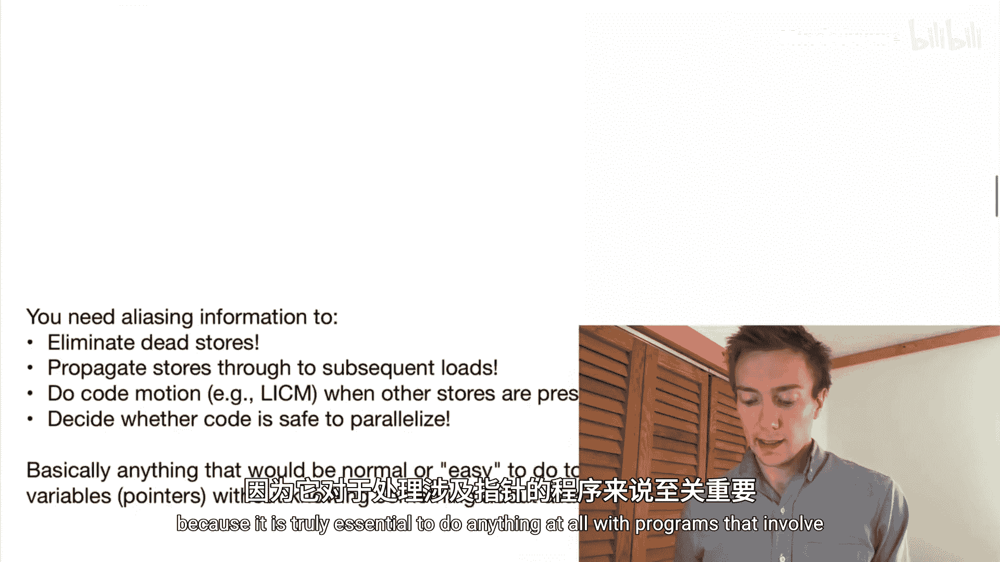

Similarly， this example involved an opportunity to propagate a store to memory through to a load and therefore get rid of both the store and the load。

 And that is made impossible because there's an intervening store to a completely different pointer that if it aliaasees kind of ruins the opportunity to do optimization。

 Similarlyly， you can imagine， really pernicious cases where it seems obvious that you should be able to do loop andvariant code motion that is to decide that some code is loop invariant。

 But because it uses pointers， you can't actually be sure that none of those pointers are being modified through other pointers that also are being used in the loop body。

 So you actually lose out a lot by by not knowing that two things by having the possibility that the two pointers might aase each other。

 An example that is close to my heart is that alaase analysis is a major bottleneck on being able to automatically paralyze programs。

 If you wanted to， for example， take some code that is written in a sequential way and make it run on a vector machine or on a multi corere machine。

😊，You need to be sure that those code that that those pieces。

 the code that you want to run in parallel with each other。

 that those pieces of code are independent。 They can't interfere with each other。

 That is when one writes， the other one doesn't need to subsequently read the value that that one wrote。

 And that is often true， if you know that the pointers involved， can't possibly aliaase each other。

 But when alaing is involved， you have to make conservative assumptions and all your attempts at automatically parallellyzing code are immediately ruined。

 So alias analysis is it really important。Analysis to do for all of these optimizations。

 basically to do anything with a code that involves pointers。

 So let's pose exactly what the alias analysis problem is。

 An alias analysis asks this kind of question for every program point， there's every instruction。

 for example， in a braille program。 And for every pair of pointer typed variables that is anything that looks like pointer to something in Briille。

 Can those two pointers point to the same location and memory at that point in time。

 that is at that program point。 There are several problems with this question。

 and the most fundamental one is that it's undecidable。 That is。

 will run into halting problem like issues if we attempt to always answer perfectly in the affirmative or the negative。

 whether two pointers might alias， It's pretty easy to see， for example， how to reduce a。😊。

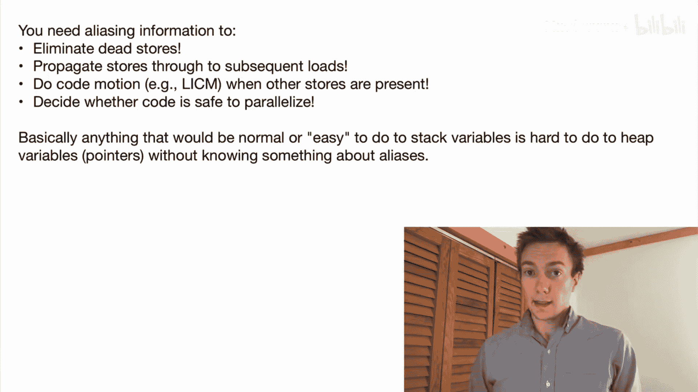

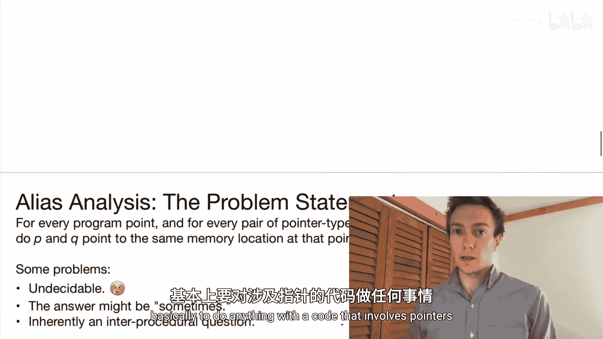

Alias analysis query that must say yes or no to the halting problem。

 that is to have two pointers at alias if and only if another program。

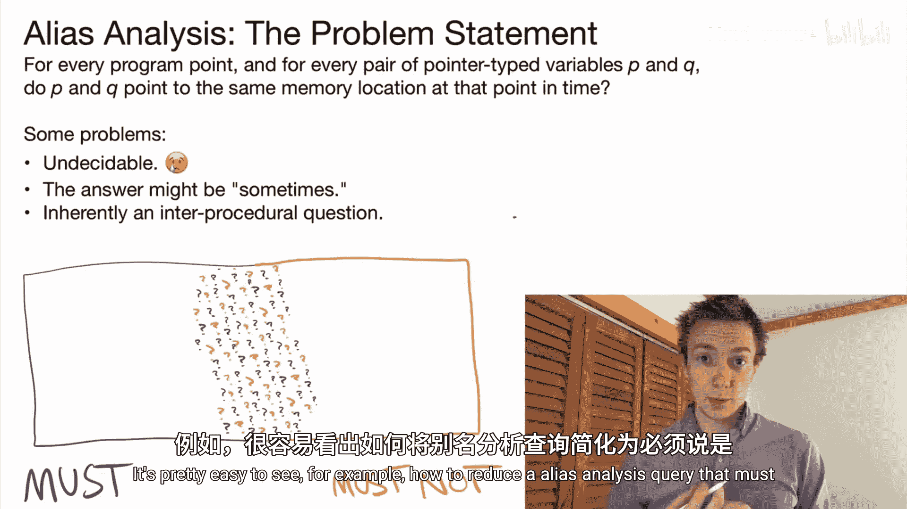

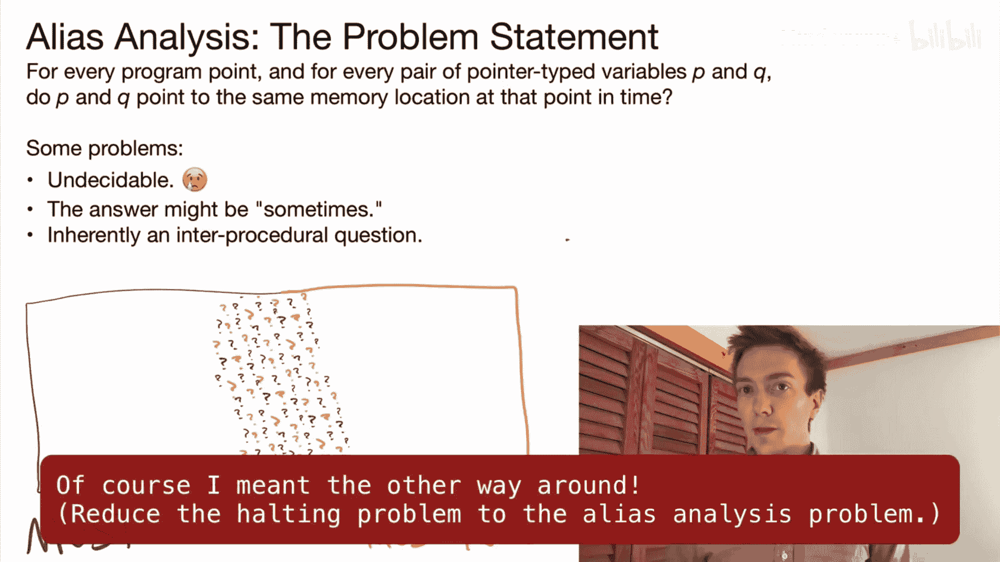

Hot。Therefore， we're going to have to do with approximations。And in general。

 even approximating this answer can be quite expensive。

 So the answer a lot of the time to the question might these two things aase each other will be sometimes that is。

 I don't know for sure， but sometimes on some executions of the program they might aase each other in other times。

 they might not。 Finally， it's inherently an interprocedural question。

 That is even simple functions like the string copying function I showed you earlier。

 the aliasing behavior depends on what are arguments are to the function。

 That is whether we're called with pointers that aase each other or not。

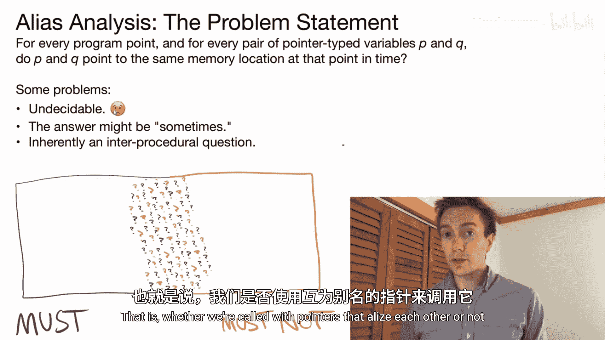

So in general， the way that alias analysis problems are set up is so that we can answer yes， no。

 or maybe。 That is there we want to classify pairs of variables as either， yes， these must alias。

 That is in every execution of this program。 These two pointers are exactly the same。

 They must not alias。 that is they can be any value， but they can never be identical to each other。

 or we don't know。 That is that they might aliaase some of the time。

 but we don't have a definitive answer either way。And unfortunately。

 the awful reality of pointer analysis is that most answers to these questions are going to end up in this middle section。

 That is most of the time we won't be able to prove either that things never alias or that they always alias。

 The typical way that alias analysis are set up to benefit compiler optimizations。

 is using may alias queries。 May alias queries ask an analysis to say yes or no。

 where yes says that the two things might alias， but we don't know for sure， and know。

 if we know beyond a shadow of a doubt that they must not alias。

 optimizationims can then use that information when the alias analysis is answered in the negative to do interesting optimizations。

 However， if the analysis answers yes， then we don't really know anything。

 We don't know if they will alias or not， and therefore， optimizations are typically restrained。

 With that in mind， Let's set up to do a may alias analysis in a straightforward way using the data flow framework。

 We will try to design a data flow analysis that tries to answer when to pointer values。😊。

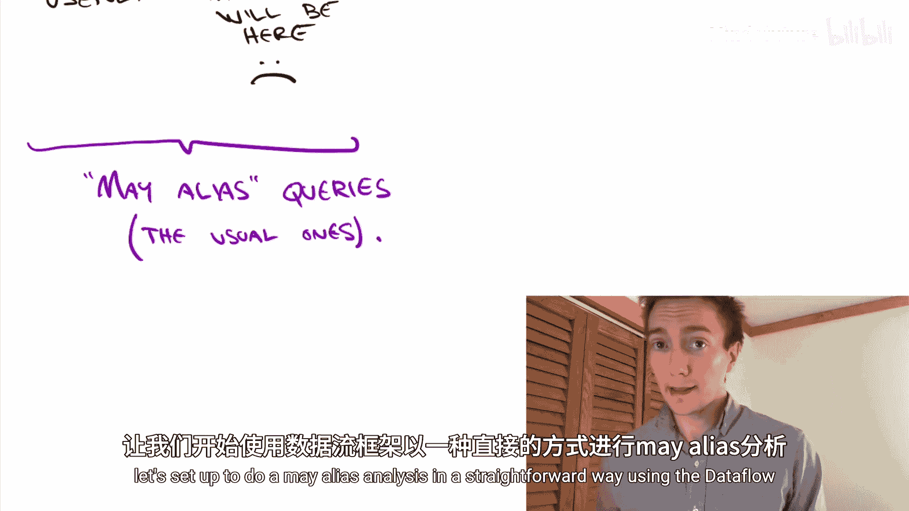

Might alias the same location。 So again， we will say no。

 if we know for sure that they don't and we'll say yes。

 if maybe that is they might alias or they might not。

I'm going to set up the first few fields in the data flow framework and leave it up to you to fill in the rest。

 This will be a forward analysis that is a normal one that goes from the entry block forward through the data flow graph。

For the domain， I'm going to set it up so that we will have a mapping that goes from variables to memory locations of some kind。

So the thing that we'll compute on the entry and exit of every basic block will be a mapping from variable names in the program to sets of locations that those variables might refer to。

 The idea is that then we can answer May alias queries by doing set intersection。 That is。

 if you ask me might X and Y alias at this point in the program。

 you'll look up this data structure for this point for that point in the program。

 and then you'll get the associated sets for X and y， you'll get the set of locations。

 And if those sets intersect， then we'll say yes， they might alias。

 And if that intersection is empty， then we'll say no， they must not alias。

 and therefore you can do interesting optimizations。

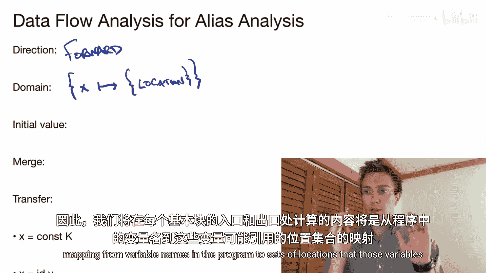

I'd like you to pause the video now and think about the rest of the aspects of the data flow framework。

 That is， what do we have to do。What will be the initial value for this analysis。

 What will be the merge function and what will be the transfer function for these three instructions。

 You can think about how to extend these to all the rest of the instructions， too， But these。

 I argue are the important representative ones。 Think about this for a moment and convince yourself that you have a minimal working。

 accurate alias analysis。We'll start out with an initial value that maps every single variable to the empty set。

 That is variables don't refer to any locations， can't refer to any memory locations at all for the offsetset。

 So I'll just say for all X。The merge function will do。A union。At every variable。

What I mean by this is we're going to take the different mappings that we need to merge。

 at least two of them。 We will take all of the sets associated with every variable and pairwise。

 take those sets and union them。 That is now when we're merging control flow。

 we now can say that the variable X can refer to any of the locations that came in from the left side or any of the locations that came from the right side。

 So that means that we'll union together all of those possibilities for every variable。

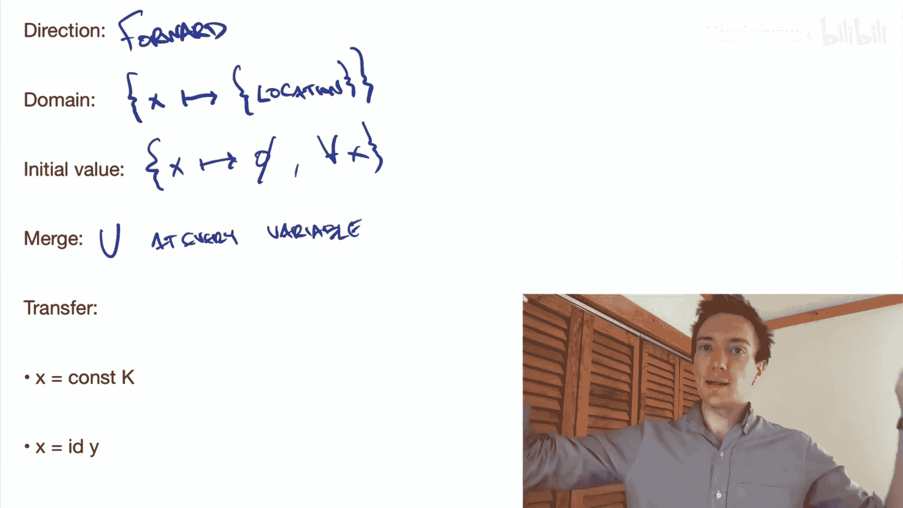

For the transfer function， I ask you to think about these three functions， these three instructions。

 rather， a constant， an ID that is a copy， and then an allocation。

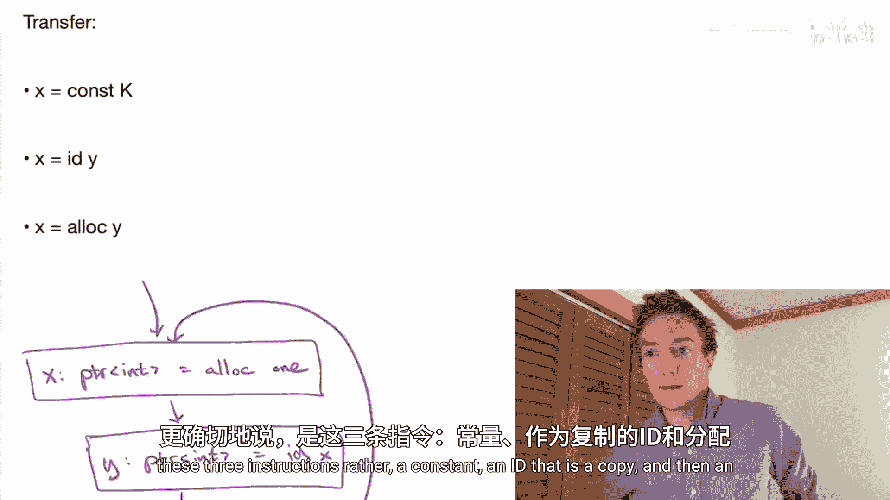

And the constant， you can think of this as being representative of other instructions also like add。

 because all we really need to do is in that mapping that we're producing for the output。

 we will just set that to the empty set。 If we have X if we were setting X to a constant。

 then we know it can't possibly refer to any memory locations。

 It's a constant like five or something like this。 So it's not a pointer。

 And so we will set its associated set of memory locations to nothing。

Then there's a copy， if we say x equals ID DY， all I want to do is set the output。

Mapping for x to be all the same locations that we had for y。And finally， there's allocation。

 We now need to come up with a new memory location that represents this allocation。

 So we'll compute a fresh location。A fresh memory location and say that the only thing that X can possibly refer to right now is that memory location。

And this is kind of the key。 This is where memory locations come from originally is allocation sites。

 and then we'll be propagating them through the rest of the program using the state of flow analysis。

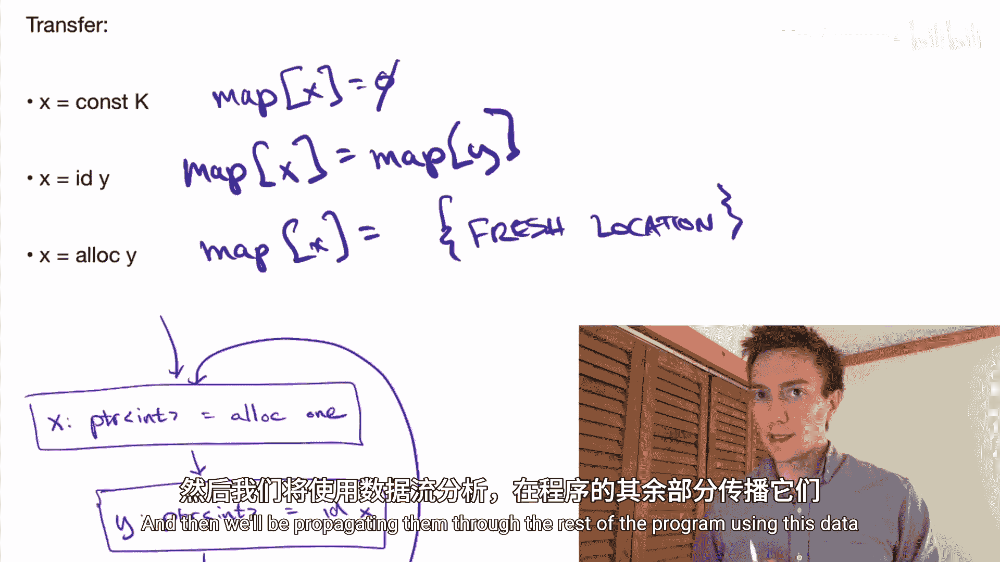

Let's now try to run this analysis on this tiny CF FG I have on the slide。

 This program only ever uses one variable， Two variables， actually X and Y。

 So when we start out the program， X will map to the empty set， and y will map to the empty set。

Then after we do the transfer function on this first block， there is an allocation in there。

 which means that we have a memory we need to associate a memory location with x。 So in between here。

 we will have a mapping that still has sorry， Y going into the empty set。

 but x now maps to let's just call this location1。So x can only contain values from that location。

After this， we'll have done our transfer that deals with copies with IDs。

 and now both X and y will map to the same location L1 to the set containing just one location L1。

The next step is to analyze this block that just has a branch in it。 branchesches， of course。

 do not affect pointers。 So we'll have the same value that is a mapping from x and Y both to the set containing L1。

 going out of this branch and therefore back into the top of the loop again。

 We then need to do run our merge function that is our kind of point Y is union across these things。

 because we're merging control flow into the top of this basic block。

 So we will end up again with this mapping， that is x and Y both mapping to L1。

 after we merge L1 with the empty set and then L1 with the empty set。

 Now we have the same environment going into this basic block。

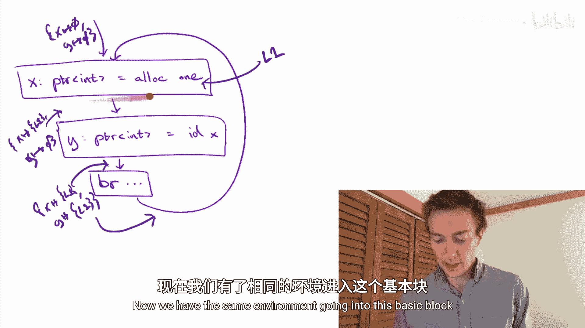

So now my question to you is what should we do with the transfer function that says that we need to come up with a fresh location for x to run this allocation again？

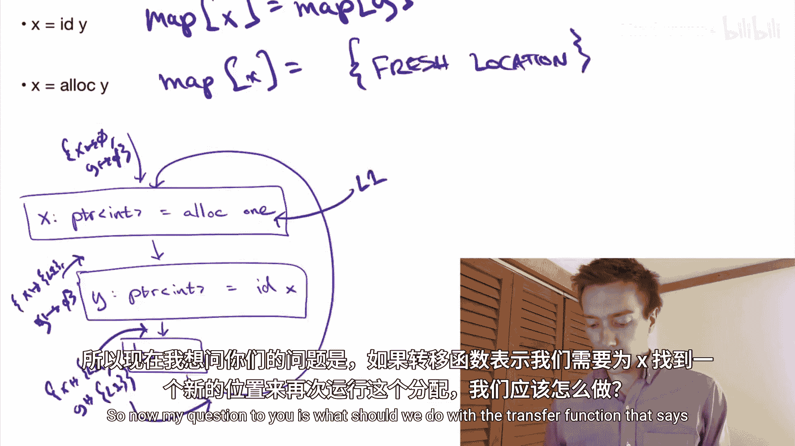

How should this change the environment。I realize this is a somewhat philosophical question。

 but I would like you to pause the video and ponder for a second what we should do when we run the transfer function the second time for this block now that it has a different in value。

I think the most natural answer to this question is that we need to generate a new fresh location。

 That is， this is the second time conceptually around the loop。 And therefore。

 it's definitely going to be a separate location in memory that we're allocating here。 Of course。

 the problem with this is that it doesn't converge。 We will keep going around and around the loop。

 Generating new memory locations and getting back to the top of the loop and ending up with a different input value。

 So we'll need to rerun the analysis for the loop again。

 coming up with a new memory location every single time。

 And this will run forever and never converge。😊，By coming up with a new memory location on every analysis of this basic block。

 we have painted ourselves into a corner where we're kind of like actually running the program and coming up with a new memory location every time that we run the loop。

And that simply won't do for an actual static analysis。

I contend that the only reasonable thing to do instead is to associate a single memory location with every static allocation site。

 That is， when we analyze this basic block again， we won't come up with a new location L2。

 We will put the same old memory location L1。😊，And associate it with the variable X。

This seems a little bit odd because we know when we run the same loop twice and we allocate twice。

 we're not getting the same memory location。But what's going on here is we need to abstract away from that actual execution of programs with a model with a static over approximation of how memory actually works。

So this gets us into the very important topic of heap models。

 Heap models basically answer the question。 What is a memory location If we answer this question with a memory location is an actual concrete pointer。

 that is an actual number that points to a location in memory。

 Then we're going to end up with a nontermination and over precisionciion problems that we just saw when we try to come up with new memory memory locations in every trip through the loop。

 So we need kind of an abstraction of memory that lets us do aliaase analysis in a computable intractable way。

 the most straightforward heatap model I can think of and also a really effective one is to associate every allocation instruction in your program with a single memory location。

 So this will be associated forever and for all time before we even start doing our data flow analysis with the location L1 will just label that instruction with that location with that location in memory。

 So this means that our abstraction of memory is that， yes。

 there's a whole bunch of actual pointers when the program runs。 But we're going to group together。😊。

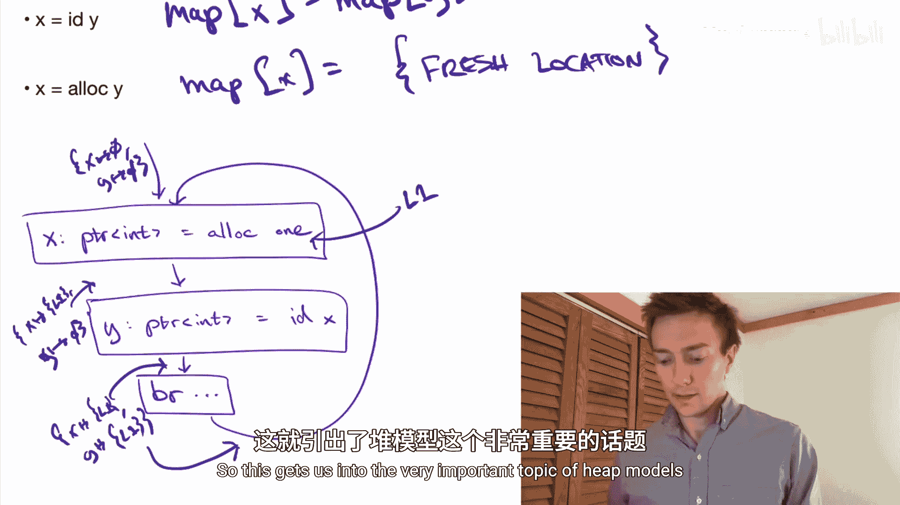

All those pointers that are allocated from this allocation site and call those all location one in our abstract domain of pointers。

 This frees us from the need to track actual pointers and gives us the tractability we need to solve the alias analysis problem。

 This， of course， has an impact on the precision of the analysis。

 It means that when we have two different pointers that come from the same allocation site at runtime。

 when we do our analysis， we will consider those to be the same location in memory。

 This seems obviously incorrect， those are not the same location in memory。

 But all it is for the purpose of our analysis is conservative。

 because we're doing a may alias analysis。 All this can do is cause us to answer more of the time that。

 yes， these two things might alias， which remember， is the disappointing and useless answer。

 It's always safe to answer。 Yes， these two things might alias。

 because we're not going to use that to do any interesting optimizations。😊，It is only unsafe。

 potentially unsafe to answer。 No， That is we can't answer the two things must not alias when there is some chance that they might。

 So this abstraction of the memory domain makes us conservative in the sense that we will will be giving less useful answers from our alias analysis。

 On the other hand， it makes it possible to do the analysis。 So that's a pretty good trade off。😊。

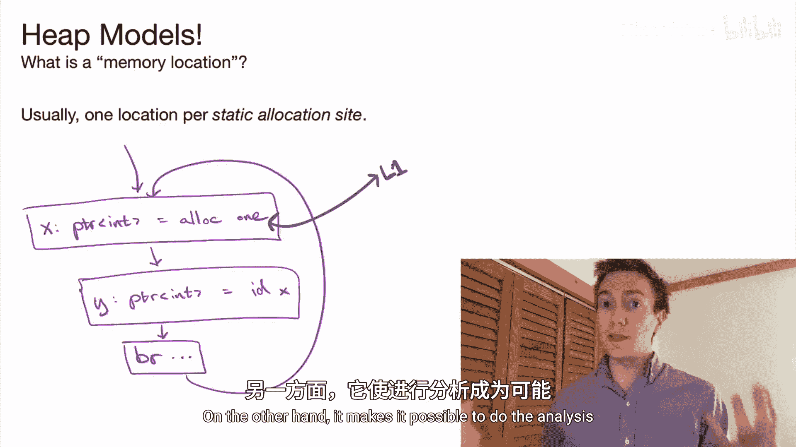

This simple heap model works for Briilll for realistic programming languages。

 You inevitably want to make this slightly more precise， at least， For example。

 in languages with arrays， you really want to have a separate memory location for every offset in the array often。

 and typically you want to have separate memory locations for different fields within an object if you' are in object oriented language。

The final aspect I want to talk to you about is bringing context sensitivity to alias analysis。

 We talked about the general concept of context sensitivity in the previous lesson about interprocedural analysis。

 alias analysis can be made very interprocedural that is it absolutely has to do with lots of interactions between functions。

 So it often makes sense to bring in some kind of context sensitivity like calling context in order to make your alias analysis more precise to show what I mean。

 let's bring back that little stir copy like function that I wrote for you at the very beginning that sort of works like the stir copy function for C。

 Now， imagine that we have two different calls to stir copy from a fu function and a bar function。

 And in one case， you're calling it with exactly the same pointer that as we're just doing stir copy of A and A。

 And some cases， we are allocating a new thing and passing into stir copy。

 So these two things cannot possibly alias。😊。

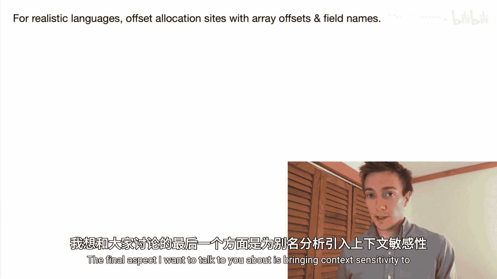

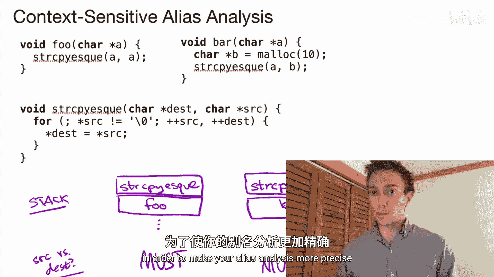

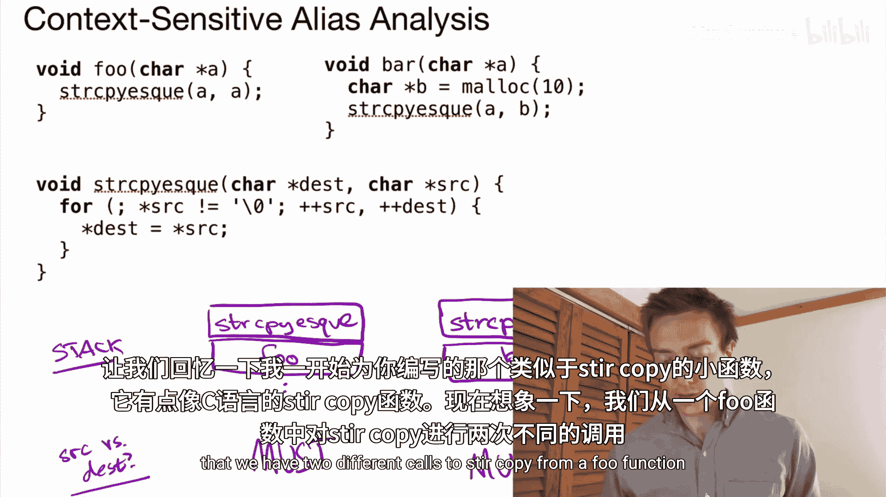

Its a straightforward alias analysis that is does not try to use interprocedural information。

 does not try to use calling context， will have to say that these two things may alias。

 and therefore this function does something quite odd rather than doing a proper string copy。

On the other hand， if we introduce just a little bit of calling context， that is if。

 if we introduce awareness of just the one function that called the string copy function。

 we can conclude that it is definitely the case that these two things alias in the context of fo and must not alias in the context of bar。

 and this is much more useful。😊。

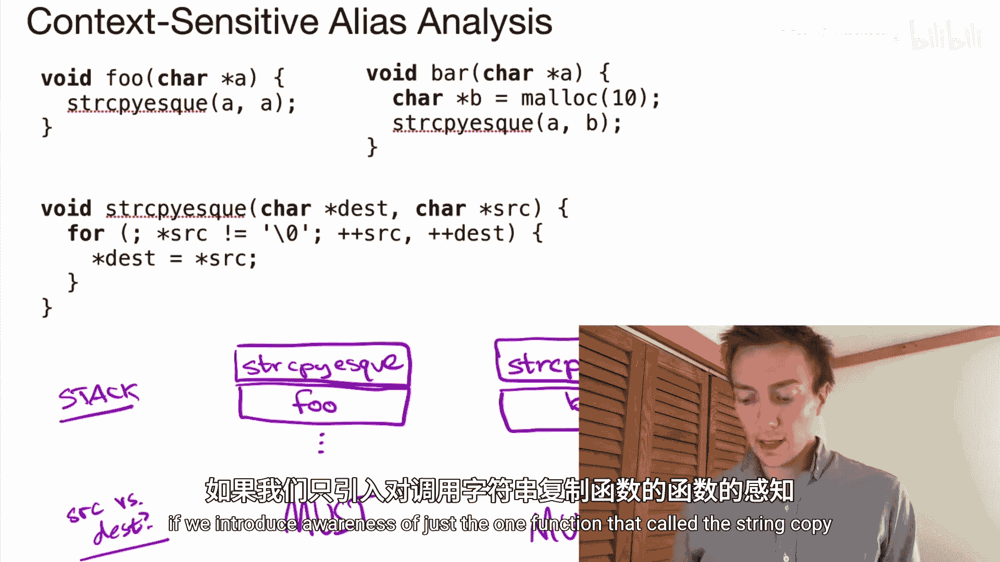

Of course， as with any context sensitive interprocedural analysis。

 there is a really sharp trade off here between the precision and the cost by precision here for alias analysis。

 what I mean is it's the fraction。 It's like the proportion of querries of alias analysis pairquerries that you can answer as either must alias or must not alias。

 and they don't have to go into that uncertain middle of the diagram I showed you before。

Adding context makes alias analysis more precise， but， of course， it also makes it way more costly。

 So at some point， there are diminishing returns to the additional precision you get at the cost of spending a lot more time analyzing your program。

In general， having a scalable that is efficient alias analysis that can analyze very large programs。

 where at the same time it is very precise is a huge open research problem。

 I really can't emphasize this enough。 There's like a whole research community out there about making good alias analyses that are both fast and precise。

 There's a huge body of research out there。 I've left a couple of links into。

 especially a really great tutorial by some people that that have worked on alias analysis to give you an idea of the gigantic breadth of research that is there for just this one kind of analysis。

 And it's so important because as we saw the very beginning of the lesson。😊。

Doing a good job with aliaase analysis is key to getting anything done that transforms programs that manipulate pointers。

 So any optimization you would like to do that has to do with memory has to rely on an aliaase analysis first before it can really do its work。

 And that's why it's so central in compiler optimization research。😊。

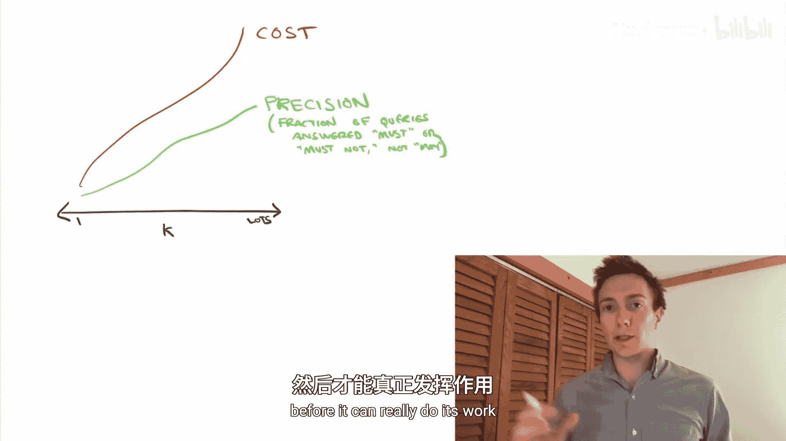