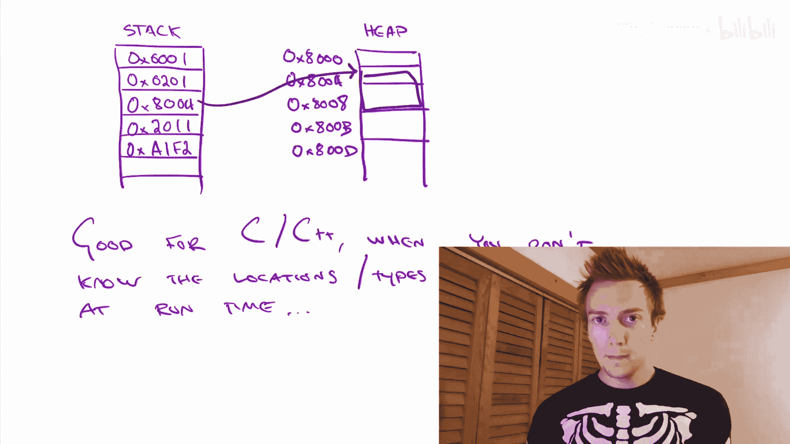
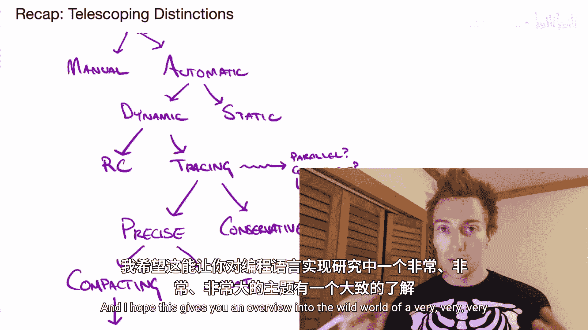

# 【康奈尔大学-•-中英】高级编译器项目教程-CS-6120（Advanced-Compilers，2020）-p15-P15-Lesson-10--Memory-Management--BV1gE9ZYsEUm_p15-

Hi today we're going to talk about memory management that is automatic memory management A a garbage collection。

 the reason that we care about automatically managing memory is because manually managing your memory in programs is extremely hard and very。

 very， very error prone。This example on the left hand side comes from the Braille memory extension。

 For instance， in Briille， you can allocate memory and you can free memory。

 but nothing really stops you from freeing the same memory twice。

 which is definitely a problem at runtime。 and in languages that make you manually manage memory。

 This is the sort of thing that's really easy to do。 And， of course， it's not just double freeze。

 There are all sorts of other kinds of bugs， really。

 really bad ones that happen when you are forced to manually reason about memory。 You can。

 for example， use memory after it has been freed and perhaps reused for some other purpose。

 You can read uninitialized memory。 You can forget to free memory。

 You can extend over the the end of some memory you are supposed to use and read someone else's memory next door。

 a buffer overflow。😊，All of these problems cause real serious issues for software engineering。

 which motivates the need for some sort of automatic support in getting memory management right。

Just for example， last year there was this very highly publicized finding from Microsoft。

 the security people at Microsoft who found that enumerating all of their CVEs。

 which are these reports of security problems within Microsoft。

 fully 70% of them stem from memory management bugs in languages that are unsafe with respect to memory that is that let you write the kinds of bugs that are possible to write in the Braille memory extension。

I think it's useful to ask ourselves。Just in general。

 like what the current landscape is with respect to memory management。

 That is all those bugs that have to do with with incorrect management of memory。

 those come from languages that make the programmer manage memory themselves。

 And there are lots of other languages that automatically do it。

 And that's what this lesson is going to be about。 But I think it's instructive to try to brainstorm languages that fall into these categories。

 That is ones with those problems。 That is ones in the manual category。 Then there is。

 then there's two different subcategories of automatic memory management。 I want to think about。

 One is when memory is managed dynamically。 that is like something happens at runtime to help automatically reclaim memory。

 and then there's something where all that reasoning is done completely at compile time。

I'm not going to make you pause the video or anything。

 I'm just want you to think for a moment as I write these things down like what languages like pick your favorite languages。

 pick your top 10 favorite languages and try to categorize them along these columns。

The standard bears for manual memory management are definitely C and C plus plus。 There are others。

 of course， but these are the famous ones and the ones where the vast majority of those 70% of those bugs we're talking about come from。

 Then there is dynamic and automatic memory management。 And this。

 I would argue is where the vast majority of languages that you probably use fall。 For example。Okay。

 I'm getting tired of writing， but you kind of get the idea languages from Haskell to JavaScript all use automatic management of memory。

 the final category， static but automatic management of memory。

 where all the decisions can be made at compile time。

Contains approximately one standard bear in a mainstream language。 And that is rust。

 You can find other examples。They're mostly researchy， however。

The vast majority of languages that attempt to automatically manage your memory for you and therefore avoid those scary memory bugs are automatic and dynamically managed。

 and that's what this lesson is going to be about。In particular， we want to create a programming。

 the model that looks more like this that is taking off on that Braille memory extension。

 but we really want is to be able to allocate memory and then use that memory and not worry about freeing it that is never write down a free call and allow a combination of the compiler and a dynamic runtime system to free it whenever it deems necessary。

Whenever it decides to free it， and crucially it should never free it before we actually need to use it again。

So just as a quick reality check for why I'm emphasizing this dynamic management of memory。

 you can consider a little bit what it might look like if we tried to introduce completely static management of memory。

 That is if we tried to guess when to free memory， just by analyzing the program。

 instead of doing some sort of accounting at runtime。 It's not that hard for this little program。

 That is we can definitely tell we're done with this memory right at the end。

 If this is truly the end of the program。 But let's consider a slightly more complicated example。

 This isn like a kind of pseudojava syntax。 We'll make a hash map。

 we'll make an object and we're going to put it into the。😊，The hash map。

 depending on like taking input from the keyboard， for example。

 So like put the thing into the hash map and then we'll take input from the keyboard again to decide whether to overwrite the same key to store null that is like to throw away the object something before finally iterating over the entire map and using the stuff So the question is how will the compiler know at any given point somewhere in the middle here。

 whether the something object is going to be used again in the future。

 That is whether it's going to be used in one of these calls to dot use。

Is it going to be used in the future here， Of course。

 that decision depends on two things that make it hard to decide。First。

 there is taking input from the user。 We can never really be sure what input the user is going to provide by typing on the keyboard。

 so the compiler can't possibly know that answer。 And the second is it needs to know something about the semantics of hashmap that is needs to know that like overwriting with the same key。

 which again might come from some unknown place that that is going to destroy the object and we're no longer going to need it in the future。

 So all of these reasons about like analyzing a whole bunch of code that seems irrelevant to the task at hand and also dealing with dynamic behavior means that it's really。

 really hard to decide where to free memory if we have to do it completely statically。

 and that's why this lesson is primarily about the dynamic the dynamic automatic memory management techniques which are collectively typically called garbage collection。

In garbage collection， that is in automatically managing memory。

The the idea is that instead of doing what we really want， which is to free memory。

 the moment that it is certain we're never going to use it again in the future。

 which that's too hard。 Instead， we'll do something a little bit easier using the evidence actually available to the compiler in the runtime system。

 which is that we will free memory after sometime after it becomes unreachable。

 So we need a definition of unreachable。That depends on sort of viewing the data structures that exist in a program as a graph。

 and what we mean is the graph theory notion of unreachable in that graph。More intuitively。

 it just means that it's impossible for a program to diverse any pointers through through its data structures to arrive at the point where it can refer to a thing。

 And if that's not possible， that is it's not possible through any path through the program to get there。

 then that thing is classified as unreachable and therefore can be freed by a garbage collector。

 So here's a picture of how the data structures in a program might look and how to view them as a graph。

So there are variables involved here' like I'm thinking of these as local variables。

 they can be normal integers in case in which case the garbage collect doesn't really care about them or they can be pointers in which case they point to other stuff。

 there can also be global variables aside from just the stack local variables and then like the actual objects involved can be things like objects with multiple fields like in object or1 languages or there might be arrays that also contain pointers。

 but any case the values inside those objects can themselves be primitives like they could just int for example。

 or they can point to other objects like this field of object B points to array A in this field of array A points to itself。

This I hope you can see is how you form a graph that is the values that can contain data。

 those are the vertices in the graph， and then where the pointers within those values point2。

 those are the edges in the graph and self loops are allowed。Broadly speaking。

 it's really helpful to divide up divide up this memory graph into two main things。

 There is the heap。 that is like the stuff that is allocated off of the stack that this is the stuff we will eventually want to free。

 And then there are the variables that can refer to that。 that can refer somewhere into the heap。

 In particular， these are the local variables from the stack and the global variables。

 those can contain pointers to stuff within the heap。

 but we're never going to free a global variable by itself。 that exists forever。

 And we're not tasked with freeing local variables。

 Those are going to go away when the stack frame returns。

 We're only considering in those things because they can point into the heap。

 And that's where all the challenge exists。 That is that's where we where we need to decide when to free values。

😊，Those things on the left hand side here that is the local variables and the global variables are typically called the roots。

 because that's where we'll start looking for live stuff。 That is the question is。

 is your value reachable from the roots。 and then of course。

 the rest of the stuff that we may or may not free。 That's the heap。

 Here's a little bit of garbage collector terminology for you。

 people will often refer to the algorithm that that's looking for stuff to free。

 That's the collector。 That's the runtime system that like decides when to free stuff。

 I think it's hilarious in the garbage collection literature。

 the other stuff that is the actual program you're trying to write。

 gets this kind of like diminutive name， the mutator。

 that is your program you're actually trying to run the whole reason we're doing this。

 that's the mutator to distinguish it from the collector。😊。

Then the terms live and De are pretty similar to the terms that we used for local variables when doing our data flow analysis。

 for example， live just means it's going to be used again。

 a thing is going to be used again sometime in the future， and dead means the other thing。

So I want to introduce you to a big distinction within the world of automatic memory management。

 There are two main lenses through which you can see the task of trying to find unreachable values and calling free on them。

 I'm going to to distinguish these two things along several different axes and try to explain them both at once。

 The two main categories here I'm talking about are called reference counting and mark sweep or tracing。

 And very briefly， as an overview， reference counting says I'm going to keep a number associated with every value that indicates how many references there are to it。

 And when that drops to0， I know I can free it。😊，And Mark Sep says I'm going to start at the roots and do a kind of graph search from there and everything I can find from it。

 I will keep and everything else I will free。I'm going to go through these step by step and hopefully you get an idea of how these are kind of related but different from each other。

All right， my cat lefty got really excited about this distinction between reference counting and garbage collection。

 so students can be with us for the next little bit of the lesson。 Lefty say hello to 6120。

 say hello to lefty。 Okay， so as I said， the first difference between reference counting and and tracing is that with metadata they have to keep along with every object that they might want to free。

 So reference counting。😊，Tries to keep at a value associated with every node in the graph that is every value we might collect that represents its in degree。

 that is how many references that how many pointers are pointing into that node。

 who might have a reference to that thing。Mark sweepep or tracing。

 or sometimes it's just called garbage collection。Doesn't have any extra metadata instead instead it's just going to analyze the graph。

The second difference is when these two things run Refence counting runs every time you change a pointer。

 That is every time you take a pointer that pointed somewhere that you create a new pointer or you modify a field of an object。

 for example， that contains a pointer to point somewhere else。

 The reference counting has something to do。 That is it needs to change some of those reference counts in some of the values in the variables。

 It needs to decrement the value of the thing it used to point to and increment the reference count of the thing it now points to When Mark sweepep or tracing GC runs。

 it runs just periodically。 That is like it kind of doesn't really have any bookkeeping to do。

 So it's just like whenever you get around to it， just call me back and I will run and try to find the garbage and delete it for you。

At that point， however， it has to do something quite a bit more complicated。

 It needs to do some sort of a graph search that is it needs to actually view the heap as a graph that you can run just a normal graph algorithm on it like DFS or BFS or something。

 and it needs to it needs to to create a data structure at that point where it keeps track of whether it has reached every single object to the entire heap。

 So it needs to like say I have reached this thing and this thing and this thing but during the course of of this BFS that I'm doing or whatever I haven't yet reached this other object over here。

 And then finally when that whole thing is done locates all the values that it has not reached。

 that is like where that that bookkeeping bit is0 and it calls free on them。

The next thing in these two columns is a little animation of what's going on in the heap when these two different algorithms run。

 That is when reference counting runs on a reference update。

 and when Mark sweepep tracing G C runs periodically whenever it's invoked。

 So let's look at reference counting first。 This scenario that I'm setting up is a tiny little heap that has two different roots pointing to two different objects that currently have a reference count of one。

Then what the mutator does， That is what the actual program does。

 is it changes the value of one of those roots to instead of pointing to the second object。

 it now points to the first object。 what the what。What reference counting now needs to do is。

 of course， count those references。 That is on every pointer update。 it has to do this thing。

 It has to look at where the value， where the pointer was previously pointing and take that count and mark it down as and decremented。

 And it needs to look at where the reference is currently pointing and take that value and incremented。

 So now that's2。The next thing it needs to do is look at where it previously just moved the the pointer from。

 where it just did the decrement and see if it hit 0。 And if it did， then we need to call free。

 So we go from this picture to this picture where。That value that just became a reference count 0。

 that now freed。 And we have one more thing to do， which is to recursively call ourselves and do that for the value we just freed。

 So if our heap， in fact， looked like this。 That is like this now0 count object is pointing to somewhere else。

 And then after we delete it， we have to do the exact same procedure for the pointers we just got rid of as part of this object。

 So recursively， notice that this used to point to this object and now points nowhere。

 So all we need to do is decrement the value on that object。

 it becomes reference count 0 and now we will free it。😊。

That's quite a bit different from the picture that Tracing GC uses。Typically。

 people talk about during the process of doing a tracing GC of nodes having different colors that is just to indicate the different state that they are in。

The colors that people typically use are gray， white and black。

 where gray means we are currently working on visiting the thing that is like this just sort of implicitly stores the work list of the algorithms stuff we still have work to do on。

The white vertices are values on the heap that are unvisited。

 That is that they might be deleted if we end and things are still in the white state。

 Black means we are done visiting and we have no more work to do。 And also because we visited it。

 of course， we're not going to free that thing because we encountered it during during visiting the entire heap。

 So the heap starts out the graph of memory starts out looking like this where the entire heap is colored white。

 meaning we haven't gotten there yet。 And all the roots are colored gray， meaning that， yes。

 they are alive because their roots and roots are always alive。

 But we haven't finished visiting them yet。 That is we still have work to do in order to traverse the references coming from these roots。

😊，The first step then。Is to to visit those roots and then everything you do like during the search is just take a given node that was gray。

 color it black， and then color everything that it points to gray。

 That's kind of the whole thing so we will color the roots black and say the stuff that they points to now that's gray。

The next frame just has those things are now black。 This one didn't have anything you point to。

 So we're kind of done with that one。 This one points to here。 So this one's now gray。

 And if you recursively do this over and over again until you have no more gray nodes。

 then you will have the black nodes that were reachable from the roots and the white nodes that are not reachable from there。

 And the only step that you have to do after this is just look for all the white nodes。

 you need to have a way to do that and you call free on all of them。

So that is the big distinction that I want to leave you with today。

 The rest of this lesson is going to be further distinctions on the side of Mark sweepep or tracing garbage collection。

 but this is the big difference when you start out and to add automatic memory management to your language are you going to count references and do that kind of like eagerly on every reference update or are you going to do it kind of lazily and try to find the garbage by doing a big heavy graph search periodically instead of on every reference update？

I would like you to think for a little bit about whether the one of these is better than the other that is I would like you to think of as many reasons as you can to prefer reference counting or to prefer Mark sweepep。

 pause the video now and write down your reasons that is really try to be positive about both of them。

I would love to hear what you came up with by posting in Zula。

 especially if it doesn't match the like very classic the conventional wisdom that I'm about to spout for。

 the relative strengths of these two techniques。One nice thing about reference counting is that it is。

Deterministic in the sense that it doesn't depend on someone else deciding when to run the garbage collector。

 It runs immediately when the mutator changes a pointer。

 So it's really easy to see from looking at your program what's going to happen。

 And that's not really true with Mark sweepep， which can run at any time and spend as long as it once and find as much garbage as it can。

Second big advantage that I think reference accounting has is that it is pretty damn simple。That is。

 it's pretty easy to see how to implement it。 It's pretty easy to understand how it works。

 And there's not like a bunch of complicated graph reversal algorithms going on behind the scenes。

 Mark sweepep， on the other hand， is going to be the subject of the rest of this lesson for a reason。

 It creates a huge design space of possible choices。 and there's many different ways to do it。

 All of them more complex than the last one。Reference counting at the very least， is quite simple。

Markwe garbage collection， however， has one really， really。

 really huge advantage over reference counting， which is dealing with cycles。 If， for example。

 you have a situation where your roots don't actually point to a data structure。But。

Everything in that data structure。Points to itself。 If you just have a cycle in the heap graph。

 then it is definitely the case that that entire day structure。

 all three of these nodes in this little example are unreachable， and you should free them。 However。

 in the reference counting world。All of these have reference count 1， because they have in degree 1。

 So a perfectly good reference counter can't find this garbage。

 This is a huge fundamental limitation to the way the reference counting works。

 and it means that lots of languages out there that primarily depend on a reference counter。

 like the main implementation of Python， for example。

Also have a backup garbage collector that is a backup Mark sweepep collector that just works that is only there to try to find cycles and free those for you。

Another really big advantage that thatmark suite collectors have is they make the。

The mutator fast by taking off bookkeeping from the critical path。

A different way to put this is that a big downside of reference counting is it has to do something on every pointer update。

 That is every time you change a field with a pointer type。

 every time you like delete a pointer or create a new pointer， you have extra bookkeeping work to do。

 And that's not really true with at least the purest definitions of Markweep collection。

 you can defer all that work to a different phase where you traverse the entire heap。

So those are the two big headline differences。 There's， of course， a lot of smaller ones。

 and I'm really interested in what you wrote。 So I again want to emphasize that I am curious to see what you wrote down as advantages and disadvantages on Zullip。

 if you can As I hinted at before， the rest of this lesson is going to be about distinctions in the research about the ways to build mark sweep garbage collectors。

 The first subcategory we will examine is conservative garbage collectors。😊。

Whereas what we saw so far in the example of a Mark suite collector is guaranteed to free all garbage that is to identify as white all those nodes that are unreachable。

 Conservative Gcs do not do that。 They do guarantee as you would really， really want。

 that they don't free things that are still reachable。 However。

 they don't guarantee that they free all the garbage。 That is all the the unreachable stuff。

 It's worth noting that conservative Gcs were invented later。

 So we had to go back and retroactively classify normal Gcs。

 That is ones that actually free all the garbage as precise。

 So the distinction is between precise and conservative Gcs。

Conservative G Cs on the face sound really bad。 Why would you ever want something to leave something in memory after it's no longer reachable。

 That is to like to lose some data and never free it。 And indeed， of course。

 it's not a good thing to do that。 But there are real advantages that conservative Gcs have。

 The big one is that they can work on memory unsafe languages， namely， things like C and C plus plus。

 where you don't know which things are pointers in which things are integers。

 that is where it's possible to kind of like squirrel away pointers in data structures。

 that the compiler has no hope of knowing whether they are pointers or not。

So the trick behind conservative GCs is they look at every word in memory and they try to decide just by looking at the memory。

 whether it can be a pointer or not。So you can see how you can do this in C and C++。

 even though it seems antithetical to the design of C++ that you should be able to do garbage collection。

 all you have to do is scan over the stack that is where the roots might live and say does this word does this like a series of four or eight bytes depending on the machine that you're running on。

 does it look like a pointer， does that look like a pointer？

And the way that you can answer that is does it point to memory？

That is like addresses in the virtual address base of the process that， first of all， are live pages。

 so if you just have like five， for example， you probably don't have a page mapped into your process that contains the address 5 usually they're much larger addresses than that where you have your actual pages。

And then secondly， do they contain a value that do those addressess point to somewhere that we have previously malled。

 so if you look at this pointer， it doesn't point to anywhere in the heap that is in point to any particular object that has been previously allocated。

But this one doesn't either。 It goes out of the range， but this one。

 if we have a object allocated at these addresseses， for example， this thing seems to point here。

 So a conservative garbage collector says， well， this number looks like a pointer。 I must。

 because I'm conservative。 I don't want to to free values that might still be reachable。

 I have to assume that it's a pointer。 So I'll just assume that this is a heap object that I need to keep around。

 that is that I need to mark as black instead of white。 and not free it。

So it's kind of amazing that it's possible to write a garbage collector that doesn't know what a pointer even is。

 and just by looking at numbers， it's possible to decide， well。

 what are all the things that I must keep around just to be sure that I'm not fraying memory that's going to be used in the future。

It is possible to create these things and people do actually use them in the CNC++ land。

There are actually other reasons to make conservative garbage collectors， too。 For instance。

 this is a really cool blog post from the developers of the JavaScriptscript compiler at Apple that is the one that lives in Safari on Mac and iPhones。

😊。

The garbage collector for the JavaScriptscript runtime uses a。

Conservative garbage collector。 So here's the little sentence from their blog post where they say precisely that they're doing exactly this technique that is being used for C and C plus plus。

 where they can scan over the stack and registers conservatively。

 just looking at everyone and deciding like， does this look like a pointer that is without using extra metadata from the language to tell it whether it's a pointer or not。

My question for you is， why would they do this， that is in a language like JavaScript where you absolutely know because the compiler made them which things are pointers and which things are not。

 which things are just normal integers。How can you possibly why would you ever use a conservative collector？

You are free to actually read this blog post to find out。

 but you're also free to just pause this video and think about it for a second。

 What are some reasons that might you might use a conservative collector in the language where it's not strictly necessary。

 that is where the compiler can tell you which values are pointers and which are not。

I'm not going to tell you the answer here， I would love you to post on Zullip if you have any ideas about why they might do this or just to read the whole blog post and see if you can glean any thoughts about why these developers of a JavaScript compiler used a conservative collector。

The next question you might have about conservative collectors is whether they would waste a ton of memory that is like。

 sure you can do this， but won't you be erroneously keeping around a whole bunch of data that is never pointed to just because the program happens to use an integer that looks like a pointer to that memory。

 The answer surprisingly is no， I'm pointing you here to a really cool paper you can read by Hans Bo。

 who's done a lot of the foundational work in this space。

 who shows how common data structures are actually by their very interconnectedness。

 robust to the kinds of errors that conservative GCs can make。

 He defines this GC robustness criterion that says something about the shape of your data structure。

😊，That if you satisfy this criterion， then the extra space by that can be taken up by a confused conservative G C is bounded by a constant factor。

 And surprisingly， most data structures and use today satisfy this criterion。

 And this goes for a long way to explain why conservative Gcs are actually practical。

 despite sounding initially， like a really weird idea。 One other。

 especially weird fact about conservative collectors is they tend to work better on 64 B machines than 32 B machines。

Fortunately， we live in an era where most computers are 64 B these days。

 That is most of our desktops and laptops and phones and servers they' are all running some sort of 64 bit architecture。

 That is where pointers are 64 B wide 64 bits wide。 And this in general。

 makes conservative collectors work a lot better in the sense that they are much more precise than when they are on 32 B。

 a 32 B machines。 For example， I found this discussion on the listserv about the go language super fascinating because it has to do with like bug reports the people havet getting about about their go programs using a whole bunch of more memory on when they're running on a 32 B machine。

 And then they switch to a 64 B machine， all those problems go away。

 And the reason is that go uses as a conservative collector。😊。

So I'd like you to pause the video now and ask yourself why this is， that is why in general。

 and this is definitely true empirically， conservative collectors tend to be a much better idea on 64 bit machines than 32 bit machines。

The answer to this question shows up later in the same thread that as someone says that。

Go uses a conservative collector， and this is the key。

 More values look like pointers in a 32 B world。 That is when you have 32 B integers and you have like a world of data you've allocated。

 that's just denser in a 32 B address space than it is in a 64 B address space。

 where it's very sparse and it's unlikely for values to be confused for pointers。

 So that's why this problem exists in go。 and why in general。

 conservative collectors are better on 64 B machines and which fortunately。

 is the arrow we live in today。😊，So let's explore a few more distinctions in Mark sweepep Gar collectors。

 one category is parallel collectors。Parallel garbage collectors are exactly how they sound。

 They basically just use multiple threads that execute in parallel to do the mark sweep process。

 This is a really straightforward argument。 We have multich CPUpus today。

 Why just run your collector。 That is the graph search algorithm that like Marx things is white or gray or black。

 Why run that in a single threaded way。 Why not use multiple cores to do it。 This is important。

 but not all that interesting， Not as interesting as the next distinction。

 which is a pretty ambitious idea called concurrent collectors。😊。

Whereas parallel collectors run the collector in parallel。

 concurrent collectors run the collector and the mutator in parallel。

 That is that those two things are run concurrently in separate threads or even on different cores。

As with conservative collectors， when concurrent collectors were introduced。

 we had to go back in time and rename every collector that existed in the past as distinct from that。

Concurrenring collectors are the opposite of what are called stop the World collectors。

Stop the world collectors。 work exactly how you would expect。 The mutator runs for a while。

 and then eventually the G C decides that it's time to run。 The mutator stops。

 The Gc runs and frees some stuff。 Then the mutator runs for a little while longer。

 And then we go through this sort of alternating process， concurrent collector。

Runs both at the same time again in different threads， possibly on different course。

 So the mutator just keeps on running and the GC runs separately and runs at the same time as the mutate。

I'd like you to pause the video now and write down as many as you can。

 the positives and negatives of running the collector concurrently with the mutator。

I think the advantages of a concurrent collector are fairly clear。

 So I hope you got the same answer as me。 First is that you don't have to pause。

 That is a really annoying thing about stop the world collectors is that they have to pause the execution of their program to do your work。

 So， for example， if you're doing something real time like rendering frames to the screen in a video game。

 it can be extremely annoying and perhaps even unworkable that occasionally just kind of out of nowhere。

 you don't get to do your work anymore， and you have to wait for the garbage collector to run。

 that's called a GC pause and it can be damaging to many different types of applications。

 Other applications don't really care。 but ones they have to do with real time， they really。

 really care。The second is that maybe they make the entire process go faster。

 That is maybe there's some sort of end to end speed up by being able to use one core to do the GC and one for the mutator。

 that may or may not be true， but in an ideal world。

 it would be because we have so much work to do and we could parallelze it across different cores。

The downsides are considerably more subtle， and they are， however。

 substantial enough to prevent concurrent collectors from being the norm。

The first is that they need to synchronize。That is。

You have to synchronize if whenever you're running two different things on two different threads。

 perhaps on two different cores， you'll need to have synchronization between the two。

 you need to do some sort of like hardware operation to make sure that they can see each other's updates。

 and that's true of any parallel program you write。

 including the parallel composition of a mutator and a collector。

This means that this whole bit about getting an intense speed up is not so easy because you constantly have to be synchronizing。

 you have to be doing all thesech synchronization operations。

 both in the collector and in the mutator。 So you might actually make both slower because they constantly have to synchronize whereas to stop the thread stop the world garbage collector just never needs to synchronize because it's running in the same thread。

 it just gets to see a consistent snapshot of the memory state without doing any of these costly like mutex operations between the two contexts。

😊，And the second， and this is even more subtle is these are just ridiculously complex to implement that it's a pretty well received wisdom that concurrent collectors are incredibly complex to get right。

 All these little bits of interaction with synchronization between the concurrent the collector and the mutator and having to do that at a way that works with the memory model of the underlying hardware make these extremely errorprone to get right。

 They're a major target for formal verification for this reason。

 because they're just so incredibly nuanced because of their interaction with parallelism。

 which we all know is hard and hardware， which is also hard。 Here's yet another distinction。

 Incr collectors are a different kind of collector that is a stopthe world collector。

 but it's kind of a less bad stop the world collector。😊。

It tries to do not the entire tracing work in a single G C pause and instead tries to like sort of save its progress along the way and get more work done later。

 So here's my little cartoon of what that looks like。

 Instead of having like big chunks of the mutator and then perhaps arbitrarily large chunks of collector time incremental collectors run a little bit and then a little bit more and then a little bit more。

 So they kind of like advance the process of doing the tracing just a little bit in each。😊。

In each G C pause， which means they need to sort of like save the intermediate state of the processing so that they can pick it up during the next G C pause and have that not be ruined by the mutator in the process。

 But， of course， this can make a garbage collector much more predictable because it interrupts you for a small amount of time frequently instead of for a perhaps giant amount of time at seemingly random intervals。

 A final big distinction I want to make is whether they use a technique that has lots of names。

 It can be called compacting or copying or moving collectors。😊。

And the main reason that these collectors exist is to deal with the problem of fragmentation。

In ordinary executions of programs， you sort of start out with a completely empty heap。

 eventually you fill it up and then you're going to do some garbage collection。

 but that leaves you with a fragmented heap that is like there are free areas that you can allocate into。

 but they might not be big enough for the thing that you want to allocate。

 you may have like thousands and thousands of2 B holes in your memory。

 but you can't use any of those to allocate a whole like 1 kiloby chunk of memory。

 even though there's in aggregate1 kiloB of memory available。This can be a really big problem。

 both for performance and for the overall memory usage of a program。

 so a moving or a copying or a compacting collector tries to mitigate this by move as the name applies by like moving stuff around to compact things into a small place as possible。

 leaving you with the big contiguous area of memory in which to allocate large objects。

A compacting collector sounds really great， but it has to deal with one enormous practical issue。

 which is that it has to do something with the old pointers that are pointing to moved memory。

 So I'm going to draw a little heap here。 Say we've got like a few objects that point to each other。

 This is a perfectly happy heap。😊，Points all over the place these point to here。

And a moving collector comes along and says， none of these nodes are dead。 However。

 those fragmentation。 So I would love to take this node that used to be there and move it somewhere else。

 These pointers that used to point to that node are now wrong。

 They point to memory that we have freed up for the purpose of getting rid of fragmentation。

 So the question I have written in the notes here， is。

 what should compacting collectors do about this。 That is， if you were a compacting collector。

 how would you deal the problem with the problem of out of date pointers that come as a result of your moving memory around。

This is a terribly open ended question， but I think it's instructive to just ponder for a while。

 so please。Pause the video。 Go for a walk around the block and just think for a moment about what。

You would do to deal with this problem of dangling pointers。

I'm again going to refrain from giving my answer because I'm really interested to see what people say。

 so if you do have a idea just about your first copying collector。

 how it might deal with updating pointers， I would love for you to write that down in a few sentences on Zip。

I want to show you a few strategies now for how to implement compacting collectors。

 starting with one that I really have to emphasize because it's so simple。 it seems like a joke。

 and it's not a joke。 It's actually something you can use。

 and it is actually practical for a few reasons。 This kind of collector is called a semispace collector。

 because what it does is it takes all the memory that's available to a process。

 and it immediately at the very beginning of the program devise it into two chunks。

 And those chunks are called the from space in the two space。 where the semispace collector。

 The first phase is that you just let the mutator allocate things willy nilly into the from space。

 So you don't do any garbage collection at first， you just sort of like let it whenever it makes a new thing。

 you put it into the from space， allocate， allocate， allocate， make some big objects。

 make some small objects。 Nothing's being freed because we're not running garbage collection。

 and eventually you run out of space。 So the moment that you can't allocate anything new in the from space。

 It's time for the garbage collector to run。 And so you do the whole markwe thing。😊。

Find all the stuff that you want to keep。 Let's like mark some of these nodes as to be kept。

 and a bunch of this stuff is now garbage， and you do the following thing。

 You find all the reachable objects。 that is the black nodes from the graph。

 and you just copy them over to the two space， which is completely empty at the moment。

You copy this over。Copy that over。Copy that over， but we can leave behind all the white nodes。

 all the stuff that is garbage that we didn't reach during the during the graft reversal。

 And then here is the trick。 And here is what makes it sound like a joke。 All you do。

Is switch the from space and the two space。So now this becomes the from space。

 and it's where we're going to start allocating new objects as the mutator continues to run。

 And the two space， Yes， it contains a bunch of data， but we don't have to worry about it anymore。

 We don't have to do anything with that stuff。 We can just。

Consider it garbage memory that we don't need anymore。 and the next time the garbage collect runs。

 we will flip back the other way by copying things from the from space。

 from from space to the two space， which was the old from space。

 and we can keep on doing this forever every time we fill up half of memory。

Sitespace collector is nice and elegant， but I think you can probably see the problem。

 which is that it requires you to double the amount of memory that you want to use。In practice。

 this is not so bad because all garbage collectors tend to have a significant memory overhead。

But as you might expect， we can do a lot better than semi space In the real world。

 most compacting collectors today are generational generational collectors exploit something called in a very high fluten way。

 The generational hypothesis。 The generational hypothesis has this like very pithy but almost useless statement that says that most objects die young。

😊，What this statement actually means is that， in this is a lot less pitity， but in my opinion。

 a lot more useful， is that recently at any given time when your garbage collector runs。

 it is much more likely that you need to free recently allocated objects than ones that were allocated a long time ago。

This means that if you spend all your time looking over the entire heap， looking for things to free。

 you're wasting a bunch of time because most of the garbage you're going to find is among objects that were recently allocated。

So here's a kind of pictorial way of putting it that is like if we the X axis。

 if we plot the age at the death of the object， that is like when it becomes unreachable and will be collected。

And on the Y axis， we're just doing a histogram so this is like the frequency of objects dying at that age。

For the most part， things die relatively young and this kind of have a long tail as we go out to things being older and older。

 So maybe you can try to imagine why this might be true。 empirically， it is born out。

 this is true of most programs。 But like there's a lot of things that programs allocate and then they use for a little while and then they're done。

 if things survive for a while。 if they get out here。

 they're much less likely to die in the next garbage collection。

 because they've been around for a while。 They sort of like prove their worst of the program。

 They're going to hang around for a while。 you can probably imagine a lot of programs like have big data structures like this。

 That is stuff that gets allocated and hangs around for a really long time。 And therefore。

 if it wasn't freed last time and it wasn't free the time before that， it seems pretty unlikely。

 although possible that it needs to be freed in the next garbage collection。

And that the generational hypothesis is what a lot of collectors exploit in order to make their collection more efficient and to find more garbage faster。

One way to think of this is kind of generalization of semi space collectors where there were two different regions in the heap And copying things from one place to another and then back again。

 generational collectors are like that， except that they have a sort of telescoping。

A range of different areas of memory， of different sizes and crucially different ages。

 So you can view the heap pictorially as something like this where you have one small area where you do all your allocations。

 And then once that fills up， you move things into this next area。 Gene 1 from generation 0。

 and then。As that fills up， you move it on down to the next generation and then from there on to the next generation。

And the critical thing that makes this work is that we run collector collections at different frequencies on these different regions of memory。

 So in this smallest， fastest youngest generation generation0。

 which is sometimes cruelly called the nursery， we will run collections very often because it is often possible to find a lot of garbage that has recently been allocated。

😊，And then anything that survives out of the nursery what we put into Gene one。

 and we run collections on that pretty fast but not quite as fast and so on and so on through as many generations as you like。

By tuning the number of generations， you can kind of like categorize things by the probability that they need to be collected and then therefore tune the aggressiveness of your garbage collector accordingly。

 that is like try to find the most garbage without spending a lot of time analyzing stuff that is unlikely to be free because its survived for longer。

So that's generational garbage collectors。I want to take a moment to acknowledge that I've just thrown a whole bunch of distinctions at you。

 So I thought it would be useful to kind of like go through these like telescoping distinctions in the way that we build memory management systems all the way from the idea of like。

 well， do you manually manage your memory or do you do something automatic at all all the way down to this fairly sophisticated notion of a generational collector？

😊，So to recap the first distinction that I give you was between doing manual and automatic memory management。

 The standard barriers for manual memory management are CNC++ automatic memory management is most modern languages that aren't CNncC and plus+ the next distinction is within automatic memory management。

 Are you going to do it dynamically at runtime or statically at compile time。

Doing a complete job of automatic static memory management is an incredibly difficult problem that has broad range of implications for the design of the language itself。

 which is why pretty much the only language that's even attempting to do this in a mainstream way is rust。

 which is why most of this lesson is about the predominant technique for automatic memory management。

 which is dynamic Aka garbage collection。Within dynamic automatic memory management。

 we made a distinction between reference counting and tracing or Markweep GC。

 and I asked you to think deeply about what the advantages and disadvantages are of both。

A paper we'll discuss coming up very soon has to do with the kind of duality between reference accounting and tracing GC。

I kind of went off onto an aside here within tracing GC。

 There are several questions about like how you can implement a tracing G。

 including are you're going to do it in parallel。 That is a multi multithreaded collection is it going to be concurrent。

 That is， will the mutator in the collector run at the same time， and will it be incremental。

 That is will you leave work for yourself to do in the future Within tracing Ie。 Markweep collectors。

The main distinction that we have is between precise and conservative collectors。

 Prese collectors are the normal ones。 Conservativeserv collectors are the strange ones that might leave some garbage around。

 They sound very strange， but they can work surprisingly well for memory unsafe languages like C C++。

 and can even be useful as an implementation technique， even in safe languages。

Within precise collectors， there is the big distinction is whether you do compacting。

 that is like whether you try to do move or copy data to avoid fragmentation。

I don't have a good name for non compacting collectors。Within compacting collectors。

 then finally we got to the idea of doing a generational compacting collector。

 so that's a big kind of decision tree here， and I hope this gives you an overview into the wild world of a very。

 very， very large topic in the research on the implementation of programming languages。

