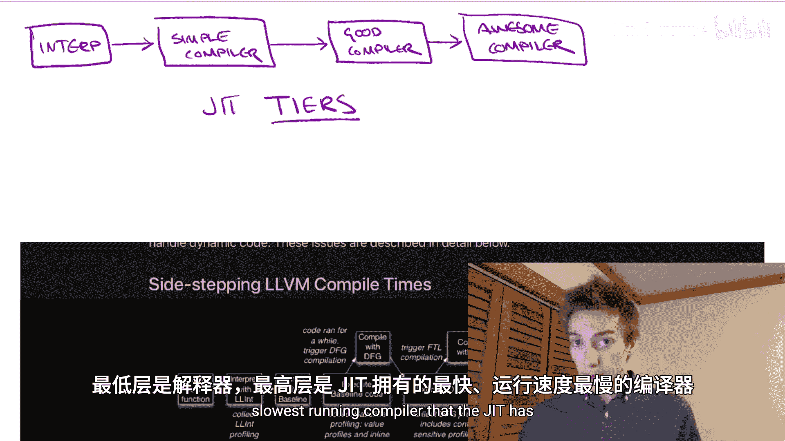
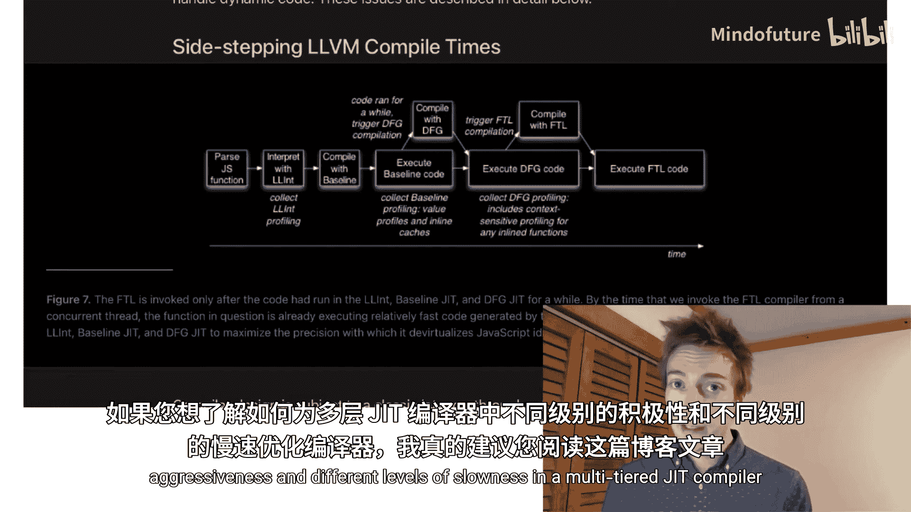
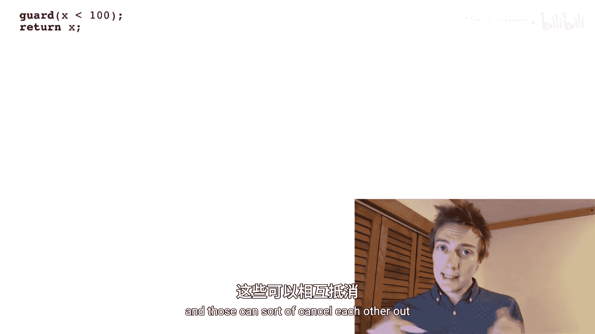

# 【康奈尔大学-•-中英】高级编译器项目教程-CS-6120（Advanced-Compilers，2020）-p16-P16-Lesson-11--Dynamic-Compilers--BV1gE9ZYsEUm_p16-

🎼あ。🎼Hello and welcome back to 6120。 Today， we're going to see a very broad overview of the landscape of just in time aka dynamic compilation。

 This is in contrast to basically everything we've done in the class up to this point。

 which you can think of as being categorized as ahead of time or static compilation in Aot compilation or static compilation。

 Things are fairly separated in time。 That is the phase that we think of as compilation is a pretty different phase in the overall lifecycl of a program from the phase we think of as execution。

 I have this little diagram on the screen showing the flow of time from left to right。

 The phase where we do the compiler stuff is separated in time separated in context from the phase where we actually execute the program When you compile something using an ahead of time or static compiler you put the program that's actually going to execute onto like a floppy disk and you put it in the US Postal service。

 and that arrives at the destination where you actually execute the program or at least conceptually。

😊，Just in time， our dynamic compilation looks very different。

 and the phases of compilation and execution are right next to each other， or even conflated。By that。

 I mean， that the thing that you put on the floppy disk is not the fully compiled program。

 It's the source code or maybe some intermediate representation of the program that still has some compilation work to do。

 That is like there's still going to be some transformation。

 possibly an opportunity for optimization that happens right at the same time as when you execute the program。

 When you receive the floppy disk in the mail， The work of compilation is not yet done in order to actually run the program。

 you have to compile it right quick before you execute it。

 That's why it gets the name just just in time compilation。😊。

It's actually more complicated than that in general。

 that is usually there's not like one compilation phase。

 and then we execute the program right after it。 That's kind of the simplest form of just in time compilation。

 What is more common is that the compilation and execution are kind of all mixed up with each other。

 That is we think of the compiler as running sort of concurrently with the execution of the program and has opportunities to redo compilation stuff。

 that is to observe the execution of the program and to reopimize things。 So in the real world。

 just in time compilers really do conflate the notions of program execution with with compilation。😊。

This sort of brings up the question， why bother doing this。

 What's wrong with the ahead of time compilation， The nice simple version where we just compile the program。

 and then we have the actual executable that will run later with no compilation。Of course。

 that has benefits and simplicity， and it means that like there's not like a bunch of heavy compiler machinery that you need to go along with the program to actually execute it。

 So what are the benefits of just in time Aka dynamic compilation。

I think there are two main categories， and they are interrelated。

The main one is that just in time compilation can exploit information that is not available ahead of time。

 That is dynamic compilers can observe the execution of the program so they can see things like the actual inputs the program is running on。

 That kind of thing is absolutely not available to a ahead of time compilers。

 The second main reason is kind of a corollary， which is that some programming languages。 super。

 super benefit from having runtime of information available to the compiler。 By that， I mean。

 languages with a lot of dynamic features in their semantics。 Think， for example。

 of the category that is sometimes called dynamic languages。

 that is ones with very dynamic type systems。 I'm thinking， for instance， of jascript。

 Python and Ruby。 And the older languages that really kicked off this whole Jit thing。

 Small talk itself fall into the same category。😊，In these languages。

 it's really hard to analyze these programs to tell exactly what they're going to do and therefore to emit simple code that does what the program was intended to do。

 The reason for this is the semantics of the languages themselves build in a lot of dynamic checks that a straightforward ahead of time compiler would need to do every single time they do even the simplest operation。

 For example， consider the expression A plus B in Python。 A plus P sounds simple。 But in Python。

 it's a really complicated thing to explain in terms of the semantics of the language。

 You have to do lots of heavy machinery to figure out how to compute a plus B， because fundamentally。

 we don't know what the types of A and B are。 For example。

 one thing that the Python semantics say you have to do is try to call a method called underscore underscore add。

 underscore underscore on the object A and pass in B as an argument to that method。Of course。

 if we somehow knew that A And B were floating point numbers that fit in 32 B floats。

 then we could compile this to just a single machine instruction。

 not looking up a method by the string name and then passing in a parameter。

 possibly looking for overloads in the class hierarchy， all of which is super expensive。

 if we knew something about the types of A And B， we could emit much， much simpler code。

 The problem is， in Python， there are very few situations where statically。

 you can be certain that this is what we're going to do。It's possible。

 but extremely unlikely in real Python code。So instead。

 if we have dynamic information that is like during the execution of the program。

 we observe that the types of A and B are both floats。

 then we can compile a faster version of the code that works only under those circumstances。

 It is wrong by the definition of the program in a static environment。

 but knowing something about the dynamic execution gives us the ability to optimize it further。

That's what I mean by saying that some languages， the semantics of those languages。

 just really cry out for dynamic compilation。 There's not that much you can do to optimize ahead of time。

 And you really need dynamic information in order to optimize these much more dynamic languages。

I want to make a couple of very nitpicy terminology points， however。

It is a pet peeve of mine when people classify programming languages as interpreted languages or compiled languages。

 like they'll say that Python or JavaScript is an interpreted language or that see or rust is a compiled language。

This seems to imply that it's a fundamental aspect of the language that says that it has to be compiled or interpreted。

 Of course， in 60120， you know this is not true。 The concept of a programming language is separate from the concept of the implementation of that programming language。

 It is possible to write an interpreter for C or for rust。

 It is possible to write a compiler for Python or javascript。 In fact， plenty of compilers exist。

 So I think it's important not to confuse ourselves into thinking that there's fundamental properties of the language that make it。

 So it's required that certain implementations exist。 Of course。

 there are properties of a language that make it a better idea to do dynamic compilation versus static compilation。

 But that's very， very different from saying that something is an interpreted language。

 So I'd much prefer it if you were to never use the phrase interpreted language。

The second very nitpicky terminology focus point I want to make is that compilers versus interpreters is。

 especially in the modern era。 That's a spectrum。 There is often not a single bright line that separates a compiler from an interpreter。

 The biggest way that this manifests is that even language implementations that we think of accurately as being primarily interpreters often have compilers somewhere within them。

 For example， C Python is the main implementation of the Python programming language。

 C Python is quite accurately summarized as being an interpreter for Python。 And yet。

 it still has aspects of a compiler going on inside of it。

 It starts with the Python source program just in text that gets parsed into an AsT。

 but the interpreter doesn't write on this As T directly。 Instead。

 there is a compiler from the As T to a format called a byte code。

 which is an instruction based representation that looks sort of like Briille or L VM。 Next。

 the interpreter， which is kind of the main component of the C。😊。

Python implementation runs on that byte code representation。

 This is both simpler to write because the bytecode format is more regular。

 and also it can often be a lot faster than doing a recursive traversal of an Ast。 So even C Python。

 which really is at its so an interpreter has a compiler within it。 And this is not just C Python。

 A lot of the language implementations that get called interpreters。

 And I think that's a good summary of what they are。 have compilers somewhere within them。

 And a lot of the dynamic compilers out there have interpreters within them。

 This is all just to say that， while it is a useful summary to say that some implementation is an interpreter or a compiler looking one level down in terms of abstraction。

 it's usually a little bit more complicated than that。

 Although I won't get you mad at you for calling C Python an interpreter， for example。

So let's talk about how to do just in time compilation。

 I want to talk about kind of like the high level structure that most Justin time compilers share。

 Most Js work by coupling an interpreter mode and a mode in which they're executing compiled code。

There are a few reasons why we need both modes。 The first is that we need a way to observe the execution of programs to get all that rich dynamic information that Jts are supposed to be able to observe about programs。

 Then we can feed that into the compiler that uses that information to do optimizations to produce the compiled code。

So the interpreter exists in one sense to let us observe facts about the execution of the program before we're ready to compile the program。

The second reason is that because we're doing a compilation online that is like during the execution of the program。

 the speed of compilation matters a lot。 That is， programs can start up really slow if we have to do a bunch of compilation before we can execute the program。

 So the interpreter also exists as kind of like a fast start mode。

 That is we can start interpreting the program immediately before really doing any transformations at all。

 And then we can eventually， once we have observed enough about the program。

 we can switch into compiled code mode。😊，You'll notice that I also have a back edge on this graph that is going from compiled code back to the interpreter。

 So why would it ever make sense to switch into compiled mode。

 executing this really fast optimized code， and then switch back to the interpreted mode。

There are two reasons for this。 Again。 The first is that we don't want to compile all the code at once。

 That is， we might have a few hot routines that are executed a lot。

 We'll compile those because it's worth expending the extra time to do that compilation。

But some of the code will be left in interpreted mode because it's just not all that important。

 If it only makes up 0。01% of the total execution time。

 it's not worth spending the time to compile that code。

The second reason is that lots of the optimizations we do in the compiled code often rely on those dynamic assumptions。

 that is information we got from executing the program。This means that those implementations。

 those optimized programs are optimized for special cases。

 They're not a general implementation of the program。

 So just in time compilers often need to observe the execution。

 even when they're executing the compiled code to make sure those assumptions are not violated。

 For example， if we know if we knew that our expression A plus B in the Python example before was most of the time working on floats。

 but some of the time that is eventually we got an addition with a string we would have to like throw the appropriate exception in order for the program to handle it。

 And that wouldn't be implemented in the efficient。

 specialized version of the code that's just for floats。

 So wed need a way to switch back to interpreter mode to run the exceptional case。

 that is to handle the full semantics of the program in a slower mode。

 here's a slightly more detailed state machine。😊，We start out in the interpreted mode。

 and we observe。When that when some code becomes hot。

 Ho is the term that just means it's being executed a lot。

 So we expect that it's worth while to compile。Then we transition from the plane interpreter mode。

 which is supposed to be fairly lightweight into an often much slower profiling mode。

 That is now that we've run this function 10 times。

 let's run it the 10 and month time as in the profiling mode so that we can observe its types and which directions the branches go in that kind of a thing。

 Then once we've profiled the code， we feed all that information and the code into our optimizing compiler。

 So this compiler looks very much like just an ordinary ahead of time compiler。

 it's just included in the runtime system。 And also it has access to to profiling information。

 So in that sense， it's like a profile guided or feedback driven optimizing compiler。

 It produces compiled code that we can then execute for a while， Eventually。

 if we find that our assumptions that we made when producing this compiled code were invalidd like the types are wrong。

 for example， then we have to go through a process called deopim。

 in which case we return to interpreted mode。 And then eventually。

 we will go back to compile mode through the top。😊。

Or maybe we will hit code that has been previously compiled and will transition to executing previously compiled code without going through the compiler again the second time。

This means that the recipe for any Jt compiler typically consists of at least an interpreter。

 a profiling mode， and an optimizing compiler that can use that profiling information together with other stuff。

 like the heuristics to tell when code is hot and ways to transition to fluidly transition between interpreted mode and compiled mode。

Another quirk of most modern jetits is that it's insufficient to。

Just have this distinction between between fast start and slow execution in the interpreter and slow start and fast execution in the compiled code。

 It actually makes sense to have gradations in between that。 So a lot of jetts today。

 have multiple tiers。 That is not just interpreter and compiler but interpreter and like kind of slow bad compiler that at least it runs fast。

 and then like an optimizing compiler and then like a super optimizing compiler beyond that。

 And the state machine， if you will， of the jett， is responsible for switching individual pieces of the code between all of those different pieces。

 And these are called the tiers of the jet。 the lowest tier being the interpreter and the highest tier being the fastest slowest running compiler that that the J has。

😊。

For example， I sometimes refer to the JavaScript compiler from Apple JavaScriptscript Core。

 which has a lot of these great blog posts describing the kind of architecture of what goes into their compiler。

 and this is taken from a blog post when they introduced the fourth tier。

 they previously add three tiers， this introduced the fourth tier of optimization into the JavaScript compiler。

And you can see that theres there's an interpreter here all the way to the highest tier giit that they have called the called the FTL layer JavaScriptscript as far as the JavaScript core compiler。

 as far as I know， still has four tiers， although it looks quite a bit different than it did in 2014。

I really recommend reading this blog post if you want to see some of the nitty gritty ins and outs of how you optimize compilers for different levels of aggressiveness and different levels of slowness in a multi tiered giit compiler。

So we've now seen the basic ingredients that go into any Jt compiler。

 and I want to now show you a distinction between two very different philosophies for how to build a Jit。

They are called Me jets and tracing Js。Method jets are kind of the normal thing that I think is what you would guess you would build based on the description I've given you so far。

Methods compile one function at a time。 That is like you have a function called F。

 If that function F gets called， say 500 times， then you decide it's time to compile it。

 and then you transition the execution of F from interpreted mode to compiled mode。

 And maybe you create like different variants of F for different arguments。 In any case。

 the unit of compilation that you do is a function or something like a function that exists in your source language。

These have a somewhat funky name。 I think that it would make be more sensible。

 It was just called a function J。 But I think that my best guess for why they're called method Js is because Js have so much intertwined with the Java programming language。

 And Java people insist that they don't have functions。 They have methods。

 They're called methods in Java and there's no such thing as a function。

 So I think that's why this is called a method jetit。

 even though it would be probably more sensible just to call it a function jetit。

The other kind of Jit is quite a bit fun here。And instead of compiling。

 profil interpreting and then profiling compiling entire functions or function like units of code at a time。

 instead， extract a path through the execution of a control flow graph。

 Perhaps even interprocedurally。 So this can go like through a single function or perhaps jumping through multiple functions。

 a kind of a single hot path that traverses through the code will extract one of those out and compile it as straight line code。

 So I've drawn a little CFfG here， and I've drawn like the execution one execution path that you might take through that CG that is like starting from a and then going down through G that's like one way that this code might run。

 The idea in a tracing giit is to observe the execution。

 And instead of compiling like this entire thing to code that has like a branch at a and then a branch at C or whatever will just leave out C and F altogether because they never execute。

 Instead will only compile the actual parts of the code， the basic blocks that actually did。😊。

Exec in that one trace that one path through the program。

 So will compile will like string together the code from A and then B and then D and then E and then G and create this straight line program that just consists of the instructions that actually executed with no branching whatsoever。

 Then we compile that code as just like ordinary straight line code with no branches whatsoever。

 which means that when in the future when we like start this function we start at A under certain assumptions。

 we can just execute this blazing fast branchfr path that captures the behavior that we saw the last time this function was executed。

 Of course， when we need to be careful about when to fall back to the more complicated execution that like actually includes the code for C and F in case that needs to run。

 But in the common case， the hopefully common case where behavior in the future matches behavior in the past we can emulate traversing this path through the CfG with this very simple branchfr straight line code。

😊，So this can often be a profitable way to simplify the code in a way that's not really possible when you don't have profiling information when you're doing a straightforward ahead of time compiler。

 It's a pretty common question to ask at this point。

 whether methodgits or tracing Jits are better in general。

 I would love you to pause the video for a moment now and try to answer for yourself。

 which is better， in what ways are they better。 The method jetit or a tracing jetit。

 Try to come up with pros and cons for both。🎼，Excellent thoughts。

 I'd really appreciate it if you were to post them in the Zulu thread associated with this lesson。

 General speaking， I've heard so much contradictory information about this。

 I've heard that tracing jets are easier to implement， but give you worse performance in the limit。

 I've heard that method jetts do exactly the same thing that is like maybe they' easier to implement。

 but are sort of limited performance versus the amazing power of the tracing transformation you can apply to programs。

 I think the jury still out on this。 I don't think that there is a one true path for building jets。

 I think that there are arguments to be made on both sides。 Anecdotally。

 I believe that the dominant approach that most people build their jetits with are method jets that is a lot of the jascript compilers you're familiar with a lot of the mainstream Java compilers out there。

 Those are all method jets in the sort of simple style。 There are a few really famous tracing jets。

 however， For example， the pipi jett for Python， which is the main efficient movement。😊。

Of Pthon outside of C Python。 that's a tracing jetit。 In fact。

 it does this amazing thing where it traces an interpreter for Python in order to generate machine code。

So this is just evidence to say that there are successful examples of Js in both categories。

And I don't think that there is a foregone conclusion that one is obviously better than the other。

I do however want to demonstrate to you in a little more detail what it feels like to build a tracing g。

 And I'm going to do that just by going through the tracing process to build the code that we're going to optimize for a little toy program。

 This is a completely contrived， boring program that looks a little bit like a javascripty syntax。

 and we're going to trace this program。So this program will start at Maine。

 It does like some orthoritic operations， defines a few new variables and returns a value。

 There's an invocation of a function F here that just like subtracts one from a variable。

 I told you this is a really dumb program。 There's also an invocation of G。

 Don't worry about what G does because we're not actually going to execute it。

 The thing about tracing is that we only are going to compile a subset of the code in this program。

 the subset that corresponds to the trace that we actually execute。

So let's imagine that we are tracing this program with， say， x equals 42。

 So we're starting out the program with the argument 42。

 and we're going to trace through the execution。 So， of course。

 the first thing that happens is that this statement runs。 and then we need to do this comparison。

 and then that turns out to be true。 So we'll do the true body and then finally will return Z。

 So that's the execution of this program。 Sa that you are a tracing Jit compiler。

 And you've decided it's time to compile the main function。

 This means that you will trace the execution during an interpretation of this function。

 writing down every statement that executes along the path through the program。😊。

So that means that the first thing we'll do is we'll say y equals x plus1。

 And here's the first funky thing about tracing。 During this execution。 We know that x is 42。

 So maybe the thing to do here is to say， well， we can we can on the fly simplify failure this to say y is 42 plus 1。

 or maybe we can just like conclude that y is 43 directly。 Now， we have much simpler code。 But。

 of course， this would be a terrible idea because we don't actually expect to invoke main a million times with exactly the same arguments。

 We're just going to， we're going to assume that we。

We execute similarly in the sense that we take the same path。

 but not that we have exactly the same value。So that means that we will preserve the computation y equals x plus 1。

 saying that like in this execution， I know I know x was 42 and therefore y was 43。

 but we'll say we're just going to write down the code that executes without folding in the actual values from the arguments。

The next step is to compute x' is less than 100。 So we'll definitely want to write that down as part of our trace。

 But when we do this， this divergence and control flow。

 that is when we have decided that we're going to take one path through the program。

 going to here instead of going down here。 Then we need to sort of record in the trace。

 that this trace。Went through a controlled divergence at this point。

 That is that this trace only works for those paths that followed the the same path we're executing right now。

 So the typical thing that tracing getss do is introduce a special statement that you can put into the tracing code called a guard。

 So they'll be like an actual statement called guard or something that says in the emitmted trace that we get out of this program that says abort here。

 if this if this condition is false。 If it's true， then just keep on going through the straight line code。

 If it's false， then we have some work to do。 We have to like recover and get out of the compiled code and transition back to the execution of the fully general interpreted code。

😊，So we'll insert that guard in order to capture the effect of the control flow divergence that happens at the F。

Then we can keep on tracing like normal。 that is we'll just copy this code down and say z equals f of y。

 for the moment I doing this I'm doing this intraprocedurally。

 that is not traversing into the function F。 And then finally， I can say return Z。

So we end up with this code that I have pre prepared this straight line code with guards in it。

 So when I say straight line， I mean， that it doesn't have any control flow divergence。 However。

 that is a little bit of a lie because it does have guard instructions。

 Guard instruction don't do something funky that wouldn't be very straight line at all。

 like jumping somewhere later in the code， but they do sort of like jump out of here。

 that is like they sort of abort the execution of this straight line program。

The idea with tracing is that we can preserve those guards and not really be concerned too much about the about the case when they fail。

 That is we're going to optimize ruthlessly for the case where all the guards in the program succeed。

 We will still be able to detect when that goes wrong。

 but we will say that it's okay if it takes us a long time。

 That is if it's a really expensive operation to recover from a guard being false to getting back to a to an execution of the interpreter。

 That can be really， really slow because we're going to optimize for the common case。

 What we hope is like 99% of the time， the guard is true。

 So we'll make that case as fast as possible， possibly at the expense of making it very slow to recover when the guard is false。

Okay， so to refine this trace a little bit farther。

 I'm going to imagine that we change the trace a little bit。

 So instead of being a intraprocedural trace， it will now be an interprocedural trace that is it will go when you call functions。

 it will continue tracing code through the execution of that function and then come back。

 I hope this is fairly easy to see how to do。 In fact。

 it might actually be easier than preserving the function calls。

 What we need to do is instead of just putting in this call Z equals f of y。

 we just need to like insert all the computations as they execute from the invocation of F while we're tracing。

 So that produces code that looks something like this。

 That is will just like assign the argument to F into to the parameter Y and then we'll just like put the only statement that existed in the body of that function F right here。

 And now we have an even simpler trace。 So doing interprocedural tracing can be super helpful in getting you down to like even simpler code where you can make even more assumptions and do even more awesome optimizations。

😊，Optimizations are what we're going to do next， I want to show you how to take this trace and do some optimizations that are really easy to do because we're in straight line code that is just a single basic block with these guard side exits。

The first thing I want to do to transform this code is I want to take this guard expression and put it as early as possible。

 It behooves me in general to check guards as early as possible for multiple reasons。

 The first is just that it's good to fail fast to do as little computation before you find out that you're wrong and have to recover。

 The second reason is that if we move guards around， then we get larger。

 contiguous regions of code that we can optimize under the same assumptions。 So。😊，In this case。

 this code happens to be like basically an SSA form， which is probably a good idea。

  honestly if we're optimizing trace。 So it is perfectly valid to move this guard up to the top because there's no assignments to X before we executed。

 So we get this nice， very simple code that just like assigns to variables without any guards in between。

Now， we can do something really simple like a local value numbering， for example。

 to reinterpret this code and say like under the assumption。 now that we have that bad。

 complicated code with a bunch of control though before。

 under the assumption that x is less than 100 All we need to do is this code or something equivalent to this code。

 And by staring at this for a little while， you can see that we can fold through some copies and we can do some canonicalization of arithmetic instructions And in the end。

 what we're doing is taking x and adding one to it and then subtracting one from that。

 and then returning the result。 And that is exactly the same as just returning X。

 So we end up by just optimizing all the code away under the assumption that X is less than 100。

 And this I have to remark is one of the coolest things about a tracing J。

 It can do optimizations that don't really seem appropriate in a normal representation of the program。

 That is previously， we had to like add one to the variable and then go into the branch to see if we wanted to subtract one from that variable。

😊，Again。It's possible to do an optimization that cancels that out conditionally。

 but it's a lot easier to see how to do that optimization。 if we first trace the program。

 That is if we first just extract the one path through the CFG through the interprocedural CFG that we were ever going to that we're ever going to care about that is we're just extract this one path and say。

 as long as this is true as long as this guard holds。

 then we know we don't have to worry about any of the rest of the code。

 So that means we don't have to worry about adding one or subtracting one and those can sort of cancel each other out。

 And that's kind of the magic of tracing jets。 We get to take complicated programs and distill out very simple traces through them in order to do awesome optimizations that might not otherwise be possible。

😊。

So that has been a whirlwind tour of how jet compilers work。In the next video。

 I'm going to walk you through an extension that I made to the Briille language to make it possible to do some tracing yourself。

The task for this lesson is going to be implementing a tracing mechanism for Briille。

 As you might have already guessed， you're going to have to do something very much like the example I just so showed you。

 It won't be in the concept of a full blown blown multi tier jetit or anything。

 but it should give you a feel of what the potential is for building a tracing jetit beyond a standard ahead of time compiler。

