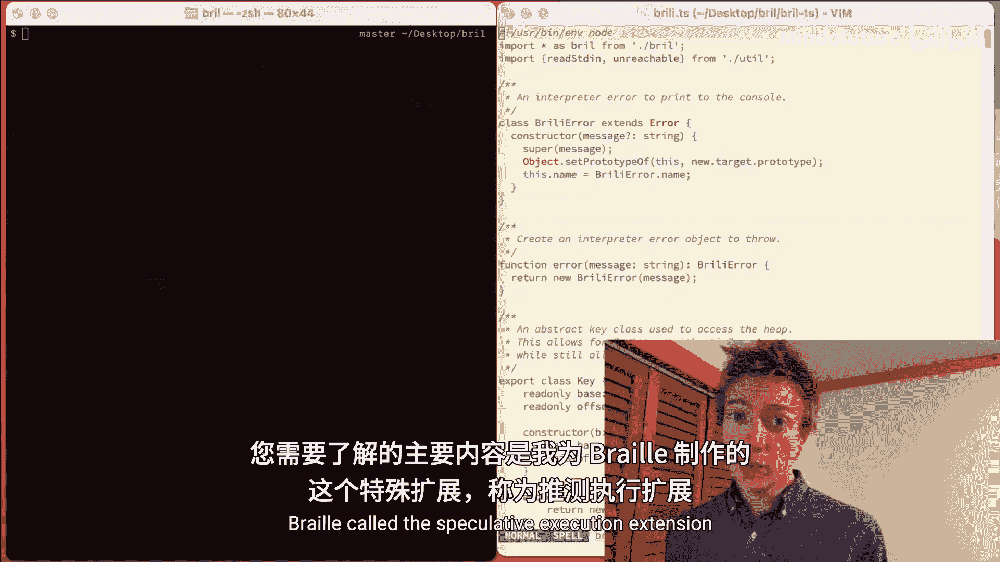
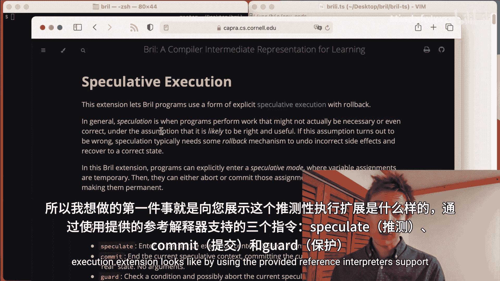
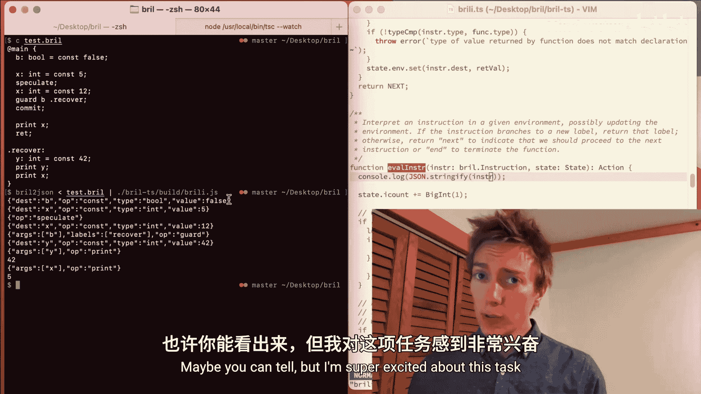

# 【康奈尔大学-•-中英】高级编译器项目教程-CS-6120（Advanced-Compilers，2020）-p17-P17-Lesson-11--Tracing-via-Speculation--BV1gE9ZYsEUm_p17-

This video is going to introduce you to everything you need to know to do the task associated with this lesson that is building a trace based optimizer for Briille programs。

The main thing that you need to know about is this special extension that I made for Braille called the speculative execution extension。

 You can check it out in the Braille documentation。

 The speculative execution extension is Men resemble speculative execution as it happens in hardware。

 that is in modern CPUs。 This is going to take the form。 However。

 of just a few extra instructions in the Braille representation。

 Those instructions are called spec commit and guard。

 The rough idea is that spec enters a simulated state of the world， where you can update variables。

 but they don't have a real effect until you say commit。 that is make all my changes real。

 And in the intervening time， you can run a guard instruction that looks like the guard from the tracing example from the previous video。

 That is it takes a condition。 And if that's true， it does nothing， you stay in speculative land。

 If it's false。 However， you abort the speculative region。 and you automatically undo all the stuff。

 all the changes to variables。😊。

You've made this makes it possible to implement a tracing optimization that makes tentative modifications to the state of the program。

 but can easily bail out and return to the full execution of the program。 the unoptimized execution。

 if you will， that sort of simulates what happens when we go from compiled code to interpreted code in a Jit。

 The thing I want to emphasize is that all this is going to happen as in ahead of time transformation on programs。

 And that's a bit different from how it works in typical Js。 It's quite a bit cleaner。

 And I think it makes it possible to explore the magic of tracing without building a fullbl。

 very complicated J infrastructure around it。 So the first thing I want to do is just demonstrate to you what this speculative execution extension looks like by using the provided reference interpreter' support for the three instructions。

 speculate， commit and guard。😊。

So I'm going to just open up just an ordinary braille program here， so I'll call it test。

briille and we can make a function called main just to make sure that I'm doing everything right。

 we can say print X after saying Exent is con5 so to run this program as usual we have to do Braille to text and then sorry Braille to Jason and pipe in the test program。

And then we will pipe the result into the braille interpreter， and it should give us a result。 Okay。

 it prints something。 great， So the thing that that the speculation extension lets you do is to say is to make speculative modifications。

 That is modifications that don't actually take effect until you commit them。

 the way you enter speculative mode is you just run the instructions speculate。

 So that just takes a that just like flips over into speculative mode。

 And now we can totally modify the state of the program so we can say like extentant is con 12。

 for example， And then to make that that modification real。 we have to say commit。😊。

So it is possible。 It's just expressly not recommended to do side effecting operations like print inside a speculative state。

 That is something that might actually print the console。 That's impossible to roll back。

 You have like， let the thing go to the console。 So you can't roll that back if a guard ever fails。

 So it's probably a bad idea。 although it's not actually prohibited by the spec to do prints inside of a speculative state。

 You're going to want to do those prints on real state。

 So you know that it's actually committed before you display the thing to the user。

 So it's instance to interpret this program。 It's not going to be very surprising。

 It's just going to do the modification。 That is， it's just going to say we made a tentative modification to X。

 And then we made that real。 and then we printed X。

The point is that this is that these tentative modifications are possible to abort。

 And the way that you abort is with guard instructions。 So a guard takes two arguments。

 You have to give it a condition and a place to go when it fails。

 So the the let's just make it true for now。 So I'll say be bull。 That's a constant true。

 And that can be， I'll just put it like way up here。 So if I'm going to。

 we need to give the the guard argument to say that this will fail unless this condition is true。

 That is will will abort the speculative state。 If it's true， as it is right now。

 we will just fall through and keep executing。We need a way to tell that something has failed。

 though， in your optimization， you're going to take normal programs and do a speculative optimization to them。

 And if that， if that speculative version fails， you're going to have to switch back to normal execution and recover。

 That is like， go back to the starting point and re executeecute from scratch。

 So you need kind of to know somehow that the guard fails， So you know。

 to respond to that instead of just keep it on truck and straight through the program。

So when guards fail， they jump to a label。 So we need to give it like some place like。

 let's just call it the recovery label to jump to when this goes wrong。 I'll put that down here。

 I'll say that the recovery code is here。 And in this case。

 I'll just make a completely different thing。 I'll say y into const 42， for example， in print Y。

 and we'll return before we ever get there。 if the guard falls through。

 So I hope I've done that correctly。 And I hope what this will do。

 is the same thing as it always did。 That is the guard is going to succeed。

 So we're just going to assign X to 12。 and then print that。Excellent， it worked。

And it should be the case that if I change this to false。

 It should be the case that now the guard will fail， we will jump to the recovery label。

 and we will then just print out 42。 Awesome， okay， it worked。 The important thing， though。

 I think is that we want to be sure that the state of the world is still correct。

 So when we get to this recovery location。 It should be that when we print out X。

 we don't get the updated 12， we get the old value 5。 That's the whole point about roll back。

 that is when we're in speculative state。 we need to， when the guard fails。

 we will roll back to the state of the world as it was when wind speculation began。

 So fingers crossed， I hope this prints out 5。 It does。 woo。

 So 42 means that we got to the recovery section and then it prints out the old value of the variable。

😊，Here are just a couple of random notes about the speculation extension that are details about its semantics。

 The first is that it supports nested speculation。 So if you really want to。

 you can speculate inside of a speculative region that's totally fine if you commit the inner one。

 that that just commits to the outer one。 and then you have to commit that to the real world。

 it works exactly as you expect the speculation composes。

 The second is that if you use this with the memory extension， it doesn't roll that back。

 So if you make modifications to memory during a speculative code when a when a guard fails。

 it's going to be up to you to roll that back。 So if you want to make a really fancy tracing optimization that can even deal with rights to memory。

 it's going to be up to you to to make some sort of transactional semantics for those updates to memory so that you can roll back modifications when something goes wrong。

😊，I now want to show you the other ingredient that you're going to need for this for the task associated with this lesson。

 which is you need to actually produce traces in the first place。

 The way that I'm recommending you do this is that you just modify the reference interpreter。

 That is you can just run programs in the interpreter and have the interpreter just like print out instructions that will turn out to be the trace that you want。

 So this way you don't have to write special tracing interpreter from scratch。

 you can just use my interpreter and modify it to print out instructions。

 I'm guessing that most of you probably haven't mucked about with the reference interpreter yet。

 So I mean give you a little preview into how it works。 Yes， you will have to write some typescript。

 but this the amount of typescript you have to know is very little。 Tpescript is super easy to learn。

😊，So I'll show you the source code for the for the reference interpreter。

 So in it's under Briille T S。 and then the Briille interpreter is Briille I under here。

 So the interpreter， it's pretty long， but it's it's a very simple interpreter and structure。

 but it has support for all the funky extensions that I've ever made to Briille。

 So that's why it's so long and complicated。 And you can ignore most of the complexity。

 The thing the thing that you want to。The the place that you want to start is to is the aval funk function。

 So theval fun function takes in a Braille function and some state。

 and it just runs every instruction in the state。 So it is responsible for calling aval In。

 And if you ever wanted to like add a new instruction to the Braille interpreter。

 this is what you would change。 It has a giant switch in a different case for every instruction。

 There's one for Kt。 There's one for and。 And then eventually there's going somewhere down here be ones that I just added recently for a speculate and guard commit。

 Anyway， so this is where all the instructions actually get executed。😊，Your job when doing a。

Tracer for Brillle is just to modify the interpreter to output information that you can use to then later stitch back into a transformation of that same program。

 That means that you're going to have to print out instructions as they execute。

 You have lots of decisions to make about when to start tracing， when to stop tracing。

 how exactly to set up the infrastructure to get the printed instructions back into the program。

 But the fact that you're going to have to print out instructions as they execute。

 That's kind of a constant。 That's kind of the whole point of tracing is that you're going to print out the path through the program。

 The actual instructions that ran as they run。The way I recommend doing that is just to go to the top of this abel Insta function。

 So this gets called every time it's time to run an instruction。

 you just need to observe when that happens。 What I recommend is write at the top of this function。

 You do something with Insta。 Insta is just the Json representation of an instruction。

 and you need to somehow get it out of the interpreter and into your hands so that you can use it as part of the trace that you optimize。

 So you can make this right to a file。 you can make it just print to the console and then use that。

 You could make it build up a data structure and then send it over the internet。 I don't care。

 Some you have to do something with Ins。 The easiest possible thing to do is just to do something like console that log In。

 This will print out the instruction。 Maybe it would be better to even even be better to like Json dot stringify the Ins before you print it out just to make sure that we don't get any like weird formatting problems。

 Then we'll have the actual Json representation of that string。😊。

When you're working on the Braille interpreter。I recommend that the thing you do is if you have the Tscripting pilot compiler installed。

 just do TSC watch and that will just will automatically recompile the interpreter every time you change it。

 so every time you if I were to modify this with an error。

 it will eventually it will recompile and give me that error， if I make it correct again。

 it will recompile it and then I have a working interpreter that I can just run。

Let's see that working。So I still have this test braille program that I just wrote。

 It runs bunch of instructions。 It doesn't really matter that it does a speculation。

 Any case I want to trace this program through the interpreter that I just changed。

 So I'll do it just in the normal way， I'll do braille to Jason to pipe in the test program and I'm going to run this in through the interpreter I just compiled here。

 you probably have this installed locally so you can just type Briille I but I'm going to give the explicit path to the actual Braille interpreter that I know that I just compiled。

 So if I pipe that in then every execution of every instruction。

 it prints out the Json representation of that thing。 So if you want to you can start here。

 that is like you can just print this out to the console。

 you're gonna to have to come up with some way to start and stop tracing。 but once you do that。

 you will just have a trace that consists of all the instructions you just ran。

 So this is the instruction that says B colon bull equals cont false in the textbased representation。

Adjason equivalent， which is what you actually want to do tracing anyway， remember。

 nobody likes parsing in 6120。So。This is all the ingredients you need。

 There's really no heavy typescript hacking to be done here。

 You just have to do something in order to obtain a trace。

 And then the real work is optimizing that trace and then stitching it back into the program so that it behaves like the original program only faster。

 That is it can opportunistically enter speculative mode run really fast and then continue on with life or abort back to normal execution。

 Maybe you can tell。 but I'm super excited about this task。 You don't have to go crazy。

 You don't have to spend lots of hours coming up with interesting optimizations。

 I just want to see whether it's possible to go from nothing to a tracebased optr of programs and doing that in a sort of standard ahead of time setting。

 So you get a feel of what it's like to make a trace based jet without all this scaffolding that comes with making a real jet compiler。

😊。

So again， I really want to emphasize， don't spend too much time on this。 Don't get to elaborate。

 but do get the essence of what's going on with tra with a tracing compiler。

I'm super excited to see how this goes。 Please let me know your experience as you go through this assignment。

😊。