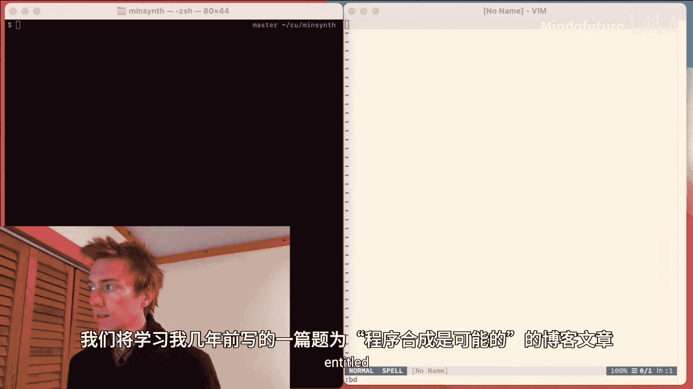
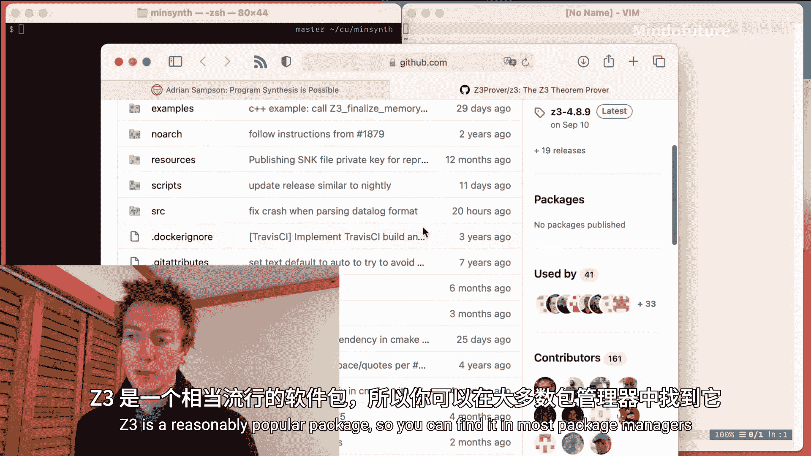
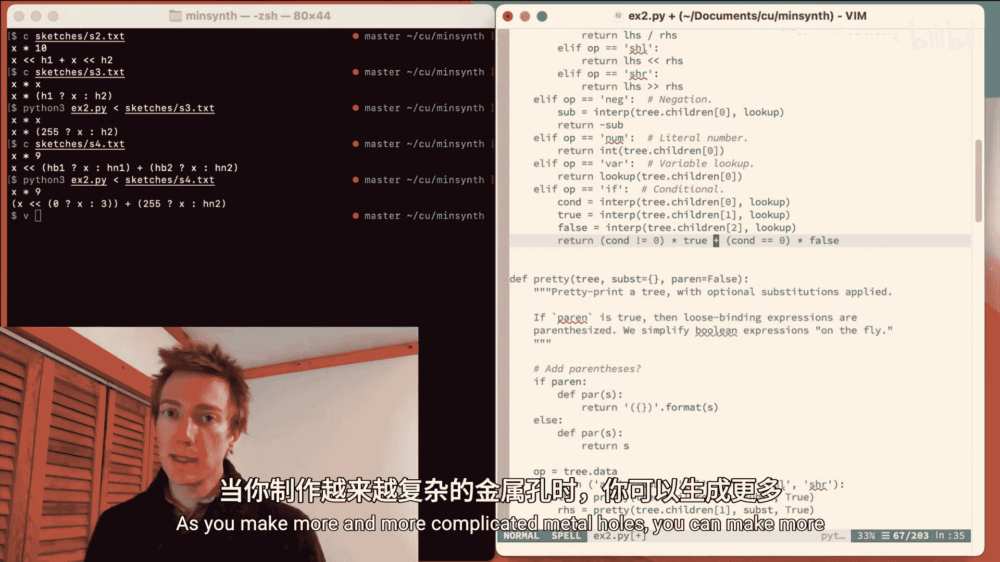

# 【康奈尔大学-•-中英】高级编译器项目教程-CS-6120（Advanced-Compilers，2020）-p18-P18-Lesson-12--Program-Synthesis--BV1gE9ZYsEUm_p18-

Program synthesis is a term for a very broad set of techniques that try to automatically generate a program that fits a specification。

 So the idea is， you feed in just a specification of what you want the program to do。

 and you get a program out of the program synthesisthesizer。

 There's a lot hidden in the notion of what makes a specification。 and it's interpreted very broadly。

 Sometimes people mean like a logical relationship between the input and output of the function。

 Sometimes people mean just a few examples and the synthesizer's job is to fill in the rest of the details。

 It goes all the way to saying that we're going to synthesize programs from natural language。

This sounds sort of like science fiction that we're just going to give a description。

 like a logical formula and get a sequence of machine instructions out or like give a very precise type for a function and get an okaml function out。

 But it's an active area of research because it sounds so exciting。

 A cartoony understanding of what program synthesis is capable of。

 is that it's going to take away all our jobs as programmers。 That doesn't seem very likely to me。

 but it doesn't mean that program synthesis is totally a fiction。 even today。

 There is lots of examples of more constrained domains where automatically generating programs from some form of specification can be extremely helpful。

😊，A common pattern is that you have a really restricted set of semantics that is a varied domain specific language。

 and it takes considerable effort none， to kind of navigate that space。

 And there's sort of an easier way for the programmer to express their intent。

 A very famous deployed example of program synthesis。 for instance。

 is the flash fill feature in Excel， which will take a few examples and try to guess the formula you are trying to write to relate the inputs to the outputs。

I think that at first， the idea of program synthesis can seem sort of like magic。

 or' using fancy tools like automatic theorem improvers。

 or're using complicated search based techniques。 and somehow we go from something that doesn't look like a program at all to coming up of a program more or less from scratch。

😊，However， I actually don't think that the basics of doing program synthesis。

 especially when aided by really great off the shelf automated reasoning tools are all that complicated。

 The basics of program synthesis are not magical at all。 In this lesson。

 we'll go through the construction of a basic program synthesisthesizer More or less from scratch。

 We're going to go through this blog post that I wrote a couple of years ago。

 entitled program synthesis is possible。 I wrote this blog post as a unit for lessons in program languages in compilers classes。

😊。

This will guide you through constructing a program synthesis tool。

 and I encourage you to pause this video often to catch up and do the programming yourself。

 You can also find my full implementation online on Github if you want。

 but I think it's more instructive to go through the motions of constructing it from scratch。

 I'm going to do this with Python， but you can use whatever tools you want。

 Python will make it possible to follow my instructions Li。 Okay。

 so when I said we're going start from scratch。 I was pretty much lying because we're actually going to start with an extremely powerful off the shelflf open source tool called a satisfiability modular theories solver or SMT solver known as Z3 out of Microsoft research。

 ST solvers are a foundation of a lot of modern synthesis techniques。

 We're going to see how to take a theorem prover and use it to build a program synthesisthesizer。😊。

The first step in this lesson， therefore， is to install Z 3 for following along in Python。

 you'll also need the Z3 bindings。 It's not that hard。 Theres a Z3 is a reasonably popular package。

 so you can find it in most package managers already。

 You probably don't need to compile it from source。 For example， I'm doing this on a Mac。

 So I can just do brew installs Z 3 and I should be good to go。 At this point。

 it should be possible to launch a Python interpreter and type import Z 3 without getting an error。

 And that will give us a convenient interface to using3。 Z3， like any Ss solver。

 works by taking a logical formula and saying whether it's satisfiable or unsatisfiable。

It can also， of course。Time out。 And then we don't get a useful answer。

SM T is like satAT in the sense that we're trying to solve a satisfiability query。

 But satAT just works on Boolean formulas where all of the variables can just be true or false。

 ST solvers augment a satAT like framework with Boolean variables and and and or in implication and stuff。

 But with something called theories。 theories are domains of variables and the operations of those variables that can be involved in your query。

 So， for example， you can say that x is greater than y， where X and Y are both integers。

 or you can say that like a plus B equal C， where A B and C are all32bit floating point numbers。

 The integers and the floating point numbers， those are theories that get plugged into a sat like framework to make an ST solver。

 And it's all those theories that make SMT solvers so useful for reasoning about program semantics。😊。

I'm first going to demonstrate to you what ST solvers and Z3 in particular， are capable of。

 just by themselves， just when issuing queries。 And to be honest。

 I'm constantly shocked by the insights that SMT solvers are modern ST solvers is able to come up with relatively quickly。

 Then the next step will be to see how to take S T queries and turn them into actual program synthesis。

 All right， let's get started with just an empty Python program。

 And I'll type import Z3 to get started。 The Z3 Python bindings have a bunch of convenient operator overloads for writing ST formulas。

 The way you get started is by declaring a variable first。 So if I say Z3 do capital int。

 and I give it a name。 This declares an ST variable named X that that is of type int that uses the integer theory in the Z3 ST solver。

😊，Now you can do things like say if you just divide this by7。

 that doesn't actually do a division we've overloaded or Z3's Python bindings have overloaded division operator instead say create me a formula that does a division of the SMT variable X divided by 7。

 so I can just bind the result of this thing which again is a formula object to a variable and I'll just try printing that out for now。

So if I run that， I'd get the formula x divided by 7 in a completely unsurprising way。

I can also to make this into a Boolean formula that can actually be satisifiable or not。

 I can use double equals。 again， that's overloaded。 and we'll get the formula that is true。

 if for all values of X when divided by 7 equals 6。 So now would be great if we could solve this。

 That is ask for a value of x that makes this thing true。 And that is what the S& P solvers is 4。

 of course， So we can just write a little function here to do the dance to invoke Z3 in the most straightforward possible way。

 we need to create a solver。😊，Add a formula to it。And then check the check method runs the solver to see if this thing is satisfiable or not。

 and then return S dot model。 The model is just the name for the valuation of the formula that is for a satisifiable formula and I'm going to hope that the formulas I feed in here are satisifiable。

 what are the values of the variables that make it true that are sort of a certificate that the formula is satisfiable。

So I'll do the standard Python thing for。Having an actual program here with a main。 So if I。

 instead of just printing out this formula now I can print out the solution to this formula。

 So this will run the solver， get the model and tell me an appropriate value of x。X is 42。

 just as I hopeded， fantastic。So this， I hope gives you a view into the power of SMT solvers。

 You can write these sort of sat like logical queries that can be sort of arbitrarily connected with Boolean connectors that do comparisons of actual variables。

 and you can ask it for valuations of those variables that make them true for this tutorial instead of using integers。

 I'm going to use the theory of bit vectors。 B vectors are instead of idealized integers that can go off into infinity。

 Bi vectors are sort of finite representations like we have in actual computers。

So instead of using int， we can also do。 we can have， we can write。For example， that why is a。

Bit vector named Y。Here， why is a collection of 8 bits that we can treat as an integer。So。

 for example， we can say why shifted left by 3， which is the thing you can do to bit vectors equals 40。

 and we can just。If we want to know what value of y makes that work。

 we can print the solution to this formula。Awesome。😊。

Another thing that makes SMT solvers super useful is that they also they have quantifiers。

 that is you're not just stuck by saying find me some value of y that makes this sort of like top level quantified formula true。

 We can write things like for all and there exists。 So， for example。

 the way that you do for all is to say Z3。 for all。 and then you have two arguments here。

 We you need to give you a list of variables we want to quantify over and then a sub formulaula。

 So I'll say that like I'll start with I'll go back to integers just for this example。

 Z3 do int Z I'll make two variables this way， it's often convenient to like create variables and then bind them to actual python variables for constructing formulas。

 So if we do this， I want to find a value that for all Z's。We have Z times N is equal to Z。

 So I wonder what that value could possibly be。 I would like to know。

I would like to know what the N is that makes this true for all possible Z's。

I'll bind that to the formula， I suppose， and then print out。The solution here。

 and totally unsurprisingly， it tells us that that the an example of an n that makes this true is one。

 that is everything times 1 equals itself， which you probably guessed already。 But Z 3 knows that。

 too。Okay， so now you understand ST all by itself。 Now I want to flip over and turn these ST formulas into something that feels more like a proper program synthesizer。

 I set up top that a that program synthesizers have many different definitions of what they mean by specification。

 program synthesis is supposed to take in some sort of specification and generate a program。

 What we're going to use is as a specification is a reference program That is we're going to take in an existing program。

 We're going to try to find an equivalent program that hopefully runs faster。

 We're going to use this with a further。😊，Piece of information called a sketch。

 sketch based program synthesis takes in a partial program and tries to complete it。

 This can make it a lot easier to find a program than trying to synthesize an entire program from scratch。

Easy is good for S&P solvers that need to quantify over all possible expressions。So。To motivate this。

 I'm going to try to synthesize faster versions of programs that use bit twiddling instead of arithmetic。

 So， for example， you probably know that if you write x times 2。

 where x is a bit factor that is like an actual computer integer。

 That's the same as shifting X left by one。 Let's imagine we're in a scenario where we want to do multiplications。

 but we can't remember what the rule is。 We just can remember that we want to do left shifts。

 but we don't know by how much。 So this is gonna to ask questions like this， That is。

 we will say here's our reference program。 It's x times 2。

 I know there's a faster program that is exactly the same thing as this。 that is。

 it's perfectly equivalent。 And it looks like this。 x shifted left by something。

 The question question mark question mark thing here is often called a whole in sketchbased synthesis。

 And we want to guess a value for the whole that is an expression to put here that makes this true。

 This is our program synthesis task for this tutorial。😊。

Here's how to make it work in the most basic setting。

 We're going to set up a couple of formulas that represent the reference implementation and the sketch that we want to fill in。

 So I'll start with a with trying to just write down the reference implementation。

 and we'll need to do this in in an SMT formula。 So we're need to declare the vector declare the the bit vector variable that we just as we did before when constructing individual queries。

And then I'll say that my， my slow expression。 that is the program。

 the reference program that we're going to use here， that's just x times 2。 Okay。

 so now I need the sketch。 that is the fast program that we want to complete。For that。

 I'm going to create a hole。 I'll call it a H， because you can't call variables question mark question mark。

 but believe me， I would， if I could in Python。 So this is supposed to be the hole that we're trying to fill in。

 So the fast expression。 That's the sketch is going to be X shifted left by H。

 And our question is going to be what is the H that makes this equivalent to the other program。So。😊。

We have these two expressions。 We now need to construct one formula that we can pass over to the ST solver to ask it to complete the sketch。

 We can use quantifiers to do this。 What we need is a for all that is something to say for all possible values of x。

 These two things are equivalentent to each other。 So I'll say for all X。

 that is for all the like free variables that you think of as inputs to the expression。

 We want it to be the case that the value of the slow expression is equal to the fast expression。

 I want to remind you that that is no actual comparison going on here。

 This is an overloaded double equals that is not saying this expression is equal to this expression。

 Yes or no。 It's returning a new formula that we will then solve。

 So this is overloaded to take in two formulas and produce a new one that's connected by double equals that will then hand over to Z 3。

 So this thing is not two or false， It's just also a formula。 I can't stress this enough。

 Opera loading is magical and amazing， but it can also be a little bit confusing。😊。

So this is the goal formula that we actually want。 that is we want to find a value of H that makes this true for all x's。

If we can do that， then we will have completed the program that as will have done a really basic form of program synthesis。

 filling in the hole to get us a program that matches our specification in the form of a reference program。

So let me solve this and see what we get。Yay， one， great。

 We can even try this a few more times like what is when you do x times 4。

 what is that equivalent to shifting left by 2， fantasticastic。 So I think this is working。

 That is in a weird way， if you kind of squint， we kind of have a program synthesis thing going。😊。

I have to admit， though， this doesn't really feel all that much like program synthesis because there's not really a programming language going on here。

 All we're doing is writing Python expressions that turn into Z3 expressions and then solving that stuff。

 So the next step is to turn this into a into operating on something that feels a little bit more like a real programming language with a real interpreter and stuff。

I'm going to give you a moment now to pause and catch up， however。

 and play around Z3 and see what it can do。 I challenge you， for example。

 to find a formula that makes Z3 take a really long time。

 that is to think more than just like a couple of milliseconds like it has so far。

 See what the limits are here for the questions that you can ask Z3 and get results in a reasonable amount of time。

😊，So the first step in making this kind of manual manipulation of formulas feel more like we're doing real program synthesis on a real programming language is to have an actual language。

 and for that， of course we will need the most fascinating topic in all of compilers。

 which is a parer， we'll need a parser for the programming language that we're synthesizing。

I'm going to fast forward a little bit here。 I have a prewritten parser if if you want。

 you can use the same parsing library that I used called La。 Lark is pretty cool。

 It's got like several different parsing algorithms built in。

 and I find it syntax for defining grammars really straightforward。

 So here's the grammar that I've prewritten。 It looks like this。

 So we're gonna have a grammar that just looks like little arithmetic expressions。

 So we will have add and subtract。 and multiply divide shift left and shift right。

 and then I'll have negation anyway， just like arithmetic on bid vectors is all that this little tiny language can do。

 I'll also add in these if that is these ternary expressions。 So like expression。

 question mark expression， Co in another expression。 that means if this is nonzero。

 then use this otherwise use this。😊，嗯。So now that I have a grammar for this。

I will change my main down here to use the grammar to parse programs that come from strings。

 so I can just say like， here's my parser。 great lark。Give it a grammar。Just， for example。

 I'll just say like x times 3。 And that whole thing shifted left by。Why， great。 Okay。

 excellent program。 We can print this out。 Just convince you that my paror is working。Of course。

 you will need to。Install lark， which。I will'll warn you is not called Lark in the Python Pack index D is called Lark parser。

Okay， so now I have this tree。 So I just have a little syntax tree that for this tiny programming language。

 The next thing that you have when you're conjuring a programming language from scratch is probably an interpreter。

 So we will write an interpreter too。 I'll just write an interpret interpreter that just works as simply as possible。

 So we take in one of these trees that like at the top is a shift left。

 And then it has some children here。 And I will also。We's just start out that way。

 That is I'll just say that like we can say tree dot data。

 we can say like if tree dot data equals add。Then the left hand side is like interp of tree do children 0。

呃。And the right hand side is is the result of recursively calling this interpreter on triage children。

One， especially if you spell children correctly。Then we will just return LHS plus RHS because we're in the ad case。

I'm also going to fast forward a little bit here and make things and fill in a bunch of these cases of the interpreter。

 but we're just doing nothing fancy， nothing you haven't seen before。

 I'm just going to write a completely normal interpreter that just like uses recursive in on this stuff and we copy and paste all this。

Okay， so the only interesting thing Ive a covered adral subd shift left shift right。

 all the kind of like ordinary binary operators。 I have the niation operator。 I have literal numbers。

 so that we just like take the string from the syntax tree and return the inteer or value of that thing we will also have variable lookup。

 So here's the first place where things get a little bit tricky。

 I'm gonna make this interpreter function take in a lookup function to tell us what to do the variables。

 and I'm just going call that function on on the name of the variable。

 So this is not doing anything fancy。 We're just using a lookup function as a map to resolve the names variables in our interpreter。

 The next thing I' will do is is implement conditionals Conition that I'm going do in a slightly weird way that I will reveal to the purpose of later。

 but it's the actual mechanics of doing the interpretation are not that odd。

 We have to recursively evaluate the condition。 the true branch and the false branch。

 And then I'm going to do this odd thing with like comparisons and multiplication that is multiplying。

😊，The result of comparing the condition with zero in order to get the result that I want。

 I know this looks a little bit odd， but you can stare at this for a moment and convince yourself that it is。

 in fact doing an if and it is working like an interpreter for this language。

So if you are convinced of that， then we can interpret this little expression that I wrote down here。

 That is if I can come up with a， I need to， I want to interpret this this tree。

 but I need like some way， some function to look up the value of X and Y。

 This isn't terribly meaningful if I don't have a value of X and Y。 So for that。

 I guess I'll make a little environment dictionary。 This says like x is 2 and Y is9。 for some reason。

 and we'll do like now create a function that can be called on this。

 So I'll just say like for some variable， just look that thing up in the environment。

 So if we do this， I should be able to now interpret this expression that I just wrote and get an actual value back。

 It worked great。 so now we have an interpreter。 this is just a little detour to to just conjure an actual language that we're gonna to do synthesis on。

😊，Now comes some truly funky magic that's going to rely on Python and operator overloading to make this work。

And we're going to take this interpreter， and we're going to。In one fell swoop。

 transform it into a constraint generator。 That is what we have here so far is an invocation of an interpreter that runs expressions on actual concrete values。

 Act numbers like 2 and 9。 What we actually want to do is run the same interpreter。

 But run it on symbolic values that is on Z 3 variables。

 So we'll say we'll give it a variable named X and a variable named Y and ask the interpreter to build up a formula that has equivalent semantics to the way that we interpreted this function。

So the trick that we need here is that instead of giving an actual environment。

 we're going to give it a look up variable that every time you create。

 every time you reference a variable， it conjures out of nowhere。

 a Z3 variable that corresponds to that variable in our programming language。So to do that。

 I'll just say like given the name of a variable， I'll just say invoke the Z3 library and say we'll make a bit vector variable there with that name and in 8 bit size。

This means that when I feed this variable that comes from the ver rule that is like。

 we'll just return that here in the interpreter。Then eventually， through a recursive call。

 we'll do something like multiplying or shifting by left。

 something involving a constant on one side and a variable on the other side。 Then as you saw before。

 through the magic of operator overloading。 This doesn't actually do a shift left by some number。

 It just creates a new formula that represents a shift left that then we we can ship off to Z3 to solve。

 So if I run this now， we won't get the number 3072。

 I took out all the actual numbers from the environment down here。 Instead。

 we should get a Z3 formula that represents the semantics of this program for an arbitrary X and Y variable。

 And in fact， we do， it looks like this。 it looks exactly like the input。

 but it means something very different。 Now this is representation of the semantics of the program as an S T formula。

 And that's the key。 That's what we need in order to do synthesis on this program language by is a sort of reinterpretation of the interpreter as a constraint generator。

 We are almost there。😊，We're just now going to bring back that sketch based synthesis paradigm that you saw a moment ago with the programs with holes and put it now into this language。

The way that I wanted this to work is I'm going to have the the have two different programs。

 both written in the same language， both parsse in the same way。

 So I'll say that we'll start with a slow program that we want。To find a faster implementation of。

 And I'll say that we'll just do it like x times 10 for now。

 And the fast program that we want that we want to This is the sketch we want to fill the holes in for is going to work by shifting left by something and adding and shifting left by another thing。

 So this is like upping the difficulty a tiny bit from before。

 is kind of like hard to remember exactly what you have to add together what two different shifts you need to do to get something that's nonpower of two。

 Instead of using double question marks， though， to just be able to reuse exactly the same grammar I had before。

 I'm going to introduce a naming convention that says that anything beginning with an H that's considered a hole。

 And that way we can tell these two holes apart from each other。

 I'll call it H1 for the first hole and H2 for the second hole。

 That we'll need to use to try to fill in all the like H starting variables in the second program to make it equivalent to the first program。

So to do that， all just。Parse both of these things。

And I want to run our symbolic interpreter that is our normal interpreter with symbolic values for all the variables on it。

 I wrote a little convenience function for myself to do this that you can find in the second example file here called like the three expert。

 I think it's called anyway， I'll steal this from my pre-written one this function is not fancy it takes in the tree that you want to interpret and then often the option you can supply existing variables to to the interpretation。

 Otherwise， it just like lazily creates a variable every time it gets referenced for the first time So just invokes the interpreter with this special lookup function that does that lazy creation of variables and then gives you back the set of variables we' using that with the new ones that were added by evaluate Lazily adding variables from the expression。

So we can do that so we can just say Z3 expert on both of these things。

And we should have the two programs that we want to make equivalent。

 The next step is just a little bit of trickery to pull out the holes from these things。

 that is we'll get the。The variables here， Then we will Ill call those like the variables for program1。

 and then like feed variables 1 into here。 and I'll get variables2 out with the updated stuff。

 So what I want is the variables without all the holes。 So I want like X in this example or Y。

 if we use it， but not H1 and H 2。 So for that， I'll just do a little bit of Python trickery。

To construct a dictionary。So it starts with H just means that that it's like H1 or something that's just an operation on the string name of the variable。

Now we need to concoct the formula that we want to give to Z 3。

 This is going look just before like when just like before we need to for all all the variables just now for all the variables instead of just for x。

 So Z 3 dot for all。So that's all the things like X， for example， in here。

 and I'll say I want the slow program to equal the fast program for all those variables。 and again。

 that's this is constructing a formula that sets those two things as equal to each other。

So all I really need to do now is to。Sove the goal。And I've done that。

 I will have values for all of the variables。So this tells me I can get the same effect as multiplying x by 10 if I first shift it left by1 and then add that to shifting it right to left by3。

That's awesome。 We now have an actual program stheizer。 I can ask， for example。

 if it's possible to do this for 12。 It tells me that， yes， it is。😊，11。No。

 this says model not available because this was unsat。 That is That is。

 the formula is not satisfiable。 so there is no combination of holes that you can use to fill this in。

I've done just a couple of fancier things in the actual thing called X2 here。

 X2 is does exactly the same， like sort of lazy setup here and does the。

Does the same synthesis goal as we had before。 and now do somethings slightly trickier。

 which is to just for aesthetic purposes， take those values of the holes and interpolate them back into the program。

 and it will do this on text files。 So it'll actually load the programs from text files just to make it feel more like a programming language。

 So if you look， for example， in in the sketchketes directory and might gi have repository。

 there there's a bunch of files that look like this。

 That is that have the slow program in the fast program with holes in it on just two to separate lines。

 and then we can just run example 2 on some of these things。 So I can say sketches S1。 For instance。

 forgot that this needs a less than。 So this will say that if you want x times 8 and you want to fit that into an x shift left by something。

 you can shift that left by3 and it termpolates it back into the program。

 Let's try it a few more sketchkees S2。 this is the one we just saw。 so I won't even run it。😊，S3。

 this one's a little bit more interesting。It's here in the examples directory in order to make a point。

 That point is that so far， we've done something it feels like kind of synthesis sort of in the sense that all we're doing is synthesizing constants to go into variables。

 That is we're asking for actual bit vector values that can go into a given hole。

That doesn't really feel like generating a program， though。 It's sort of generating program。

 but really its just generating the constants for a program。

 So how do we get to generating like entire expressions。 And here's the trick to doing that。

 We actually don't need to change our synthesis engine at all。

 because it already has support for conditionals for those ternary expressions。 So， for example。

 if we want to do a less constrained version of this sketching where we don't know whether we want to multiply by a variable or by a constant。

 We can just express that as a condition that is think of this entire parenthesized expression as kind of a meta hole that is in the actual system。

 you would just ask programmers to write down something like x times question mark question mark and you'd expand that automatically to this Boolean expression。

 This Boolean expression says I'm not sure whether I want the variable X that is reference to a variable that already exists or a constant in order to get there。

 That is you choose form me by choosing the first hole， which kind of。😊，Expression to use。

 And then depending on the kind of expression， there may be additional holes that you need to fill in to make this work。

If you kind of squint at this， we've built a program syntheizer that doesn't just synthesize constants anymore。

 It synthesizes expressions。 It does that by encoding the choice of what expression to use as a variable itself。

So I want to demonstrate that this works， too。And indeed does。

 this has selected that we need to multiply x by x。To make this even more interesting。

Now we can I'm taking that idea of like using metal holes to its logical conclusion。

 So this is saying that like， I want to do x times 9。

 And I think that I have to do that with a shifted left by something plus something。

 So I know that I need to sort of like offset by something else。 But in both cases。

 I'm going to pretend that I don't know what kind of expression at all that I want。

 Here I'm using a really simple termer expression that just selects again between variables and constants。

 So here's the boolean hole that chooses what to do in each of those locations。

 And then that can choose whether to use whether to use x that is a reference to an existing variable or synthesize a constant。

And this tells us that we want to shift left by3 and then add X。

 That is it chooses a constant for the first metalhole and then a variable for the second metal hole。

 Although of you can see that you can take this to its logical conclusion。

 And you can make by clever nesting of integers and comparisons and turn expressions。

 You can make this synthesisthesize lots of different expressions。

 That is doesn't just have to choose between variables in constants， It could say， well。

 I'm not sure if I need a variable or a constant or a shift where one side is either a variable or a constant or a shift。

 And you can do this to some finite depth and phrase some really complicated synthesis problems。😊。

That's a surefire way to make Z3 time out。 But it shows you that this paradigm。

 even though it started simple with just synthesizing constants。

 is enough to ask interesting questions where we're getting Z3 to write real programs for us。

 given an infinite amount of time。 Of course， doing all this turnernary operator trick required that funky trick。

 I I alluded to earlier when writing the interpreter。 That is this case for the condition。

 The obvious way to do that in Python would just been to say， okay。

 so we've gotten evaluated the condition the true in the false value， Those are all constants。

 So I can just say true if con des false， which is the moral equivalent of the question mark colon。

 in our source language。 This， of course， will not work if true and con and false。

 Those are all those are all symbolic values， and even them might be symbolic values。

 especially if the con is a symbolic value。 The Python， if doesn't work that way。

 It can't be overloaded to do different things， unlike equals and shift left and shift right and all that stuff in Python。

 So we need to find some other way to generate something to generate an equivalent。Z3 expression。

 and that is this。 This expression happens to work both in Python under normal interpreter mode and also in Z3 operator overloader mode because it doesn't use if adjust just uses not equals in times and plus and stuff。

 So that's how I sort of snuck in a case in the interpreter that worked in the normal interpreter mode and then also happen to work in the symbolic interpreter mode。

 but once you do that， you kind of have a pretty general program synthesizer as you make more and more complicated metal holes。

 you can make more and more complicated synthesis problems。

 So your task for this lesson is to start with this paradigm and follow the tutorial。

 get yourself up and running with a real program synthesizer like this one and then make it more interesting。

 It's totally openend it。 You can add whatever feature you want。 There is as usual。

 no need to spend a huge amount of time on this。 but I'm interested in what you come up with to make this language more expressive。

 I'm also interested in where you start to run to scalability issues that is dealing with complex programs and large program。

Is the hard part of program synthesis。 And it's what a lot of the literature is about letting these techniques that work on small examples scale up to real complicated programs that programmers actually want to synthesize in the real world。

 Good luck and have fun synthesizing。😊。