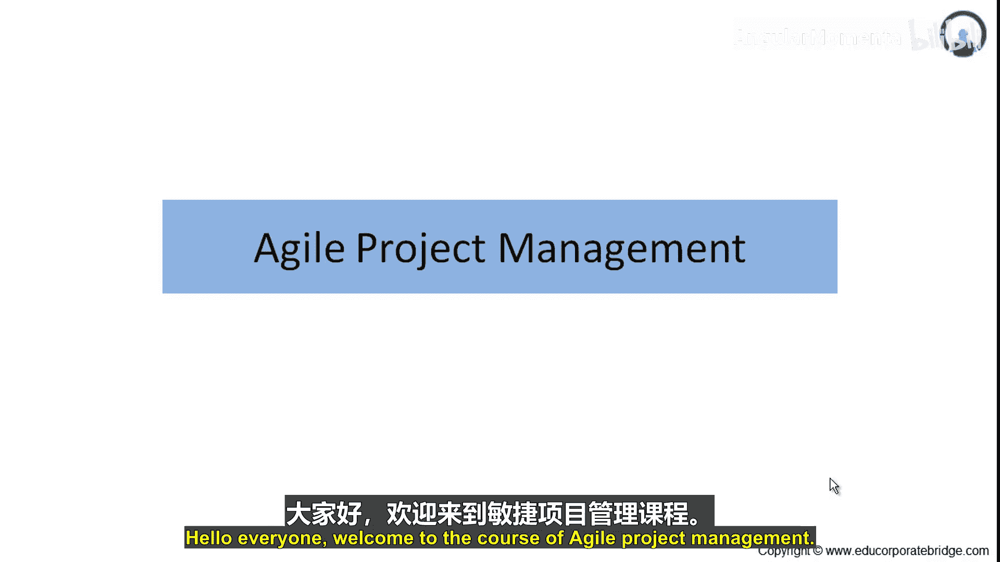
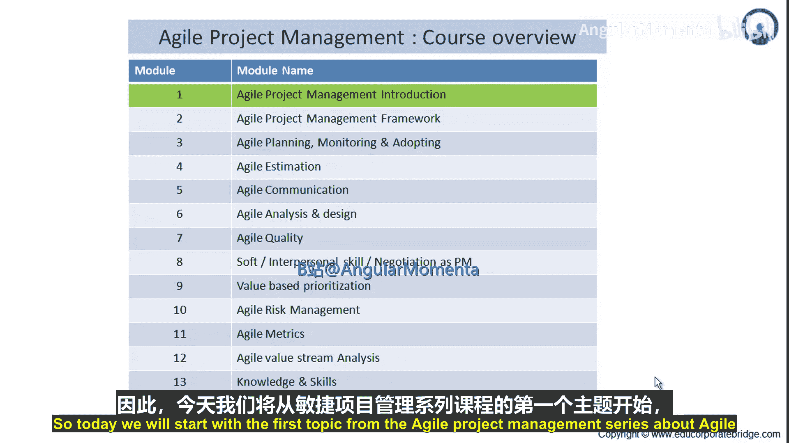
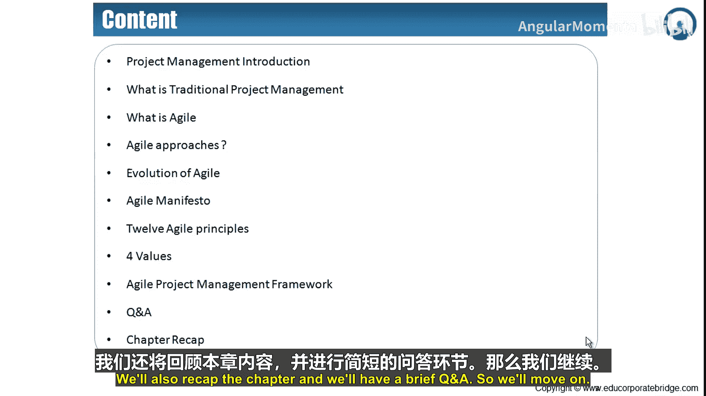
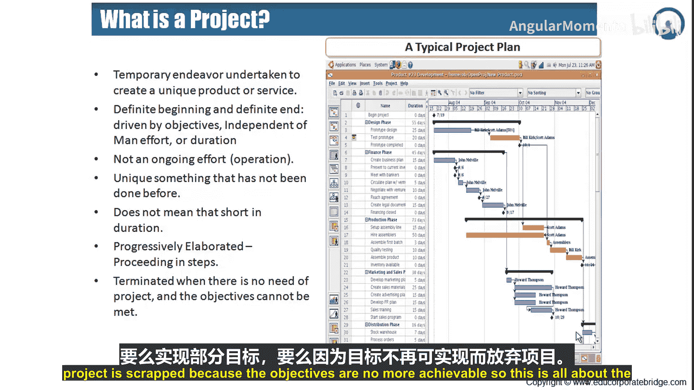
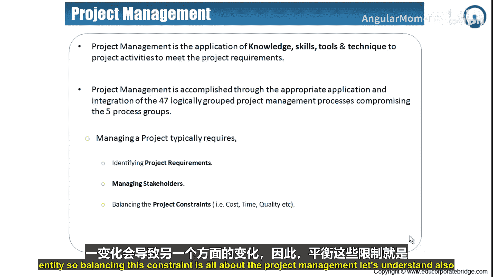
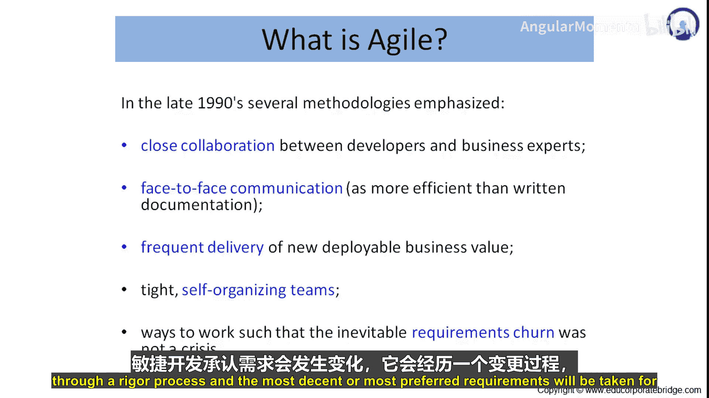

# 【EDUCBA】从思维模式出发的应用、评估与优化 ｜ Agile Practices： Apply, Evaluate & Optimize from Mind p01 01_01_01_简介 -BV1TLcTzJEXS_p1-

Hello everyone， welcome to the course of Agile project Management。😊。

As。Most of you know that Agile is a project management technology。

 Global use for software development by most of the top。

Firms so today we will start with the first topic from the Agile project management series about Agile project management introduction。

😊。

The content for this chapter is what is project management， project management introduction。

What is the traditional project management？What is agile。

 how agile is different from the traditional project management？What are the agile approaches？

How a child has evolved。What is a giile manifesto？What are the 12 agile principles？

What four values on which the agile is。Agile pillar is sort of established。

What is the Agile project management framework will also recap the chapter and we'll have a brief Q&A。

So we'll move on。What is project？As you know， a project is a temporary ende undertaken to create a unique product or services。

Please understand that project deliverables are unique。

 these are different from the repetitive operations。😊。

Definite beginning and Definite end project always has a definitive beginning that is start and definitive end。

😊，It is driven by objectives。😊，When the project started， certain end results were always eyed upon；

 it is independent of man effort and duration。😊，It is not ongoing。

 like in operations when we provide 24 by7 services。

 supposeupp in case of providing a mobile support services or providing an electrical supply that is ongoing effort。

 it is not the project。And unique in the sense that something which has not done in the past。

And it does not mean that definitive end does not mean that it is shot in duration。

It is progressively elaborate it is elaborated from top to bottom。🤢。

And project is terminated when there is no need of project or objectives cannot be met so when you start project either you get a all objective achieved or you get a partial partial objective achieved or project is scrap because the objective are no more achievable so this is all about the project now lets understand。

What is project management？Project management is an application of knowledge， skills。

 tools and technique。To project activities to meet the project requirements。😊，As you know。

 project is a。Join effort by team members span across the business community， IT community。

 and various other stakeholders。And as you know that to manage so many people。

 you need to have the specific knowledge。😊，Skills， tools and techniques in order to。

Deliver those objectives so project management is accomplished through the appropriate application and integration of 47 logically group project management processes compromising of P process groups。

😊，And managing a project typically requires identifying the project requirements。

 the requirement should be well understood， it needs to be well elaborated。

 it needs to be agreed upon all the parties in order to take for project to deliver certain objectives for the project。

Managing stakeholders， as you know there are sponsors， there are executive committee。

 there is a project manager， there is a business units。

 there is a domain SMEs there are testing teams so all these stakeholders they have a specific interest in the project and managing their interest。

 keep their participation high， keep their morale high in order to get value of a project is managing the stakeholders。

😊，Balancing project constraints， as you know， project。Is having a constraint about the time。

 about the cost， about the quality and。A single variation in which one entity results into variation into another entity。

 so balancing this constraint is all about the project management。😊。

Let's understand also there two terms which are most frequently used in regards with project that is program。

And portfolio。So our program is a group of project which is managed as a group。

Provides decreased risk economies of scale and improved management。

So when you have a group of projects which are managed together， it is called a program。

And a portfolio。Is a collection of project or a program。In other words。

 that group together to facilitate the effective management。

Of that work to meet the strategic business objectives。 So in order to bring the economies。

 bring the efficiencies being synergies and collaboration。

Similar set of projects are grouped together either as either as a program or as a portfolio。

 for example， if you are doing the projects to develop the。Iphone， the series of iPhone。

 you can group them into a iPhone development project portfolios。

And if you are developing the screen that is required for mobile or a tab。😊。

Then you can group them into a program， which is can be called as a。Mobile screen program。

So now let us understand what is a child。As you know， this traditional project。😊。

Management methodologies has certain limitations。And in late 90s。

 there several methodologies have been emphasized which。😊。

Sort of try to overcome the traditional project management methodologies shortcomings and they promote close collaboration between developers and business experts。

In traditional project management there is a requirement document which is given to developers they read the requirement document goes back in case of any query with the business start development。

😊，Do the development， test the development and during 90% of the time when they consume on the project。

 they come back to the business and say this is what weve delivered。😊，啊。

In most of the cases when all the development is done the user come back and says oh。

 this is not what we were looking for So in order to avoid a situation agile。😊。

Recommends close collaboration between the developer and business expert so that there is a agility。

 there is a rig， there is a close coordination with respect to requirement and the development which is undertaken by project。

😊，Face to face communication， as you know， a lot of time。

Gone by writing the document and submitting for the development community。

 whereas if they have a face to face communication， the verbal non verbal clues are picked。😊。

The queries are answered， clarifications are sought。

 and hence there is a strong understanding of the business requirement within developer community and the development comes very close to what is required by the business。

😊，Frequent delivery of new deployable business value in traditional project management。

 it takes substantial time。For delivery to reach to the business。

 whereas aileile stresses upon frequent delivery of a deployplable business value which can be consumed by business。

 which can be tested early in the stage so that the non value added activities like reworks scrap can be avoided。

😊，Tight self organizing teams。Agile project micro method is designed in such a way that there is a。😊。

Cohesive team， the work in a。In an environment where there is a very good coordination。

 there is no isolation within the project teams and it undergoes the framework which。😊。

Helps to bring in the self organization within the teams。

Way to work such that inevitable requirement was not a crisis。So agile。

Acknowledge that there will be a requirement change it will undergo through a churn。

 It will undergo through a rig process and the most。

Deiscent or most preferred requirements will be taken for development。

