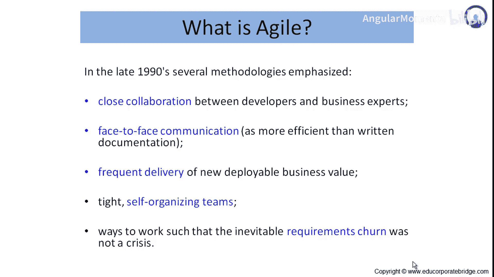
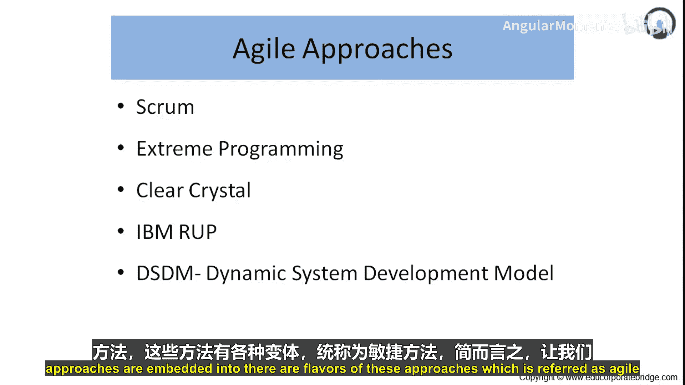
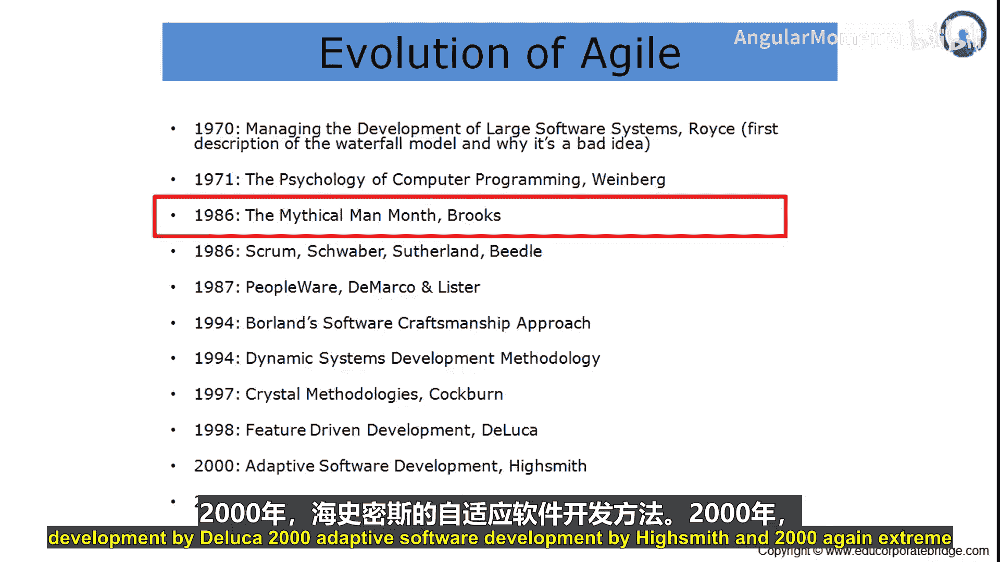
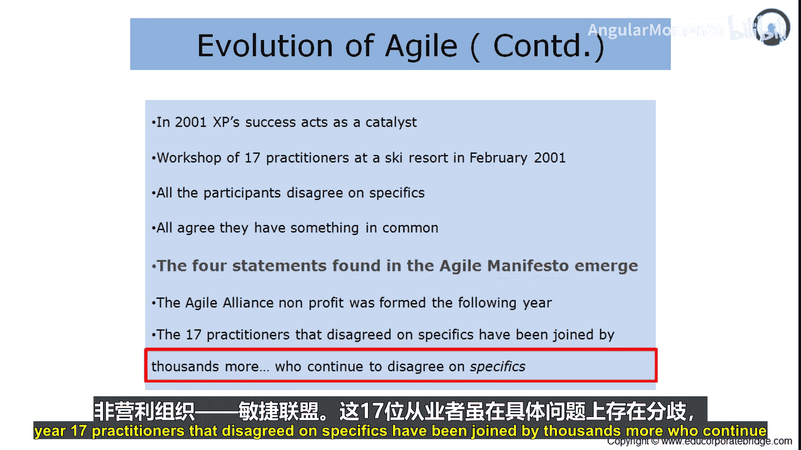
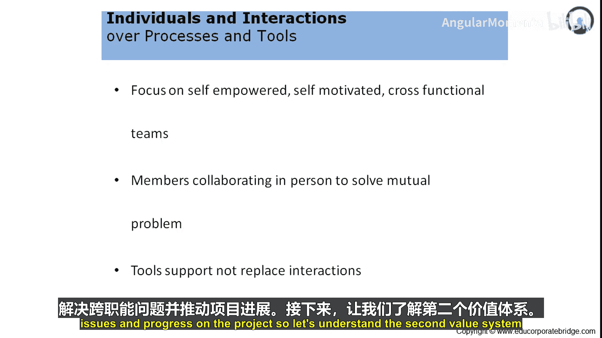

# 【EDUCBA】从思维模式出发的应用、评估与优化 ｜ Agile Practices： Apply, Evaluate & Optimize from Mind p02 01_01_02_敏捷方法 -BV1TLcTzJEXS_p2-

So now， let's understand。What are agile approaches？

So there are five Aile approaches which compromiseriss of scrum。Extreme programming。

C crystalrystal IBM R U P。Dynamic system development model So these five approaches compromises of agile。

So we will touch base these approaches in coming chapters for introduction just keep in mind that whenever we speak about agile all these five approaches are embedded into。

 there are flavors of these approaches which is referred as agile approach。😊。

So in short， let us understand the evolution of agile。In 1970。

Managing development of a large system Roce first description of waterball model and why it is a bad idea。

😊，So early 1970， people started recognizing that this waterfall model has shortcoming and there needs to be something more which will help the project community to do good developments and meet the customer expectations。

😊，In 1971， the psychology of Comp programming Wiberg。

He come out that you know how the computer programming can be done in a better and effective way。

In 1986。ブルックス？Myical man month he。Has a doctrine， and he advocates that how。

Teams effort or teams availability can be better leveraged by by tweaking certain project management approaches。

😊，86 again， scumb， Soburg， Sutherland and Ba。They come out with the initial Scrum approach。

87 people were demarco and listed， they have a。Come with the agile approach。

94 Bland software Kamship App。Which also brings in how this software development can be expedited or can be done in a better way。

😊，1994 Dnamic system development Meologies。97 crystal Meology by Cochburn。

98 feature development by Deluca。2000 adaptive software development by Hame and 2000 again。

 Ex programming by VC。

So in 2001， extreme programming success started acting as a catalyst。😊。

There was a workshop organized by 17 practitioners。In February 2001。

All participants disagree on specific， but you know all agree that they have something in common。😊。

So the full statement found in agile manifesto emerged in 2001。

So the agile alliance is a non nonprofit was formed by the following year。

The 17 practitioners that disagreed on specifics have been joined by thousands more who continue to disagree on specific。

😊。

So these 17 practitioners， they come with a manifesto， which is called a value system。😊，So。

 this manifesto has been discussed and released to unleash the value within the project management。😊。

Under agile framework。So， the statement was that。We are uncovering better ways of developing software by doing it and helping others to do it。

Through this work we have come to value the individual and interactions or processes and tools。

Working software or comprehensive documentation。Customer collaboration or contract negotiation。

Responding to change or following a plan。That is while there is a value in terms of。

Items on the right， which are。Processes and tool， comprehensive documentation， contract negotiation。

Falling a plan。But we value the items on the left more that is the individual and interactions。😊。

Working software。Customer collaboration and responding to change。

 So the whole paradigm about the project management。Having a very good set of processes and tools。

Writing a comprehensive requirement documentation。Undergoing a contract。

 writing and negotiation between vendor and supplier。Having a upfront plan。To kickstar the project。

 all this。Founds where all the paradigms where。Shifted and there is more emphasis bought on the individual and interactions。

Producing a working software which can be deployed to business。

 they can get the early flavor of what's coming on their way and give feedback what changes。🤢。

May or may not required。Collaboration with customer to bring in delight to bring in value。

 what is most relevant feature for them。And assuming affirmfront that there will be change in the requirement。

 which was perceived at the start of the project。 And as and when change are come coming。

 responding them on to the changes proactively。 So these are the four。

Pillers are four value system which agile Mano has produced now let us understand the each value system in depth which were published in agile manifesto the first is individual interactions or process and tools。

So， agile。Focuss on self empowered。Self motivated cost functional themes by meaning of self empowered is that the team members they know their role。

 they know what is expected out of them and they are all thought processes inclined towards producing value。

 so they are self empowered to produce value for the project。

Self motivated the whole philosophy is that instead of managing the people if they have shown the bigger picture they are self motivated to bring in the value so the emphasis is more on the motivating the team members than managing them。

😊，And cross functional teams。By meaning that that the business experts， the domain experts。

 the technical developers， the testers， they work together。😊，In order to bring in the best。

Software feature as a project deliverable。 So there is a cross functional synchronization coordination teamwork。

 which is。Embbedded into agile approach。Members collaborating in person to solve mutual problem in traditional project management methodology。

 if a team member has some issue， he locks that issue into a issue management system or seek clarity from a functional lead or a project manager。

And the bug stops there， whereas in agile methodologyology。

 the members collaborate to solve the mutual problem since there is a emphasis on the individual and interactions they meet in a preed frequencies。

 mostly at least once in a day so those interactions are useful for people to solve the mutual problems and as the problems get solved with with a great velocity。

 the project progress。😊，With a great spin。Tool support not replace the interactions。

 So as the statement says， there is a more emphasis on interactions。

 So tools are used as when required， but the first preference is given to the individual interactions。

 So the interactions are。With the rig so that the need of the tool comes only when the interactions are not able to produce the desired result。

 So in short， the individual and interactions are。Useful。

And they give an edge over process and tools。In order to adhere to the value。

 motivate the team spirit， solve the cross functional issues and progress on the project。

So let's understand the second value system。

