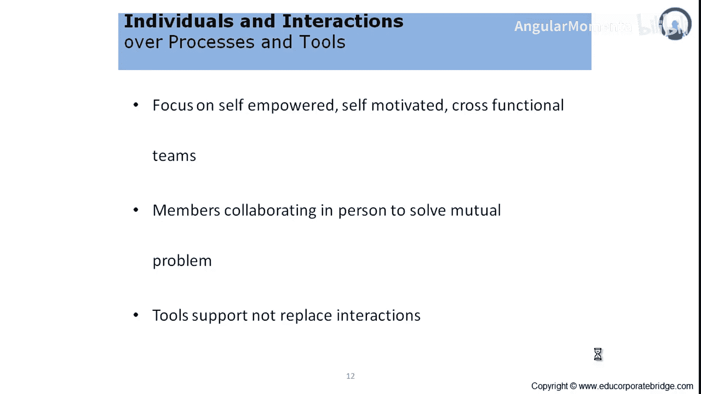
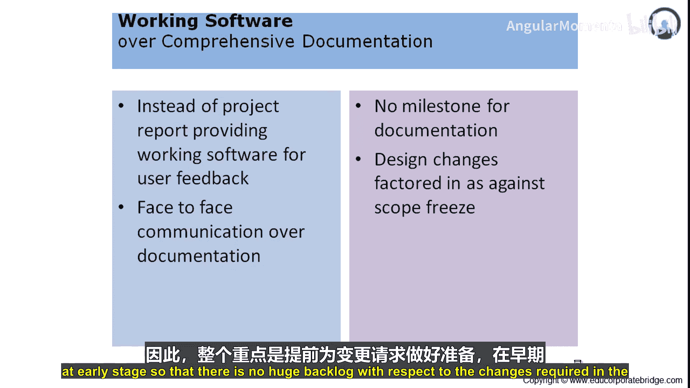

# 【EDUCBA】从思维模式出发的应用、评估与优化 ｜ Agile Practices： Apply, Evaluate & Optimize from Mind p03 01_01_03_客户协作 -BV1TLcTzJEXS_p3-

That is customer collaboration over contract negotiation。As all of you know that in a project。

 there is a customer who has some work。😊，He engages a couple of vendors。

In order to get the right work done， they undergo a RFP process。

 a contract is drafted and signed and the customer is expecting delivery。🤢。

With respect to the obligations written in contract where the vendor is expecting money to be paid for the services they have。

😊，Given to the customer since there is a contract which is legally binding all the interactions。

 all the actions， all the conflicts they are navigated through a contract which is a baseline for all discussions。

😊，Whereas agile。Bringing up a mindset where they want to bring the collaboration between the customer and the vendor or a service provider so that they work in a open。

 healthy atmosphere。 they try to。Bring in the value in most optimal way and try to avoid the litigation or out of。

Scope discussions。So this is the broad framework or the value system， which agile。Prootes。

Under their manifesto。 so customer is a part of this development process in traditional system。

 customer comes only when the delivery is ready and they say show me what I'm gonna get。

 And when when they see their natural expressions， oh， this is not what we are ask for。

 So in order to avoid that surprise to the customer customer is engaged right from the start of the project with a predefined frequency so that customer is a part of the development process。

 customer is aware of what development is happening。 customer get chance to test。

 deploy that development and give feedback if something。😊，Some changes are required。

Writing specification and waiting for software is not effective so customer as is engage from day to day。

😊，Bais he is having a control or having a sort of understanding of the project development activities and so that the writing specification waiting for software when it is ready。

😊，It doesn't arises。Customer， since he is engaged， he owns the process。

And not come at the end as a verification validation agent。

 So customer wears one cap as a owner of the process， he。Give all valid inputs。

 he consumes the development， he gives feedback， he gets the changes done so that the process become much more simplified and there is a deliverable software which is available for the business。

😊，And there is no vendor customer fencing because a Jile framework promotes that the project。😊。

Deliverables。arere aing to the value system and everybody gets their pi off credit from the project so there is no fencing when things goes wrong。

😊，So let's move to the third value system， there is working software or comprehensive documentation。

As you know， a typical project management methodology。

 it starts with a front definition of all the requirement once that is signed off。

 then the development starts and as and when the requirement gets changed since there is a change freeze。

 there is a resistance by the development team towards the change。😊，So this all scenario is avoided。

😊，In so this all scenario is awarded into agile project management methodologyology。

 so this value system promotes that instead of project report providing working software。

For the user fit。So value is a or the credit on the milestone is given only when the working software is available for user feedback。

Whereas in traditional project management， if the requirement document is prepared。

 you get the milestone done when there is a。Blueprint is prepared。

 you get the milestone done when there is a unique development is done you get the milestone done when when the prototype is developed you get the milestone credit so all the focus which is there in Ka project management methodology towards documentation。

or the activities which are not directly linked to the software development those have been avoided as you know in most of the project we come to know that the project is delayed when it consumes the 90% of the project time whereas agile since it is aligned to the delivery of the working software it at every stage。

The project team members and project manager is aware of that how project is progressing with respect to the milestones so the emphasis is on producing the working software rather than producing set of documents。

Which is not directly linked to giving any direct value to the user community。😊。

Face to face communication or documentation as there is a rigor with respect to the interactions the changes are told discussed in face to face meetings they have been debated they have been accepted and the development is undertaken and the result of the development is discussed face to face so the face to face communication is used to bring the rigor intensity with respect to the team communication。

😊，Agile doesn't allow any milestone for documentation。 So all the thought process， all the。

Actions are inclined towards producing the value which can be directly consumed by the user community。

Design changes factored in as against score freeze。

So changes are very much essential for the business community as and when they get the。

Charity on the business side。And the developer community has a resistance for the change。😊。

Since these two positioning。Is observed in a traditional project management methodologyrology agile upfront agrees that there will be changes。

 there will be changes those are factored in under the project work。😊。

And in order to deliver on those changes， agile has a daily meeting where the changes are discussed。

 debated， accepted， developed， tested and consumed。🤢。

So the whole emphasis is on the afrontent provisioning for change request。

 accommodating those changes at early stage so that there is no。

Huge backlog with respect to the changes required in the software。

