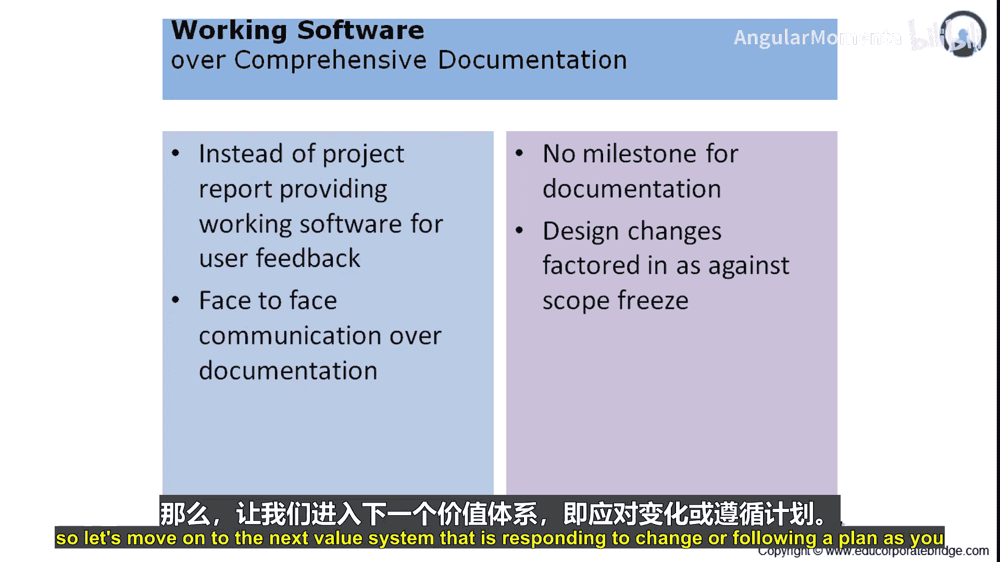
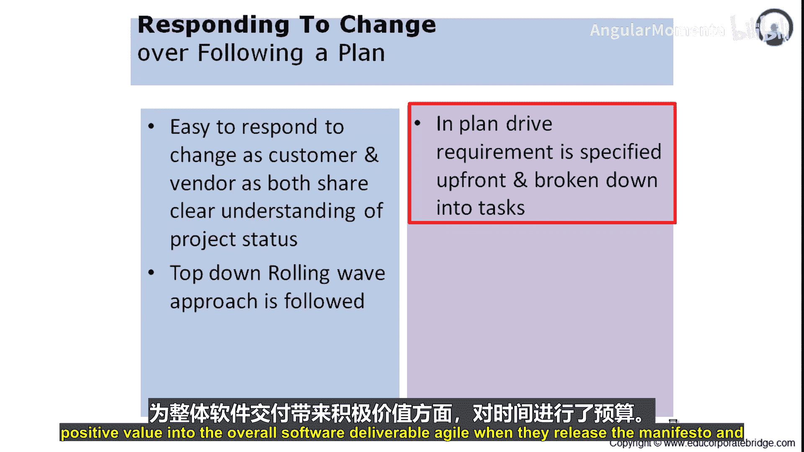
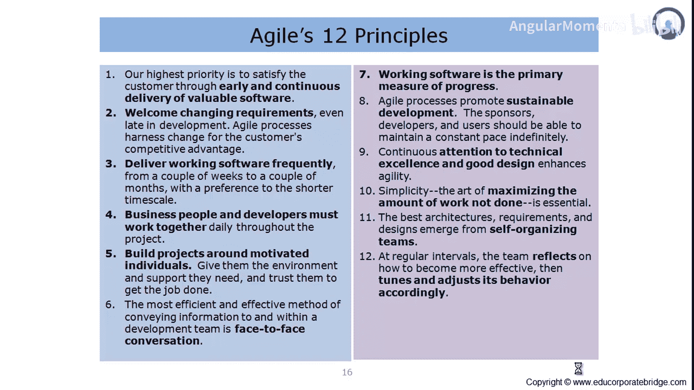

# 【EDUCBA】从思维模式出发的应用、评估与优化 ｜ Agile Practices： Apply, Evaluate & Optimize from Mind p04 01_01_04_应对变化 -BV1TLcTzJEXS_p4-

So let's move on to the next value system that is。

Responding to change or following a plan。As you know in traditional project management methodologyology。

The plan is。Lay down at early stage of the project。 all the team members， they。

Work towards meeting their obligation within the plan and if something extraordinarily done needs to be done。

 which is not。🤢，W in the plan， there is a resistance by the development community to do that activity。

Whereas the agile manifesto。Agile foundation， Agile value system。Pches to respond to the change。

Instead of following a plan。So they。Recommend that it is easy to respond to a change as a customer and vendor as both share the clear understanding of the project status。

Supposing。You are in a project which is developing a iPhone and as you know that。

IPhone near the feature of。Having the screen response within 2 milliseconds and as you know that once the development is started。

 one of the competitor has a launched。😊，A phone which has a response time of1 millisecond。

 So if you still continue with your earlier specification of screen response time of2 milliseconds。

 you know that how better you will make that iPhone no customer will like to buy that iPhone so your specification gets upwardly revised something less than one millisecond so in such scenarios if vendor and customer take their position and they says will go only by early specification。

😊，How good or best you produce the product， nobody will buy that product so to be more realistic。😊。

The agile manifesto promotes that customer vendors。

 they both share the clear understanding of the project status， they know which change。

Will bring in what positive impact on the software and their actions are aligned with respect to adapting that change as early as possible。

😊，Agile approach is top down。Rolling wave whereas they start with the higher level specification and as you。

Go into the iterations you bring in further detail or the clarity within that iteration and rolling wave approach。

Is useful to develop the software。Iplanum requirement is specified upfront and broken down in task。

So。In traditional approach。You define the requirement at the start and you start the development。

 whereas in。Agile， you develop the high level。Scope and you have the rolling waves to further progressively elaborate the requirements。

So， to summarize。AGile budgets the time with respect to handling the change， adopting the change。

 and ensuring that the change brings positive value into the overall software deliverable。😊。

Agile when they release the manifesto and they release the four value system they also released the 12 principles which complements the value system and which brings further details on how agile project mi methodologyology is helping customers to get better value so lets understand what are these 12 principles which supports the four value system which is in agile manifesto so the first one is our highest priority is to satisfy the customer through early and continuous delivery of valuable software。

So， the first principle says that。We want to deliver the software to the customer early。

Early in the sense， as at least possible， not。I know where customer needs to waitdge for long in order to get glimpse of the software。

Will continuously deliver the software as and when it's ready so that customer can use it。

They can give feedback。If there is any change which can be accommodated and the whole emphasis is on to producing the value with respect to the business。

So the first principle says that will give the software。As early as possible。

 there will be continuous delivery， accommodating the changes， evolution of the software。

 and there is a value which will be continuously transmitted to business。😊。

Like if you are developing the iPhone。The business will。

As and when the components and assemblies ready， business will。

Get a flavor how the Internet connectivity is， how the。

Screen responses how the Wifi connectivity can be achieved， what is the audio quality level。

 what is a download speed likewise。The second principle says that welcoming changing requirement even late in the development。

 agile processes harness change for the customer's competitive advantage。

So instead of opposing the change which is done in traditional project management methodology。

 agile welcomes the change。It understands that changes are essential to keep the customers into the business。

To give competitive advantage to the customer。 So agile methodology。孩子们。

Working way where the changes are being welcome to bring in for the discussion。

Changes are well understood。 They are well debated。

Various option to accommodate those changes are discussed。

 the viable option is chosen and changes implemented and transmitted to customer。

So that is how customer prefer agile methodology since it welcomes the changes and changes are。

It necessary when you run the business。The third principle says that deliver working software frequently。

😊，From a couple of weeks to a couple of months。With the preference to the shorter time scale。

So instead of giving requirement and then waiting for a long period to get the software。

For the testing customer。Is given汝。Limited delivery of the software so that they can start using it。

 give feedback， bring in changes， further enhance the value and the whole emphasis is to give the software or the phases of delivery at a shorter frequency and as as possible。

Foot value。Business。People and developer must work together daily through the project。

So agile has a daily math meeting short floor meeting。 There is a team。Interaction。

Wch undergoes what was planned， whats being delivered， what were the challenges。

 what coordinations required， are there any changes so that intensity within project community helps to bring in clarity within team members。

Helps to bring focus on the what is essential and what is most important for the business。

And it also ensures quick turn around。Within the project， as you know， in traditional project。

 there is three to five working days is allowed to review the document。

 So if you are taking five working days to review and agree upon。

Any requirement document when the actual development comes it takes more than two weeks for testing and then the defects are communicated back and those defects gets fixed so lot of time goes waste with respect to back and forth interaction within the team members and agile principle tries to overcome that shortcoming of a traditional project management methodologyology by bringing the rig their the project interactions are designed in such a way that developers and business they work together right from the start till the desired value is achieved。

😊。

