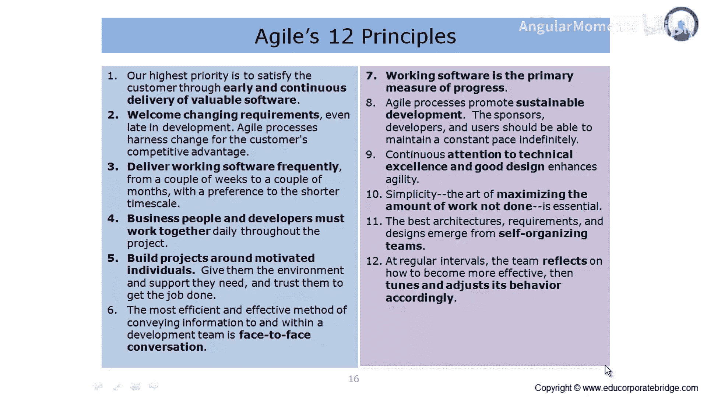
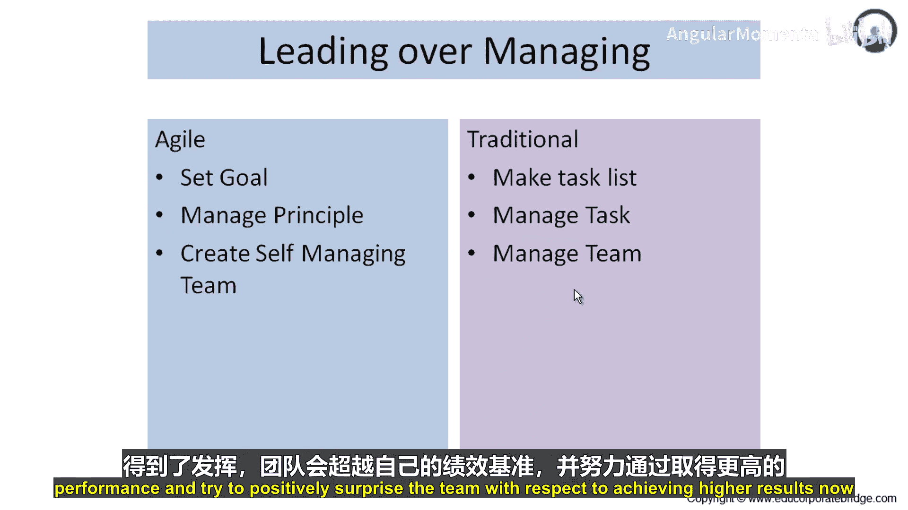
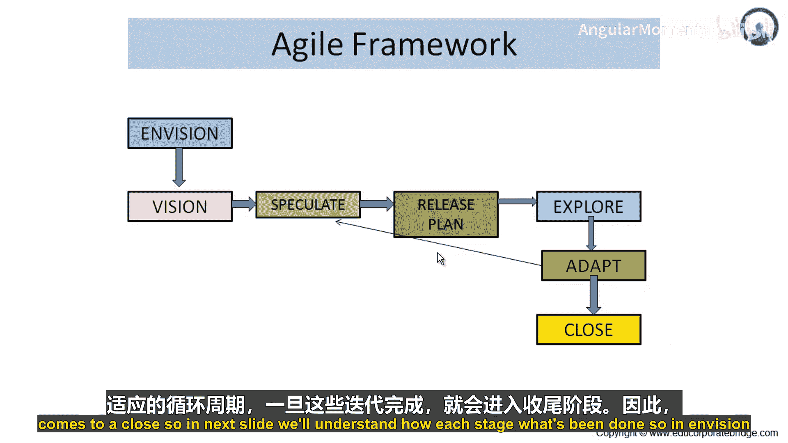
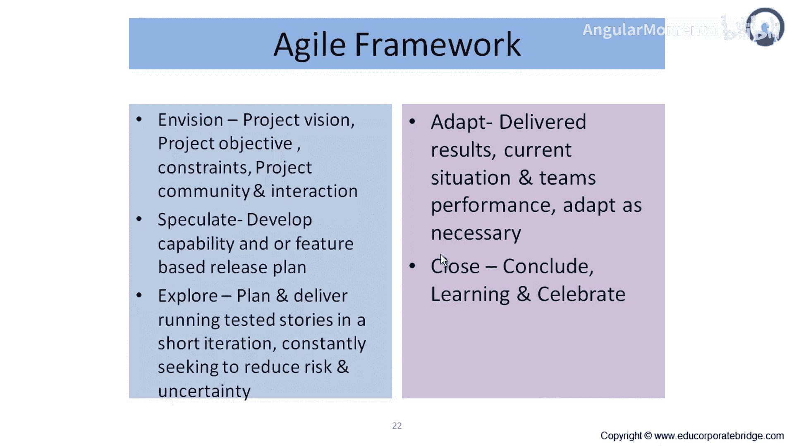

# 【EDUCBA】从思维模式出发的应用、评估与优化 ｜ Agile Practices： Apply, Evaluate & Optimize from Mind p06 01_01_06_敏捷价值观框架 -BV1TLcTzJEXS_p6-

So now let's understand the values。Of agile methodologyology in traditional project you have the triple constraint about this scope quality in cost as you change the scope you know there is a significant impact of the change in scope on the quality or cost or when you change the wants to upgrade the quality the scope and the cost goes also on the upward revision so this triple constraint is predominant in。

Traditional project manm methodology， whereas in agile all these triple constraints are overcome by sticking to value which is extrinsic quality。

😊，The quality which is in also intrinsic quality and constraint cost schedule and scope as。The team。

As a team works on the cost。Schedule and scope， they bring in the agility。

 There is a good communication。 They produce the working software。 There is a collaboration。

 So the constraints on the cost， scope and。Schedulule are overcome in agile methodology。

So the next value is adapting or confirming。In agile， there is a flexible release plan。

Which is more inclined towards business and user communities need。

The planning emphasize is on by features， which features come on to priority， which features are。

Most urgently required by business。The scope is。Get flexible。

So that the changes and with respect to the score and with respect to the velocity。

 the scope can be delivered。And there is a learning on every iteration。

Whereas the confirming approach in traditional project management they have with the baseline release plan。

The best size plan once baseline， the deliverable takes substantial time to reach to the business and that's where there is a disconnect between the business and the project team。

The traditionalial project management， they。Plan by task whereas the agile methodology。

 it plans to deliver value。The traditional project management， the baseline the scope。

 whereas in agile the scope is flexible， the scope is covered with respect to the team's agility with respect to the customer and vendor participation so there is a win win situation for all the stakeholder as there is a greater velocity there is a。

😊，Great acceptance of the changes。 So customer gain more。 So customer。

 all action and interactions are inclined toward derive more。Value from the project team。

And in traditional project management methodology， once all the development is done。

 there is a testing and there is a defect which comes to known to project team those get fixed so learning comes at the end whereas in。

AGile metal learning comes in every iteration as every iteration there is a workable software which is given to business。

 business， provides their feedback and there is a learning to the project team。😊。

So adaptive as in agile or confirming as in the traditional project management methodology。😊。

Let's move on and understand what is the next value system leading or managing。In agile。

 the team sets goal for themselves。😊，Whereas in traditional there is a task list for the team members。

 so task doesnt necessarily produce the value whereas goal definitely produce the value for the projects。

 So hence agile has a better approach towards setting the goal as against。

Defining a task for the team members。Team members， they are managed by task whereas team members in a child they are managed by principles what value they bring in。

 so the value is most preferred in a child as against the task execution。

 which is done by a team member in traditional project management methodologyology。

A Jile emphasiss on creating self managing team so there is a less of a reporting less overhead it with respect to managing the team and since team is self motivated they produce greater results。

😊，Whereas in traditional project management methodology people wait to be told what they need to be done and they only do what theyve been told to do so that is where the team's full potential is not leveraged in traditional project management methodology whereas in agile the team's full potential gets leverage and team overcome their own benchmark of performance and try to positively surprise the team with respect to achieving higher results。

😊。

Now let's understand the Agile framework。Agile framework has first step of in。😊，Followed by vision。

 speculate。Prepaid the release plan。Explore。Adapt。Then adapt goes to a further cycle of speculation。

 release planning， exploring and adapting and once these iterations are completed it comes to a close。

 So in next slide we understand how each。Stage what's been done。

So in envision， the project vision project objective。Project constraint。

 project community and their interaction is design and plan。So what the project is all about。

 what the project is expect to achieve。What are the likely constrained or challenges they will face。

Who is the project community， who are the key stakeholders， who are the business。

 who are the developers， how their interactions will happen。

 all these things are defined in vision stage。😊，The next stage is speculate the word speculation is mostly used with respect to the trading terminology but the whole approach which agile text is keep the scope flexible and try to deliver maximum value within the scope and within given budget thats what is speculate so instead of upfrontly committing the deliverables the agile teams they speculate。

😊，Develop the capability and feature。😊，Best release plan。 So the in speculation stage the plan。

Release plan is prepared and it only throws light which features can be delivered。😊。

And high level timeline about it。As they go into explore stage。

 they plan and deliver running tested stories in a shorter iteration。

 constantly seeking to reduce risk and uncertainty。😊，So， in Exp stage。

 they undertake the user stories or the requirement for development， do the development。啊。

Deliver the development to the。Business community and seek feedback。😊。

