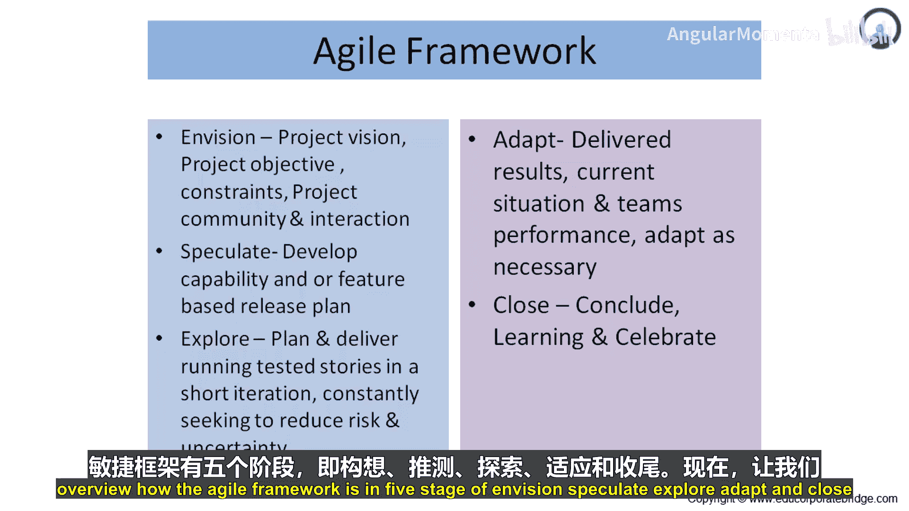
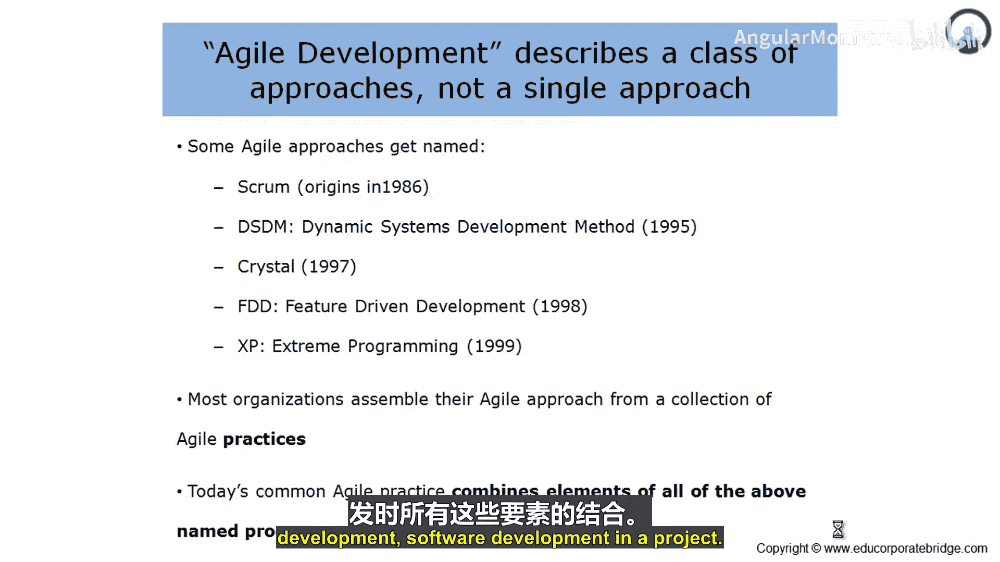
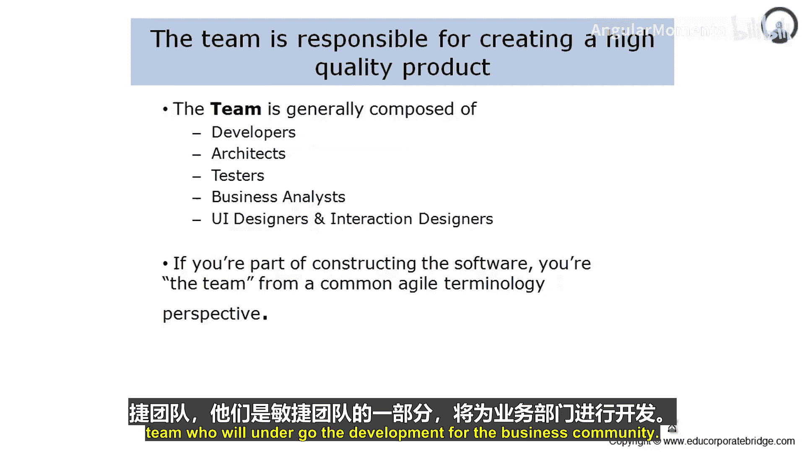

# 【EDUCBA】从思维模式出发的应用、评估与优化 ｜ Agile Practices： Apply, Evaluate & Optimize from Mind p07 01_02_01_敏捷团队构成 -BV1TLcTzJEXS_p7-

So in AD stage the results gets delivered， the current situation is monitored。

 Team's performance is monitor enhanced and team adapts the changes as and when required。😊。

In close stage， they conclude。On the overallal development of the project software learnings are shared and the reserve speech they achieved are celebrated well see this framework in chapter 2 in much detail for the moment we've given you a brief overview how the agile framework is in five stage of In vision speculate。

Explore， adapt， and close。Now， let's understand。How these agile approaches are。

Sort of emerge and you how they get named， you know， so。

This agile class of approaches comprises of five approaches， Scrum， which is originated in 1986。BSBM。

 that is dynamic system development method， which got developed in 1995。Crystal in 1997。

Featured driven development in 1998 and extreme programming in 1999。

So always remember that agile approach。Has this class of five。Aプs and。

Any single approach can best use of any of these approaches altogether。 So these approaches are。

Used together as a combination。Most organizations assembled the as agile approach。

From collection of agile practices。Today's common agile practices combine elements of all of our bound name processes。

So any approach is a combination of all these elements which is being followed for product development。

 software development in a project。

Let's spend some time with respect to understanding。The project team composition。

While agile isnt a specific process， a common process life cycle and roles have emerged。

 so all the agile projects they have the process life cyclee and the role which are common in nature。

People in agile development often act as one of the three super roles。

 so agile project has three roles and the people who participate in agile projects。

 they act as one of the super three roles。And people often move freely between these rules， remember。

 stakeholder has multiple caps。They act in a project with respect to the project requirement and they can change the cap。

 they can change the rule as the situation demands。So Agile team has three team roles。

 those are called super roles。The roles are interchangeable。

An agile process undergoes specific process life cycle and the rules。So now， let's understand。

The team responsibilities and composition。说第。Generally， is composed of developers， the people who。

A write the codes develop the screen do the de integration， So these people are called developers。

Architects these people are responsible to design the overall interaction between people processes。

 product partners， and which is called the business or enterprise Archect。😊。

Testers who ensures that the deliverable meets the requirement。😊，If not。

 then the defect is fixed and retested， so testers play important roles for verification and validation。

Business analyst。These are the communities who ensure that the requirement is。Elicited in a nice way。

 There is a。Focus with respect to digitizing the business processes。The software， which is produced。

 meets the end requirement。User interface designer and interaction designers。

 These are the people who。Ensures that the two systems， two processes。

 they interact with each other in a homogeneous way and all interactions。

Within the business value chain are captured and digitized。For producing the business result。

So these are the key roles in a agile。Project and if you are part of construction of the software。

 you are the team from a common agile terminology perspective。So。Constructing team is a agile。Team。

 and they are the part of the agile team， who will under。

Go the development。For the business community。