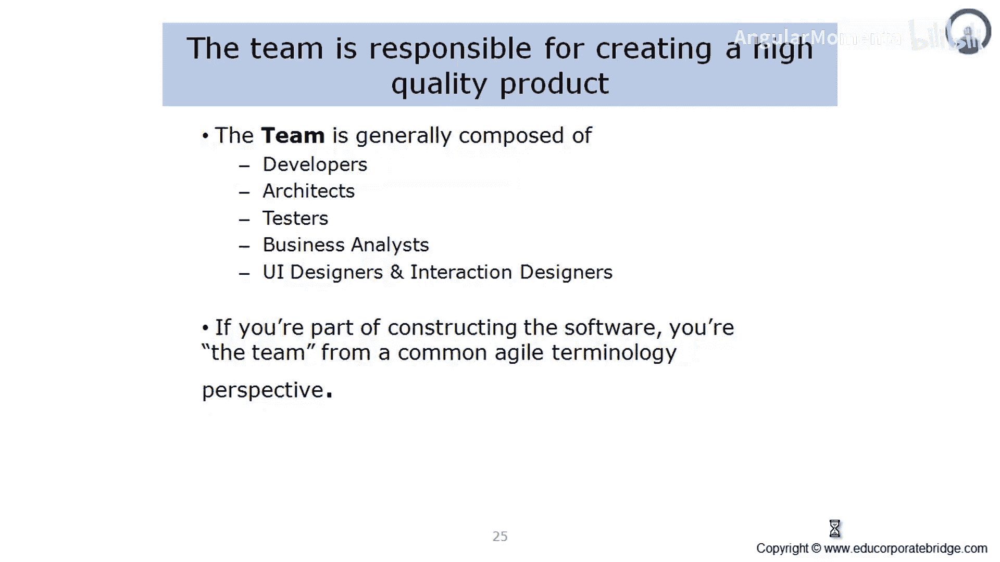
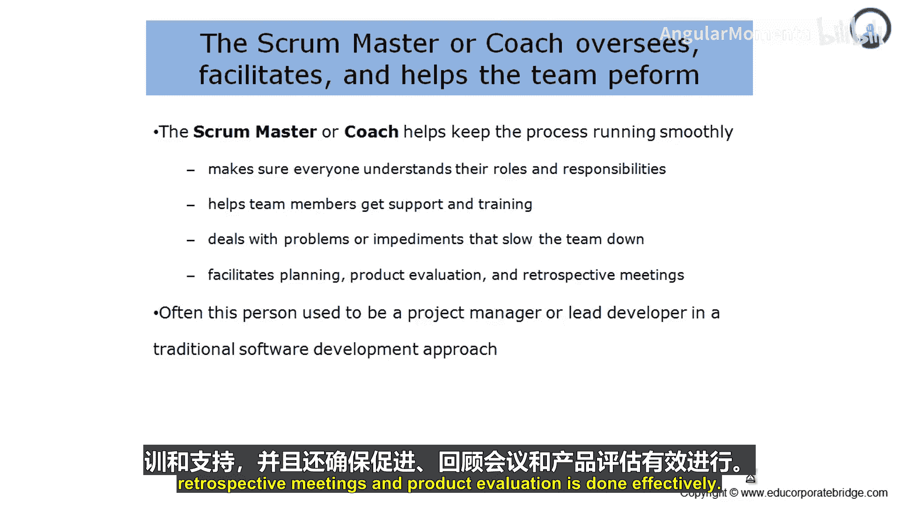
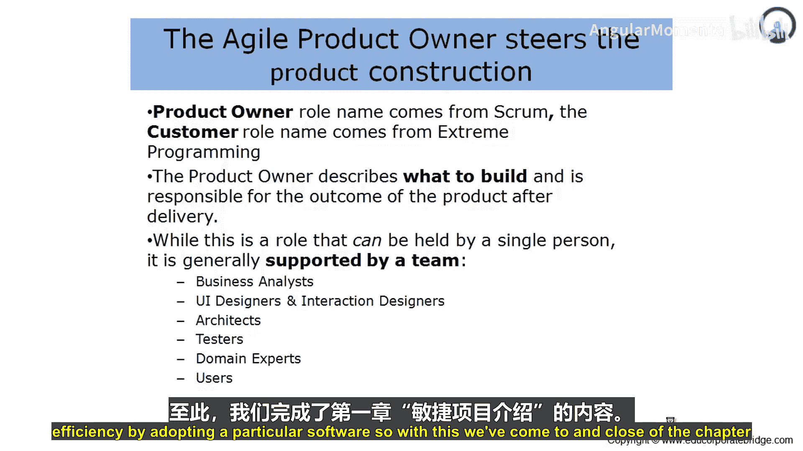
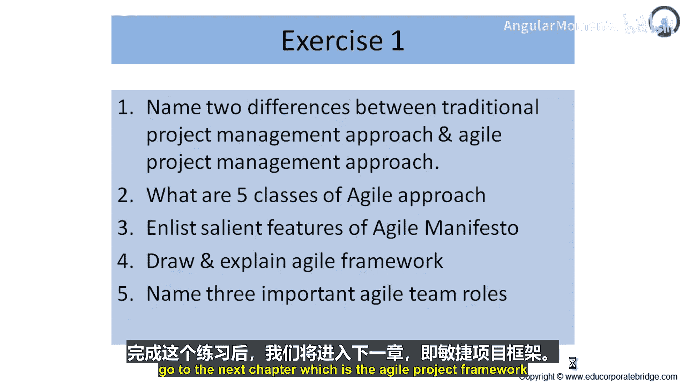
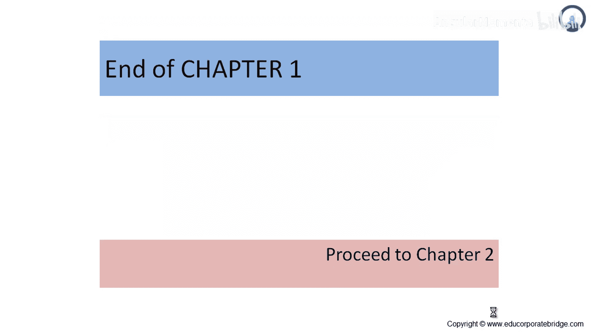

# 【EDUCBA】从思维模式出发的应用、评估与优化 ｜ Agile Practices： Apply, Evaluate & Optimize from Mind p08 01_02_02_团队构成延续 -BV1TLcTzJEXS_p8-

This sc master or coach helps。🤢，Keep the process running smoothly。

 He ensures that everyone understand their role and responsibilities。

 So if coach brings clarity with respect to their roles and responsibilities。

He helps team members to get support and training so he is the one who understand the heat map of the team members。

 the competency capability gaps， the training requirement。

 occasionally handholding and support required for the team members。

He deals with the problems and impediments that slow the team down。

 he acts as an accelerator and ensures that issue that slows down the process or the progress of the project。

😊，Gets addressed quickly and effectively。 He facilitates planning。

 product evaluation and respect retrospective meetings。So the facilitation planning。The evaluation。

 which is done by the business side and the retrospective meetings about managing the changes all are done。

😊，With help of this Sc master or the coach。Often， the coach is the person used to be the project manager or lead development in a traditional software development approach so the。

Competncy， the。The degree of authority a person holds within the business community project community those people are generally being nominated as a Scrum master or a coach so this Scrum master or coach role is very much essential because they act as an accelerator they bring clarity about who is doing what they also G provides facilitate trainings and support when the need arises and they also ensures that the facilitation retrospective meetings and product evaluation is done effectively now let' us understand who the product owner is so the product owner name has come from Scrum。

The customer role name comes from extreme programming。

The product owner describe what to build and is responsible for the outcome of the product after delivery。

So product owner is a custodian of the design and specification of the build and he ensures that it is aligned towards the business requirement any change which is or which is suggested by the customer doesn not negatively impact the overall build。

😊，While this role sounds to be of a single person， but entire team supports for this role to ensure that the product ownership is handled。

Well within the project。 So these。Rolls are supported by business analyst。

 you are designer and interaction designers， architectures， testers， domain experts and users。

 so business analyst， they ensure that what is right for the business gets。

Conveyed and gets developed UI designers and interaction reasoner ensures that the development is user friendly and user interfaces are optimal as per business requirement architect ensures that reliability。

 robustness performance are addressed tester ensures that the development is meeting the business requirement with respect to verification validation domain expert ensure that the industry best practices are followed and user ensures that the development is fit for use and there is a efficiency by adopting a particular software。

😊。

So with this， we've come to and close of the chapter 1， which is a Jile project introduction。So。

 what weve understood in this chapter is。What is a typical project management methodologyology？

What is project management， what is program management， what is portfolio management？

What is agile manifesto？What are the four value systems which are preached by a child？

What are 12 principles？We've understood the agile project framework。We've understood the team。

Composition， weve understood the couple of key roles。Now it's time for exercise。

 So we have listed couple of。Questions here。These questions are。

Needs to be answered so please undergo this exercise youve got 30 minutes to solve these five questions the first question is name two differences between traditional project management approach and agile project management approach。

Second question is define five classes of agile approach。Third。

 enlist the sal features of a gi manifesto。Fourth， draw and explain agile framework。

Name three important agile team roles。So please undergo this exercise which will help to further cement your understanding about the Agile project management framework。

😊，As you complete this exercise。We will go to the next chapter， which is the Agile project framework。

