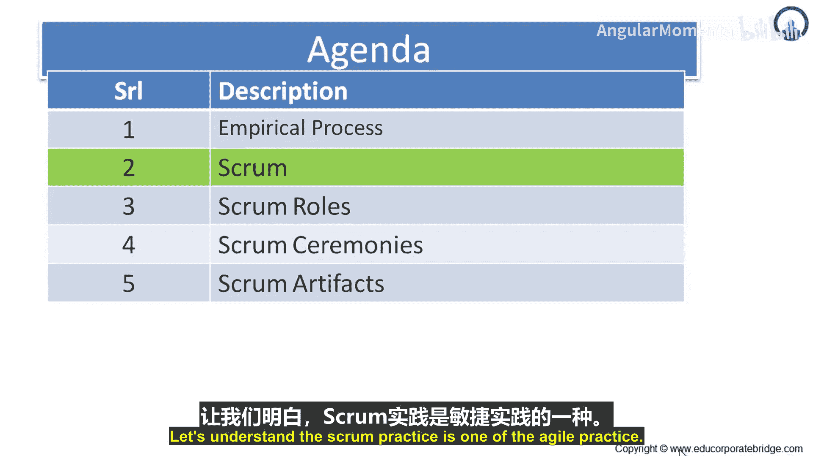
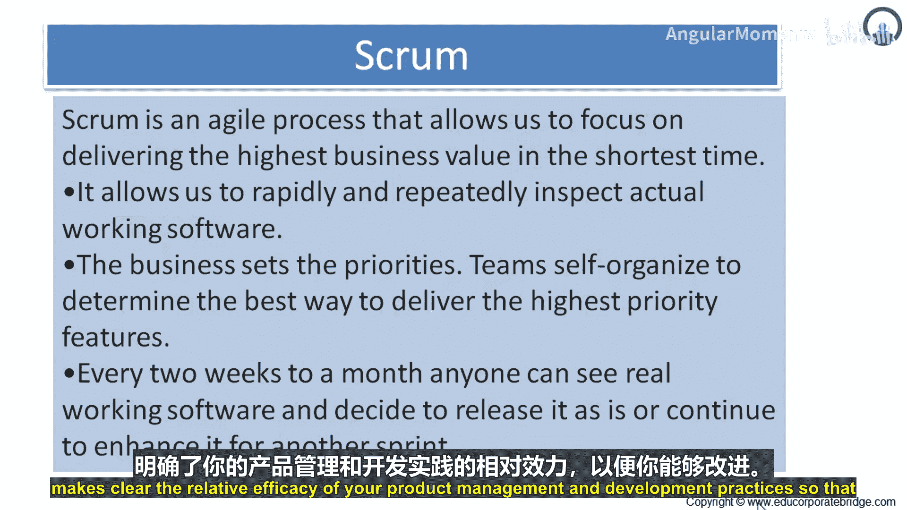
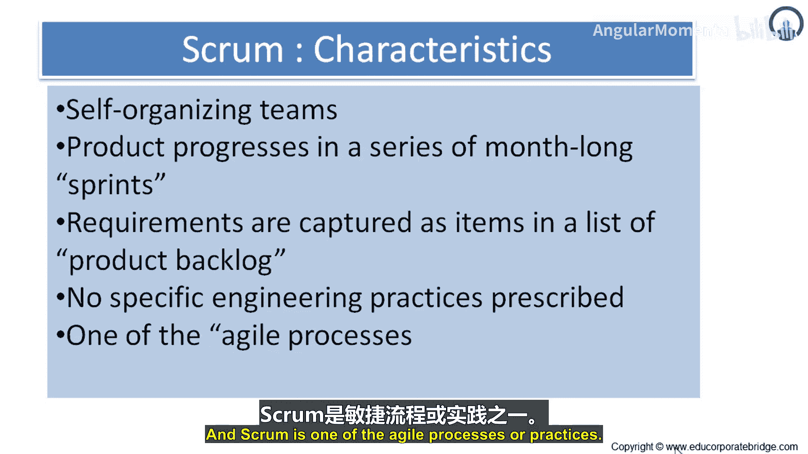
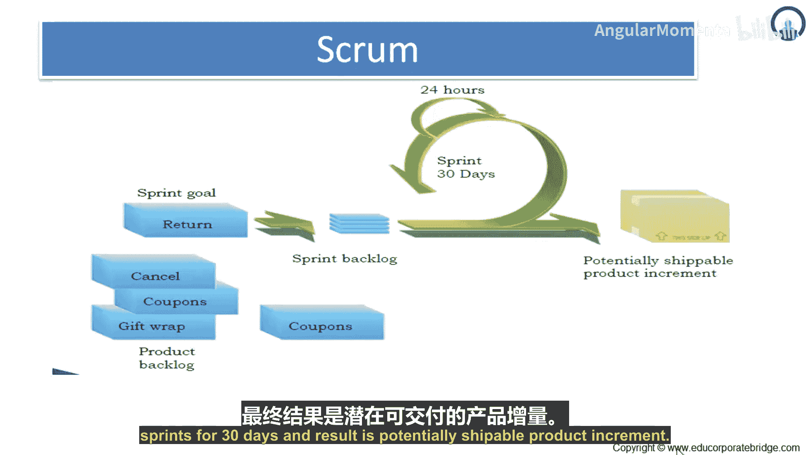
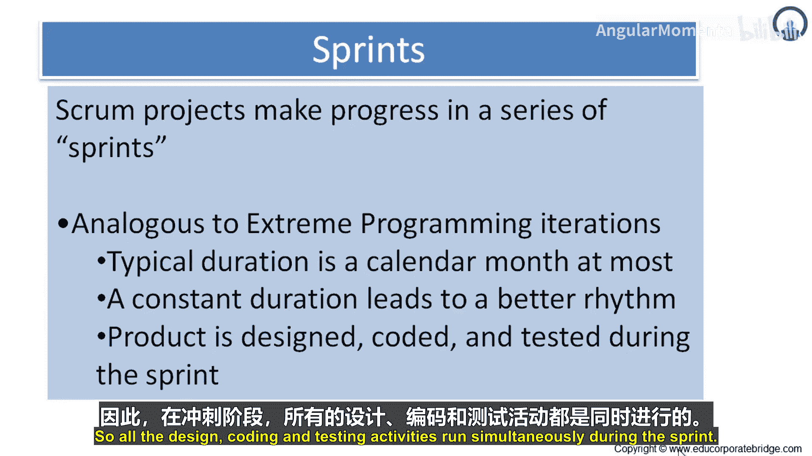
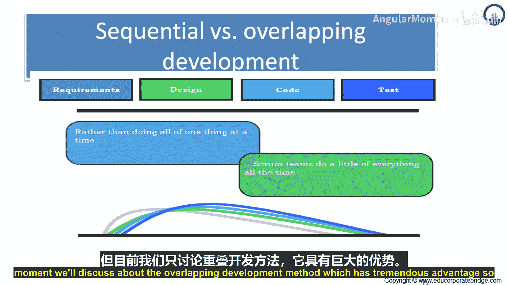
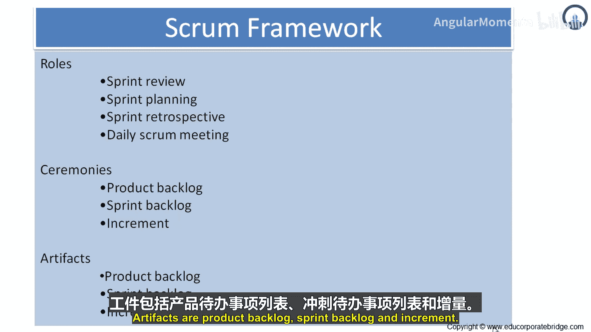

# 【EDUCBA】从思维模式出发的应用、评估与优化 ｜ Agile Practices： Apply, Evaluate & Optimize from Mind p09 01_02_03_Scrum实践导论 -BV1TLcTzJEXS_p9-

Let's understand this scrum practice is one of the agile practice。

Scrrum is an agile process that allows us to focus on delivering the highest business value in shortest time。

So the prime principle of scrum is to deliver highest value in shortest time。

It allows us to rapidly and repeatedly inspect actual working software。

The business sets the priorities team self organized to determine the best way to deliver the highest priority features。

Every two weeks to a month， everyone can see real working software and decide to release it as。

Ease or continue to enhance it for another sprint。A framework within which people can address complex adaptive problems。

While productively and creatively delivering products of the highest value， Scrum is one lightweight。

2， simple to understand， and three extremely difficult to master。

ScuM is a process framework that has been used to manage complex product development since early 1990s。

Scrm is not a process or a technique for building products。Rather。

 it is a framework within which you can。Employ various processes and techniques。

Scrrum makes clear the relative efficacy of your product management and development practices so that you can improve。

The scrum framework consists of scrum teams and their associated road events， artifacts and rules。

 Each component within framework serves a specific purpose and essential to scrum success and usage。

😊，Specific strategies for using Scrum framework vary and are described。

The rules of scrum bind together the events， the role， the artifacts。

 the governing relationships and interactions between them。

 The rules of scrum are described toward the body of。です。Training document。

Scrm is founded on empirical process control theory called empirism。

 Empiricism asserts that knowledge comes from experience and making decisions based on what is known。

 Scum employs an iterative incremental approach to optimize predictability and control risk。

3 pillarers uphold every implementation of empirical process control transparency。

Inspection and adapt。Transparency， is significant aspect of process。

 must be visible to those responsible for the outcome。

Transparency requires those aspects to be defined by a common standard。

So observers share a common understanding of what's being seen。For example。

 a common language referring to the process must be shared by all participants and。

Common definition of done must be shared by those performing the work。

Those accepting the work product。Inspection， scrum users must frequently inspect。

Scrrum artifacts and progress towards a goal to detect undesirable variances。

Their inspection should not be so frequent that inspection gets in the way of the work。

Inspections are most beneficial when diligently performed by skilled inspectors at。The point of work。

Aruption， if an inspector determines that one or more aspect of process deiates outside acceptable limits and that the resulting product will be unacceptable。

 The process or material being processed must be adjusted。

An adjustment must be made as soon as possible。To minimum further deviation。

 Scrum prescribes four forward opportunities for inspection and adaptation。

 as described in Scrum events section。😊，Scrrum planning meetings， De Scrum。

 Sprint review and Sprint retrospective。Let's also understand the scrum characteristics。

About the team， teams are self organizing。 so team。They organize their own team meetings。

 they organize their own reviews， they organize their own retrospectives。

 they organize their own communication。Product processes in a series of month long ss。

So the development of the software or the product progresses as a part of a month lock ss in which there is item which is taken from the backlog taken for development。

 there is a daily sprint， there is a monthly sprint and a shipable product comes out out of the sprint。

Requirements are captured as items in the list of the product backlog。

So product backlog is a placeholder。All the。Input。For product development。

So all the requirements which came from the user's stories are captured in the product backlog。

There's no specific engineering practices prescribed by Scrum。

So Scrum is irrespective of specific engineering practices you can use one or two or combination of engineering practices for product development。

😊，As Chm is one of the agile processes or practices。

This is one of the most。Commonly use diagram to elaborate。The？Sprint process。On the left side。

 we have got the product backlog。Comprises of giftra coupons。And cancel。

So based on the product backlog， a sprint goal is decided。And spring backlog is created。

The sprint backlog undergoes 30 day sprint each 30 day sprint has 24 hours of cycle of sprint。

 and at the end of the sprint， potentially shipable product increment comes out。

So the logical flow of scrum is product backlog。Sprint backlog。

Sprints for 30 days and result is potentially shipable product increment。

Scramp projects make the progress in series of sprints。

Which is analogous to extreme programming iterations。

The typical duration of a sprint is a calendar month at most。

It doesnt sprints are not typically allowed to exceed more than 30 days。

A constant duration leads to a better rhythm because the team members are familiar to complete the sprint backlog within a predefined period。

 they are habitual of getting into cycle of development and delivering shipable products within 30 days。

There is a cadence， there is a rhythm within team once they start the sprints。

Product is design coded and testing during the sprint。

 so all the design coding and testing activities run simultaneously during the sprint。😊。

So the diagram depicted here shows two type of approach， the first is sequential。

And the other one is overlapping sequential requirement， design， code and test。

These phases follow one after another， there is hardly any overlap between the phases。😊。

As you can see on the top。For rectangles in blue， green， sky， blue and dark blue color。

And the second bottom shows the overlapping development。

Where you could see the requirements the design， the code and the test happen simultaneously。

The fundamentals of overlapping development is rather than doing all of one thing at a time。

Scrrum seems do little of everything at a time。There are pros and cons。Of both the methods。

 but for the moment， we will discuss about the overlapping development method， which。

Has tremendous advantage。So the scrum framework has three pillars roles。Cremonies and artifacts。

The roles are print reviewers， print planning， print retrospective scrum meetings。Ceremonies。

 product backlog， print backlog， increment。Arifacts are product backlogs。

 print backlog and increment。

