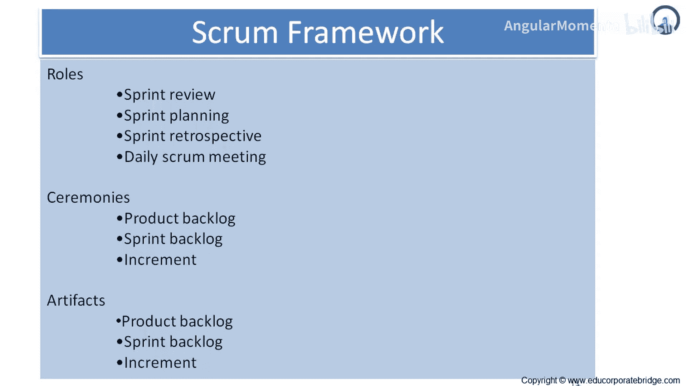
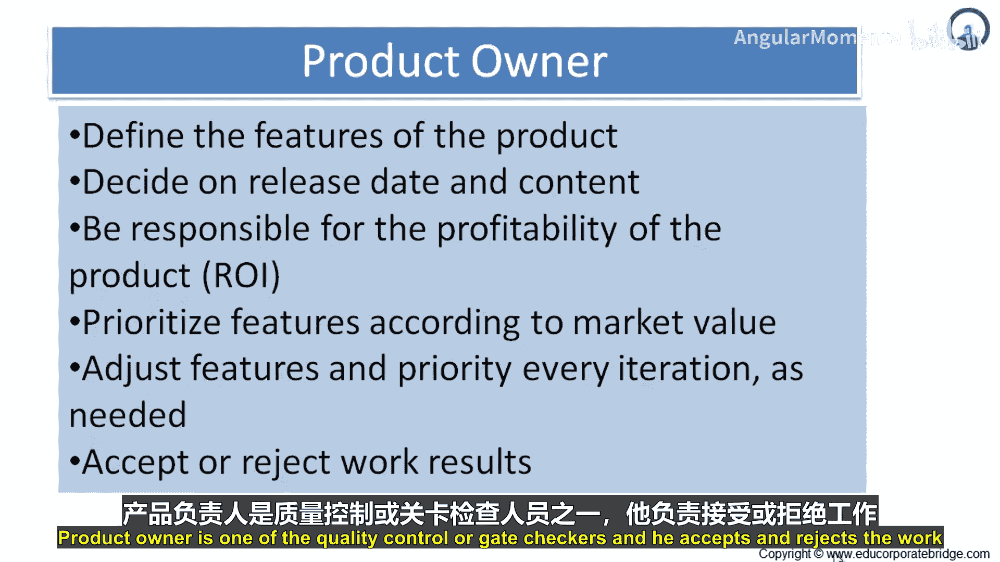
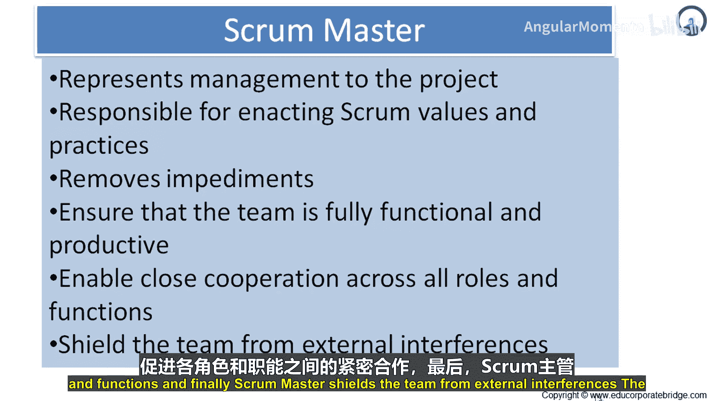
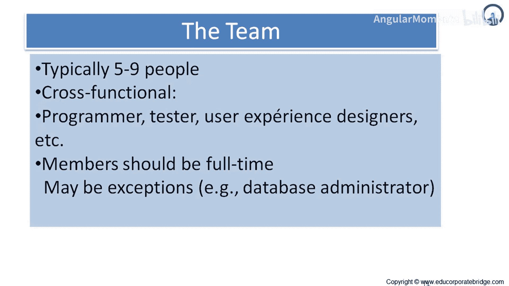

# 【EDUCBA】从思维模式出发的应用、评估与优化 ｜ Agile Practices： Apply, Evaluate & Optimize from Mind p10 01_02_04_产品负责人  Scrum主管  团队 -BV1TLcTzJEXS_p10-

So let's understand the product rules。Rather， the sc rules。The first rule is a product owner。

The product owner is responsible for maximizing the value of the product and the work of the development team。

 How this is done may vary widely across organizations， sc teams and individuals。

 The product owner is sole person responsible for managing the product backlog Product backlog management includes。

Clearly， expressing product backlog items。Ordering the items in the product backlog to best achieve goals and missions。

Ensuring the value of the work the development team performs。

Ensuring that the product backlog is visible， transparent and clear to all and shows what the Scrum team will work on next and ensuring the development team understands items in the product backlog to the level needed。

The product owner may do the above work or have development to do it。 However。

 the product owner remains accountable。The product owner is one person not committee the product owner may represent the desires of the committee in the product backlog。

 but those wanting to change the backlog items priority must conceive。Mus convince the product owner。

For the product owner to succeed， the entire organization must respect his or her decisions。

 the product owner's decisions are visible in the content and ordering of the product backlog。

No one is allowed to tell development team to work from different set of requirements and the development team isnt allowed to act on what anyone else says。

So to summarize the product owner define the features of the product is a custodian of the product。

 he designs the features， functionalities。Aspect of the product。Product owner decide on release。

 date and content。 Hes the one who is about。To decide on the release date and the content of the release。

Product owner is responsible for profitability of the product。 There is return on investment。

Product owner is responsible to ensure that all the investment yield into positive value written。

 There is a。NPV payback or I about the product is。Positive with respect to the customer。😮。

Product owner prioritizes the features， according to market value。The black owner的 has子。

Will use his own expertise and knowledge。He will gather all necessary inputs to decide upon the priority of the features as for the market value。

Product owner also addresses features and priority every iteration， as they did。So。

 as there is iteration。The product owner gets opportunity to do further fine alignments with respect to features and priorities。

 and he keeps on。Adding or deleting some of the features or fine tuning the features and priority as iteration progresses。

😊，Product owner is one of the quality control or gate checkers。

 and he accepts and rejects the work results。 Now， let's understand the scrum master。

 The scrum master is responsible for ensuring the scrum is understood and enacted。

 Scrum masters do this by ensuring that the scrum team adheres the scrum theory。 Pra and rules。

 The scrum master is a servantant leader for scrum team。

 The scrum master helps to those outside the scrum team and which of these interactions。

 with the scrum team are helpful and which aren't。😊。

The scrubrum master helps everyone change these。These interactions to maximize the value created by the ScM team。

Scrm master service to product owners。 Scrumma serves to product owner in several ways。

 including one finding technique for effective product backlog management。

 two clearly communicating region goal and product backlog items to the development team。Three。

 teaching the Scrumrum team to create clear and concise product backlog items。4。

 understand long term planning。In an empirical environment。5 understanding and practicing agility。

And six facilitating scrum events as requested or needed。Similar way。

 Scrum master service to development team。Including one coaching the development team in self organizing and cross functionality。

2， teaching and leading the development team to create high value products。3。

 removing impediments to the development team's progress。😊。

F facilitating scrum events as requested or needed。And fifth。Coaching the development team。

In organal environment， in which scumb is not yet。Fully adopted and understood。

 Scrum master also service to the organization。In several ways。

 including one leading and coaching the organization in its scrum adoption。

 planning scrum implementation within organization。

Helping employees and stakeholders understand and enact Scrum and empirical product development fourth causing change that increases productivity of the Scrum team and fifth working with other Scrum masters to increase the effectiveness of the application of Scrum in the organization。

So to summarize Scrum master represent management to the project。

Scrrum master is responsible for enacting Scrum values and practices。

Scuum master removes impediments。Scrm Master ensures that team is fully functional and productive。

Scumma enable close cooperation across all roles and functions。And finally。

 Scrum master shields the team from external interferences。😊。

The development team， the development team， consists of professionals who do the work of delivering a potentially reable increment of done product at end of each print。

 Only members of the development team create the increment。😊。

Development teams are structured and empowered by organizations to organize and manage their own work。

 resulting synergy optimizes teams。Overall， efficiency and effectiveness。

Development teams have following characteristics。When they are self organizing， no one。

 not even the Scrum master tells development team how to turn a product backlog into increment of potentially reable functionality。

😊，Second， development teams are cross functional with all of the skills as a team necessary to create product inement。

😊，Third Scrum organizes no titles for development team members other than developer。

Regardless of the work being performed by the person， there are no exceptions to this rule。

Fourth individual development team members may have specialized skills and areas of focus。

 but the accountability belong to the development team as a whole and fifth。

The development team do not contain sub teams dedicated to particular domain like testing or business analysis。

The development team size。Optimal development team size is small enough to remain nimble and large enough to complete significant work。

 Fer than three development team members decreases interaction and results in smaller productivity games。

Smaller development team may encounter skill constraints during the sprint。

 causing development team to unable to deliver a potentially reasonableusable increment having more than9 members requires too much coordination。

Large development teams generate too much complexity for empirical process to manage。

The product owner and the scrum master roles are included in this count unless they are also executing the work of the sprint back。

 So to sum， the team typically has 5 to 9 people。The team composition is cross functional。Developers。

 tester。Are the prime composition members。Programr， testr， user experience， designer， etc cetera。

 member should be full time。And some members may be part time as an exception， for example。

 database administrator。

