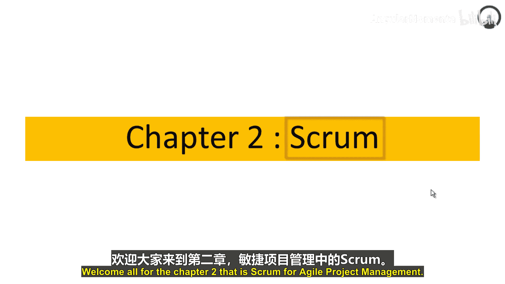
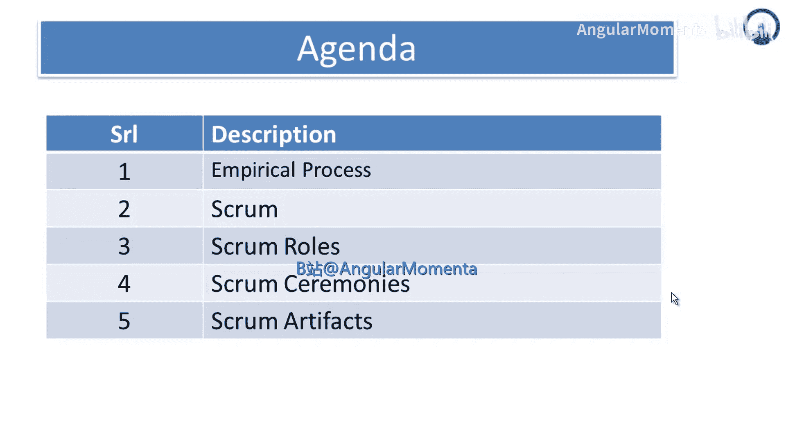
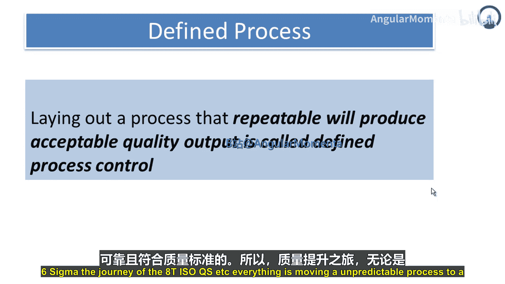
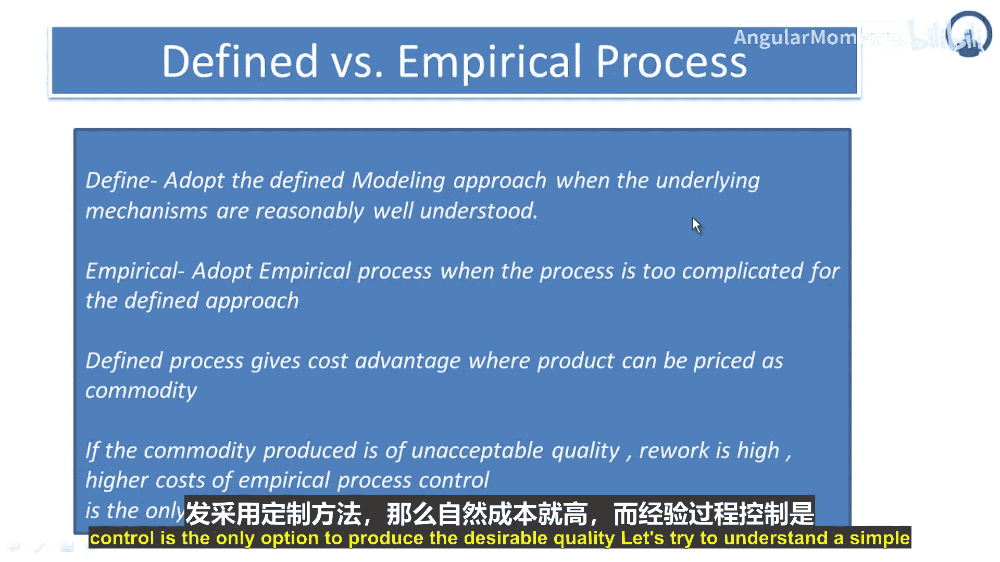
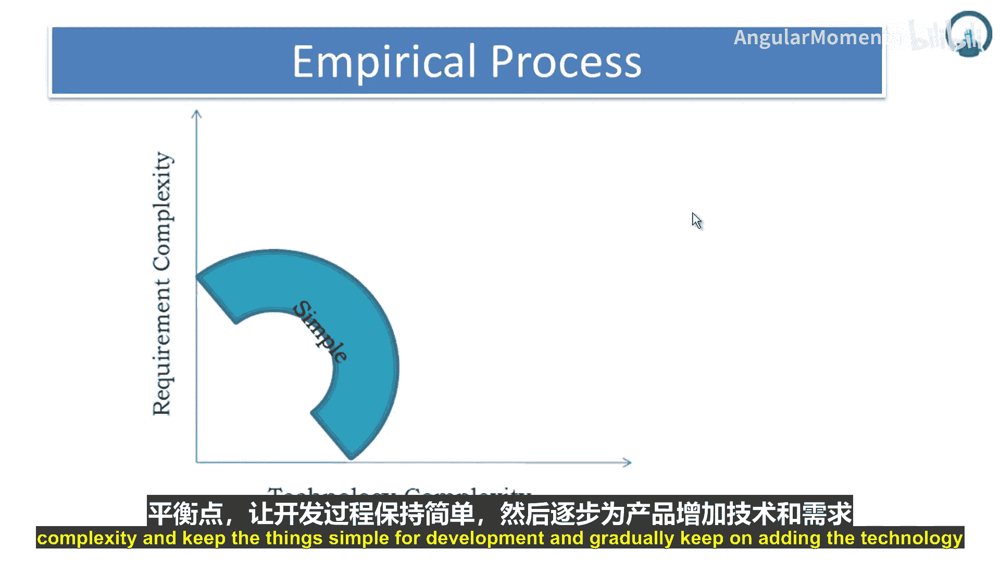
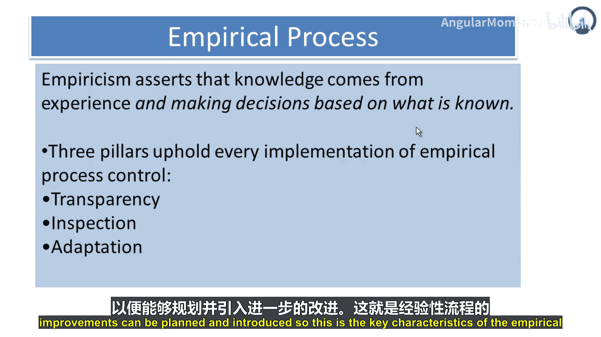
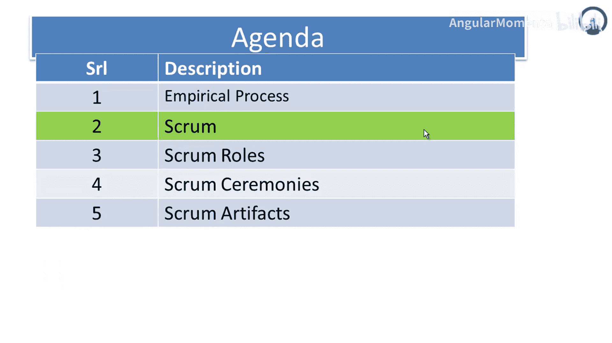

# 【EDUCBA】从思维模式出发的应用、评估与优化 ｜ Agile Practices： Apply, Evaluate & Optimize from Mind p11 01_02_05_敏捷开发 -BV1TLcTzJEXS_p11-

Welcome all for the Cha 2 that is CRm for Agile project management。

The agenda for today is first， what is empirical process， second， what is Chm third？

What are the scrum rolls fourth？What are the scrum ceremonies and what are the scrum artifacts so now let's get started and let's deep dive into what is empiricalpericular process。

The empirical model of process control provides and exercises control through frequent inspection and adapt for processes that are imperfectly defined and generate。

Unpredictable and unreputtable outputs。 So in a process there are two categories which are perfectly defined and which produces the perfect repeatputable results。

On contrary， there are processes which are imperfectly defined and which doesn't produce repeatputable outputs。

 supposing you are trying to develop a software which will get executed in 10 minutes。

 And if that software gives consistent output well within 10 minutes the process is perfect and it gives consistent result。

 But if process gives sometimes2 minutes， sometimes 20 minutes， sometimes 50 minutes。

 then it is giving you unreputable outputs， So empirical process。

 they the approach do the frequent inspection and adapt for similar process who are not very well defined and who doesn't produce a consistent output So inspection and adapt are the key pillars for the empirical process。

 let's move on and also understand。What do we mean by defined process。

 as name suggests defined process lays out process that is a repeatable and will produce acceptable quality output。

 Its called defined process control。 So you know the software gives consistent test results。

You know that the screen responses consistently to milliseconds。 You know that。

The initial takeoff or acceleration will happen within 10 milliseconds so these are the consistent and acceptable quality outputs and that is the key characteristics of defined processes so defined process are well laid down where articulated clinically precise processes and the output is also consistent deable and in line with the quality standard so the journey of qualityology the journey of the kzen journey of the six sigma the journey of the8T Io Qs etc everything is moving a unpredictable process to a defined process so let's also understand the difference between the defined and empirical process defined process。

😊。

Adopt the defined modeling approach when the underlying mechanisms are reasonably well understood。

 so defined processes are based on the modeling approach and the underlying mechanism the key input triggers drivers。

 the parameters which contribute to the end results are well understood。

 So defined process you have got most of the information youve got most of the variables under your control and there is a sufficient degree of information and knowledge about the process to its owner empirical process adopt empirical process when the process is too complicated for the defined approach。

 So when process is。To complicated it has got multiple parameters that are contributing towards end result and there is no a very standard or linear relationship among those parameters with respect to the output that is the empirical process。

Supposing you're trying to get the software detect the key defect。

and send you alert and if the software is able to detect only 95% of the defect and 5% of defect are not able to captured with respect to software it needs manual inspection to capture those defects so such process where the there is a less degree of information about its inputs its parameters。

 its variables it is not able to give consistent output which is in line with the expectation。

Then the empirical approach applicable to such processes defined process gives cost advantage where product can be priced as commodity so defined process gives cost advantage where product can be priced as commodity because the variables are less the standard deviation is minimal you have most of the information and then you can make the product as a commodity and pass on the cost advantage to the customer or the consumer if the commodity product is an acceptable quality the rework is high and the higher cost of empirical process control so if the process not well defined if there are complications can if you cannot make the product as a commodity if you have to have a customized approach for each development then naturally the cost is high and empirical process control is the only option to produce that is。

😊。

lets try to understand a simple graph about the empirical process on y axis we have got the requirement complexity。

On the x axis weve got a technology complexity and as you can see if the requirement complexity is high。

 the technology complexity needs to be minimal or if technological complexity is very high the requirement needs to be simple and this C inverted C shape curve shows that one need to be having a right balance between the requirement complexity and technology complexity。

And keep the things simple for development and gradually keep on adding the technology and requirement complexity to the product certain three characteristics about empirical process。

It asserts that knowledge comes from experience and making decisions based on what is known so the。

K sort of pillar for the empirical process is experience。Because it gives the historical information。

 it forms the benchmark， it gives you know how how to navigate at a difficult situation。

 how to overcome the complexity and making decisions on what is known and leaving the unknown element aside and try to emphasize more on the information available to support the decision。

 the three pillars that uphold every implementation of empirical process are a transparency。

 second inspection and third adapt Transencies about what is working， what is not working。

 what process gives what outputs， what are the defects， what are the rework。

 what are the key focus areas if certain decision is taken。

 what information or data supports that information inspection doing the frequent inspection adapt。

 unless you inspect you won't get the right。So try to build information base in order to support the decisions so do frequent inspections and gather information about the results。

 outputs consistency， repeatability etc adoption what is being developed produced how well it is adapted what are the adoption challenges so that further improvements can be plan and introduced so this is the key characteristics of the empirical process now well see about the scrum in next section。

