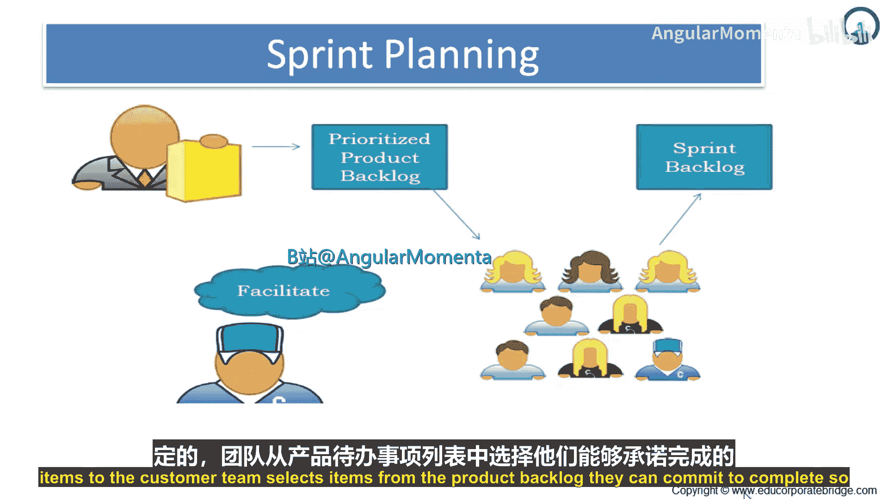
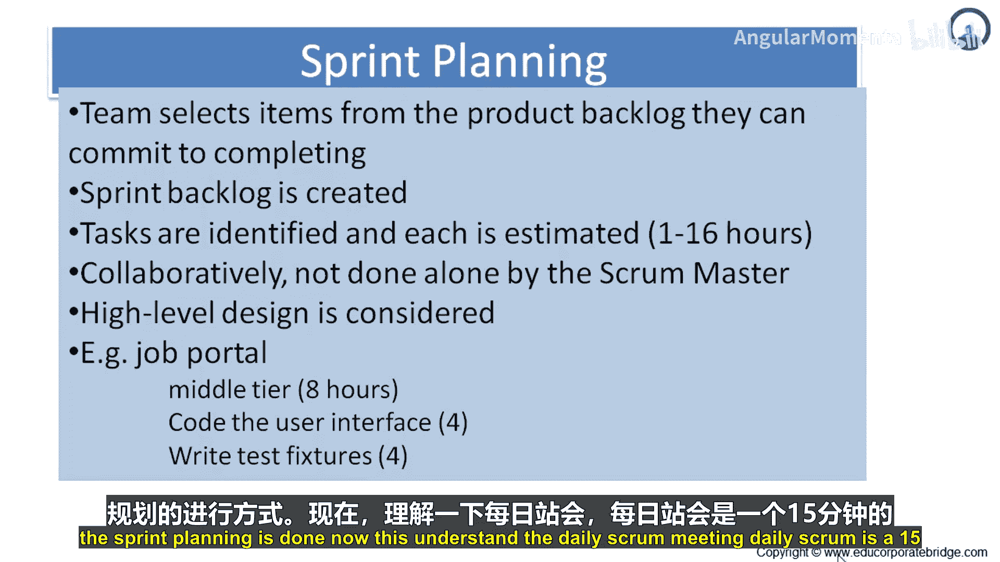
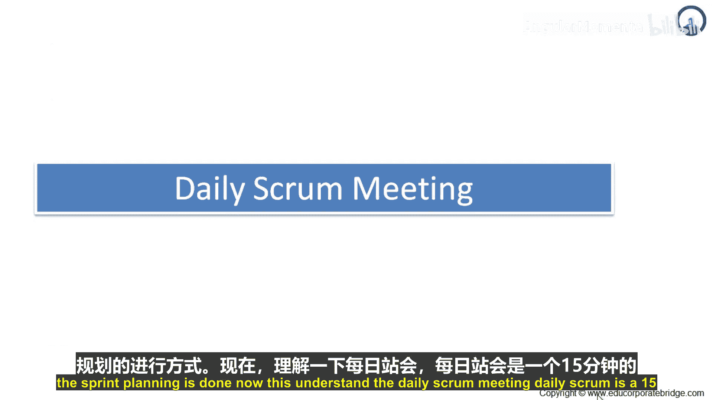
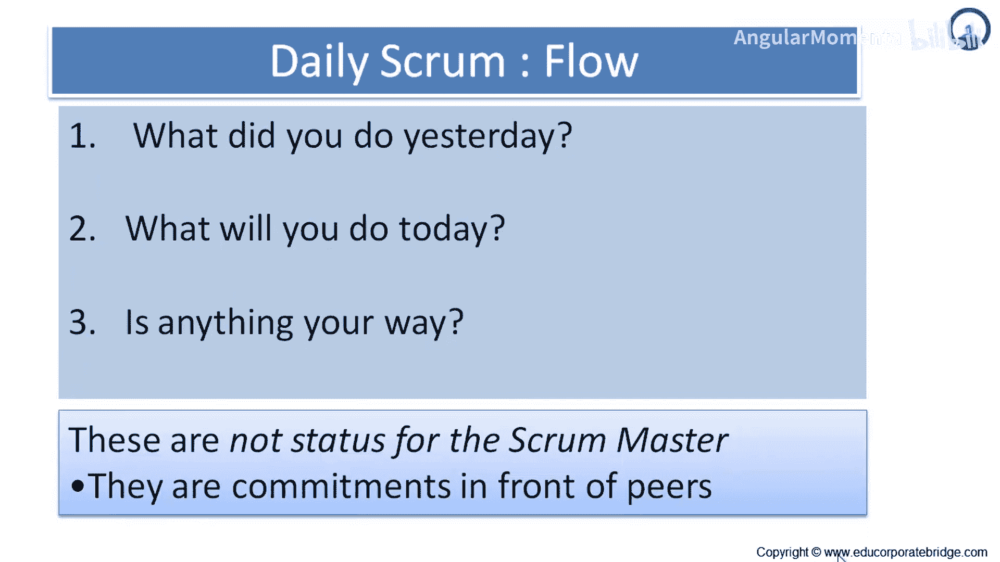

# 【EDUCBA】从思维模式出发的应用、评估与优化 ｜ Agile Practices： Apply, Evaluate & Optimize from Mind p12 02_01_01_冲刺评审 -BV1TLcTzJEXS_p12-

The slide shows a high level sprint planning process flow。There is a prioritized product backlog。

 which the team reviews and creates the sprint backlog。And the facilitator facilitates the process。

A sprint backlog is taken with respect to planning the sprints。And delivering the shipable work。

Items to the customer。

Team selects items from the product backlog they can commit。To complete。

So it's a team who sits the product backlog。 the selection character is based on the。

Items are the themes which will create a maximum value to the customer and which can be shipable to the customer within the time frame。

Based on teams input Sprint backlog is created， the tasks are identified and each is estimated one to 16 hours。

So the sprint backlog is decomposed into task。And。The sequencing of the task is created and the time is also estimated for the task。

It is done collaboratively by all the team members， not by an individual or not by a scrum master。

The planningning is always considered by doing the high level design。Say， for example。

 if team is designing the job portal。So， they'll always。

Consider that the middle tier will take eight hours code for the user interface will take four hours。

Writing test pictures will take four hours， likewise。So this is how the sprint planning is done。

Now let understand the daily Sc meeting。

Daily Scrum is a 15 minute time box event for development。

Team to synchronize activities and create a plan for next 24 hours。😊。

This is done by inspecting the work since。The last data scrum and forecasting the work that could be done before the next one。

Day Scrumrum is held at the same time and the same place each day to reduce the complexity。

During meeting， each development team member explains。What has been accomplished since last bidding？

What will be done before the next meeting？What obstacles are in a way。

The development team uses the Da Scrum to assess the progress towards sprint goal and to assess how progress is trending towards completing the work in the sprint backlog the Da Scm optimizes the probability that team development will meet the sprint call。

 the development team often meets immediately after Da Scm to replan the rest of the sprint work every day the development team should be able to explain product owner and Scrum masterster how it intends to work together as a selforgan team to accomplish the goal and create anticipated incrementement in the reminder of the sprint。

😊，The Scrum master ensures that development team has the meeting。

 but the development team is responsible for conducting。The daily scrubrum。

The Scrum master teaches the development team to keep the daily Scrum within 15 maritime blocks。

If team needs to exceed beyond 15 minutes。Dcr。Master ask everybody that we want to discuss few important things and it is exceeding our 15 minutes time box。

 Is everybody okay for the further ex of next five minutes。

If everybody agrees then meeting continues， otherwise meeting gets closed after 15 minutes。

Scrrum master enforces the rule that only development team members。Participate in da scm。

 The da scm is not a status meeting。And is for the people transforming the product backlog into an increment。

Dady Scrum improves communication， eliminates other meetings。

Identify and remove impediments to development， highlight and promote quick decision making and improve the development team's level of product knowledge。

This is。A key， inspect and adopt meeting。So the rationale for D Sc meeting is to ensure fine grain coordination。

What team has completed， what team is doing and what help they need。

 what risk issue that needs to be。Resolve for teams' effective functioning。

Seeking commitment what can be finished by end of day today？Making a。

Push for them to accomplish things on day to day basis。Raising the impediments。So that it is。

Understood， interpretreed and acted upon。The whole ecosystem will spare pressure。

For the team members who are not performing to exc。To uplift their performance and match their peers。

And also assesses progress towards the sprint goal。

 so the parameters for D Sc meeting it is daily basis。It is a 15 minute meeting。

 it is a stand up meeting。It is not a problem solving meeting it is a meeting which is conducted in a different fashion it is。

Attended by only team members。Scrmma， product owner。It helps to avoid unnecessary meetings。

 This is the only meeting which team will。At tin。So their meeting commitments are getting completed in the meeting。

And team is responsible for conducting this meeting。

 So it's a self organizing and team's responsibility to conduct this meeting。 key questions。

 what did you do today。What you will do today and is anything your way。

