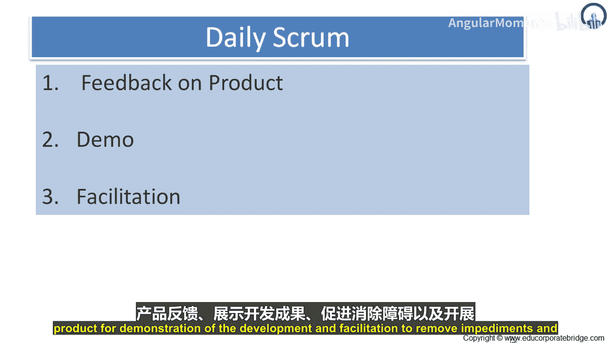
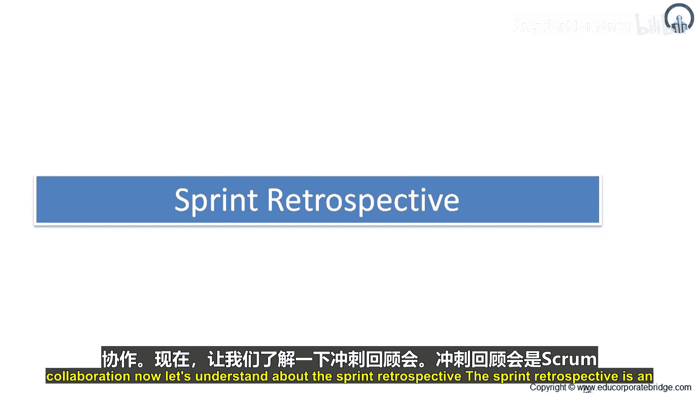
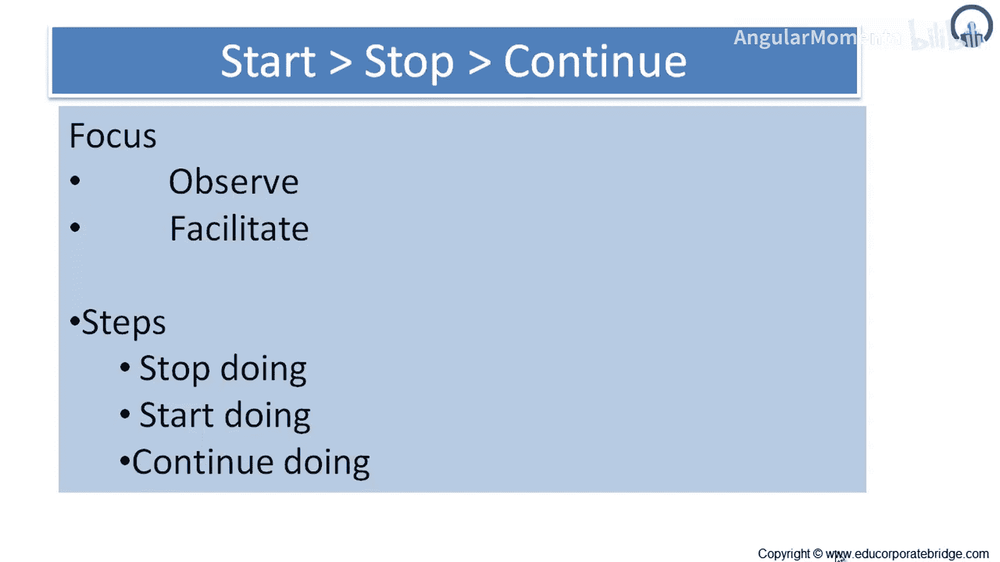

# 【EDUCBA】从思维模式出发的应用、评估与优化 ｜ Agile Practices： Apply, Evaluate & Optimize from Mind p14 02_01_03_回顾性研究 -BV1TLcTzJEXS_p14-

The Daily Scrum is a 15 minutes time box event for the development of team to synchronize activities to create a plan for next 24 hours。

This is done by inspecting the work since last day scrum and forecasting the work that could be done before the next one。

Daily scrum is held。At the same time and a place each day to reduce complexity during the meeting each development team member explains。

What has been accomplished since last meeting。😊，What will be done before next meeting。

 what obstacles？Are in the way the development team uses the data Scrum to assess the progress towards the spring goal and to assess how progress is trending towards completion。

Of the work in the sprint backlog， the daily Scrum optimizes the probability that development team will meet the sprint goal。

 The development team often meets immediately after daily scrum。To replan the rest of the。

Sprints work every day， the development team。Should be able to explain to the product owner。

And Scrum master Ht intends to work towards a self organizing team to accomplish the goal and create anticipated increment in the remainder of the sprint。

The scrum master ensures that the development team has the meeting。

 but the development team is responsible for conducting the daily Scrum the scrum master teaches the development team to keep daily scrum within 15 minutes time box。

The sc master enforces the rule that only development team members participate in the daily scrum。

 The Daily scrum is not a status meeting is for the people transforming the product backlog into an increment。

Dais Scrum improves communication， eliminates other meetings。

 identify and remove impediments to the development。

 highlight and promote quick decision making and improve the development team's level of project knowledge。

 This is a key inspect and adopt meeting。So primarily data Sc is for feedback on the product for demonstration of the development and facilitation to remove impediments。

And collaboration。Now， let's understand about the。

Sprint retrospective。 the sprint retrospective。Is an opportunity for Scrum team to inspect itself and create a plan for improvements to be enacted during next print。

The sprint retrospective occurs after sprint review and prior to the next sprint planning meeting。

 this is。그。Our time box meeting for one month sprints proportionportionately less time is allocated for short sprints。

 The purpose of sprint retrospective is to1。Inspect how the last print went with regards to people。

Relationship processes and tools。Second， identify and order the major items that went well and potential improvements。

Third。To create a plan for implementing improvements to the way the Scrum team does it work。

Scrrum master encourages this Scrum team to improve within the Scrum process framework。

 its development process and practices to make it more effective。

And enjoyable for the next print during each print retrospective。

 the scrum team plan ways to increase product quality by adapting the definitions of done as appropriate。

😊，By the end of the sprint retrospective， the team。

Should have identified improvements that will implement the next print。

Implementing these improvements in the next print is adapt to the inspection of the scrum team itself。

 although improvements may be implemented at any time。

 the sprint retrospective provides a formal opportunity to focus on。Inspection and adaptation。

So sprint retrospective is periodically done to take a look at what is。

Working and what is not working。It's done after every sprint。The participants are scrum master。

 team and product owner。And there is also retrospective about the retrospective how retrospective has planned and went along。

The focus is on observe and facilitate。The steps are stop doing， start doing and continue doing。

So team ask question what activities should we stop doing。

 what activities should we start doing and what activities should we continue doing in order to improvise in order to further expedite the velocity in order to further collaborate。

So， and and so forth。

