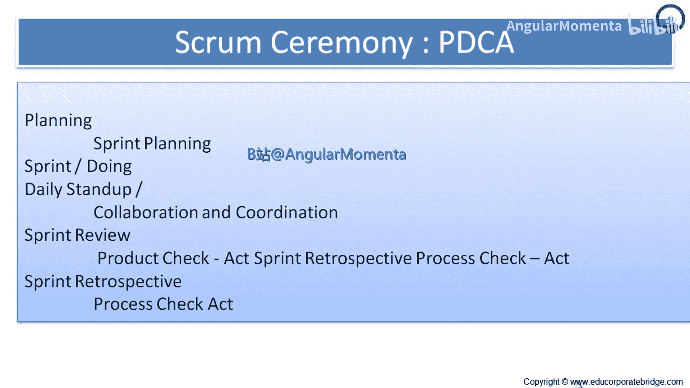
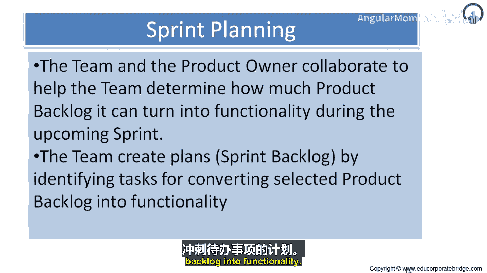
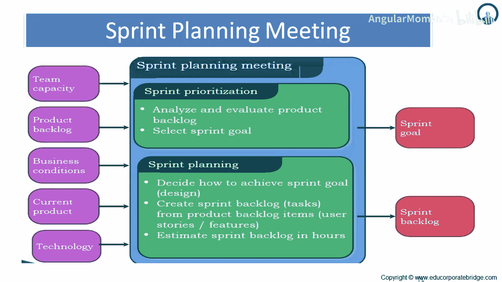

# 【EDUCBA】从思维模式出发的应用、评估与优化 ｜ Agile Practices： Apply, Evaluate & Optimize from Mind p15 02_01_04_冲刺会议 -BV1TLcTzJEXS_p15-

The teams are safe organizing， ideally no titles， but rarely a possibility。

Our membership should change only between the sprints。So now we'll see the scrum ceremonies。

Planning the sprint planning， sprint doing， they is stand up。Collaboration on codations。

Sprint review， product check at Sprint retrospective process check at。

Sprint retrospective process check Act。So let's a deep dive into sprint planning work to be performed in the sprint is planned at the Sprint planning meeting。

 the plan is created by collaborative work of the entire Scamp team。

The sprint planning meeting is time box to 8 hours for one month sprint for shorter sprints。

 The event is proportionately shorter。 For example， two weeks printprints have four hour。

Sprint planning meeting。The Sprint planning meeting consists of two parts each one being time box to one half of the sprint planning meeting duration。

Two parts of spring planning meeting answer the following questions respectively， one。

What will be delivered in increment resulting from upcoming sprint？2。

 how will the work needed to deliver the increment be achieved？Part1， what will be done this print。

In this part， the development team work to forecast the functionality that will be developed during the sprint。

The product owner presents the order product backlog items to the development team and entire Scrum team collaborates on understanding of the work of the sprint。

The output of this meeting is the product backlog， the latest project。Increment projected capacity。

Of the development team during the sprint and the past performance of the development team。

 the number of items selected from product backlog was s。Is。Soly up to the development team。

 only the development team can assess what can accomplish our upcoming sprint。

After the development team forecast and product backlog items it will deliver in the sprint。

 the Scrum team crafts a sprint goal。 The sprint goal is an objective that will be met with the sprint through implementation of product backlog and it provides guidance to the development team on why it is belonging the increment。

😊，Part 2， how will chosen work get done。Having selected the work of the sprint。

 the development team decides how it will build this functionality into done product increment during the sprint。

 product backlog items selected for this s plus the plan for delivering them is called sprint backlog。

 The development team usually starts by designing the system and the work new to convert product backlog into a working product increment。

Work may be of a rank size or estimated effort。 However。

 enough work is planned during the splint planning meeting for the development team to forecast what it believes it can do。

In the upcoming sprint， work plan for the first days of the sprint by development team is decomposed to units of one day or less by the end of this meeting。

 The development team self organizers to undertake the work in。😊，In the sprint backlog。

 both during the sprint planning meeting and as needed throughout the sprint product owner。

May be present during the second part of the spring planning meeting to clarify the selected product backlog items and to help make trade offs If the development team determines it has too much or too little work。

 it may negotiate。Renegotiate the sprint background items with product owner。

 the development team may also invite other people to attend in order to provide technical or domain advice。

By end of the Sprint planning meeting， the development team should be able to explain to the product owner and the Scrum master how it intends to work as a self organizing team to accomplish the sprint goal and create the anticipated increment。

😊，So in short， sprint planning， the team and the product owner collaborate to help team determine how much product backlog it can turn into functionality during the upcoming sprint。

 the team create plans called sprint backlog by identifying task for converting selected product backlog into functionality。

The slide shown here is about the Sprint planning meeting。

The inputs for spring planning meeting is team capacity。Product backlog， business conditions。

Current product and technology。The sprint plan meeting is in two parts。

 first part is printprint prioritization in which analysis and evaluation of the product backlog is done and the sprint goal is selected。

In second part， the sprint planning is done。To decide how to achieve sprint gold design。

Create Sprint back， the task。From the product backlog items。An estimates spring backlog in averse。

The output are sprint goal and sprint backlog， let's spend some time to understand some of the details about the s goal。

The sprint goal gives the development team some flexibility regarding the functionality implemented within the sprint。

As the development team works。It keeps this goal in mind。In order to satisfy the sprint goal。

 it implements the functionality and technology。If the work turns out to be different than the development in expected。

 then they collaborate with product owner to negotiate the scope of the sprint backlog within the sprint。

The sprint goal may be a milestone in the larger purpose of the product road map。

