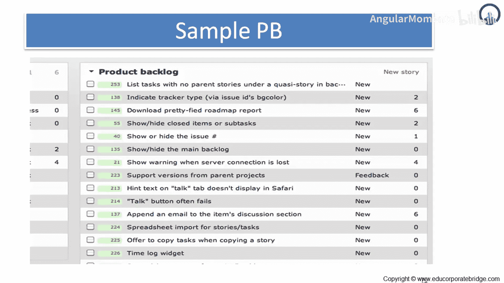
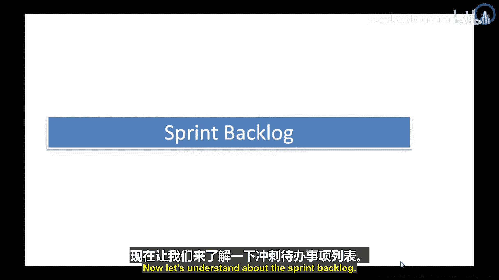
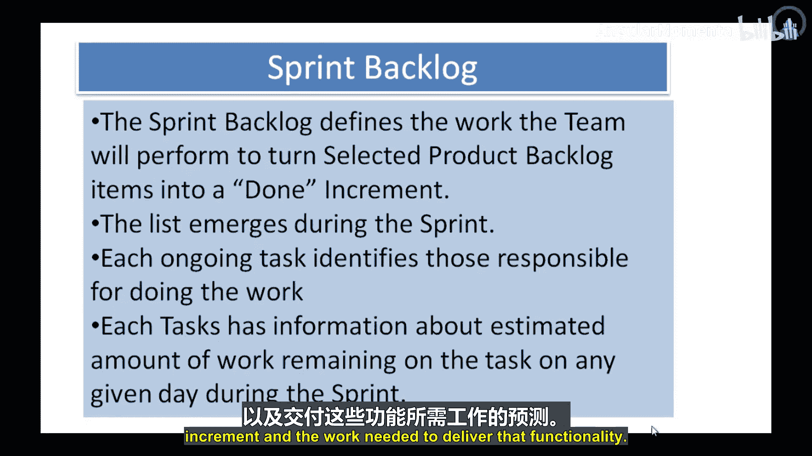

# 【EDUCBA】从思维模式出发的应用、评估与优化 ｜ Agile Practices： Apply, Evaluate & Optimize from Mind p16 02_01_05_更多关于冲刺会议的内容 -BV1TLcTzJEXS_p16-

Here we have tried to give you a sample product backlog。

As you can see， it is very simple a list of the。The stories are the themes that comes into the backlog。

 it has got column based on how it has got added into this new feedback likewise。

So a sample product backlog includes list tasks with no parent stories under causes St。

Indicate tracker type。Download pified road map reports show high close items or subtasks。

So this is one type of sample product backlog which is being pulled and displayed here for participants。

Reference。Now let's understand about the sprint backlog。

嗯。The sprint backlog is a set of the product backlog items selected for sprint。

 plus a plan for delivering the product increment and realizing the sprint goal。

The s backlog is a forecast by development team about what functionality will be in the next increment and the work needed to deliver that functionality。

