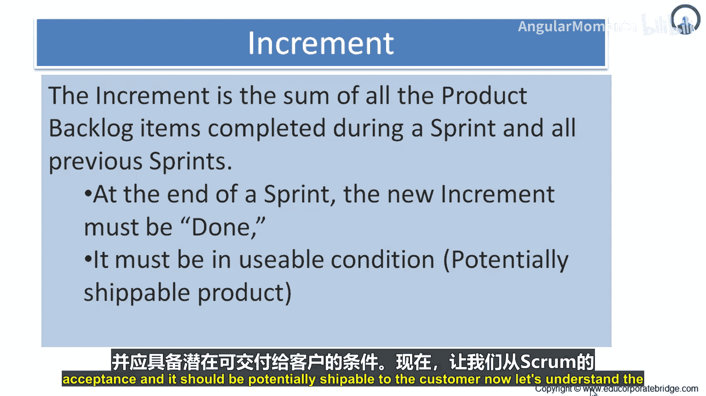
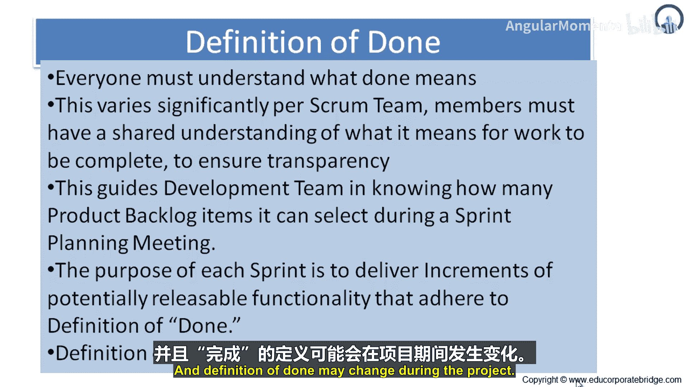
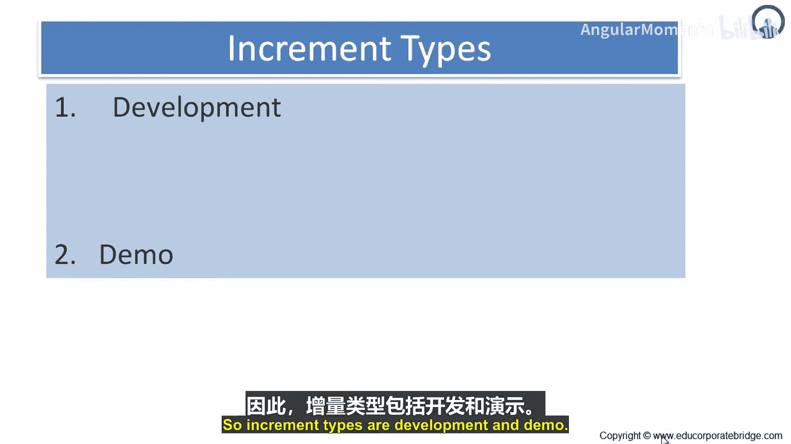

# 【EDUCBA】从思维模式出发的应用、评估与优化 ｜ Agile Practices： Apply, Evaluate & Optimize from Mind p17 02_01_06_增量 -BV1TLcTzJEXS_p17-

Lets also understand one of the important artifacts about the scrum is that is increment。

 the increment is the sum of all product backlog items completed during a sprint and all previous prints。

At the end of a sprint， the new increment must be done。

 which means it must be in usable condition and meet the scamp team's definition of done。

 It must be usable condition， regardless of whether the product owner decides to actually release it。

So the incriement is some of all products backlog items completed during the sprint and all previous prints。

At the end of the spring， the new increment must be done。It must be usable condition。

 potentially shipable product， So the focus is to complete some of the product backlog。

And it is completed in all respect with respect to the development and testing functional acceptance。

And it should be potentially shipable to the customer。 Now， let's understand the definition of done。

From Scrum perspective。When the product backlog items or an increment is described as done。

Everyone must understand what done means， although this very significantly post scrum team Member must have a shared understanding of what it means to work to be complete to ensure transparency。

 This is definition of done or the scrum team and used to assess when work is complete on the product increment。

The same definition guides the development team in knowing how many product backlog items it can select during a sprint planning meeting。

 The purpose of each spring is to deliver increments of potentially reable functionality that adhere to Scrum teamss current definition of done。

Development teams deliver an increment of product functionality every sprint。

 This increment is usable， so a product owner may choose to。Immediately release it。

 each increment is additive。To all increments although tested ensuring that all increments work together。

As a scrum tin is mature， it is expected that definition of de with expand to include most stringent criteria for higher quality。

So the rational or the premise for definition of done is that every must understand。

The state at which done is communicated。So there should be a consistent view about the completion of the work in progress。

Though it varies with respect to the team and the team members， but within team。

 it should should be consistently understood。D is also guiding team in knowing how many product backlog items it can select during a sprint planning meetingss。

With the purpose that at the end of each sprint， the deliver increments of potentially reliable functionality that can be shipped to the customer。

And definition of done may change during the project。

So increment types are development and demo。 So to conclude Scrum is free and offered。

And this。Slide tick Ss rule a even and rules are immutable。

 and although implementing only parts of scrum is possible。The result is not Scrum。

 Scrum exists only in its entirety and functions， well as。A container for other techniques。

 path and practices。

Thank you。