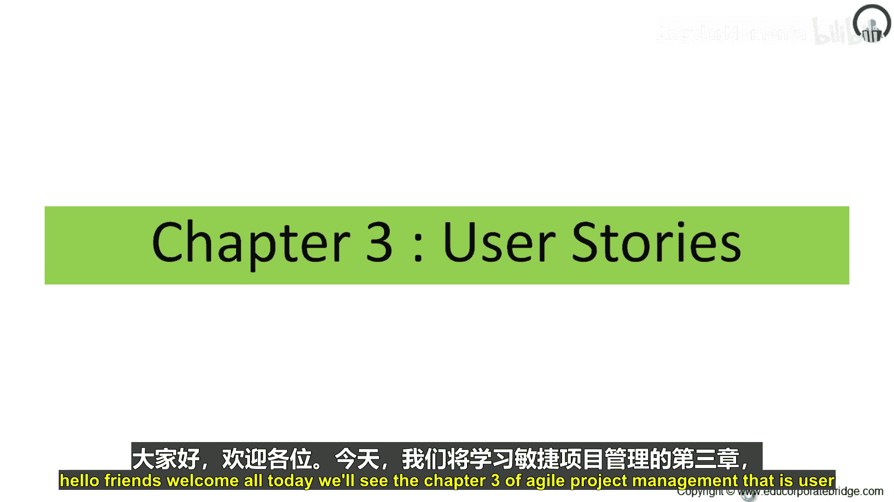
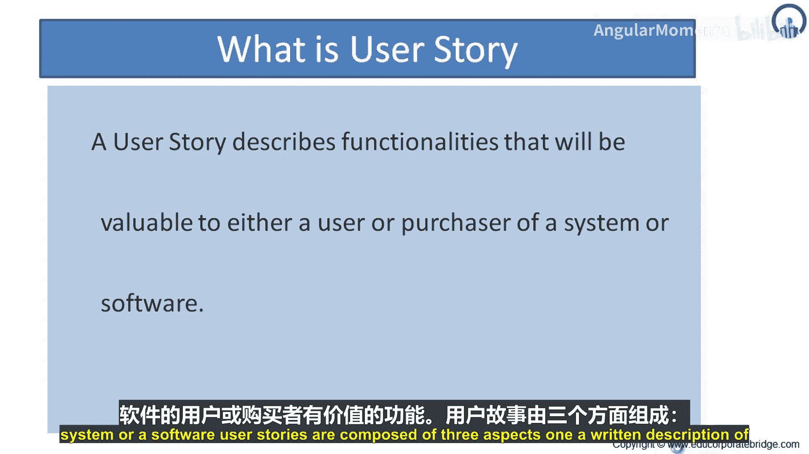
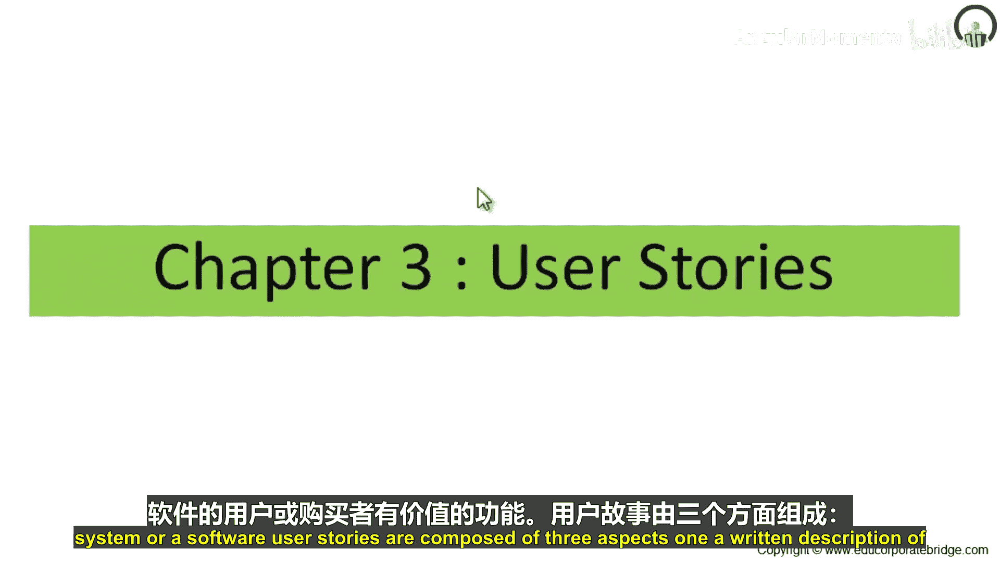
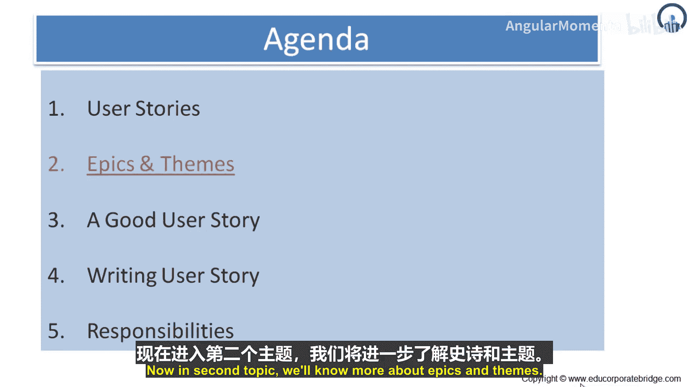

# 【EDUCBA】从思维模式出发的应用、评估与优化 ｜ Agile Practices： Apply, Evaluate & Optimize from Mind p18 02_02_01_用户故事入门 -BV1TLcTzJEXS_p18-

Hello， friends。Welcome all today well see the chapter 3 of Agile project management that is user stories。

We will see what is user stories， what is epics and things。What a good user story compes of。

How to write a user story and roles and responsibilities as regards to user story for the various stakeholders in agile projects。

So， let's get started。With what is user story？A user story describes functionalities that will be valuable to either a user。

😊，Or a purchaser of a system or a software user stories are composed of three aspect。

1。

A written description of story used for planning。And as a reminder。Second。

 conversation about the story that serve to flesh out。Details of the story。글。

Best that convey the document details and that can be used to determine when story is complete。😊，So。

 understand。Use this story describes the functionality that are valuable to the purchaser or a user。

It has three aspect written description。😊，Of the story used for planning and as a reminder。

 a conversation about story that serves to flush out details of the story。

Test that convey and document details and that can be used to determine when story is complete。😊。

So example of user stories。User can search for jobs， company。Post new job opening。

User can limit who can see her resume wrong example one software will be written in C plus plus。

Why wrong， Because user need to give requirement？Or they need to specify what functionalities or what value they are looking for not get into solutioning mode。

😊，Second example， the program will connect to the database through a connection pool here again。

 user instead of giving requirement is getting into solutioning mode。😊。

User St does not need to augmented in a typical requirement documentation style。

A userr story is an agreement between customer and team members to detail detailed requirement during an iteration。

😊，Emphasize verbal rather than written communication。And it is the right size for planning。

It should be as brief as possible it is a communication。😊，Werally， not through a document。

And it should be used， user story should be used as a right size for planning。

User story is not a requirement document requirement needs to be captured by discussion。

Now let's understand the general process flow。A project's initial stories are often written in a story writing workshop。

 but stories can be written at any time throughout the project。During the story writing workshop。

 everyone brainstorms as many stories as possible， armed with starting a starting set of stories the developer estimate the size of each。

😊，Why does a customer write the stories， the customer team rather than the developer write the user stories for true primary reason。

First， each story must be written in a language of the business， not in technical jargon。

 like the C plus plus or connection pool what we have seen in earlier examples。

So that the customer team can prioritize the stories for inclusion into iteration and releases。😊。

Second， the primary product vision is the customer team is the best。

Position to describe the behavior of the product。Now let is understand why user stories user stories emphasize verbal rather than written communication。

You the stories are comprehenible by both you and developers。

 user the stories are the right size for planning。Use this to work for iterative development。

And user stories encourage differing detail until you have best understanding。

You are going to have about what you really need now let' us understand three Cs about user stories。

The first C is about card。The user story is written on a note card generally 3 inch by5 inch note card。

This card may be annotated with notes estimates etcter。

 so the card will necessarily will have a requirement in short it will also have some notes to further elaborate the requirement and it will also have some rough estimation。

😊，On the card。Conversation， the user story detail behind the story come out during the conversation with the product owner and the customer。

When a user comes with the user story he。Or she gives a very brief requirement。Like for example。

 a user story description could be that a company can post new job openings。

Now this is a small brief information available for the project team and now the customer and the project team they have a discussion to further detail out about the user story。

😊，So， this conversation is more of an understanding what is this requirement all about。

 what are the high level expectations， what are the inclusions， what are the exclusions。

What sort of dependencies are there so that this user story。Can be taken for aning。

The third C stands for confirmation acceptance states confirm a story was quoted correctly。

So this confirmation is very important。Because。When you do a acceptance test at that point in time it。

It is referred back to a user story where requirement belongs to and one of the criteria or the most important criteria is to go back and check the initial hire requirement whether that is met or not。

😊，Acceptance testing is the process of verifying the stories were developed。

Such that each works exactly the way customer team is expected it to work。😊，Once an iteration begins。

 the developers start coding and the customer team starts specifying test。

 depending on the technical proficiency of the customer team members。

This may mean anything from writing test on back of the story card to putting the test into an automatic testing tool。

A dedicated and skill tester should be included on the customer team for more technical of this task。

😊，They should be reaching as early in an iteration as possible。😊。

Or even slightly before the iteration， if you are comfortable taking a slide guess at what will be in the upcoming iteration。

😊，Wting the test early is extremely helpful because more of the customer team's assumptions and expectations are communicated earlier to the developers。

😊，For example。Suppose you write the story。The story goes a user can play。Sorry。

 a user can pay for the items in her shopping cart with a credit card。Story end。

You then write this simple test on back of the story card。Test with the visa。

Mastercard and American Express。Testte with diner's Club。Pass or fill， test with the Vi debit card。

 pass or fill。Test with good， bad and missing car ID numbers。From the back of the card。

Test with expired cards。Test with different purchase amounts。Including one over the cards limit。

So this way the acceptance tests are written and confirmation is obtained with respect to the original user story or the requirement。

😊，So just to summarize， remember three Cs， one is card。

 second is conversation and third is confirmation。So always remember about your story。

As a user who wants this functionality。What user want is mentioned？

And it also needs to be mentioned that why it is required if the user or a business get that。😊。

Functionality， what change will happen， what positive change will happen， what business do。

What benefit business can expect so three elements of user story is as a user I want。😊。

And if I get that， what will happen？So with this， weve completed the first section about introduction to user stories。

😊，Now， in second topic， well know more about Eps and themes。😊。

