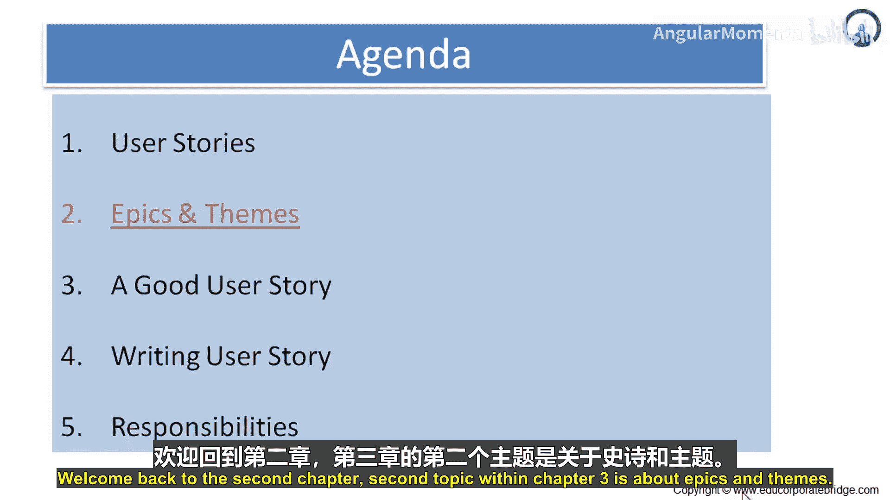
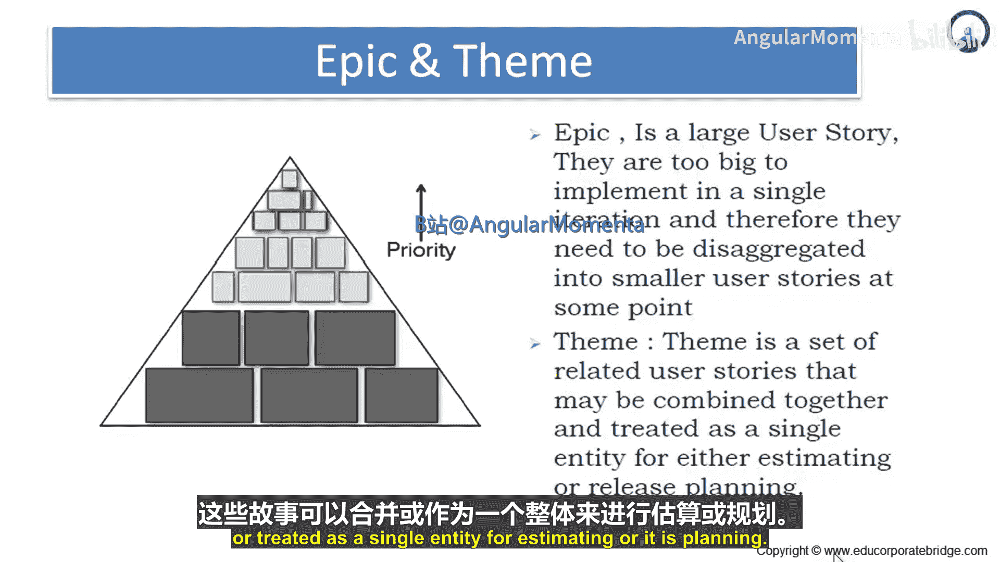
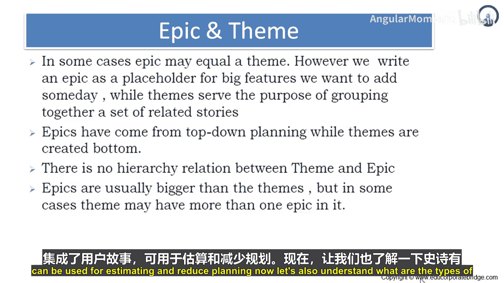
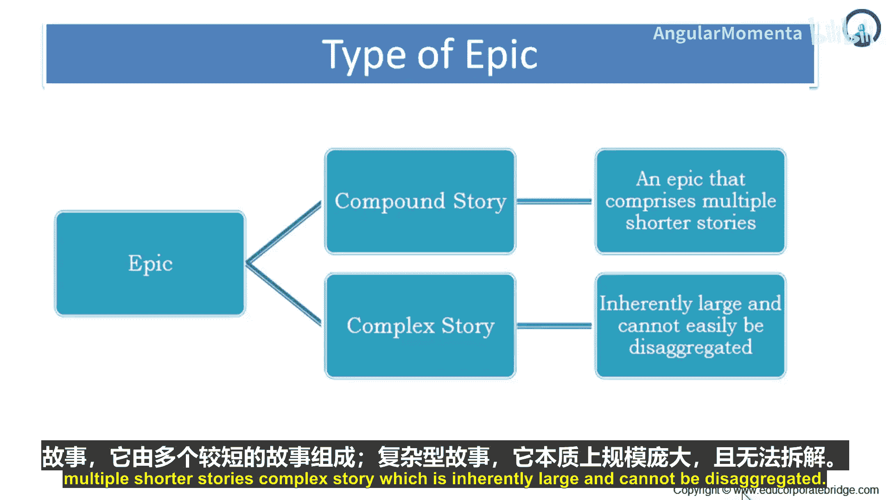
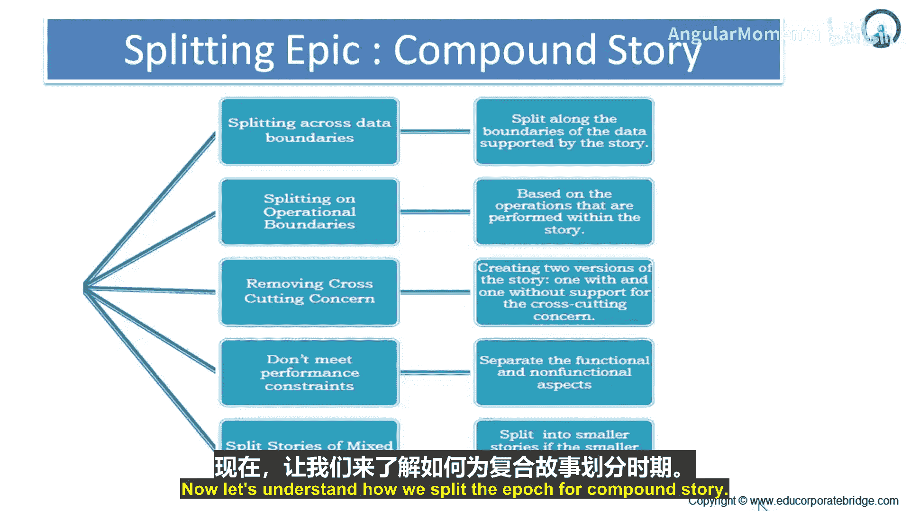
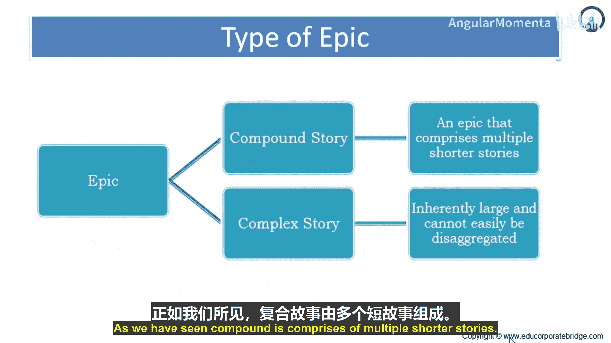
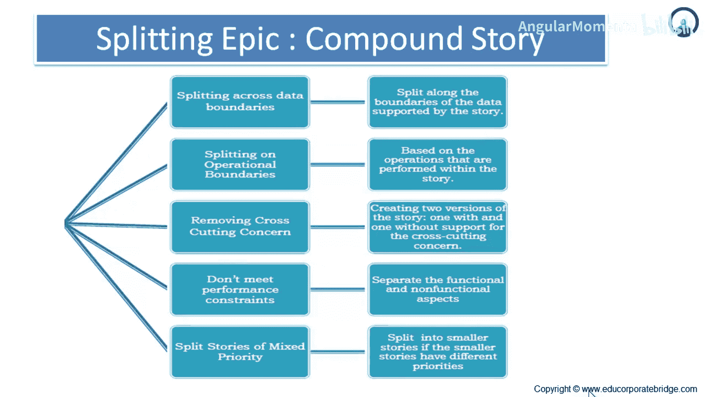

# 【EDUCBA】从思维模式出发的应用、评估与优化 ｜ Agile Practices： Apply, Evaluate & Optimize from Mind p19 02_02_02_史诗 -BV1TLcTzJEXS_p19-

Welcome back to the second chapter， second topic within chapter three is about epics and themes。

So there will be a natural question， what is epic？EPpic is a large user story。

They are too big to implement in a single iteration。And therefore。

 they need to be disaggregated into small user stories at some point。So。

 traditionally a user story is a requirement of a user in which is conveyed in brief or in short like example。

A user can search for a job。Or a company can post new job openings。

Or a user can limit who can see her resume。Now this is the simplest user stories。啊。

But if this user story， which is a company can post a new job。Is con that company。Should have a job。

Management portal。So this is a large state of users story。

And we can say that this is instead of user story now， this is an epic where it has got a。😊。

Too big to implement in a single iteration。And it needs to be disaggregated so we can。

Company can have a job portal can be disaggregated into a company can have a resume passing company can search the candidate company can have a resume。

Posting company can circuitlude it the CVs。So， these are the different disaggregated stories and that is how epic is conem into a。

Many user stories。Now this understand the team。A theme is a set of related user stories that may be combined together and treated as a single entity for either estimating or release planning。

So， epic former。Large is the story。And think form a related stories which can be。

Use either for estimating。And are release planning。So coming back to the example of job portal。

 so screening the CVs by passing， screening the CVs by downloading。

 screening the CVs by automated matching tool so these three user stories form a theme sort of。

Accessing the CVs and shortlisting few CVs out of them So this are the three stories which belong to a E which is a company having a job portal。

😊，So， in short， E is a last story and theme is a set of related user stories that may be combined or。

😊，Or treated as a single entity for estimating already planning。

In some cases， a big may include a team。However， we write an epic as a placeholder for big feature。

We want to add someday。While themme serve as the purpose of grouping together a set of related stories。

😊，For students are dont get confused between a peek and theme。Sometimes it may be equal。

 but understand that we always write a as a placeholder for larger stories。

And out of that larger stories， we break into themes of integrated things。

Which can be used for estimating and release planning。

And below that there is a user story Es have come from top down planning while themes are created at bottom。

So understand the difference epic corrupt response to top down。

In the sense that identifying a big user story isaggregating into themes。

And further disaggregating them into user stories so the approach is start with a bigger story。

 disaggregate with the sub functions， further disaggregate with the a function。😊。

Whereas themes are created at bottom， so at the bottom if you see say for example of job portal resume search。

Resume matching。Reme posting this can be a likely themes， which can be done at the bottom。

 There is no predefinine or fixed hierarchy relationship between themes and epic。

 but always epic is at the apex level。And theme is at the bottom level。

Epics are usually bigger than themes。But in some cases， teamme may have more than one epic in it。

So imagine a situation where。A team may have more than one epic in it。Let him kiss off。Job portal。

 if you have a team of resume passing。So downloading resume。Maching the resume。Indexing the resume。

These three are the things。And out of that three theme passing regime can also become an epic。

 it can become a bigger story。So， the approach is flexible but the fundamentals are sound so E is a placeholder it is a bigger story theme is at the bottom which has integrated user stories which can be used for estimating and reduced planning。

😊。

Now let's also understand what are the types of epics。So broadly。

 there are two types of epic one is compound story。And second is complex story。In compound story。

 an epic that comprises of multiple shorter stories， So it's a compound of shorter。

Use the stories in large numbers。Like the example which we have taken having a job Port is an epic and shorter user stories are resume passing。

 resume search， resume， download。Resume mass made， etc。

A complex story inherently is a large and cannot be easily be disaggregated so passing resume can be a complex story and it cannot be further disaggregated。

So， compound， you can separate。Constitent one， con2， consti 3， but in a complex story。

 you cannot really separate the constituents。And cannot be disaggregateated。

So remember there are two types of epics compound story。Which comprises of multiple short stories。

Complex story， which is inherently large and cannot be disaggregated。

Now let's understand how we split the epic for compound story。

As we have seen， compound is comprises of multiple shorter stories。

So these stories can first be split across data boundaries。It is more about。

Splilit along the boundaries of the data supported by the story splitting。On operational boundaries。

 that is a second type of splitting。Based on the operations that are performed within the story。

So if you have a you this story。For。Searching the job， so you can。Slit by operations。

 search on internet， search through classified， search by location， search by job title。

 search by salary。The third type of splitting is removing cross cutting concern。

 so this is about creating two versions of story， one which and one without support for cross cutting concern。

The fourth type of splitting is dont meet performance contrain this separates the functional and non functional aspect。

So， when you have a。Requirement of software， the functional requirement is what more the。

Software is supposed to do supposing you have a search engine as a software search should be fast accurate it should give most probable reserve these are the functional requirement and the nonfunction requirement about the reliability。

 maintainability usability etc。So these are the second type of user。Sttories。So。

 the user story related to functional is mentioned in one category and the user requirements related to non functional is mentioned into another category so you can split the compound story。

In this way， the fifth way of splitting compound story is。By split stories of mixed priority。

 it is splitting into smaller stories if the smaller stories have different priorities。

So you split the stories with respect to most required nice to have。

Likewise and if you assign the priorities like most required and nice to have and then index the user stories of must required those have been taken first for development and once you。

Complete those must have requirements then you take the nice to have requirements。

 so this way you can priorize the the stories。Based on the mixed priorities。

