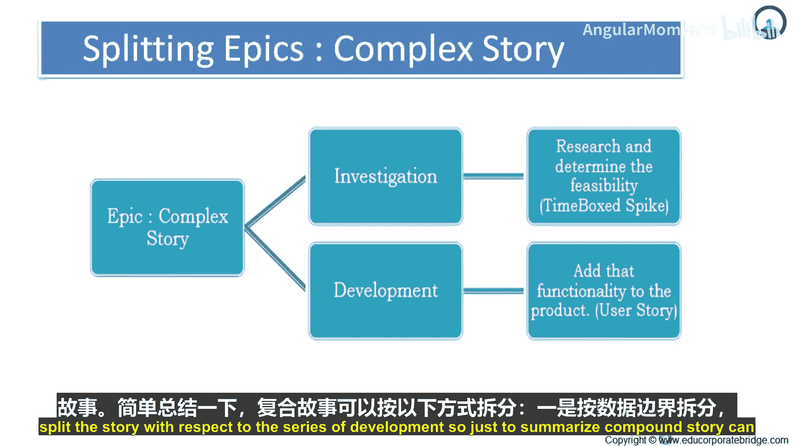
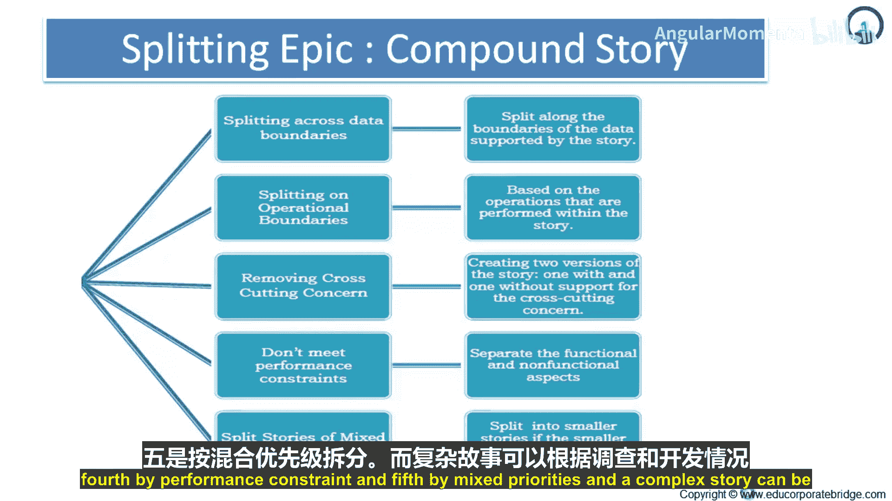
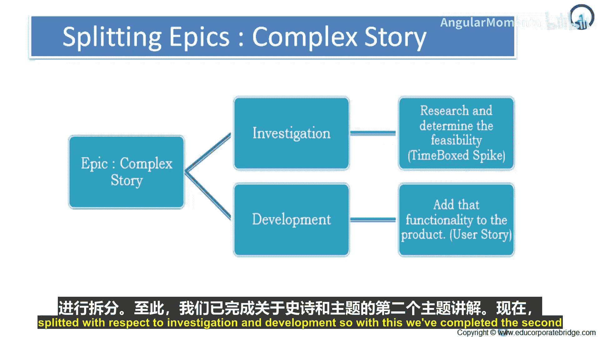
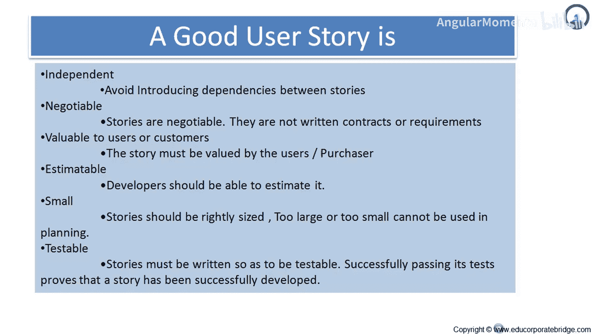

# 【EDUCBA】从思维模式出发的应用、评估与优化 ｜ Agile Practices： Apply, Evaluate & Optimize from Mind p20 02_02_03_史诗主题 -BV1TLcTzJEXS_p20-

Now， let's also understand how we can split the complex stories。So by definition。

 we understand that complex story cannot be aggregated into smaller stories。

Because the stories are interrelated and they cannot be aggregated。

So the first method is by investigation。The details is。Research and determine the feasibility。

Time boxers spike。So you research more， you determine the feasibility and thats how。😊。

You sort of classify or split a complex story。The second method is development。

 Add functionality to the product user stories。 So you have a complex story of。

Automating the functionalities。So first way of splitting is by investigation you will investigate what are the ways to automate and you will automate with respect to that our second way is for development you take a small portion for development which will help you to。

😊，Split the story with respect to the series of development。So just to summarize。

 a compound story can be splitted one by data boundaries。

Second by operational boundaries。Third by cross getting concerns。F to buy。

Performance constrain and fifth by mixed priorities。

And a complex story can be sped with respect to investigation and development。

So with this， weve completed the second topic about Es and themes。Now， let understand what is a good。

Use this story。So， as。We have give an example。About the good user stories will further。

Try to get some example and well see are these stories are good or not So the first example is a user can run the system on Windows X P and Lux。

So the answer is a good story。Second example is of either story is all graphing and chaing will be done using third party library。

😊，Is it a good story， no， it's not a good story。Users will not care how graphing and charting are done。

Their concern is， how。The best way to do the graphing and chaing。

The third example of user story is user can undo。Up to 50 command， I it a good story， yes。

The fourth example of his story is the software will be released by June 30。Is it a good story， no？

It is a constraint that will need to be considered during release planning。

Fth example of the story is the software will be written in Java。Is it a good story， no？

It depends on the product if the product is a class library being marketed to Java programmers。

 the user will care about the language。The sixth user story is the user can select her country from drop down list。

 Is it a good story。Yes。😊，The seventh example of the user story is the system theyll use log 4 J to lock all error message to a file。

😊，Is it a good story， no？😊，It should not specify that log 4 J。To be used for logging mechanism。

The Ed user story says that the user will be prompted to save her work if she hasnt saved it for 15 minutes。

 this is example of a good story。9th。If the story says the user can select export to Xl feature。

 Is it a good story， yes。😊，10th example is the user can export data to Xm。 Now。

 is it a good story user story， Yes， it is a good user story。 So we have intentionally taken。😊。

T0 example， and try to give you。Some rational。With respect to。

Deciding about is it a good user story or not？But agile gives you。6 bar laborators。

By which you can decide about a good good user story or not and these。Pararabits are independent。

Negotiable。Valuable。Estimatetable。Small。デテブ。So let us understand one by one。

 the first one is independent。Independent is to avoid introducing dependencies between stories。Now。

 as much as possible， K should be taken to avoid introducing dependencies between stories。

Dependencies between stories lead to prioritization and planning problems。For example。

 suppose a customer has selected as high priority a story that is dependent on a story that is low priority。

😊，Depenencies between stories can also make estimation much harder than it needs to be。For example。

 suppose we are working on big money jobs website and need to write stories for how companies can pay for the job openings。

They post on our site we could write these stories one company can pay for a job posting with Visa card。

Second company can pay for a job posting by Mastercard。

 third company can pay job posting with American Express card。

Suppose the developer estimate that it will。Take three days to support。First credit card type。

 regardless of which it is。And then one day for second and third。

With highly dependent stories such as these， you dont know what estimates to give each story which story should be given three day estimate。

When presenting with this type of dependencies， there are two ways around it。😊，One。

 combine the dependent stories into one larger but independent story。Or second。

 find a different way of splitting the stories。Combining the stories about the different credit card types into a single story。

A company can pay for a job posting with a credit card works well in this case。

 because the combined story is only five days long。If the combined story is much longer than that。

 better approach is usually to find different dimension。Along with the split。Of the story。

If the estimates for these stories had been longer， then an alternative split would be one。

Customer can pay with one type of credit card。And second。

A customer can pay with two additional type of credit cards。

If you dont want to combine the stories and can find a good way to split them。

 you can always take a simple approach of putting two estimates on the card。

One estimate if story is done before the other story。A lower estimate if it is done after。So啊。

Basic premise is if you have a dependent stories。Then it creates problem for estimation and execution。

And the Priise of user story is a measurable unit which can be taken for development。

So it is a smaller unit。 So if you include too much of depend story in one story。

 it becomes a bigger task to execute。 So that's where。

To the extent possible you need to have independent stories。

 there shouldn't be a dependency on many of stories。If there is a dependency， you have to do a split。

