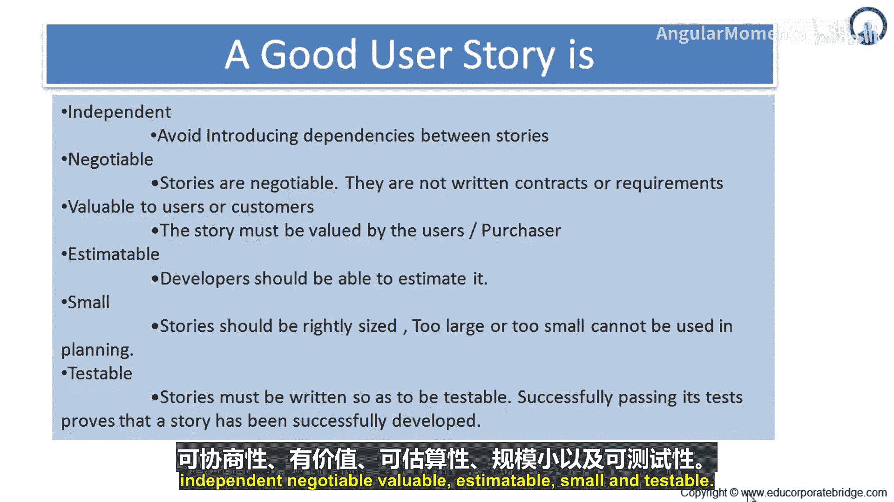
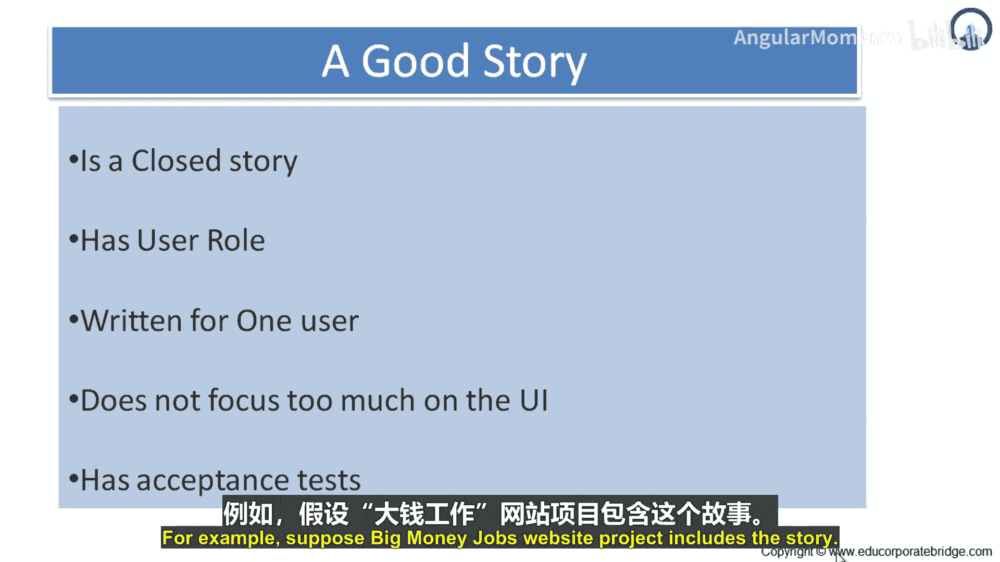
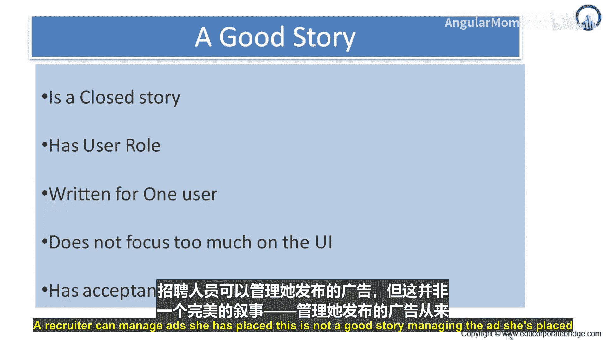
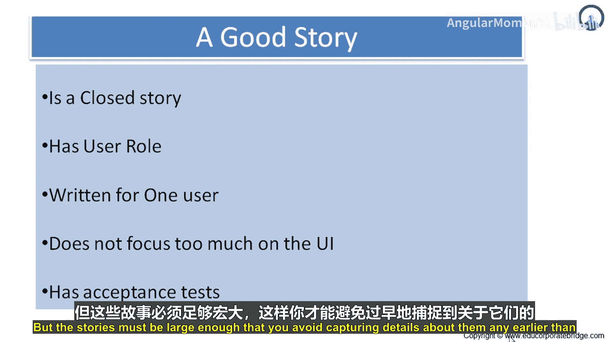
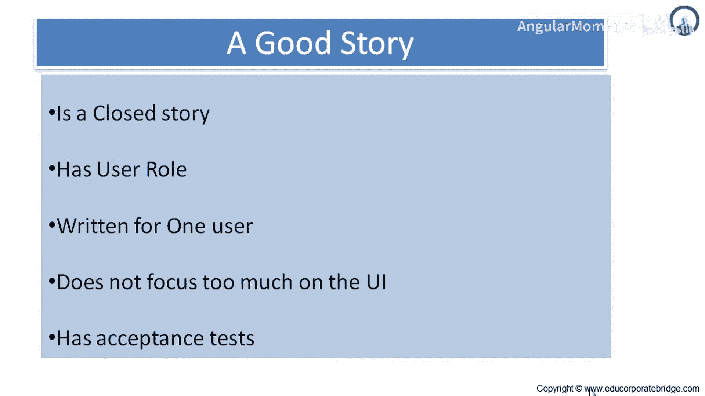

# 【EDUCBA】从思维模式出发的应用、评估与优化 ｜ Agile Practices： Apply, Evaluate & Optimize from Mind p22 02_02_05_优秀用户故事的特征解析 -BV1TLcTzJEXS_p22-

The six characteristics of a good users story is testable。

Stories must be written so as to be testable。Successfully passing of its taste proves that a story has been successfully developed。

If story cannot be tested， how can the developer know when they have finished coding？😊。

Untested stories commonly show up for non functional requirements。

Which are requirements about software， but not directly about its functionality。For example。

 consider these non functionalal stories。A user finds the software easy to use。

The user must never have to wait long for any screen to appear。As written。

 these stories are not testable whenever possible tests should be automated。😊。

This means try for 99% automation， not 10%。You can almost always automate more than you think you can。

When a product is developed incrementally。😊，Things can change very quickly and code that work yesterday can stop working today。

 You want automated test that will find this as soon as possible。😊，They are very small subset。

Of test that cannot realistically be automated。For example。

 a user story that says a no voice user is able to complete common workflows without training。

Can be tested， but cannot be automated。Testing this story will like involving human。

Factors expert design a test that involves observation。Of a random sample of representative。

 no voice uses。That type of test can be both time consuming and expensive。

 but story is testable and may be appropriate for some products。😊，The story。

A user never has to wait long for any screen to appear is not testable because it says never and because it does not define what width long means。

Demonstrating that something never happened is impossible。As far。

Easier and more reasonable target is to demonstrate that something rarely happens this story could have instead been written as new screens appear within2 seconds in 95% of the cases and even better and automated test。

😊，Can be written to verify this。A user can make and change automated job search agents。

Users should be able to create automated search agent。

Is they should be able to change job such agent。So testability and verification and validation of the requirement is very important aspect of a good user story。

😊，So just to repeat， we have six characteristics about good user story that is independent。

 negotiable， valuable，estimable， small and testable。😊。

So a good story is a close story。🤢，So， let's understand。What do you mean by。Close stories。

Sourin Lawson in 2002 introduces the idea of closure of task in his。

Compendium of requirement techniques， his ideas are equally applicable to user stories。

 A close story is one that finishes with achievement of meaningful goal and that allows the user to feed she has accomplished something。

😊，For example， suppose big Money jobs website project includes the story a recruiter can manage as she has placed。

 This is not a good story。 Managing the ad she's placed is not something that's ever completely done。

 Instead， its ongoing activity。 The story can better constructed as a set of close stories such as。

One recruiter can review resumes from applicants to one of her ads。

Two recruiter can change expiration date of an ad。Third。

 recruiter can delete an application that is not a good match for a job。And so on。

 each of this closed story is a part of original story that was not closed。

After completing one of closed stories， a user is likely to feel sense of accomplishment。

The desire to write close story has to be tempered against completing。

Competing needs remember that stories also needs to be small enough to be estimtable and small enough to be conveniently scheduled into a single iteration。

But the stories must be large enough that you avoid capturing details about them。

Any earlier than necessary。

