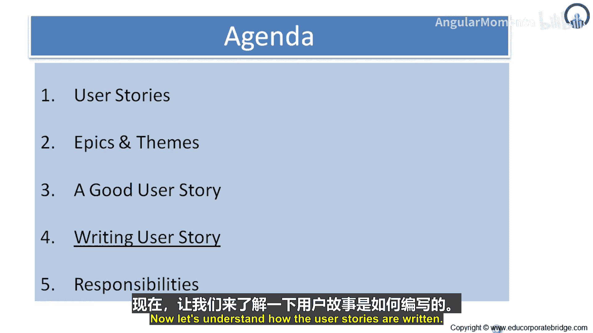
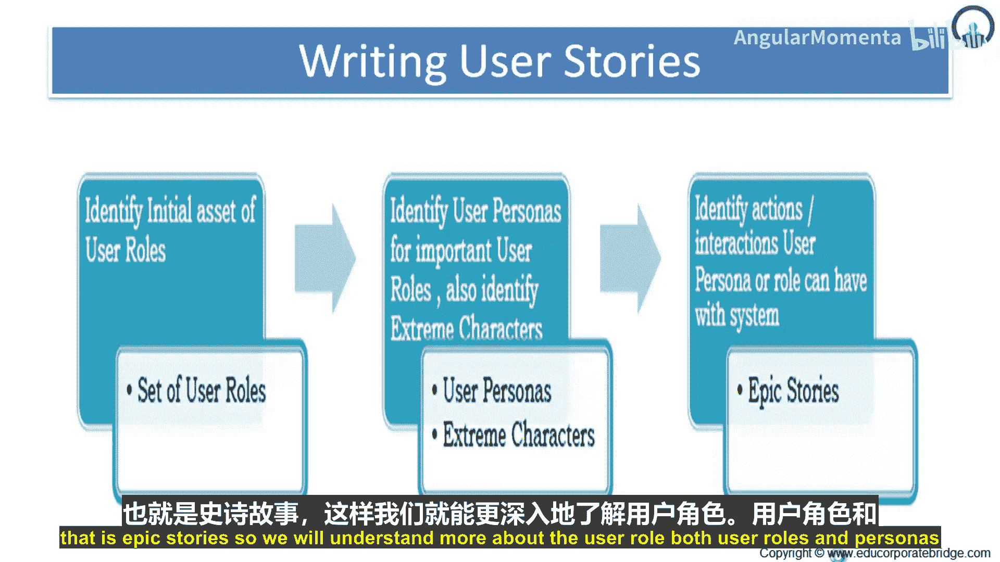
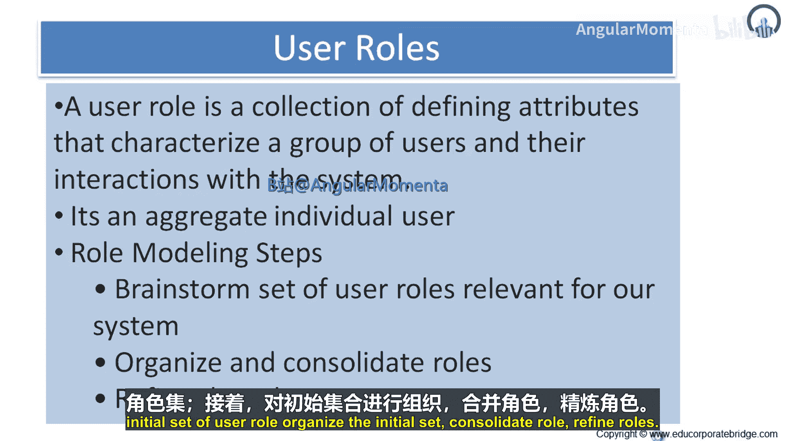
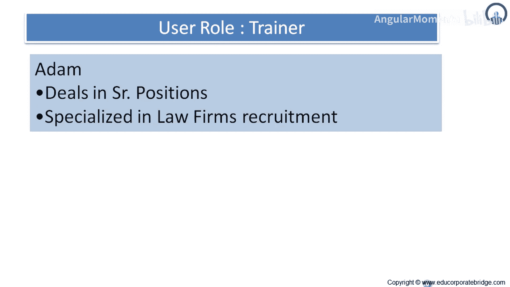
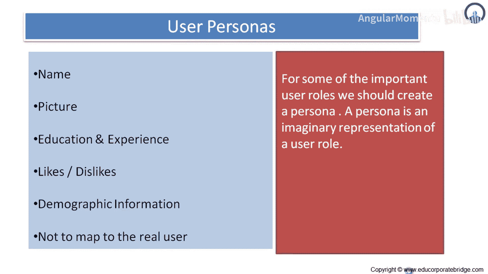

# 【EDUCBA】从思维模式出发的应用、评估与优化 ｜ Agile Practices： Apply, Evaluate & Optimize from Mind p24 02_03_02_如何撰写优质用户故事 -BV1TLcTzJEXS_p24-

Now let's understand how the user stories are written。

So writing this story is a three step process。Identify initial asset of user roles。

That is a set of user roles。Followed by identify user personas for important user roles。

Also identify extreme characteristics。That is user personnel and extreme characters。

Followed by identify actions， interactions user persona or role can have with system。

That is epic stories。

So we will understand more about the user role。Both user roles and personas are effective means for capturing and conveying basic understanding about the user and for informing design process。

 but they differ in different ways personas describe user while user role describe relationships between users and system。

Personas are。Figurative models rather than abstract model that is。

They are constructed to resemble real users even down to photoss。

Background information and personal history。Very similitude most likely contribute to the popularity of the personas。

 They sound like people you could know and over the course of the project can take on reality that encourages empathy and facilitate thinking from the user。

Perspective， what is more many people find the creative process of constructing personas to be engaging and energizing。

Personas are fun by contrast， user role do not resemble real power。

 nor they intended to roles are spa abstractions narrowly focused on those aspect of relationships most likely to be relevant for。

Presentations and interaction design。Compared to personas。

 user stories or user roles are more technical and formally structured model a user role is a collection of defined attributes that characterize a group of users and their interaction with the system。

It's an aggregate individual user。What are the role modeling steps we will use foreign steps to identify and select。

A useful set of user stories first brainstorm an initial set of user role。Organize the initial。

Set consolidate role， refine roles。

Here weve tried to give one user role that is trainer who is Adam who is drill in senior position and specialized in law firm recruitment。

Now understand the personas。For some of the most important user role。

 it might be worth going one step further and creating a persona for the role persona is imaginary representation of a user role earlier in this chapter we made Mario。

Who is responsible for posting a new job opening for his company。

 C a persona requires more than just adding a name to a user role persona should be described。

Sufficiently in that， everyone。In the team feels like that they know the persona， for example。

 Maio may be describe as follows if you choose to create persona for your project be careful。

That enough market and demographic research has been done that the persona chosen truly represent the product target audience。

This persona description gives a good introduction， however nothing speaks as loudly as a picture。

 so you should also find a picture and include that did the persona definition you can get photographs all over the web or you can cut one picture from magazine a solid persona definition combined with photograph will give everyone on the team thorough introduction of the persona most persona definitions are too long to fit into。

A note card。 So suggest you write。On a piece of paper and hang them on the teamss commonplace。

 you don't need to write personal definitions of every user role。 you may however。

 think about writing a persona definition for one or two of the primary user roles if the system you are building such that it is absolutely vital that the products satisfy one or two user roles then those user roles are candidate for expansion into personas stories become much more expressive when put in terms of a user role or a persona after you have identified user role and possibly a persona or two you can begin to speak in terms of role and persona instead of more generic the user rather than writing stories like user can restrict job search to specific。

5G regions， you can write a geographic。Searchcher can restrict his job searches to a specific geographic region。

Hopefully， writing a story this way reminds him about Alan， who has looking for any job。On毛。

Writing some stories with user role or personal names。

Does not mean that the other roles cannot perform these stories rather it means that there is some benefit in thinking about specific user role or persona when discussing or coding the story so user persons include name picture education and experience likes dislikes demographic information and it is not a map to the real user。

So for some important user roles， we should create a persona。

 a persona is an imaginary representation of a user role。

