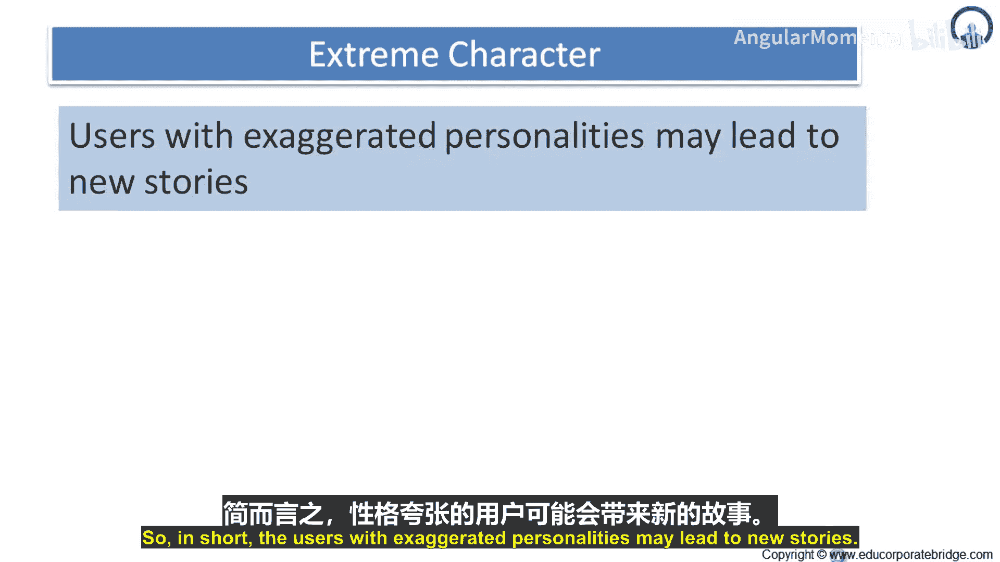
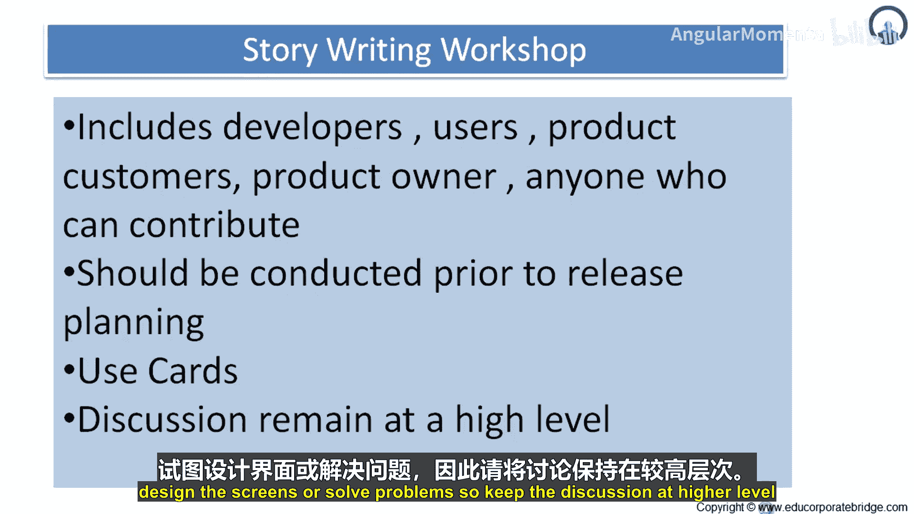
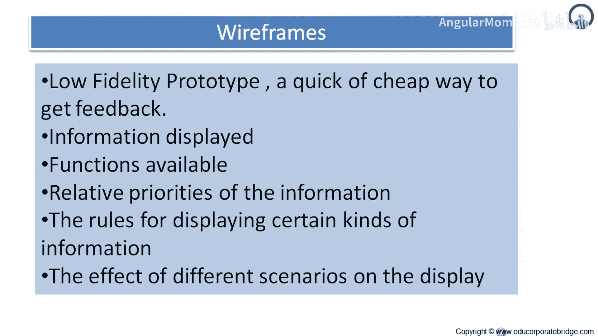

# 【EDUCBA】从思维模式出发的应用、评估与优化 ｜ Agile Practices： Apply, Evaluate & Optimize from Mind p25 02_03_03_如何撰写优质用户故事续篇 -BV1TLcTzJEXS_p25-

Now， let's understand extreme characteristics。It's a second technique you might want to think about the user of extreme characters when considering the design of a new system。

 they describe an example of designing personal digital digital assistant PDA handheld computer。

 they advise that instead of designing solely for a typical sharp dress BMW driving management consultant the system designers should consider users with exaggerated personal。

Specifically， the author suggests designing a PD for a drug dealer。

 the Poe and a 20 year old woman who is juggling multiple boyfriends。😊。

It' is very possible that considering extreme characteristic。😊，Characters will lead you to share。

 you would like to miss otherwise， for example， it is easy。To imagine that the drug dealer。

And a woman with several boyfriend may each want to maintain multiple separate schedule in case of PDA is seen by a police or a boyfriend。

Pope probably has less need for secrecy， but may want。A larger font size。So。

 while extreme characters。May lead to a new stories， it is hard to know whether。

Those stories will be ones that should be included in the product。

It is probably not worth much investing in time， but you might want to experiment with extreme characters at a minimum you can have a few minutes of fun thinking about how the pope might use your software and it is just may lead to an insight or two。

So in short， the users with exaggerated personalities may lead to new stories。

Now let's understand the story writing workshop。AGering stories technique because stories will be evolving and coming and going through the project。

 we need a set of techniques for gathering them and that can be used iterly the technique we use must be sufficiently light it and nonob。

😊，That they can be applied more or less continuously。

 Some of most valuable technique for creating a set of stories are user interviews， questionnaires。

 observations， story writing workshops。😊，So let's spend some time and understand more about story writing workshop。

During a storywriting workshop， the focus should be on quantity rather than quality。

 even if you will eventually keep your stories electronically during the storywriting workshop。

Use cards。Just let the ideas come and write down them a story that seems like bad idea now might seem a brilliant in few averse。

 or it may be inspiration for another story additionally， you do not want to be。

To get walkedgged down in lengthy debate or e story。

 if story is red with or become replaced by a better story later， then you can just rip up the story。

 Similarlyly when customer prior stories for release she can assign low priority to low quality stories。

 O some participants。😊，In story writing workshop， have a hard time either getting started or moving past a sticking point in this case it can be very beneficial to have access to competitive or similar products。

😊，Pay attention to who is contributing during a story writing workshop。 Occasionally。

 a participant will remain silent， though much or all of the meeting。 If this is the case。

 Talk to the participant during one of the breaks and make sure she she is comfortable with the process。

 some participants are reluctant to speak up in front of their peers。And superiors。

 which is why it is important that story ideas not bed during judged during the session。

 one participant becomes comfortable that their ideas will simply be noted。😊。

Not debated at this point。They will contribute more readily。 Finally。

 to reiterate that the discussion during user story workshop should remain a very high level。

 The goal is to write many user stories， in short。Time possible。

 This is not the time to design screens or solve problems。So a storyri workshop includes developers。

 users， product customer， product owner and anyone who can contribute。

It should be conducted prior to release planning。Storywriting workshop should use。Cars。

Discus remain at high level。 we are not。Trying to design the screen source or problems so keep the discussion at higher level。

