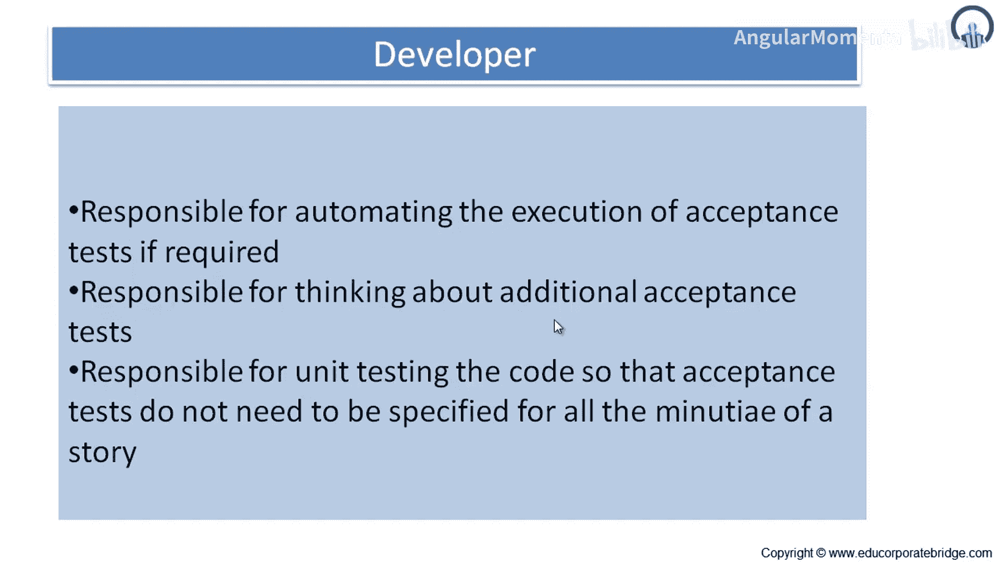

# 【EDUCBA】从思维模式出发的应用、评估与优化 ｜ Agile Practices： Apply, Evaluate & Optimize from Mind p26 02_03_04_职责与责任 -BV1TLcTzJEXS_p26-

Story writing workshops now also let's see about the wireframes。Is wire frame a prototype， yes？

It is a low fidelity prototype， a quick of cheap way to get feedback。So wireframes， once you develop。

 it is very easy to get the feedback， get the user inputs few boxes here and there do the align bin and get sign off。

It's more about the information display。How information will be displayed across the header and footer columns and ribbons。

 menus and sub menus and drill downs。It enlist the functions available。

 list of the functions available， what are the authorizations with respect to the functions and how a user can manuver across the software？

It also gives relative priorities of the information。

By means of relatives you will have a drill down information when first you will get a summary at a global level then once you drill down you can go to a national level。

Further drilling down will take you to the state level and further drilling down down will take you to the。

District level， so hierarchical relative information display will happen because if you display entire information in one screen。

 it is not possible。 And then the users grasping analysis and interpretation will be a challenge。

 The rules for displaying certain kinds of information。

Supposing a user has some selection menu so the associated rule will be set that if user selects input a the output should be related to group A likewise or if user gives some input based on that somerithmetic calculation will be done and display will happen accordingly。

 so wireframes enables rules for displaying certain kinds of information。

 wireframe can also effect of the different scenario on the display so if there is some parameter setting if user set some parameters it will also。

Give you the effect of that parameter setting with respect to the final output。

 So here we have tried to bring a very basic wire frame where。On the top left side。

 you can see the logo of the company or the software， there is a basket items。

It starts with your login creation and then it goes into a home screen likewise so you can develop the wireframe It is a quick and effect effective prototype by which you can get the。

Requirements， you can fine tune the requirements， you can put the conditions。

 you can build the rules and progress on writing the user story。So with this。

 we have completed the fourth chapter about the user story。

Now we will understand their responsibilities， responsibilities。Is the stakeholders？

What are their responsibility with respect to the user stories？

So customer responsibility is to identify appropriate roles。By meaning appropriate tools。

 the Scrum master， the product owner， the developer， the tester， the business user likewise。

Participate in the process of identifying user role and personas。As you know。

 user stories about the user roles and the personas。

And who else can give you more information customer has a good information about the user role and the personas。

 so customer participation with respect to providing input to user role and personas is essential for project success。

Write stories。 every customer is a business user， he has some requirement。

 so he or she needs to write the stories。Whatever is applicable。

When writing stories ensure that each story can be associated with at least one user or persona。

So writing user story。Ensuring it is attached to user role or persona so the combination of user story user role and persona will give holistic picture for developers to proceed with the development so writing user stories attaching it to user role and user persona is very critical。

Fall effective software development。If you need help in writing stories you are responsible for scheduling and running story writing workshops。

 so the best way if you are struggling or if you need help set up a storywriting workshop。

 set the theme enlist the list of the user stories which needs to be written。

 get the key stakeholders their inputs and write the stories， one after another。

So what are the developer responsibilities with respect to user stories？One。

 participate in the process of identifying user roles and persons。

Developer who is supposed to develop the software should help and participate so that he get a better understanding。

Of the user role and personas。And when he gets the user story， he can effectively。

Develop the user story by coding。Participate in writing user stories non functional requirement or certain functional requirement。

 developer can also write the user stories or wherever there is a a customer who struggles to write a good user story。

 developer can。Right there is the story himself。User stories。 and in the early chapters。

 we've discussed that user stories。Also， need。Acceptance taste。

So you need to write the acceptance test as well。And to write the acceptance test。

 you need to have a user story one for which acceptance test one。

For all the user stories like you just story two， three， four。

 the number of stories you've got for your project。

You need to have acceptance date for each individual stories。

So once you can do the acceptance testing of individual user stories。

You can write the system under test called SU T， which will test the system。In totality。

 and that's how you will prepare for release。So， the roles。For acceptance testing。

 writing is that customer is supposed to write the acceptance test。

 Custom is giving the requirements。 So he also needs to give what are the conditions that needs to be met so that the acceptance。

Of the user story is complete。Write test as many which adds value and clarification to the stories。

Not only write the acceptance criteria， but also write the。

Values say if you need screen the response of2 milliseconds and the tolerance。Is plus or minus 0。

1 milliseconds， so you need to write that the screen response should be in between 1。

9 milliseconds to 2。1 mill secondsds。If certain you need to check the discibel value。

 you need to say that check the disbel value by audiometer。So， customer has。

Return the user story customer has written the acceptance test。

 developer has completed the development now it' is time for customer to execute the acceptance test and by doing acceptance testing user firsthand will give information and feedback that whether the development is in line with the expectation or not does it meet the quality requirement outlineing acceptance test or not。

😊，So developer has a substantial role to play。4 acceptance test。

Developer is responsible for automating the execution of acceptance test if possible， if required。

As we have understood， a Gi principle says automate the testing。So are the。

The acceptance is requirement， which being received from the customer developer is supposed to automate that。

Desscript。Mikecurrie F test Pro is one of the automation tools there are many IBM rational is another S has its own automation tool。

 so there are many professional test automation tools available in the market。

Responsible for thinking about additional acceptance test。

If developer feels that there is more that needs to be tested。😊。

The acceptance test given by customer is light， he can comprehensively fill the gap and write additional criteria to make the acceptance test comprehensive。

Developer is responsible for unit testing the code so that acceptance tests do not need to be specified for all the。

Mute of story。So customer is supposed to do acceptance testing。

 but before that unit testing will be done by developer so that if there are some small minute defect that can be fixed and the defects which really customer can identify。

Those defective at all remain in the development code。

 otherwise most of the defects are identified and fixed by developer himself。

