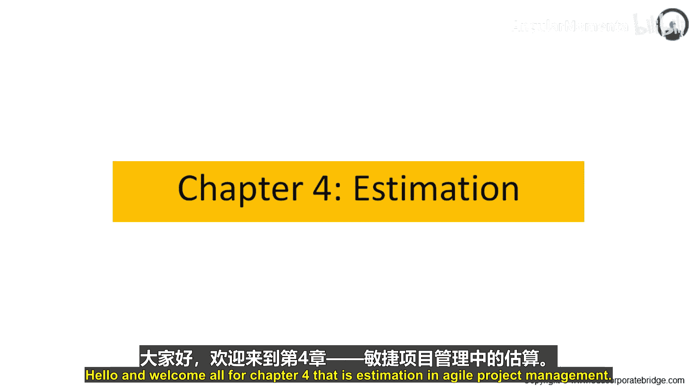
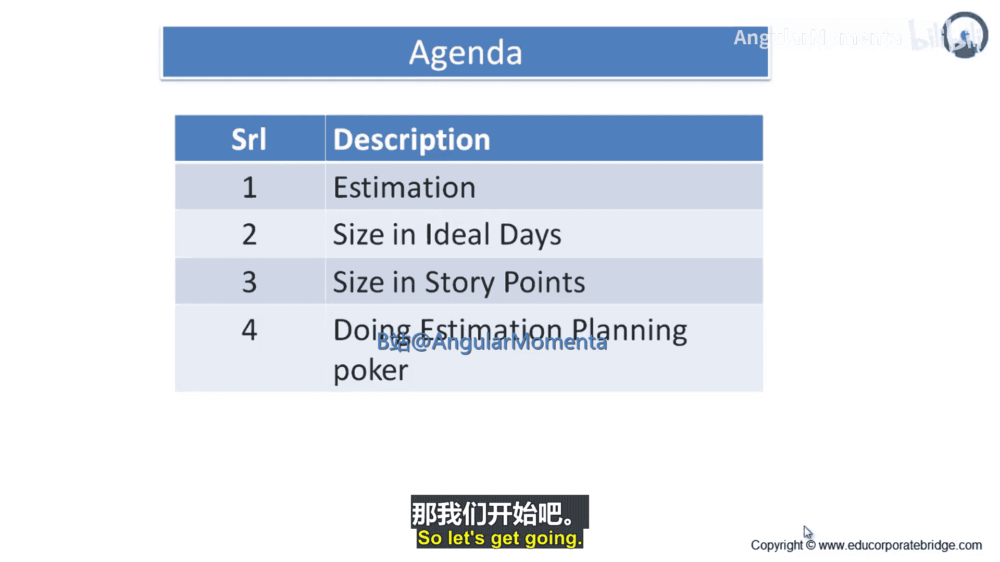
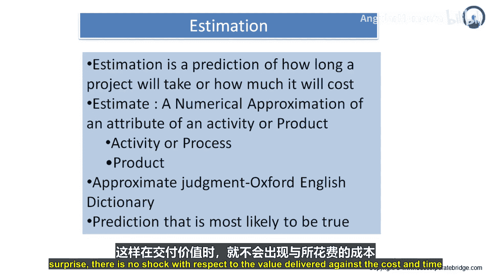
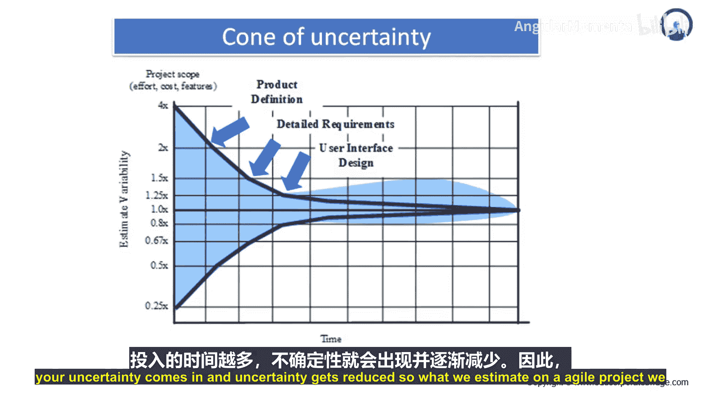
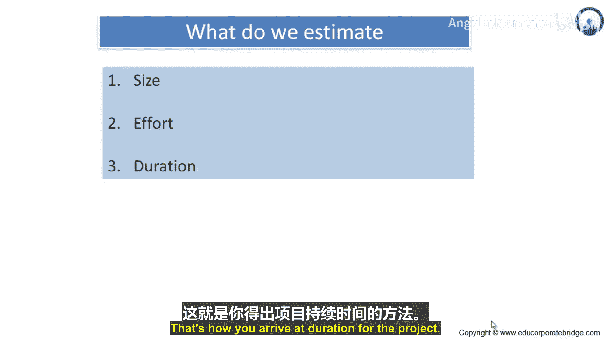

# 【EDUCBA】从思维模式出发的应用、评估与优化 ｜ Agile Practices： Apply, Evaluate & Optimize from Mind p27 03_01_01_估计导论 -BV1TLcTzJEXS_p27-

Hello and welcome all for Chaer 4 that is estimation in Agile project management。

Today we will see the the details such as voice estimation。😊，What is size in ideal days。

 what is size in story point and doing estimation。And planning poker so lets get going first we understand what is estimation so estimation is a prediction of how long a project will take or how much it will cost so it is a prediction in order to decide one to get started or not second to have a understanding understanding about what resources it takes primarily the human resources the time and the money that is cost and third when we are on our journey。

 how we are doing with respect to what we have estimate。

That is are we ahead of our estimation are we behind our estimation if yes by what degree and what is that likely constant and time it will take when it will get completed so estimate is a numerical approximation of an activity of an activity or a product。

So on agile project we get requirement through user stories。

 we estimate the effort required for all the user stories。

We estimate the effort for testing and deployment and release， and that's how we。

Agreggate all these estimates either bottom up or top down or with some expert opinion or analogy and we arrive at a project duration so estimation can be done on activity or process it depends on the project manager to what degree of detail or to what level of decomposition he wants to do all you can do estimation on product as well。

Oxford Dictionary， define。Estimation as approximate judgment。So。

 estimation is also a approximate and the degree of accuracy also varies with respect to at what stage you are estimating and what type of estimate you are producing if it is a ballpark estimate it is very vague。

😊，If it is。A order of magnitude estimate it is big。

 but if it is a expert judgment or if it is a definitive estimate， then it is accurate。

 say minus-10 to plus 5% of the actual cost of time remember the prediction is not an astrology its know based on certain facts and figures and the statistics and thegile project manages the estimate so that their estimate is most likely to be true or estimate is most likely to be near what the actual cost。

😊，Comes so the degree of closeness is one of the success factors for the project managers。

 If there is too much of deviation， which we call for additional time， additional cost。

 additional resources， project manager has to approach this stakeholders and sponsors and customers and which in turn will give bad perception about the project manager so to summarize estimation is a prediction。

 we estimate for the activity process or product and it needs to be accurate or near to the actual cost so that there is no surprise is no shock。

With respect to the value delivered against the cost and time incurred to deliver that value。

So here we've tried to elaborate the cone of uncertainty， as you know。

 when you start the project initially there is a high degree of uncertainty。

When you deal with the project scope， effort cost and features， so if you see on the y axis。

There is a central line and the cone is converged from my left to right and it becomes nearly a point at the extreme end on the right side of the vertical bar so when you deal with the projectgecope effort cost and features。

 the uncertainty is high。As you move to the product definition。

 the uncertainty reduces as you move towards detailed requirement。

 the uncertainty further gets reduced and when you develop user interface and design it further gets reduced and know as you do the testing and release the uncertainty becomes absolutely zero so logically understand when you start with the product scope。

 its effort， its cost， its features you have very little idea about what the product is all about so that's the stage where you live in high degree of uncertainty though you know some things you you have some facts and figures but the end output picture is little vague in everybody's mind but when you get a product definition you definitely start to put the things into a frame。

 you try to put inclusion。😊，Exclusion and you say now okay this is what I am supposed to develop and when you get user stories。

 when you get detailed requirement you know exactly what you are supposed to do but still there is some element of uncertainty of integration and adapt and release which prevails you to have a complete control on the project。

So that's where you develop the user interface， you design the software。

You put the enterprise architecture in place likewise and that is how you eliminate the uncertainty to the extent possible so call of uncertainty it plots the estimate variability against the time and as the more time you spend on the project your your certain comes in and uncertainty gets reduced So what we estimate on agile project we estimate the size。

We estimate the effort。 We estimate the duration size means how many user stories can be part of the release。

 What features we are going included that compromises of the size effort is the。The man of。

required to build those user stories to develop or code the user stories。

 test them and release them and duration is the time required from start of the project till the release and the duration is obtained from getting the requirement。

 planning the activities assigning resources to the activities。

 assigning time to the resource activity。Combination and roll that up with respect to arriving at the project durations so you estimate the duration for user stories and you aggregate the number of user stories and the time required that is how you arrive at duration for the project。

