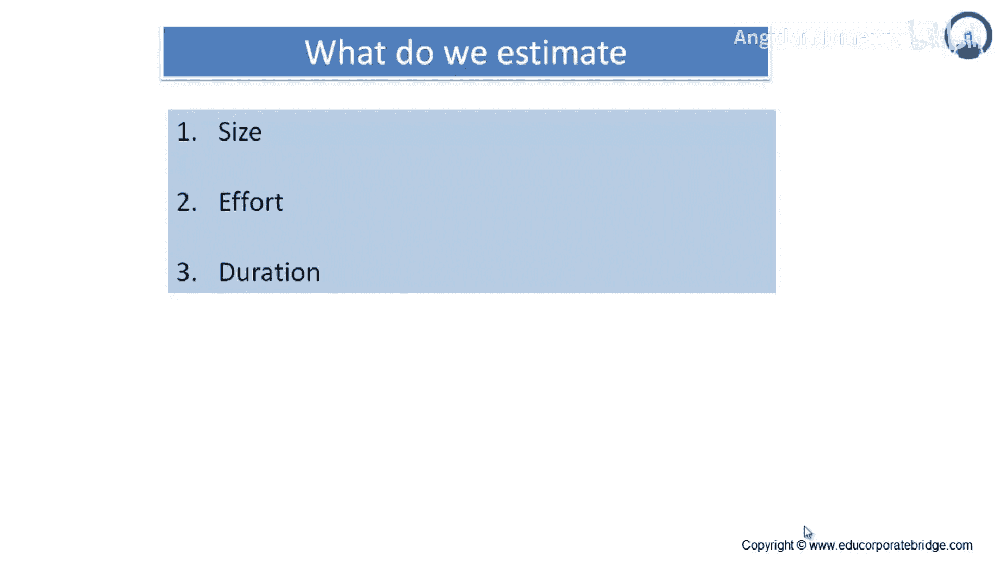
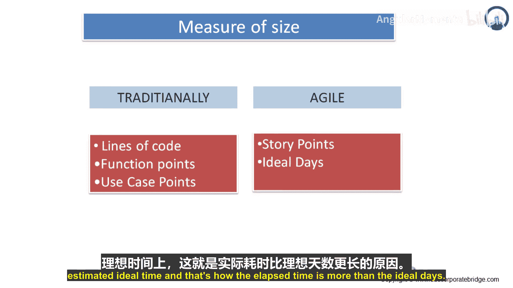
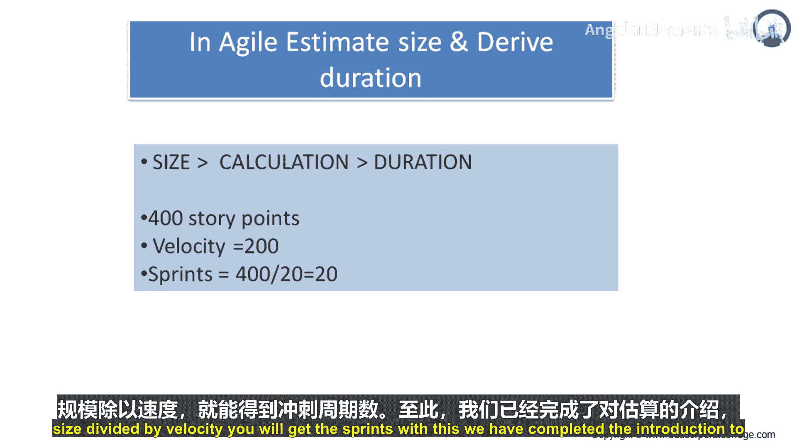
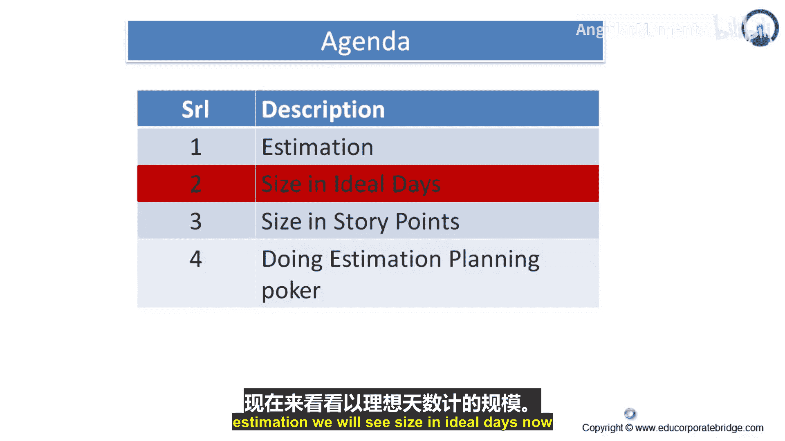

# 【EDUCBA】从思维模式出发的应用、评估与优化 ｜ Agile Practices： Apply, Evaluate & Optimize from Mind p28 03_01_02_尺寸测量 -BV1TLcTzJEXS_p28-

So traditionally， when you measure the size。You used to major lines of chors。

 how many lines the code has and as you know the sudden not all lines add value to the code。

 I certain lines are remarked lines header and footter and loops。So traditionally。

 when you measure the size， you measure the lines of codes， you measure the function points。

 how many function points are part of the code， you measure with respect to use case points。

How many use case points are part of the development and the project and that is how you estimate traditionally。

 but in agile the major of size is by s points。And the ideal days。

 So story points are a unit of measure for expressing the overall size of a user story。

 feature or other piece of work。When we estimate with story points。

 we assign a point value to each item。 The raw value we assign are un important。

 What matters are the relative values， the story that is assign a two should be twice as much as story that is assigned to one。

 It should also be twotds of a story that is estimated as three story points。

 The story point are unit of measurement for expressing overallal size of user story feature or other piece of the work the two common ways to get started。

 the first approach to select story that you expect to be done for the smaller stories you will work with and say that story is estimated at one story point。

 The second approach is state to select a story that seems somewhat medium and give it a number somewhere in the。

Of the range you expect to use。 Now， this understand ideal days。

It is almost always far easier and more accurate to predict the duration of an event in ideal time。

D in e lap time on a software project， ideal time differs from ela time， not because of timeouts。

 incomplete passes and injuries but because of natural overhead we experience every day on any given day in addition to working on the plan activities of a project。

 a team member may spend time and setting email making a support call to a vendor interviewing a candidate for the open analyst position and attending two meetings。

More example of what ideal time does not equal to last time are supporting the current releases。

Sk time meetings， demonstrations。Personal issues， phone call， special projects， trainings。

 email reviews and walkthroughs， interviewing candidates， task switching。

 bug fixing in current releases， management reviews problem can arise when manager ask a team member the inevitable question。

 how long will。Will this take。The team member responds five days。

 So manager counts off five days on her calendar and marks a day with big red X。 The team member。

 however， really mean to say five days， If that's all I do。 But I do a lot of other things。

 So probably two weeks， once of your project multitasking also broadens the gap between ideal time and e lap time。

 a football player is never told by his coach since。😊。

You are not busy on every play I want you to play in this high priority hockey game at the same time a software developer who is told to multi task loses a great deal of efficiency while switching between two tasks。

One software project。We may choose to estimate user story or other work in ideal days when estimating in ideal days you assume the story being estimated is only thing you will work on everything you need will be on hand when you start and there will be no interruptions。

😊，So remember， ideal day is more about your priority you are doing one thing or many things simultaneously。

 you will have do you have all the resources at at point in time when you start the work and are there any interruptions。

 distractions in your work I day as a measure of size when we estimate the number of ideal days that a user story will take to develop。

 test and accept it is not necessary to consider the impact of overhead of the environment in which the team works it developing a particular screen will take me one ideal day it will take me one ideal day regardless of whether I am employed by a start with no overhead or other demands on my time or by a huge bureaucracy。

The amount of time thatelapes on a clock or a calendarander will differ， of course。

 I may be able to achieve close to an ideal day of work at low overhead starts。

 as additional demands are in place on my time。 I have less time to work on deliverables for the project。

😊，The amount of elase time to complete one ideal day of work will increase when considerations of organizational overhead is are ignored。

 I day can be thought of as another estimation of size。

 just as story points are when an estimate of size expressed as a number of ideal days can be converted into an estimate of duration using velocity in exactly the same way as user story points。

 So ideal day is a time of irrespective of the iteration。

That the only work and all resources are available a resource will take to complete the task。

 There are overheads with respect to the organizer setups which add the overhead onto a estimated ideal time and thats how the elastic last time is more than the ideal days。

 So how a J project estimate the size and derive the duration so one example we have given that if you want to develop a job portal for the organization and it has got 400 story points so and the team velocity is 200。

 so 400 divided by 20 that is 20 ss are required。 So the formula is。

Size divided by velocity， you will get the sprints。

With this， we have completed the introduction to estimation。We'll see size in ideal days now。

