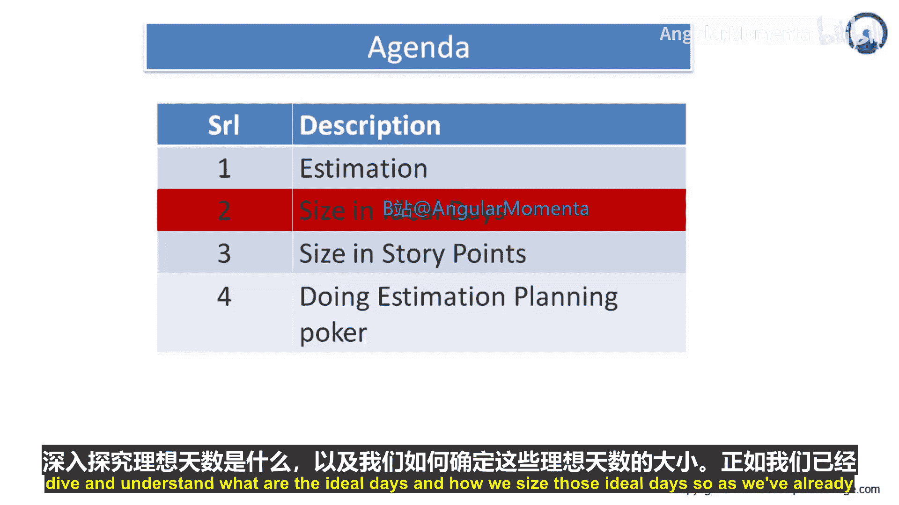
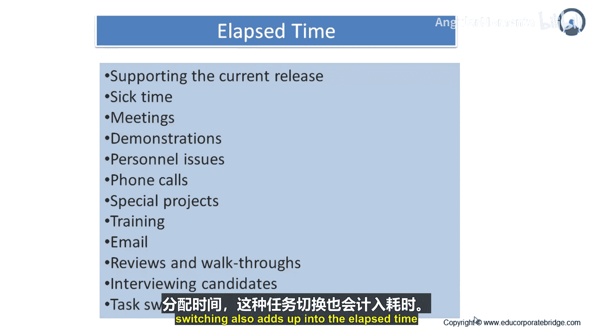

# 【EDUCBA】从思维模式出发的应用、评估与优化 ｜ Agile Practices： Apply, Evaluate & Optimize from Mind p29 03_01_03_什么是理想的一天 -BV1TLcTzJEXS_p29-

Section one of estimation we've seen what is the ideal days now in section 2 will。

Try to deep dive and understand what are the ideal days and how we size those ideal days。

So， as weve already discussed， the ideal days are how long something would take if。

It is all you worked on this is the only thing you will be do you will not do any other thing。

Your time is 100% devoted for that particular activity。

 you had no interruptions you are free from all interruptions there is no distractions。

 all the necessary tool resources， equipment are supported to you and everything you need is available the resources with respect to manpower。

 the tools with respect to automation coding code checking， test automation。嗯。The templates， the。

Formats， the repository， the hardware software everything is made available to you so ideal time is the time you take when you only work for a task there is no interruption and all the resources are available to you so ideal day is the shortest time which one could estimate on contrary you have the interruptions you have many other task to do some of the resources are not available or some of the resources are not in good shape to be leveraged for your productive work so you end up spending more time as compared to ideal day and that time is called elapsse time and it is definitely higher than the ideal days so let's see further details so elapsse time the constituent of elapsse time is supporting the current release。

Preparing documentation， doing testing， ensuring there's a good adoption， ensuring about the。

Training of the end user， so and and so forth。 S time。

The time on which you are not physically fit to do the work。

 so it is time of absenteeism because of sickness。Buting in a project environment。

 there is a daily sprint meeting， there is a。😊，Periodic reviews， there are possible。

Customer inquiries， phone calls so all this time is attributed to meetings。

 demonstrations as you build the software you need to do demonstrations for your team members to get their feedback to get the sign off so that demonstration a there is a time required to prepare for the demonstration to do necessary education and support information and be the time of actual demonstration。

Where the customer and the team members see the demo and third post demo there will be a lot of suggestions so incorporating those suggestions So there is a substantial time which goes behind demonstration that is part of the lap time personal issues such as。

The bank transactions， the utility bill payment， there is some case owners to pick and drop on the airport likewise。

 there are personal issues which also consumes your ideal time for working phone calls answering the queries。

Giving clarification， seeking information， so these phone calls will also add time to the elapsse time special projects。

Organs have strategic initiatives with respect to projects because of your knowledge power。

 your expertise in the domain you've been asked to provide feedback Part in giving the requirements help to shape the vision mission finalize the objectives and goals interview resources。

 ensure PMO structure is in place governance do the compliance so with spatial projects also are considerable time consumables training as the software development is in terms of working with the technology technology has its evolution。

 newer version comes new technology is being released to adapt that technology you need to have trainings so those trainings are the knowledge empowerment with your team members either you are preparing to。

Deliver the training or you are getting training from some expert so this skill up building time is a part of e lappsse time on the project。

Email emails are the most preferred communication media so there a substantial amount of email communication that is happening on day to day basis。

 decoding the emails responding over it circulation of periodic reports so and so forth so these are the part of the time widgets which is under the elase time reviews and walkthroughs on agile projects you have daily review you have a demonstrations you have a weekly review。

 you have a retrospective， you have compliance and audits， walkthroughs， the software development。

 the build development， sudden proof of concepts， certain prototypes so these forms the reviews and walkthroughs interviewing candidates those who you wish to onboard on the project etc and tasks which as you do multitasking you focus your time。

With respect to the priorities and this task switch also adds up into the elase time。

