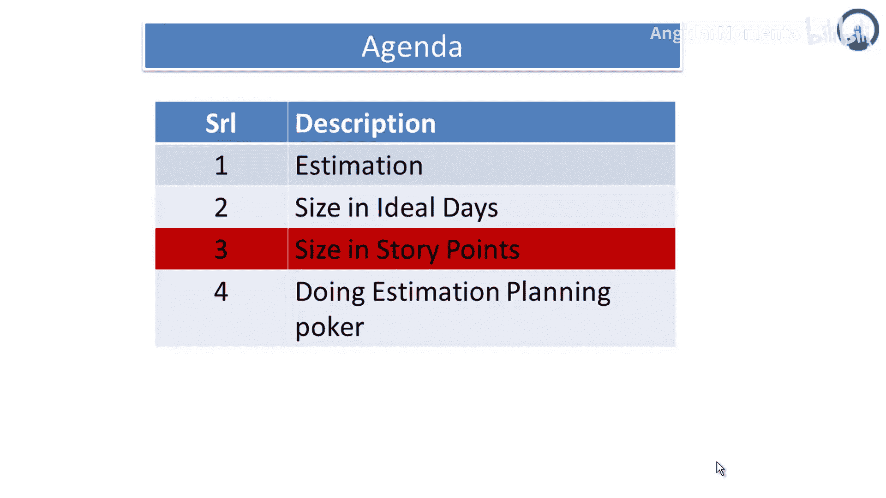
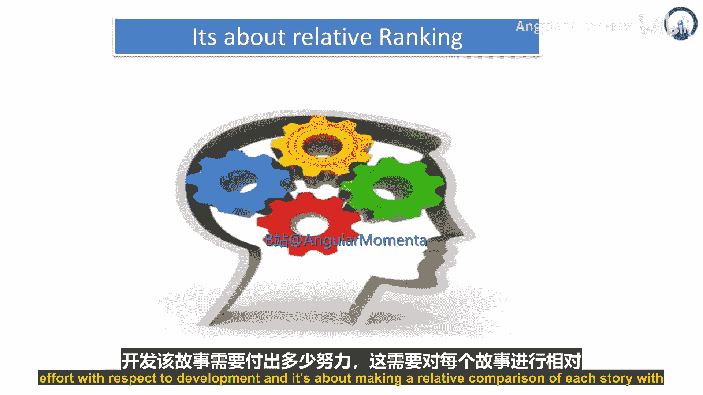
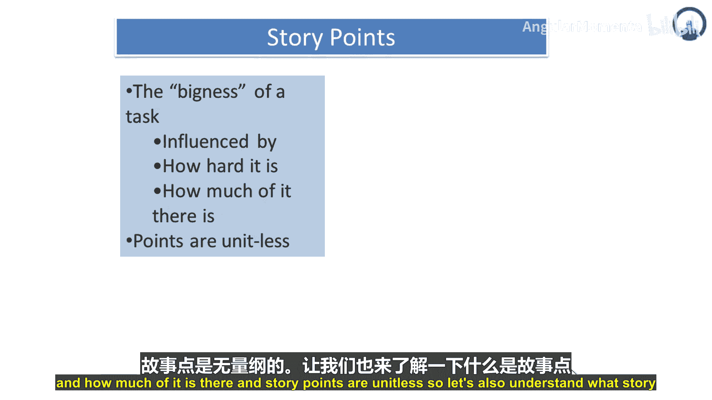
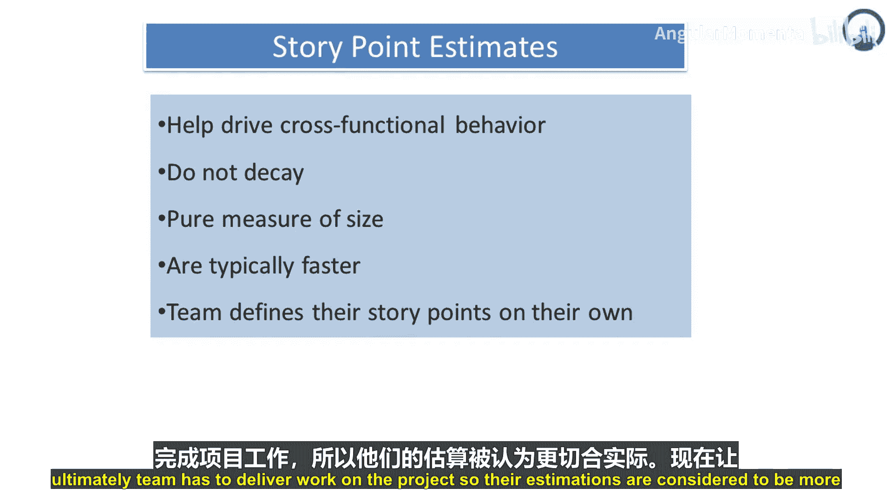
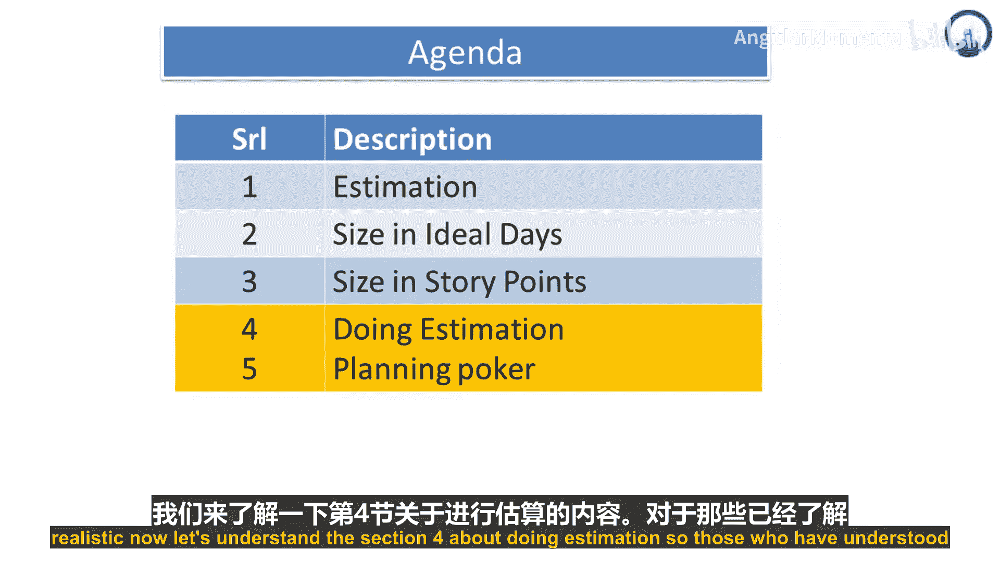
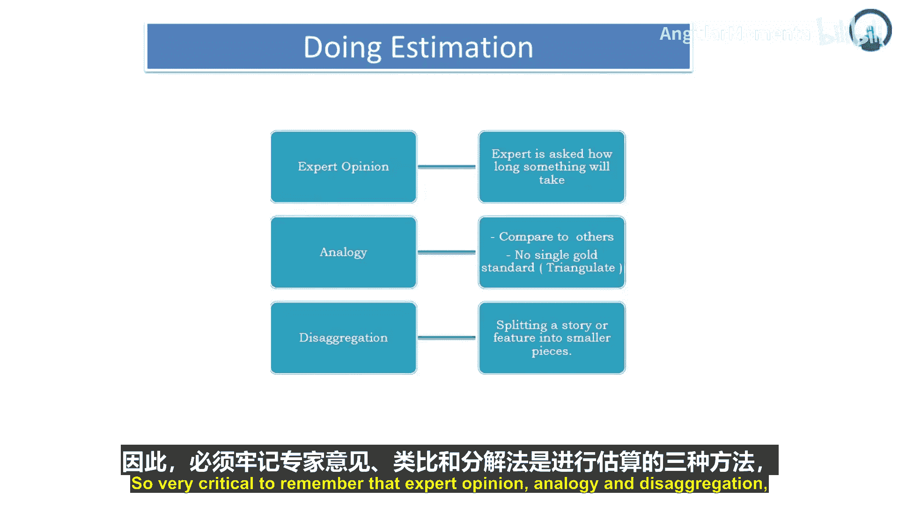

# 【EDUCBA】从思维模式出发的应用、评估与优化 ｜ Agile Practices： Apply, Evaluate & Optimize from Mind p31 03_01_05_故事点 -BV1TLcTzJEXS_p31-

Now let's see the size in story points。

So when you estimate the size in story point， it is about the relative thinking。

 how much the story point or the how much is the story which will。

Need the effort with respect to development。 and it's about。

Making a relative comparison of each story with respect to one another story points。

Is the bigness of the task is influenced by how hard it is and how much of it is there and story points are unit less。

 so lets also understand what story point estimate is story point estimate help drive cross functional behavior because when you do a story。

Point estimation， you understand all the effort with respect to development effort with respect to testing。

Effort with respect to release planning， effort with respect to adaptation， etc。

 the estimate do not decay as you progressively elaborate or as you roll up it keep on incrementing the story points are the pure measure of the size。

And they are typically estimates are faster， because you are。

Doing the relative sizing you are not doing the traditional bottom of estimating which takes a lot of time。

 so it is very simple to understand easy to do and faster and effective way of estimation。

And the team defines the story points on their own so team they are self regulating self governing they define their own story points and estimation and because ultimately team has to deliver work on the project so their estimations are considered to be more realistic now let's understand the section4 about doing estimation so those who have understood or learn the traditional project management approaches there is a method called expert opinion。

When experts are asked how long something will take。As you know。

 project management is a combination of art and science。 It involves the technology。 It involves the。

Sharop as human brain and some of the task gets completed within fractions of second and some task take long time to get finished。

 typically a testing or a sign up or a writing a requirement document。

 so those who have work on the similar project those who have got expertise in managing similar projects。

 are their opinion counts， so estimation technique called expert opinion is very important wherein experts are asked to estimate how much time the project will take for completion。

The second method is called analogy。 It try to correlate with the。

Historical data or compare with the similar projects and come out with the estimation there is no single goal standard but say in your previous project if it takes 10 days to complete one interface and in your current project if there are 10 interfaces to be developed then you can safely assume that 10 multiplied by 10 that is 10 days of effort it will take to complete all the interfaces similarly if you have got a0 test scripts to be tested and you know that one test testing x one hour so you can safely assume that for testing 00 test scripts it will take 00 hours for your project So this is the second method called analogy and the third method is disaggregation this aggregation means splitting the story。

Or a feature into smaller pieces， supposing you want to develop the software for smartphone。

And then if you break down that development work。For the one for the basic telephone system。

 second for the internet， third for the smartphone applications。

 and then within the say application you can divide into the games you can divide into the banking application likewise so you are trying to break down the large work into hierarchical server work so that you。

Going into the。2 levels， three levels or four level down the important level that is project。

 and you。Alloccate the estimated time and effort for each individual atom and then roll that up。

 add them， aggregate them。Into a larger work， so disaggregation means breaking down the larger work into smaller pieces。

 estimating for smaller pieces and adding all effort together to come out for a estimation for the project。

 So very critical to remember that expert opinion analogy and disagggregation These are the three methods for estimation。

