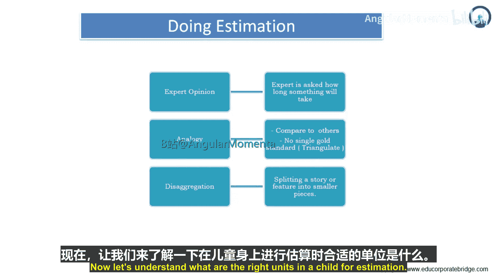
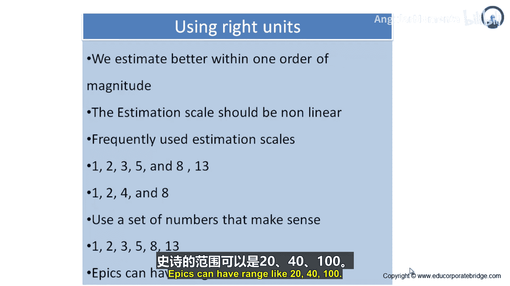
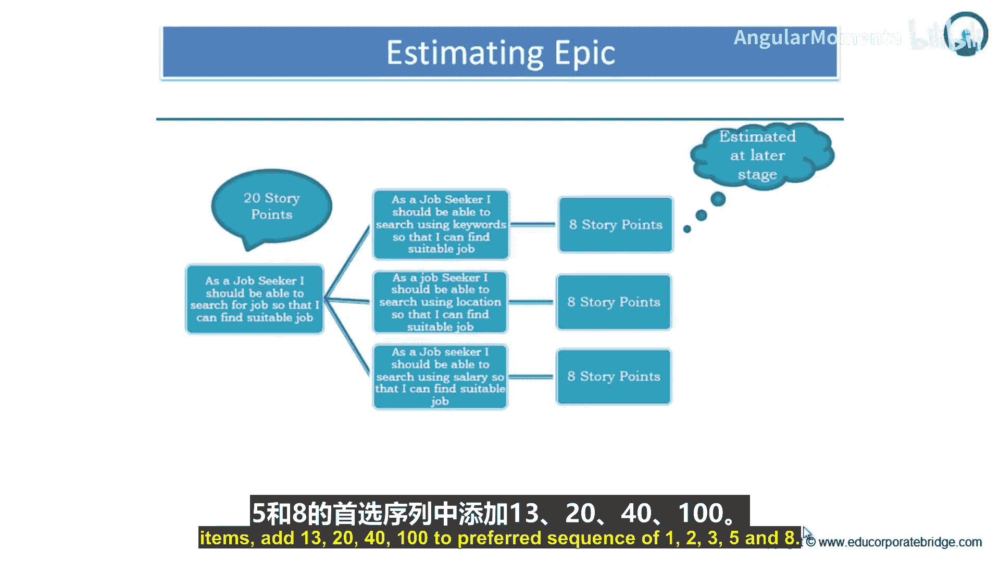

# 【EDUCBA】从思维模式出发的应用、评估与优化 ｜ Agile Practices： Apply, Evaluate & Optimize from Mind p32 03_01_06_什么是估计 -BV1TLcTzJEXS_p32-

收呃。Key message is there are three ways of estimation， expert， opinion， analogy and disaggregation is。

These approach are different with respect to how much time is available。

 what sort of expertise are available for the estimation？

And what accuracy is required with respect to estimation now let's。

Understand。What are the right units in a child for estimation？

So a study have shown that we are best at estimating things that fall within one order of magnitude within your own you should be able to estimate reasonably well。

 the relative distances to think like the nearest grocery store。

 the nearest restaurant or nearest library， the library may be twice as far the restaurant for example。

 your estimates will be far less accurate if you are asked to estimate the relative distance to the moon or neighboring country's capital。

Because we are best with a single order of magnitude。

We would like to have most of our estimates in such a range。

 two estimation skills that we've had a good success with our。One， two， three， five， and eight。Or1，2。

4， and 8。This rationalization of scales helps。😊，To group and classify the estimates and roll that up into the project estimates。

So understand there is a logic behind each of these sequences。

The first is Fabbonacci sequence I found this to be very useful estimation sequence because the gap of the sequence becomes appropriately larger as the number increases a。

1 gap from 1 to2 and from 2 to 3。😊，Seems to be appropriate。Just as a gap from3 to5 and from 5 to a2。

 the second sequence is a spaced such that each number is twice the number that pres 8。

 so2 is double then 1，4 is double then 2 and 8 is double then 4。

These non nonlinear sequence work well because they reflect the greater uncertainty associated with estimates for larger units of work。

Either sequence works well， although my my slight personal preference is for the first。

 some of these prefer to work with large numbers such as1 2030，1500。 This is fine because。😊。

There is are also within a single order of magnitude， However。

 if you go with large numbers such as 10 to hundred0， I still recommend that you。啊。

Preidifying the number you will use within the range。 Do not， for example。

 allow one story to be estimated at 666 story points or ideal date and another story to be estimated at 67。

 This is false level of precision。 We cannot discern a 1。5% difference in size。

 It's acceptable to have one point difference between the value such as 123。

A percentage of this difference is merged larger between 66 and 67。

 so we estimate better within one order of magnitude。😊，The estimation scale should be nonlinear。

 particularly the estimation scales are 1，2，3，5，8， and 3。Which is the Fabbonac number， the first。

And second number edition。Comes。Third number like1 plus2 is3，2 plus3 is 5，3 plus 5 is 8。

8 plus 5 is 30。Or the 1，2，48 C where the second number is a double of the number which processs it use a set of numbers that makes sense。

1235830 Es can have range like 20 4000， so we understand how to estimate E。

Although in general we want to estimate user stories whose size are within one order of magnitude。

 this cannot always be the case if we are to estimate everything within one order of magnitude it would mean writing all stories at fairly fine grain level for features that we are not sure we want a primary cost estimate is desired before too much of investment is put into them or a feature that may not happen in near future it is often desirable to write one much larger user story a larger user stories is sometimes called an epic so epic is a larger user story typically to the range of 20 plus story points to the range of 20 to 00 or sometimes 200 additionally a set of related user stories may be combined usually by a paper clip if working with one note。

Car are treated as a single entity for either estimating a release planning such a set of user stories are referred to as the an epic by its very size alone is often themme on its own by aggregating some stories into themes and writing some stories as epics a theme is able to reduce the effort they have spending on estimating。

 however， it's important that they realize that estimates of themes and epics will be more uncertain than estimates of of the more specific smaller user stories Use stories that will be work on the near future。

Or in the next few iterations need to be small enough that they can be completed in single iteration these items should be estimated within one order of magnitude I use the sequence12358 for this。

User stories or other items that are likely to be more distant than few iterations can be left as epics or themes。

 the items can be estimated in units。Beyond  one28 range。

To accommodate estimating these larger items， add 1320， 4000 to preferred sequence of 1，2，3，5 and8。

