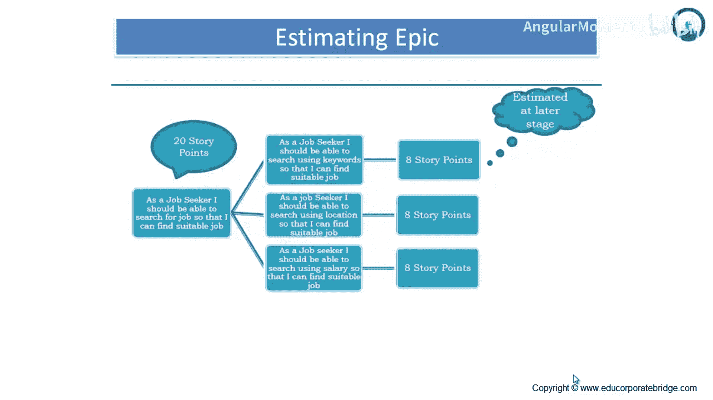
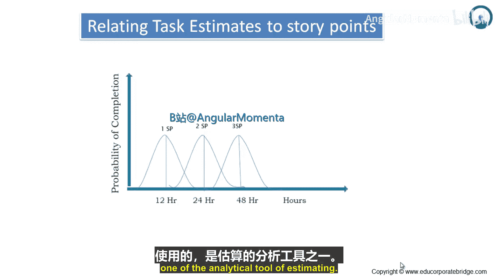
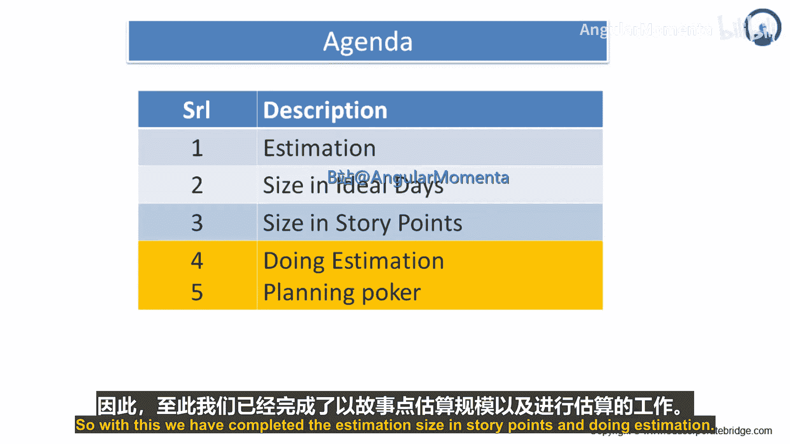

# 【EDUCBA】从思维模式出发的应用、评估与优化 ｜ Agile Practices： Apply, Evaluate & Optimize from Mind p33 03_02_01_如何进行估算 -BV1TLcTzJEXS_p33-

So on this slide we tried to demonstrate how Eex can be estimated So if you see E is a larger user story so let's take an example of a user story saying that as a job seeker I should be able to search for job so that I can find suitable job so since this is a larger set of requirement they have disaggregated the requirement into three sub requirements so first sub requirement is as a job seeker I should be able to search using keywords so that I can find suitable job so this is more related to a keyword search to find a job so now this story has been disaggregated to much more meaningful and。

😊，relativelyelatively small size， so we've assigned eight story points to this story。

Second disagggregation is you know in the story as a job seeker I should be able to search using location so that I can find a suitable job so first one was a keyword search about the job description now second one is searching by location again the story is disaggregated into smaller meaningful story and we have assigned eight story points to this story now as a job seeker I should be able to search using salary so that I can find suitable job so salary limit is one of the constraint or one of the limits for search so this is a story is also assign eight story points in initial estimation and during the calibration the entire E is assigned 20 story point so thats how the。

Epics are estimated by disaggregating to a smaller user stories and individually retuibating the smaller user stories and adding the estimation and doing drawinging off do remember that disaggregation happens first for all the user stories and then individual user stories are estimated this another method called relating task estimate to story points。

What it means is on y axis you have got probability of completion and on the x axis you got a duration so if it is one story point it may take from 0 to 24 hours the mean is 12 hours if it is2 story points it will take anything between 12 to 24 12 to 36 hours so the mean is 24 hours if it is3 story point it will take from 24 to。

60 hours so the mean is 48 hours so this mean of 12 hours 24 hours and 48 hours respectively for one story point two story point and three story point is taken for estimating this is used when best on the statistical information and it is one of the analytical tool of anestimating so with this we have completed the estimation size in story points and doing estimation。

