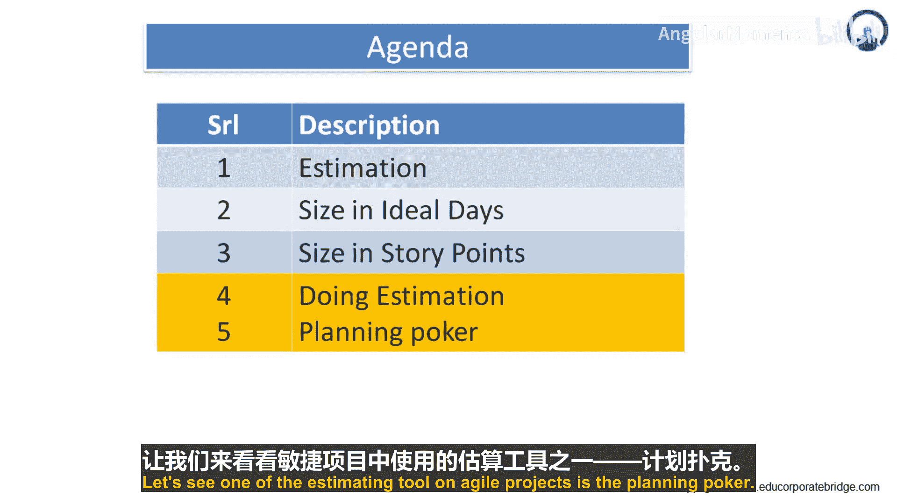
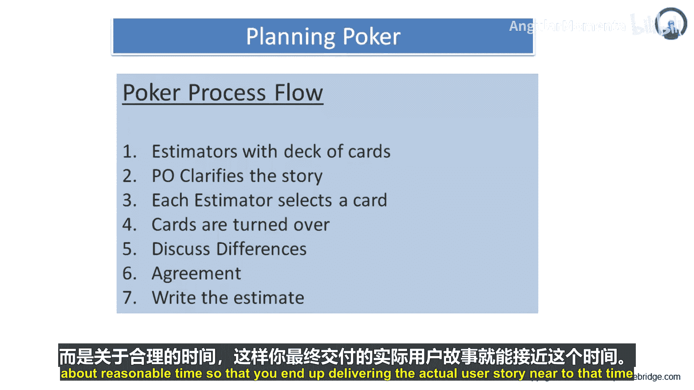

# 【EDUCBA】从思维模式出发的应用、评估与优化 ｜ Agile Practices： Apply, Evaluate & Optimize from Mind p34 03_02_02_计划扑克：一种估算技术 -BV1TLcTzJEXS_p34-

Let's see one of the estimating tool on agile projects are is the planning poker the best way I've found for agile teams to estimate is by playing planning poker planning poker combines expert opinion analogy and disaggregation into an enjoyable approach for estimating that results in quick but reliable estimates so remember it's a combination of expert opinion analogy and disaggregation it is quick method of doing estimation and its very participative so team members enjoy the estimation Part in planning poker include all of the developers on the team。

Remember that developers refer to all programmers， tester， database engineers。

 analyst user interaction designers and so on on an agile project this will typically not exceed 10 people if it does it is usually best to split them into two teams each team can then estimate independently and will keep the size down。

The product owner participates in planning poker， but does not estimate。

At the start of planning poker， each estimator is given a deck of cards。

 Each card has written on it one of the valid numbers。 Each estimator may， for example。

 be given a deck of card that reads 0，1，2，3581320400。

 The card should be prepared prior to the planning poker meeting and the number should be large enough to use across a table cards can be saved and used for next planning poker session for each user's story or theme to be estimated A moderator reads the description。

 The moderator is usually the product owner or an analyst。 However。

 the moderator can be Anyone as there is no special privilege associated with the moderator's role。

 The goal in planning poker is not to derive an estimate that will。

withstand all future scrutiny rather the goal is to be somewhere well on the left of the effort line where valuable estimates can be arrived at cheaply so understand the focus is not to accurately estimate everything but to arrive estimate quickly and effectively After all questions are answered each estr previously selects a card representing his or her estimate Mo asks the question the developers and team members pull the card about their estimate After all questions are answered each estr privately selects a card representing his or her estimate cards are not shown until eachest has made a selection at that time all cards are simultaneously turn over and shown to all the participants they。

see each estimate It is very likely at this point that estimates will differ significant。

 It's very natural。 you have got up to 10 team members and the the story tagline is red and the team members have done the estimation so it could vary by a large percentage So it is very likely at this point in time。

 the estimate will differ significantly actually this is a good news If est differ the high and low estimators explain their est。

 It's important that this does not come across as attacking those estimators instead you want to learn what they are thinking about so you go to high est and understand why the estimate is high so he will have probably。

😊，Accounted additional work。The low estimator might have accounted some degree of automation or may have some innovative way of accomplishing the work so you understand both the perspective and decide upon the group can discuss the story and their estimates for a few more minutes the monitor can take any notes she thinks will be helpful when the story is being programmed and tested after the discussion each estimator reestimate by selecting a card card are once again kept on privately until everyone has estimated at each point they are turned over at the same time in many cases the est will already converged by second round if they have not continue to repeat the process the goal is for the estimators to converge on a single estimate that can be used for the story It really takes more。

than three rounds， but continue the process as long as estimates are moving close together。

 it isn't necessary that everyone in the room turns over a card with exactly the same estimate written down if I am moderating an estimate meeting and on the second round four estimate。

Metterters tell me 55，5 and 3 I will ask the low estimator if she is okay with estimate of 5 again the point is not absolute precision but the reasonableness so the idea is to arrive at consensus in a group not stick to accurate but it is about reasonable time so that you end up delivering the actual user story near to that time。

😊。

