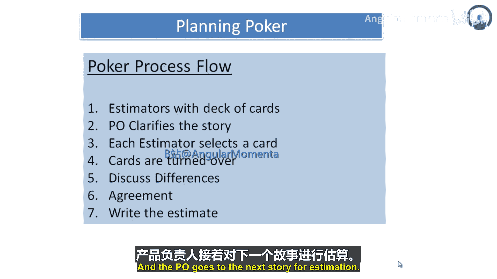
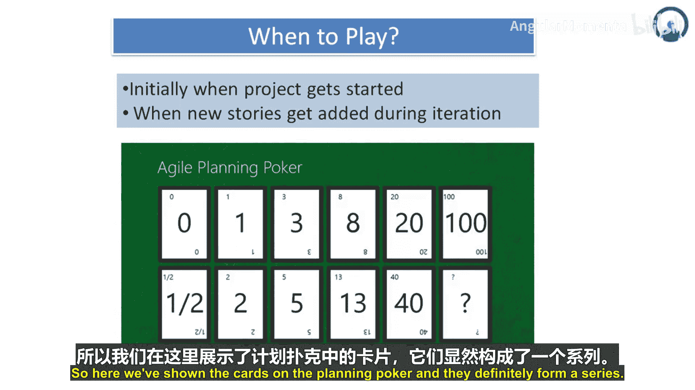

# 【EDUCBA】从思维模式出发的应用、评估与优化 ｜ Agile Practices： Apply, Evaluate & Optimize from Mind p35 03_02_03_规划扑克 2 -BV1TLcTzJEXS_p35-

So there is a right amount of discussion or the right degree of the discussion is essential when doing the planning pokecal。

Some amount of preliminary design discussion is necessary and appropriate when estimating。However。

 spending too much time on design discussion sends a team too far up。

The effort accuracy curve here is an effective way to increase some amount of discussion but make sure that it doesn't go on too long by a2 mi sand timer place it in the middle of the table where the planning poker is being played。

Anyone。When the meeting can turn the timer over any time when the sand runs out in two minutes。

 the next round of cards is play。If agreement ist reached， the discussion can continue。

 but someone can immediately turn the time over。Again， limiting the discussions to two minutes。

 that timer rarely needs to be turned over more than twice over time it helps teams to learn to estimate more rapidly it is possible to play a planning poker with sub of the king rather than involving everyone。

This isn't ideal but may be reasonable option， especially if there are many。

 many items to be estimated as can happen at start of the new project。

 the best way to do this is to split the large team into two or three smaller teams each of which must have at least three estimators it is important that each of the team's est consistently when your team calls three story points or ideal days。

Had better be consistent with my team calls the same。To achieve this。

 start all team together in a joint planning proposition for an hour or so。

 have them estimate 10 to 20 stories then make sure each team has a copy of these stories and their estimates。

And that they use them as a baseline for estimating the stories they are given to estimate so here we have enlisted the key steps in bringing the estimation using planning proper。

First step is to estimators with takeoff cards。There needs to be sufficient number of cards available。

For the estimators。PO clarifies the story。So details about the story is provided。

 each estimator selects the card， the precise。Effort required in hours or days。

The cards are turned over。So that everybody displays their estimations。

Discusses the differences are the high estimation and the low estimation is chosen for discussion。

And。The agreement is sought between the teams and the estimation is summarized and the P goes to the next story for estimation now it is very essential at what point in time we should play the。

Lning book。The teams will need to play planning poker at two different times first there will be usually be an effort to estimate large number of items before project officially begins or during its first iterations。

Estimating an initial save of your stories may take a team of。

Team two or three meetings from one to three hours each naturally。

 this will depend on how many items。There are to estimate the size of the team。

And the product owner's ability to clarify the requirement secondly。Second。

 teams will need to put forth some ongoing effort to estimate any new stories that are identified during an iteration。

One way to do this is to plan to hold a very short estimation meeting near the end of each iteration。

Normally， this is quite sufficient for estimating any work that come。

In during the iteration it allows new work to be considered in the prioritization of coming iteration alternatively Kent be suggest hanging an envelope on the wall with all stories placed on the top of the envelope as individuals have a few spare minutes they will grab the story or two from the envelope and estimate them themes will establish a rule for themselves typically that all stories must be estimated by end of the day or by end of the iteration。

I like the idea of hanging an envelope on the wall to contain。Unestimated stories， however。

 I would prefer when someone has a few spare minutes to develop to estimating。

He find at least one other person。And that they estimate jointly by planning poker works。

Below are the reasons why it works so well first planning poker brings together multiple expert opinions to do it do the estimating because these experts form a cross functional team from all disciplines on a software project。

 they better suited to estimation task than anyone else after completing a thorough debut of the literature on software estimation Joensson。

Concluded that people most competent in solving task should estimate it。Second。

 a lively dialogue ensus during planning poker and estimators are called upon。

By their peers to justify their estimates。This has been found to improve accuracy of the estimate。

Especially on items， this large amount of uncertainty。

Being asked to justify estimates has also shown to result in estimation。

That better compensate the missing information。This is important on an agile project because the user story is being estimated are often intentionly vague third studies have shown that averaging individual estimate leads to better results as do group discussions of estimates group discussions is the basis of planning poker and those discussions led to an average of sorts and individual estimates finally planning poker works because its fun so when to play the planning poker initial event project get started。

when new stories are getting added during the iteration， so here weve shown the cards。

On the planning poker and they definitely form a series。

