# 【EDUCBA】从思维模式出发的应用、评估与优化 ｜ Agile Practices： Apply, Evaluate & Optimize from Mind p36 03_02_04_什么是重估计 -BV1TLcTzJEXS_p36-

As we will understood about the estimation， there are some scenarios。

 there are some situations at that point in time you are supposed to do reestimation。

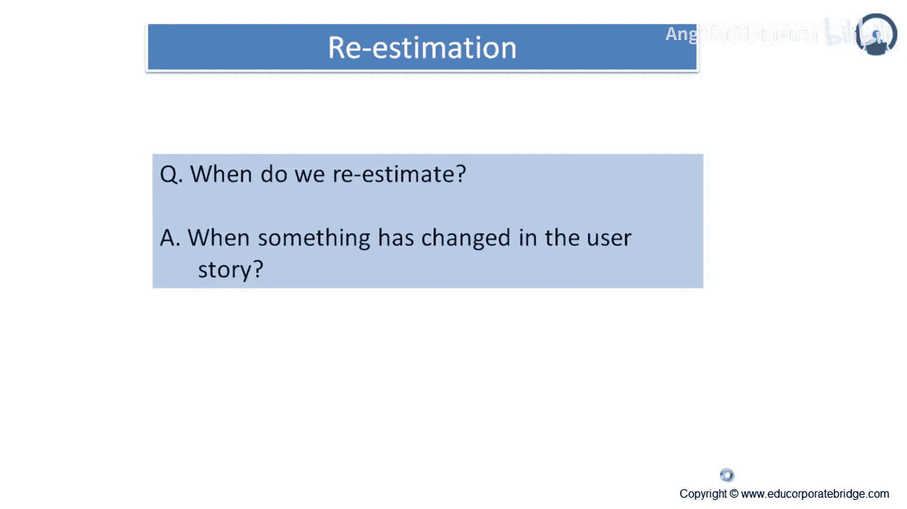

Reestimation is the doing estimation again for something some user stories for which you know previously did the estimation so naturally the question will arise。

When do we do reest？Naturally you when something has changed in the story， we do the reestimation。

 one of the most common question about estimating with study points or ideal day is when do we reest to arrive at an answer it is critical to remember that story points and ideal days our estimate of overall size and complexity of the feature being implemented。

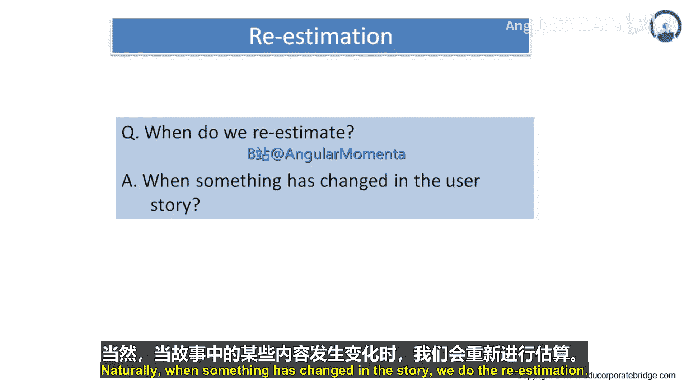

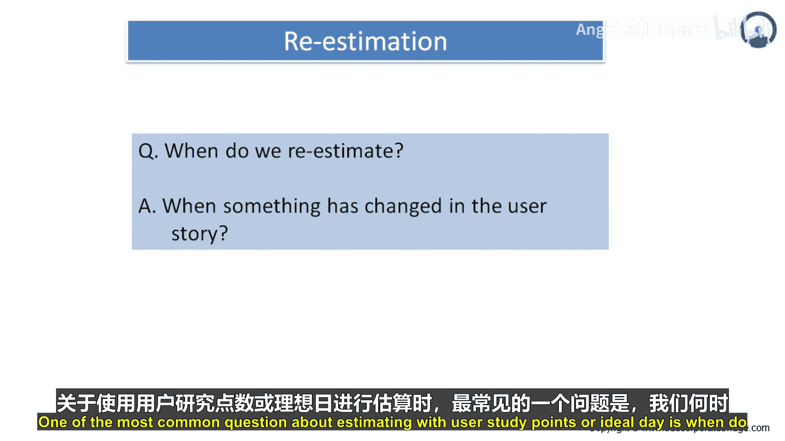

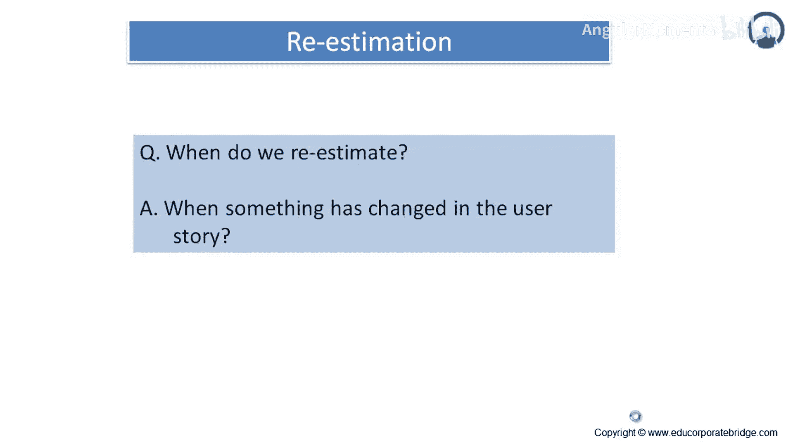

Story point in particular are not an estimate of the amount of time it takes to implement the feature。

 even though we often fall into the trap of thinking of such the amount of time that implementing a feature will take is a function of its size。

Estimated in ideal days or story points and the team's rate of progress as reflected by its velocity。

 if we keep in mind that story points， an ideal time estimate size。

 Its easier to see that we should reest only when we believe a story relative size has changed when working with story points or ideal point。

 we do not reest solely because a story took longer to implement than we thought。

 the best way to see this is through some examples， What happened that velocity is greater equalizer。

 because the estimate for each fissure is made relative to the estimate for other fiss。

 It does not matter if our estimate are correct。 a little incorrect or not incorrect。

 What matters that they are consistent we cannot simply roll a die。😊。

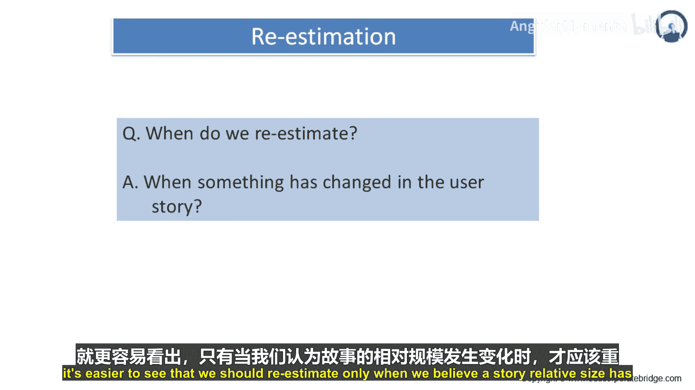

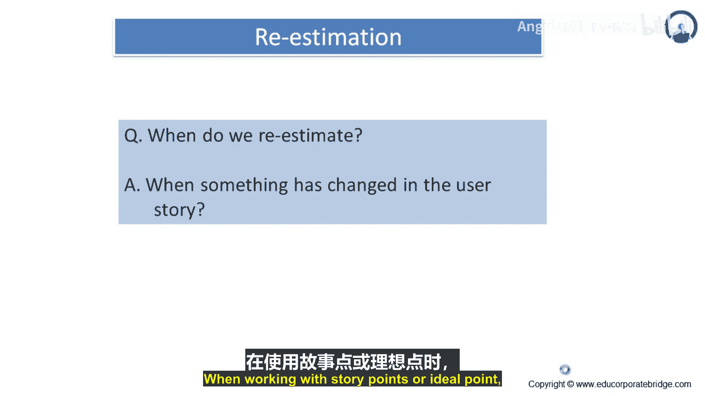

And assign that number as estimate to a feature， however。

 as long as we are consistent with our estimates。Mejouring velocity over the first few iteration will allow us to hane。

In on a reliable schedule， reestimating partially completed stories。

 you may also wish to reest when team finishes only a portion of a story during an iteration。

 supposeuppose the team has been working on a story that says， as a coach。

 I can have a system recommended。😊。

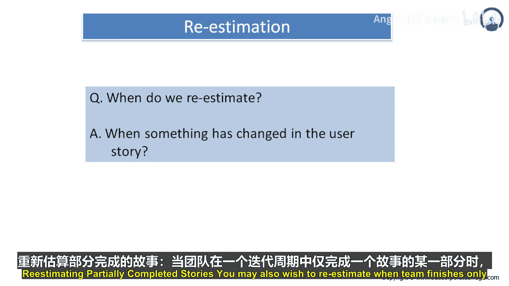

Who should swim in each event。 This story is initially estimated as five points。

 but it will deceptively complex。

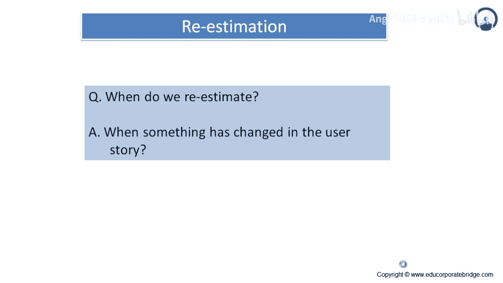

If story is done quoted tested and accepted by product owner， the team earns all the points。

 but if anything on the story isn't done， they earn nothing at the end of an iteration。

 this is the easiest case to assess if everything is done。

 they will get all the points if anything is missing， they will get no points。

 If team is likely to take on remaining portion of the story in the next iteration this works well。

 their velocity in the first iteration is a bit lower than expected because they got no credit or partially completing a story。

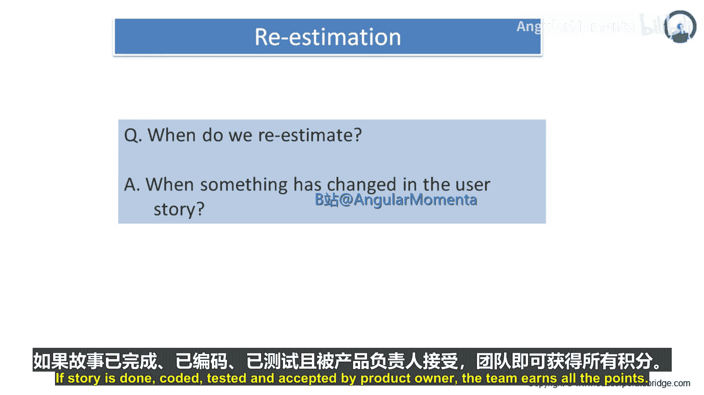

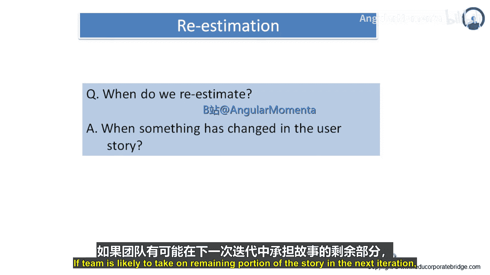

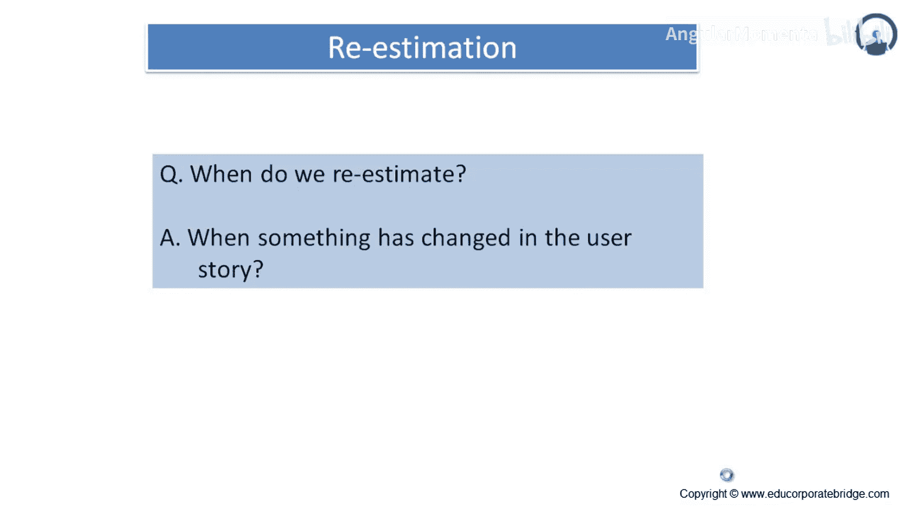

In the second iteration， however， the velocity will be higher than expected because they will get all the points。

 even though some hard work has been completed prior to the start of iteration。

 this works well as long as everyone remembers that they mostly interested in teams's average velocity over time。

 not in whether velocity jumped up or down in a given iteration。😊，However， in some cases。

 the unfinished portion of a story may not be done in a next iteration in these cases。

 it can be appropriate to allow a team to take partial credit for completed portion of the story。

 the remaining story which is subset of initial story is red based on Team's current knowledge。

In this case the original study was estimated at5 points if team feels that the subset they completely they completed is equivalent to three points or ideal days。

 they will give themselves that much credit。😊，The unfinished portion of the original story in this case could be rewritten to be as a coach I can have system recommended who should stream in each relay the team could then estimate that smaller story relative to all other stories。

 the combined estimate would not need to be equal the original estimate of five however two best solutions to allocating points for incomperate stories are to have any incomperate stories to use sufficiently small stories。

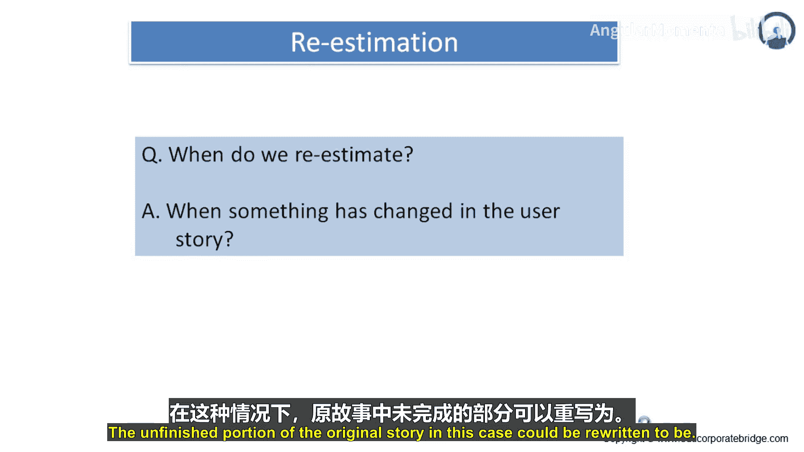

That partial grid isn't an issue now lets understand the purpose of reestimation one thing to remember that do not become overly concerned with the need to reest。

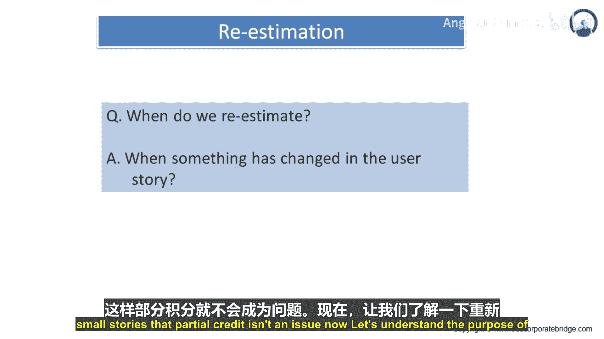

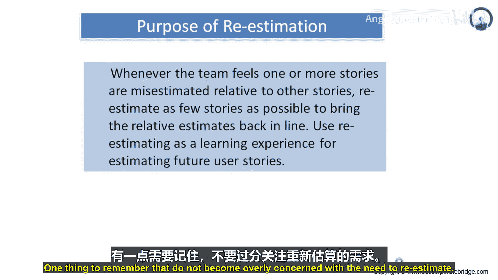

It's more of a refining， it's more of a fine tuning based on the journey so far。

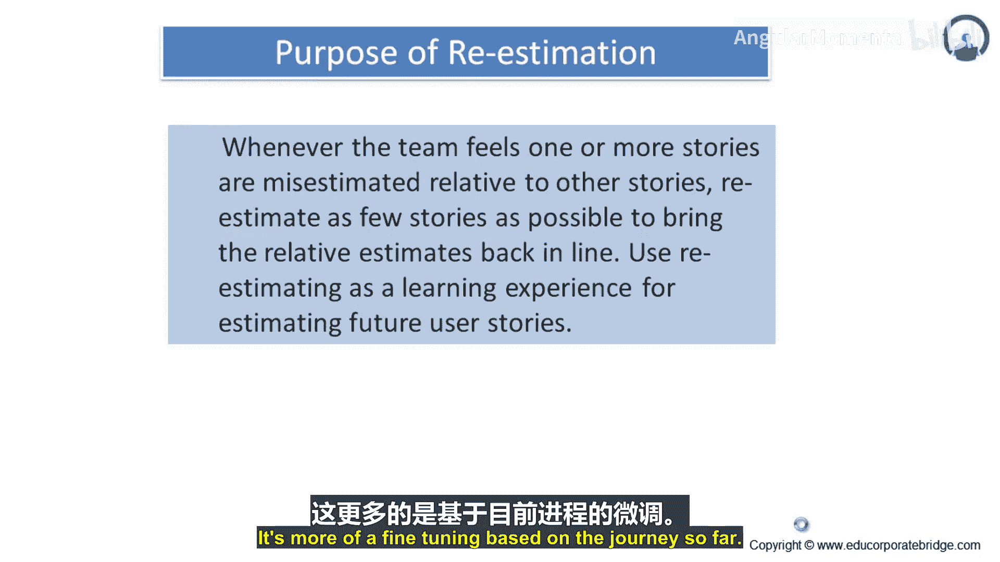

Whenever the team feels one or most stories are misestimated relative to other stories。

 reestimate as few stories as possible to bring relative estimates back in line use reestimating as a learning experience for estimating future user stories failure to learn is the only true failure。

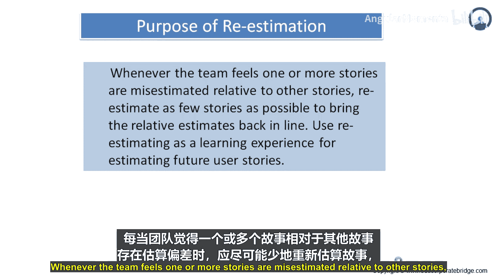

Learn from each reestimation story and turn the experience into success。

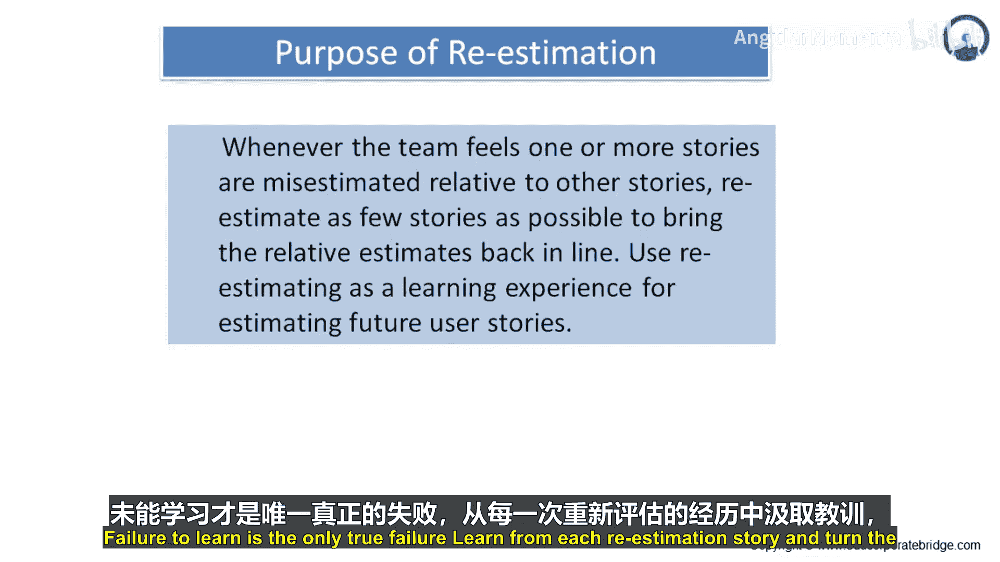

。

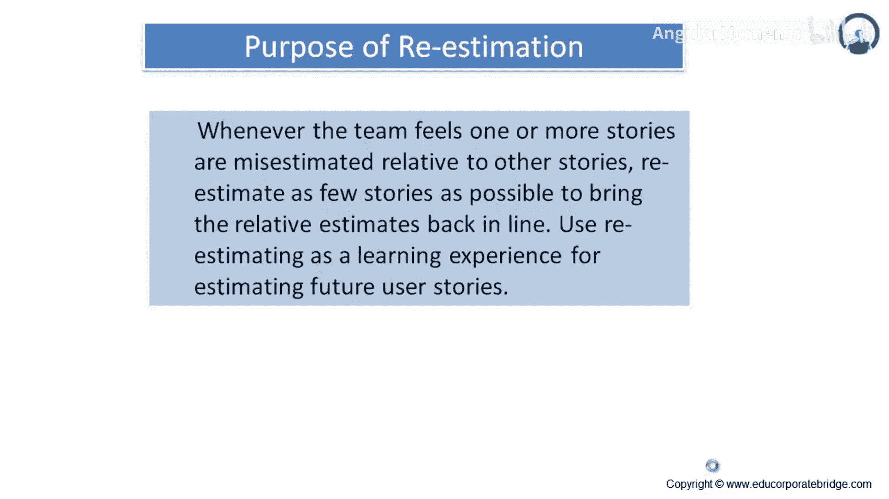