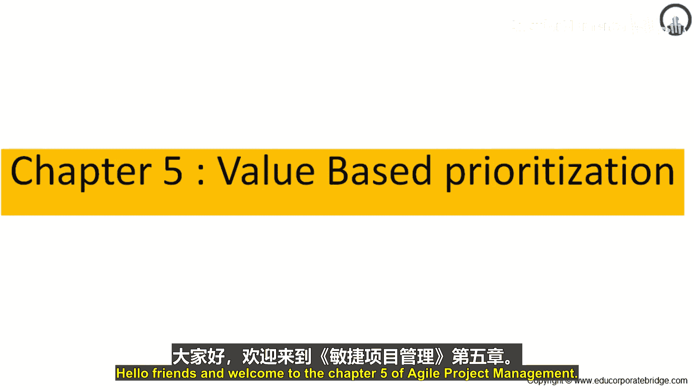
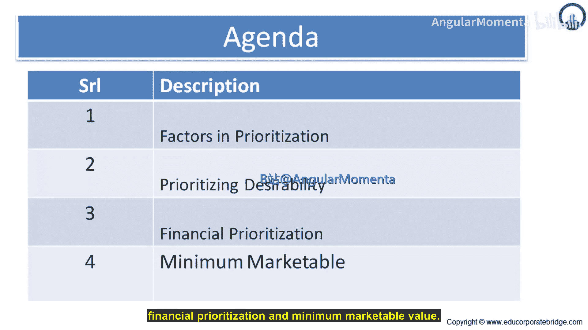
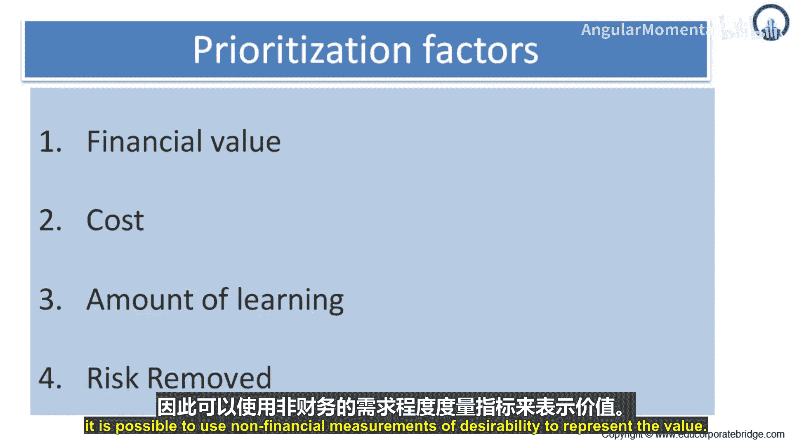

# 【EDUCBA】从思维模式出发的应用、评估与优化 ｜ Agile Practices： Apply, Evaluate & Optimize from Mind p37 04_01_01_优先级排序导论 -BV1TLcTzJEXS_p37-

Hello， Prince and welcome to the Chapt 5 of Agile project management。

 The chapter's name is value based prioritization。 What agenda today will see factors in prioritization。

 prioritization desirablesirability financial prioritization and minimum marketable value。

 So determining the value of a theme is difficult and product owners on agile project are often given the vague and mostly useless advice of prioritise on business value。

 So factors in prioritization are one the financial value of having the feature， Second。

 the cost of developing and perhaps supporting the new future， this comes from story point estimates。

 Third， the amount of and significance of learning and new knowledge created by developing features and for the amount。

😊。

Of risk removed by developing the features because most projects are undertaken either to save or make money。

 the first two factors often dominate prioritization discussions。 However。

 proper consideration of the influence of learning and the risk on the project is critical if we are to prioritize optimal So let's understand the value the first factor in prioritizing work is the financial value of a theme。

 how much money will be with organization make or saved by having new features included in the theme。

 Often an ideal way to determine the value of a theme is to estimate its financial impact over a period of time usually next few months Cos or possibly years。

 this can be done if product will be sold commercially，For example。

 a new word processor or a calculator with embedded software would be it can be difficult to estimate the financial written on a theme doing so usually involves estimating the number of new sales。

 the average value of a sale including follow on sales and maintenance agreements。

 the timing of sale increases and so on， because of complexity of doing this it is often useful to have an alternate method for estimating value because the value of a theme is related to the desirability of a theme to new and existing users it is possible to use non-financial measurements of desirability to represents the value。

