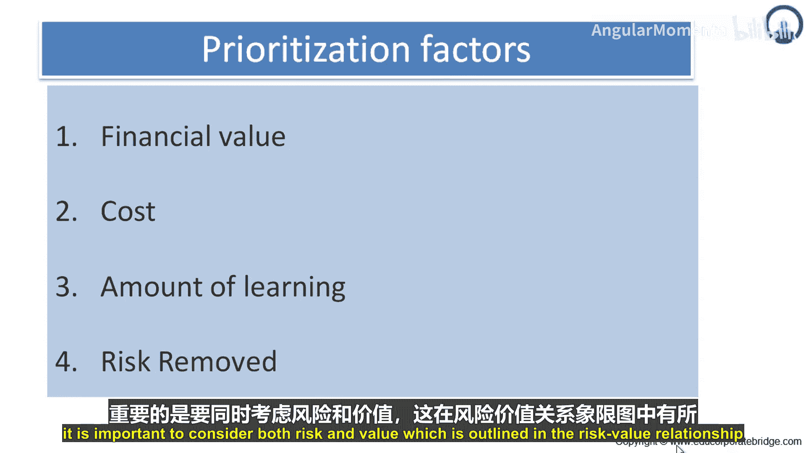
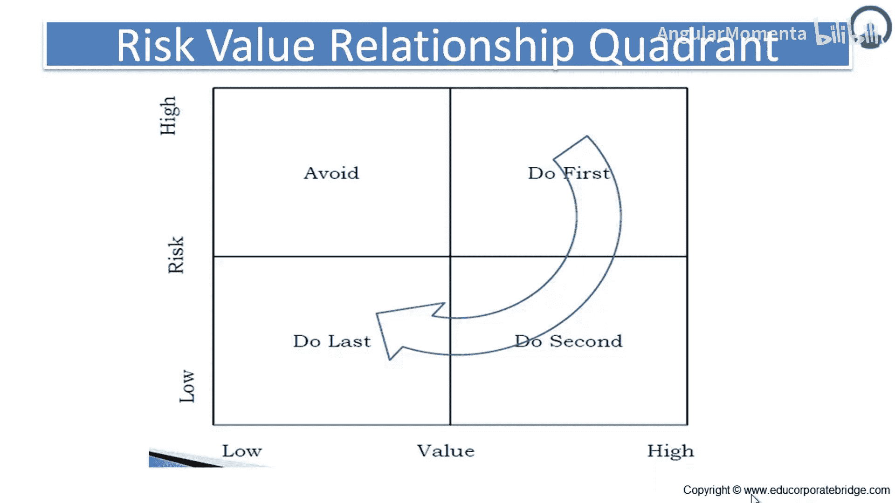

# 【EDUCBA】从思维模式出发的应用、评估与优化 ｜ Agile Practices： Apply, Evaluate & Optimize from Mind p38 04_01_02_什么是风险优先级 -BV1TLcTzJEXS_p38-

The second aspect is cost naturally the cost of a feature is a huge determinant in overall priority of a feature。

 many features seem wonderful until we learn their cost an important yet often overlooked aspect of cost is that cost can change over time adding support for internationalization today may take four weeks of effort。

 adding it in six months may take six weeks so we should average now right maybe often the best way to do this while prioritizing is to do a rough conversation。

Offfer story points or ideal days into money， third earns amount of learning。

On many project much of the overall effort is spent in pursuit of a new knowledge Ors invest in developing the skill sets or developing the capability by undertaking a project it is important that this effort to be acknowledged and considered fundamental to the project。

 acquiring new knowledge is important because at the start of a project we never know everything that will be needed to know by the end of the project。

 the knowledge that a team develops can be classified into two areas one knowledge about the project。

 second knowledge about the project， product knowledge is a knowledge about what will be developed。

It is a knowledge about the features that will be included and about those that will not be included More product knowledge a team has better able they will。

P to make decisions about the nature and feature of the product Project knowledge by contrast is knowledge about how the product will be created。

 Examples include knowledge about the technologies that will be used about the skills of the developers about how will the team functions together and so on。

 fourth one is a risk closely align with the concept of new knowledge is the final factor in prioritization risk Almost all projects contain a tremendous amount of risk for our purpose。

 risk is anything that has not yet happen but might and that would jopardize or limit the success of the project。

 There are many different types of risk on projects。

 including scheduled risk we might not be able to do by October cost risk we might not be able to buy。

For right price functionality risk， we might not be able to get the work done。 Additionally。

 risk can be classified as either technological or business risk a classic struggle exist between a high risk high value features of a project should a project team start by focusing on high risk features that could derail the entire project or should a project team focus on what Tom Gill called juicy bits the high value features that will deliver the most immediate bank of the project buck to choose among them let's consider the drawback of each approach the risk driven team accepts the chances that the work they perform will turn out to be unnieded or low value they may。

Develop infrastructurefrastructural support for features that turn out unnecessary as a product owner refines her vision of the project based on what she learns from users as a project progresses on the other hand a team that focuses on value to the exclusion of risk may develop a significant amount of application before hitting a risk that jopardize the delivery of the product the solution of course is to give neither a risk nor a value total supremacy when prioritizing to prioritize work optimally it is important to consider both risk and value which is outlined in the risk value relationship quadrant on y axises we have a risk on x axis via value and we have four quadrants to combine the four prioritization factors think first about the value of the feature relative to what it could。

To develop today This gives you initial priority order for the themes。

 Those themes with high value to cost ratio are those that should be done first。

 Next the other prioritization factor as moving towards forward or backward。

 suppose that best on its value and cost and theme of medium priority。 Therefore。

 the theme would tend to work on the theme midway through the current release。 However。

 technology needed to develop this story is very risky。

 This would move the theme forward in priority on the schedule。

 It is not necessary that this initial ranking followed by shifting forward and back be a formal activity each can and often does take place entirely in the head of the product owner the product owner will then typically present her priorities。

to the team who may intri the product owner to alter priorities slightly based on the assessments of the the。

 so a high value high risk proposition should be done first followed by high value low risk proposition then followed by low value low risk prioritilization and high high risk low value proposition should be awarded completely。

