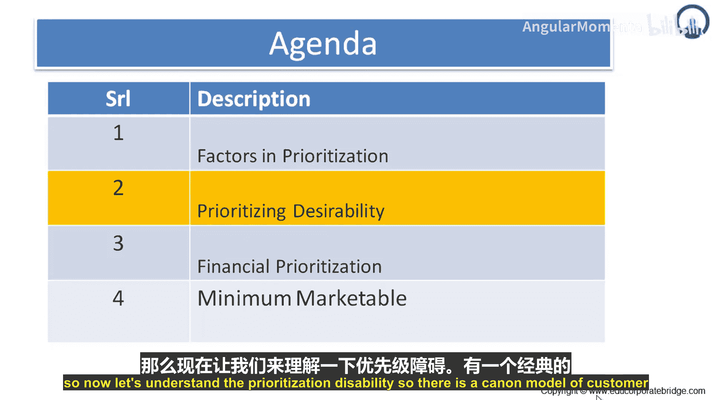
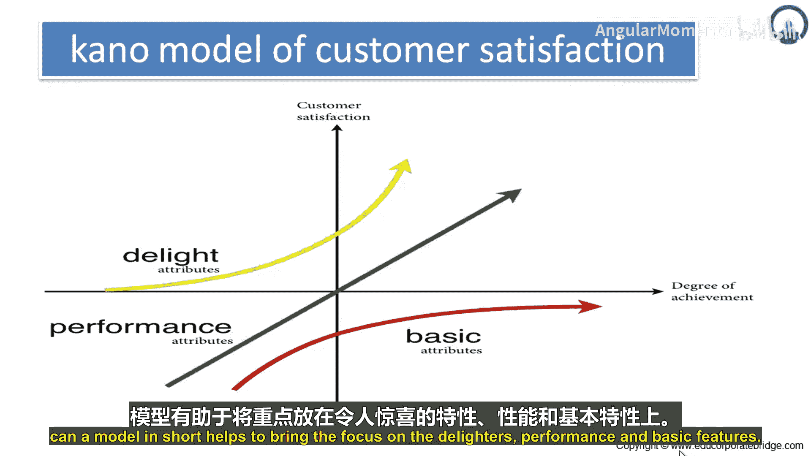

# 【EDUCBA】从思维模式出发的应用、评估与优化 ｜ Agile Practices： Apply, Evaluate & Optimize from Mind p40 04_01_04_卡诺模型 -BV1TLcTzJEXS_p40-

So now let's understand the prioritization disabilityability so there is a can model of customer satisfaction which classifies the basic attributes。

 the performance attributes and the delight attributes as you can see in the graph on the y axis there is a customer satisfaction and on the x axis there is a degree of achievement and there are three lines red green and yellow so as you can see from basic attributes with increase in degree of achievement there is hardly any increase in customer satisfaction the second line which is performance attributes with the degree of achievements。

 the customer satisfaction increases proportionately and the third and yellow line is a small degree of achievement there is a exponential increase in customer satisfaction and this attributes help you to do your prioritization。

😊。

If you are looking for customer delight and satisfaction。

 you should focus on customer attributes if you're focusing on performance you should strive to excel in performance attributes and basic attributes anyways you need to support separating product features into previous three categories can provide a great deal of information about how appitization work for the new product release process of doing so was originated by Noocchi can who whose approach gives us a way to separate features into three categories one threshold or must have features second linear features third excs and delighters threshold features are those that must be present to the product for it to be successful they are often referred as must have features these are the bed bathroom desk clean。

s of my hotel room， improving the performance or amount of threshold features will have little impact on customer satisfaction。

 For example， as long the hotel bathroom meets my basic need I don't care what control are made from a linear feature is one which is more the better holds true。

 the bigger hotel room is the better。 these are called linear features because customer satisfaction is correlated linearly with the quantity of the feature。

 the better one of these feature performs or the more of it there is the more satisfied the customer will be because of this product price is often related to a linear attributes if hotel has dumbs and two nice trade bills。

 I'll be happier than if it is just as one rusty old stair climber。 I'll be even happier。😊。

If it has got elliptical trainers and spinning bikes。

 the important for the hotel I will be more likely to return and pay a premium for its rooms finally excers and delighters are those features that provide great satisfaction often adding a price premium to the product。

😊，However， the lack of excited or delighter will not decrease customer satisfaction below neutral built in television on hotel Stm was excited for me。

 I would not have been dissatisfied if the hotel didn't offer this because I didn't know anyone had them。

 In fact， exciteder and delighteders are often called unknown needs because customer or user do not know they need these features until they see them。

 Re between these three feature type It shown in the diagram as presented on the slide。

arrow through the bottom right of this diagram shows that one once some amount of must have feature has been implemented。

 customer satisfaction cannot be increased by adding that feature also。

 no matter how much must have feature added customer satisfaction never rises above mid point On the other hand。

 the。😊，In the left top shows that customer satisfaction rises dramatically based on ever a partial implementation of excited or delighted because must features are required for a product to play in its market segment emphasis should be placed on prioritizing the development of all threshold features。

A product must have feature do not need to be developed in their iteration of a release。 however。

 because user considers these features to be mandatory。

 they need to be available before the product is released。 Secondly。

 emphasis should be placed on completing as dinner features as possible。

 because each of these feature lives directly to greater customer satisfaction。

 the more of this feature that can be included the better excluding， of course。

 such situation as product that is already bloated with too many features。 Finally。

 and with time permitting at least few delightrs should be prioritized。

 such that they are included in the release plan。 So camera model。

 in short helps to bring the focus on the deleters performance and basic features。😊。

