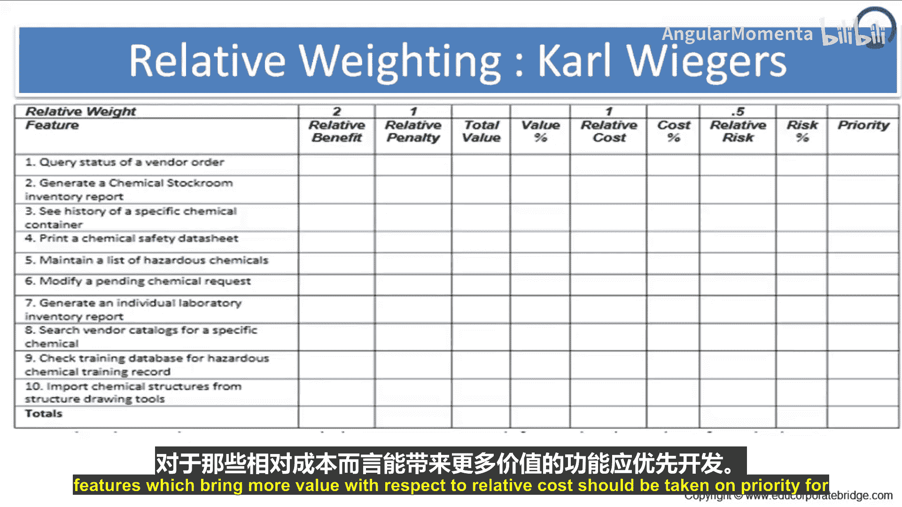
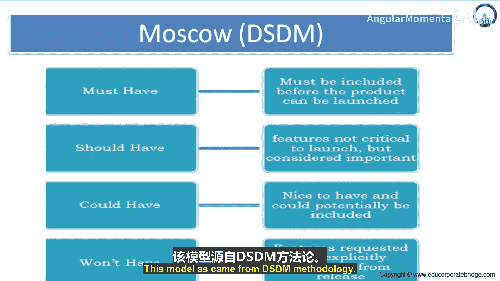
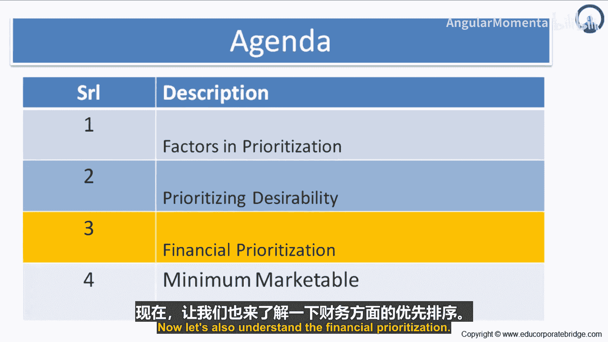
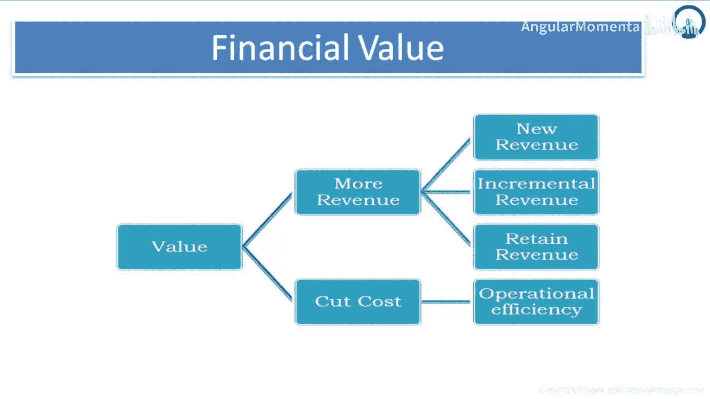

# 【EDUCBA】从思维模式出发的应用、评估与优化 ｜ Agile Practices： Apply, Evaluate & Optimize from Mind p41 04_01_05_财务价值 -BV1TLcTzJEXS_p41-

So call vis come with another similar approach called relative weighing。

 It considers both the positive benefit of the presence of feature and the negative impact of its absence。

 So this is most important， it considers both poitivities and negativities of having or not having the features。

 rather than use question as this approach relies on expert judgment Collly but laid by product owner。

 the team assesses each feature being considered for the next release。

 each feature is assessed in terms of benefits that will be that will bring implemented as well as the penalty that will be incurred if its not implemented As with estimates of story points and ideal time estimators of benefit and penalties are relative a scale of one to 9 is used。

 So on the first column you have a list of the features and for each feature you will。😊。

R the relative benefit in the scale of one to 9 youd also rate the relative penalty again in the scale of one to 9 you add them together to get the total value so with the total value for all the features you add the total value and calculate the percentage value that feature is adding with respect to entire feature for the software Similarlyly you put the ranking for a relative cost you add all cost together and you put the percentage cost for each feature in column5 you put the relative risk again in the scale of one to 9 and calculate the percentage risk for that feature so priority is relative with respect to value and cost so while calulating priority you divide the value by cost higher number represents higher priorities because they will create more。

valueue for their effort invested in them because of high value to cost ratio posting posting query status of a vendor order is the highest priority feature so you get the absolute value versus cost rating for all the features and the features which bring more value related to respect relative cost should be taken on priority for development let's understand Moscow must have should have could have methodology so this methodology is again based on the classification of the features on the four categories one must have second should have third good have and fourth won't have must have other features that must be included before the product can be launched should have other features that are not critical to launch but are considered to be import。

And of high value to the users could have are the features that are nice to have and could potentially be included without incurring too much effort or cost these will be the first feature to be removed from scope if projects time scales are later at risk won't have are the features that have been requested but are explicitly excluded from scope for the planned duration and maybe be included in the future phase of development this model as came from DSDM methodology Now let's also understand the financial prioritization so if the prioritization is based on the value you have two categories one is to bring more money or more revenue to the enterprise and second is to do savings or cut costs by operational efficiencies so。

can come from new revenue。 That is one second from incremental revenue and third from retain revenue。

Some projects are undertaken to generate revenue and others to cut expenses。

 and some strive for both。 We can estimate the amount of money that will be made or saved by each team。

 we can use that to help prioritize forecasting the financial value of a theme is the responsibility of the product owner。

 but it is a responsibility shared with all other team members， programmers。

 testers and analyst project managers and so on。 In most cases。

 the product owner will also need to draw on business knowledge and forecast from the sales and marketing groups to compare multiple themes we need to use one or most standard financial major we will look at net present value internal rate of written payback period discounted payback period。

 However， before looking at these parameters， we must consider how projects make。

Save moneyny So new revenue certainly is one of the most common contributors to the return on a project is the opportunity for new revenue。

 very few companies are satisfied with their market share most companies would like new customers even if a software product is not sold directly adding new features can lead to a new revenue for example。

 I work at a company that develop software for our own use in serving our hospital customers At one point。

 our CEO realizes that with some enhancements， our software could be used to provide those same services to health insurers we made changes and were able to bring an entirely new source of revenue to the organization because what the new software enabled Another example are we have bought。

A software which is used for test automation and weve realized that that software can also be used for data migration。

 so we have decided to invest ourselves to develop a software which can do both do the test automation and upload the data do data migration and the additional revenue that has come from the software has bring new revenue to the organization Now let's also understand what do we mean by incremental revenue it is often useful to distinguish revenue from new customers from additional incremental revenues from existing customers incremental revenues can result because the new system or product encourages existing customer to purchase more licenses includes optional addon modules that can be。

Se include features that allow charging a higher price encourages the use of consulting services。

 for example， to integrate with separate third party applications so incremental revenues are additional avenues available in the marketplace where you are already existing to bring more revenue for the organization Now let's also understand retain revenue retain revenue is separate from both new and incremental revenue Re revenue refers to the revenue and organization will lose if the project or theme is not developed suppose you've been successfully selling a patient scheduling product。

To solo practitioner， some of the customers have been doing well。

 and they are expanding to have two or three chiropractors in practice。

 unless your software is enhanced to support scheduling patients among multiple chiropractors。

 you stand to lose the business of these growing practices。

 a project to add this capacity would allow the company to retain this revenue。 interestingly。

 there could also be an opportunity for incremental revenue。

 because you may be able to charge more for version that supports more than chiropraice。

 So weve understood the more revenue can come from one new revenue from incremental revenue and retain revenue。

 Now， let's understand the other aspect of doing savings oring cost by improving the operational efficiencies。

 no organization。😊，Aver is as efficient as it could be there is always some task that could be streamlined or eliminated if you are developing software for use by internal customers you are probably quite aware of the importance of the operational efficiencyencies however。

 even if you are working on commercial software that is sold to others outside your company some task within your project may still contribute to improving operational efficiencies in your case though most often this will refer to your own inefficiency and looking to improve operational efficiencies。

 some likely places include anything that takes a long time or that would take a long time if company grew better integration or communication between departments de。

😊，Employyee turnover， shorter training time for new employees， anytime sensitive processes。

 combining multiple processes， anything that improves accuracy and reduces rework so operational efficiency is extended with respect to improving accuracy。

 bringing down the rework rejections combining multiple processes。

 business process reengineering automation streamlining reducing employee turnover likewise so this is how the value can be obtained by agile project for the enterprise。

